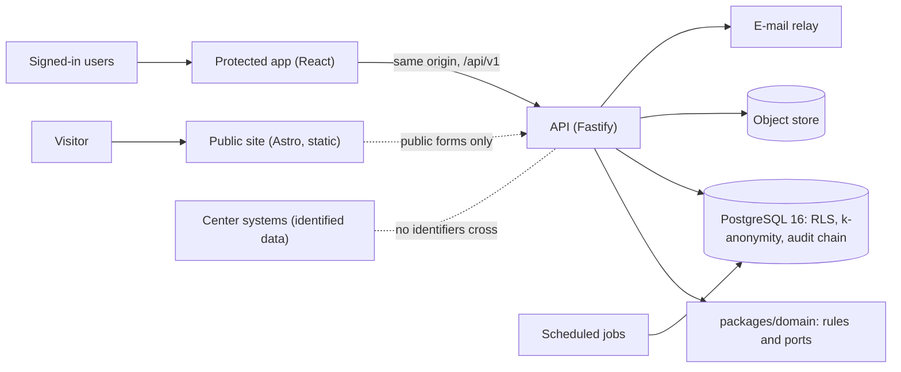

# ARI-PST Portal

A national, bilingual (Hebrew and English) portal that helps researchers **find** pediatric solid-tumor samples held in Israeli medical centers and **request** them through a governed approval process.

The portal stores an **index only**. Tissue and patient identity stay in the medical centers. Initiative: ARI-PST × Tech4Cancer.

| | |
|---|---|
| **Version** | Phase 1 (pilot build) |
| **Data** | Synthetic test data only. No real data is allowed until the gate `GATE-PROD-DATA` closes (DPA, region control, export round trip, migration path, legal review, pen-test). |
| **Live demo** | <https://ari-demo-api-7teo.onrender.com> (Render free plan, Frankfurt) |
| **CI** | One required check, `ci-gate`, on every pull request |
| **Licence** | Private. All rights reserved. |

## Contents

1. [How it works](#1-how-it-works)
2. [Roles](#2-roles)
3. [Verified status](#3-verified-status)
4. [Use the live demo](#4-use-the-live-demo)
5. [Run it on your computer](#5-run-it-on-your-computer)
6. [Test it](#6-test-it)
7. [Architecture](#7-architecture)
8. [Repository layout](#8-repository-layout)
9. [Deploy](#9-deploy)
10. [Security and privacy](#10-security-and-privacy)
11. [Documentation](#11-documentation)
12. [Contribute](#12-contribute)
13. [Troubleshooting](#13-troubleshooting)

## 1. How it works

The portal has two parts:

- **Public site:** information about the initiative, centers, partners and news, plus join and contact forms.
- **Protected area:** a searchable index of coded sample records, and the access-request workflow.

One request moves through these steps. Each step is a screen in the protected area.

| Step | Who | What happens |
|---|---|---|
| 1. Register | Researcher | Signs up on the portal. |
| 2. Approve registration | National coordinator | Approves the account. The researcher sets a password and a second factor (TOTP or passkey). |
| 3. Search | Researcher | Filters by diagnosis, sample type, age band, center and time point. Sees **counts only**. Small groups show "Too few to show". |
| 4. Request | Researcher | Adds sample groups to the cart. Fills a 5-step form: research question, ethics (IRB/Helsinki) approval, planned use, funding, review. |
| 5. Pre-check | National coordinator | Checks the request. Forwards it, or asks the researcher for more information. |
| 6. Decide | Access committee | Members vote. The request needs N of M approvals. |
| 7. Coordinate | Coordinator and center clinician | The coordinator links coded samples per center. The center accepts or declines. |
| 8. Agreements | National coordinator | Records the MTA/DTA for each center. Delivery stays locked until each accepted center has a signed agreement. |
| 9. Deliver | Center clinician | Marks the samples as delivered. The request closes as "delivered". |
| 10. Audit | Everyone (recorded) | Every view, download and decision goes into a tamper-evident audit log. |

The researcher follows the request in an 8-step tracker from cart to closed.

## 2. Roles

| Role | Can do | Cannot do |
|---|---|---|
| Visitor | Read the public site. Send a form. Register. | Open the protected area. |
| `researcher_il` | Search counts, use the cart, send and track requests, answer questions, appeal. | See sample rows. |
| `researcher_intl` | Search counts. | See sample rows, use the cart. |
| `center_clinician` | See the coded records of the own center. Verify or flag a record. Open the center's own system. Accept coordination. Mark delivery. | See other centers' records. |
| `national_coordinator` | Enter and import samples (CSV or XLSX, with dry run). Approve registrations. Pre-check. Coordinate centers. Record MTA/DTA. Watch data freshness. | Mark delivery. |
| `committee_member` | Review and vote. Declare a conflict. Second-approve `k` changes and role grants. | Edit the index. |
| `system_admin` | Manage users and centers. Propose `k` changes. Read the audit log. | Approve requests, read sample data, or change `k` alone. |

All staff sign in with a password and a second factor. Sensitive actions need a second-factor check from the last 5 minutes.

## 3. Verified status

Results on the current code (2026-11-14), with synthetic data:

| Check | Result |
|---|---|
| Unit and integration tests (`pnpm test`) | 478 passed, 0 failed |
| Browser tests on the mock API (`pnpm test:e2e:smoke`) | 33 passed |
| Full-stack test on a Render-like database (`pnpm test:e2e:full`) | 24 passed |
| Major user flows on the real production build (`pnpm test:e2e:flows`) | 39 of 39 steps passed, 58 screenshots |
| Architecture, typecheck, lint, API-client check | Clean |

Flow report with pass/fail per step and screenshots: [`docs/qa/flows/REPORT.md`](docs/qa/flows/REPORT.md).

## 4. Use the live demo

1. Open <https://ari-demo-api-7teo.onrender.com>. The free service sleeps when idle. The first request after a pause can take about one minute.
2. Get the demo password. In the Render Dashboard, open service `ari-demo-api-7teo`, then **Environment**, and copy the value of `SEED_USER_PASSWORD`.
3. Print the demo users. On your computer, in a clone of this repository, run:
   ```bash
   SEED_USER_PASSWORD='<value>' node scripts/seed-credentials.mjs
   ```
   The script prints each synthetic user: e-mail, role, TOTP secret and the current 6-digit code.
4. Sign in with the e-mail, the password and the code. Add the TOTP secret to an authenticator app if you want new codes.

Do not paste the script output into chat, tickets or commits.

## 5. Run it on your computer

### 5.1 Prerequisites

| Tool | Version | Needed for |
|---|---|---|
| Node.js | 22.18 or later | Everything |
| pnpm | 10 (`corepack enable`) | Everything |
| PostgreSQL | 16, binaries in `/usr/lib/postgresql/16/bin` | Database and API tests, full-stack run |
| Chromium for Playwright | `pnpm --filter @ari/web exec playwright install chromium` | Browser tests |

### 5.2 Install

```bash
git clone https://github.com/johnny882020/ARI-PST.git
cd ARI-PST
corepack enable
pnpm install
```

### 5.3 Start an app

| Goal | Steps | Open |
|---|---|---|
| Public site | `pnpm --filter @ari/public-site dev` | <http://localhost:4321> |
| Protected app with a mock API (no database) | 1. `pnpm --filter @ari/web mock` 2. In a second terminal: `pnpm --filter @ari/web dev` | <http://localhost:5173> |
| Full stack with a real database | `pnpm -r build && pnpm test:e2e:full`. It starts a Render-like PostgreSQL, runs the pre-deploy step, starts the API and runs the browser flow. | <http://localhost:18080> while it runs |
| Component gallery | `pnpm --filter @ari/design-system gallery:dev` | Address printed by Vite |

To run the API by hand: set the variables from `apps/api/.env.example` in your shell, then run `pnpm --filter @ari/api dev` (port 8080). Point the app at it with `API_URL=http://localhost:8080 pnpm --filter @ari/web dev`.

## 6. Test it

| Command | What it checks | Needs |
|---|---|---|
| `pnpm test` | All package tests | PostgreSQL 16 |
| `pnpm test:unit` | Packages that do not need a database | — |
| `pnpm --filter @ari/domain test` | One package | — |
| `pnpm --filter @ari/domain exec vitest run src/request-state.test.ts` | One test file | — |
| `pnpm --filter @ari/db test` | Database roles, RLS, privacy engine, workflow (port 55432) | PostgreSQL 16 |
| `pnpm --filter @ari/api test` | API integration, authorization matrix (port 55433) | PostgreSQL 16 |
| `pnpm test:e2e:smoke` | Protected app on the mock API, Hebrew and English | Chromium |
| `pnpm test:e2e:full` | Full stack on a Render-like database (port 55435, API on 18080) | PostgreSQL 16, Chromium |
| `pnpm test:e2e:flows` | All major user flows on the real build, with screenshots | PostgreSQL 16, Chromium |
| `pnpm test:a11y` | Public-site accessibility (axe) | Chromium |
| `pnpm typecheck && pnpm lint && pnpm build` | Types, lint, build | — |
| `pnpm arch` | Architecture rule: the domain imports no platform library | — |
| `pnpm lint:openapi` | The generated API client matches the OpenAPI contract | — |
| `pnpm verify:render` | All Render Blueprints match the code | Python 3 |

## 7. Architecture

A modular monolith with ports and adapters. One web service serves the API at `/api/v1` and the protected app at `/`, on one origin. Privacy rules run inside PostgreSQL (Row-Level Security and k-anonymity functions), not only in the API.



| Layer | Technology |
|---|---|
| Language and runtime | TypeScript 5, Node.js 22.18 or later, pnpm 10 workspaces |
| API | Fastify 5, Argon2id passwords, TOTP and WebAuthn passkeys |
| Protected app | React 18, Vite 5, React Router 6, TanStack Query 5, zod 4 (jitless, for a strict CSP) |
| Public site | Astro 7 (static), Decap CMS (Git-based editing) |
| Shared UI and text | `packages/design-system` (logical CSS only), `packages/i18n` (Hebrew and English) |
| Visual style | Calm navy and gold, pill controls, Hebrew-first right-to-left ([style guide](docs/design/STYLE-GUIDE.md)) |
| API contract | OpenAPI 3.1 (`packages/contracts/openapi.yaml`) and a generated client |
| Database | PostgreSQL 16, forward-only SQL migrations |
| Tests | Vitest, Playwright, axe-core, dependency-cruiser |
| Hosting | Render Blueprints. A Google Cloud migration guide is ready. |
| CI | GitHub Actions, required check `ci-gate` |

Details: [`docs/architecture.md`](docs/architecture.md).

## 8. Repository layout

| Path | Content |
|---|---|
| `apps/api` | API: ten modules, adapters, scheduled jobs. Also serves the built protected app. |
| `apps/web` | Protected app, mock API, browser tests |
| `apps/public-site` | Public site and CMS content |
| `packages/domain` | Pure rules: roles, request state machine, voting, k-anonymity, ports |
| `packages/contracts` | OpenAPI contract, with allowed roles (`x-roles`) on every operation |
| `packages/api-client` | Client generated from the contract |
| `packages/design-system` | Design tokens, components, gallery |
| `packages/i18n` | Hebrew and English text |
| `packages/synthetic-data` | Synthetic test data generator |
| `db/` | Bootstrap, migrations, runner, seed, export and import, SQL tests |
| `render.yaml`, `infra/` | Render Blueprints (production, staging, free demo) and policy |
| `scripts/` | Pre-deploy, smoke test, demo credentials, backup and restore drill, end-to-end runners |
| `.github/` | CI workflows, code owners, templates |
| `docs/` | Current documentation. Start at [`docs/README.md`](docs/README.md). |
| `plan/` | Design-time plan and decisions. Binding: `plan/00-contract-pack.md` and `plan/11-integration/canonical-decisions.md`. |

## 9. Deploy

| Target | File | State |
|---|---|---|
| Free demo on Render | [`infra/render.free.yaml`](infra/render.free.yaml) | Live (Blueprint `ari-pst-demo`). Manual deploy from `main`. |
| Production on Render | [`render.yaml`](render.yaml) | Ready, not applied. Needs paid plans. |
| Staging on Render | [`infra/render.staging.yaml`](infra/render.staging.yaml) | Not applied. |
| Google Cloud | [`docs/migration/google-cloud.md`](docs/migration/google-cloud.md) | Step-by-step guide. |

To redeploy the demo after a merge to `main`:

1. Open the Render Dashboard, service `ari-demo-api-7teo`.
2. Select **Manual Deploy**, then **Deploy latest commit**.
3. Wait for "Your service is live". The start command runs `scripts/render-predeploy.mjs` (database roles, migrations, synthetic seed) before the server.
4. Check that `https://ari-demo-api-7teo.onrender.com/readyz` returns `"status":"ok"`.

Production deploys of the protected area need two approvers in the GitHub Environment `production-protected`. Full guide: [`docs/deployment.md`](docs/deployment.md).

## 10. Security and privacy

- **Index only.** No names, ID numbers, link keys, free-text clinical notes or exact dates. The sample collection date is month and year only.
- **Two-step coding.** The portal issues random sample codes. Each center maps them to its own records. The portal never stores the link.
- **Rules in the database.** Row-Level Security limits each clinician to the own center. External researchers have no access to sample rows. They get counts only through functions that apply k-anonymity (k ≥ 5, distinct donors, extra suppression to block subtraction attacks).
- **Separation of duties.** The system admin cannot approve requests, read sample data or change `k` alone. Role grants and `k` changes need a second approver.
- **Sessions.** One origin. Secure, HttpOnly, SameSite=Strict cookies with a CSRF token. A strict Content-Security-Policy. No cross-origin access, except credential-free public forms.
- **Audit.** An append-only log with a keyed hash chain records every view, download and decision.
- **Errors and logs** contain no identifiers. Errors follow RFC 9457.
- **Legal.** Legal and regulatory text in this repository needs legal review. It is not legal advice.

Open findings: [`docs/REVIEW-2026-11.md`](docs/REVIEW-2026-11.md). Known gaps: [`docs/KNOWN-ISSUES.md`](docs/KNOWN-ISSUES.md).

## 11. Documentation

| Document | Content |
|---|---|
| [`docs/README.md`](docs/README.md) | Index of all current documents |
| [`docs/requirements/`](docs/requirements/) | Original concept and specification (v1.0) |
| [`docs/architecture.md`](docs/architecture.md) | Architecture and security design |
| [`docs/design/STYLE-GUIDE.md`](docs/design/STYLE-GUIDE.md) | Visual style and components |
| [`docs/deployment.md`](docs/deployment.md) | Deploy to Render, GitHub settings, rollback |
| [`docs/migration/google-cloud.md`](docs/migration/google-cloud.md) | Move from Render to Google Cloud |
| [`docs/ops-model.md`](docs/ops-model.md) | Owners, cadence, release rules |
| [`docs/runbooks/`](docs/runbooks/README.md) | Incident runbooks RB-01 to RB-08 |
| [`docs/qa/flows/REPORT.md`](docs/qa/flows/REPORT.md) | Major flows: pass/fail per step, with screenshots |
| [`docs/planning/`](docs/planning/) | Editable development timeline to the February 2027 launch |
| [`docs/KNOWN-ISSUES.md`](docs/KNOWN-ISSUES.md) | Known gaps and unverified facts |
| [`docs/REVIEW-2026-11.md`](docs/REVIEW-2026-11.md) | Code review findings |
| [`docs/CHANGELOG.md`](docs/CHANGELOG.md) | Release history |
| [`db/README.md`](db/README.md) | Database roles, functions and privacy engine |
| [`CLAUDE.md`](CLAUDE.md) | Rules for Claude Code and other coding agents |

## 12. Contribute

1. Create a branch from `main`.
2. Use synthetic data only (`packages/synthetic-data`). Never add real or realistic personal data.
3. Change the contract first (`packages/contracts/openapi.yaml`, `db/migrations/`), then the code.
4. Write migrations forward-only (expand, then contract).
5. Use logical CSS properties only (for right-to-left support).
6. Run `pnpm typecheck && pnpm lint && pnpm test` before you push.
7. Open a pull request and fill in the template.
8. Wait for `ci-gate` to pass. It passes only when every CI job passes.
9. Merge with squash. Do not push to `main` directly.

If the code and the plan disagree, [`plan/11-integration/canonical-decisions.md`](plan/11-integration/canonical-decisions.md) decides.

## 13. Troubleshooting

| Problem | Fix |
|---|---|
| The demo takes about one minute to open | The free Render service was asleep. Wait, then reload. |
| `pnpm test` fails with "database does not exist" or a port error | Another PostgreSQL uses the test port (55432, 55433 or 55435). Stop it and run again. |
| Browser tests cannot find Chromium | Run `pnpm --filter @ari/web exec playwright install chromium`. |
| A sign-in code is rejected | The TOTP code changes every 30 seconds. Run `scripts/seed-credentials.mjs` again for a fresh code. |
| `/readyz` reports `"migrations":"behind"` | The pre-deploy step did not finish. Check the deploy logs, then redeploy. See [`docs/runbooks/`](docs/runbooks/README.md). |
