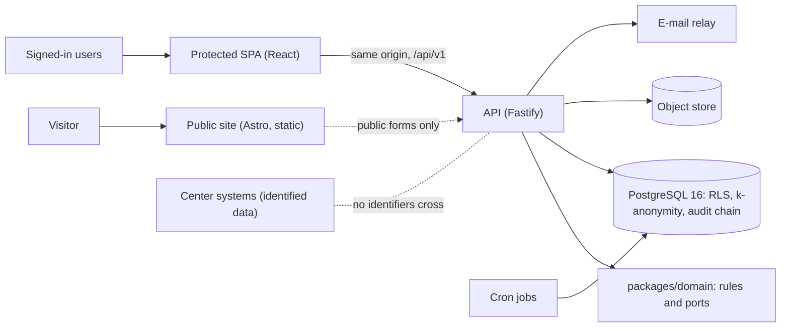

# ARI-PST Portal

The ARI-PST Portal is a national index of de-identified pediatric solid-tumor samples. Researchers use it to find out whether suitable samples exist and to send an access request. A committee decides each request. The portal holds an **index only**. Tissue and patient identity stay in the medical centers. The portal has two parts: a public site and a protected area. Both are in Hebrew (RTL, default) and English. Initiative: ARI-PST × Tech4Cancer.

> **Status:** Phase 1 · **synthetic data only** · CI `ci-gate` green · production Blueprint not applied.
> No real data may enter any environment until the gate `GATE-PROD-DATA` closes (DPA, region control, export round trip, migration path, legal review, pen-test).

## Live demo

| Item | Value |
|---|---|
| URL | <https://ari-demo-api-7teo.onrender.com> |
| Host | Render free plan, Frankfurt. Blueprint `ari-pst-demo` from [`infra/render.free.yaml`](infra/render.free.yaml) |
| Data | Synthetic only (40 samples, 2 centers) |
| Deploy | Manual (Render Dashboard, Manual Deploy) |

The free service sleeps when idle. The first request after a pause can take about one minute.

To sign in:
1. Open the Render Dashboard, service `ari-demo-api-7teo`, **Environment**. Copy the value of `SEED_USER_PASSWORD`.
2. On your own computer, run:
   ```bash
   SEED_USER_PASSWORD='<value>' node scripts/seed-credentials.mjs
   ```
3. The script prints each synthetic user: e-mail, role, TOTP secret and the current 6-digit code.
4. Sign in with the e-mail, the shared password and the code.

Do not paste the output into chat, tickets or commits.

## Features by role

| Role | What the role can do |
|---|---|
| Visitor (anonymous) | Read the public site. Send a contact or join form. Register as a researcher. |
| `researcher_il` | Search with k-anonymous counts. Add sample groups to a cart. Send an access request through a 5-step form. Track it. Answer questions. Appeal. |
| `researcher_intl` | Search with k-anonymous counts only. No sample rows, no cart. |
| `center_clinician` | See the coded records of the own center. Verify or flag a record. Follow a link to the center's own system. Confirm coordination and delivery. |
| `national_coordinator` | Enter and import samples (CSV or xlsx, with dry run). Approve registrations. Run the pre-check. Coordinate centers, agreements and delivery. Watch index freshness. |
| `committee_member` | Review requests. Vote (N of M). Declare a conflict. Approve `k` changes and role grants as second approver. |
| `system_admin` | Manage users, centers and role grant proposals. Propose `k` changes. Read the audit log. Cannot approve requests or read sample data. |

All staff sign in with a password and a second factor (TOTP or passkey). Sensitive operations need a step-up younger than 5 minutes.

## Architecture

A modular monolith with ports and adapters. One web service serves the API at `/api/v1` and the protected SPA at `/` on one origin. Privacy rules are enforced in PostgreSQL (Row-Level Security and k-anonymity functions), not only in the API.



Details: [`docs/architecture.md`](docs/architecture.md).

## Tech stack

| Layer | Technology |
|---|---|
| Language and runtime | TypeScript 5, Node.js 22.18 or later |
| Monorepo | pnpm 10 workspaces |
| API | Fastify 5, Argon2id, WebAuthn (passkeys), TOTP |
| Protected app | React 18, Vite 5, React Router 6, TanStack Query 5, zod 4 (jitless) |
| Public site | Astro (static), Decap CMS (Git-based) |
| Shared UI and strings | `packages/design-system` (logical CSS only), `packages/i18n` (ICU, he and en) |
| Visual style | Calm navy and gold, pill controls, Hebrew-first RTL ([style guide](docs/design/STYLE-GUIDE.md)) |
| Contract | OpenAPI 3.1 (`packages/contracts/openapi.yaml`), generated client (`openapi-typescript`) |
| Database | PostgreSQL 16, forward-only SQL migrations |
| Tests | Vitest, Playwright, axe-core, dependency-cruiser |
| Hosting | Render (Blueprints). Google Cloud migration guide available |
| CI | GitHub Actions, single required check `ci-gate` |

## Quick start

### Prerequisites

| Tool | Version | Needed for |
|---|---|---|
| Node.js | 22.18 or later | Everything |
| pnpm | 10 (`corepack enable`) | Everything |
| PostgreSQL | 16, binaries in `/usr/lib/postgresql/16/bin` | Database and API tests, full-stack test |
| Chromium for Playwright | `pnpm --filter @ari/web exec playwright install chromium` | Browser tests |

### Install

```bash
corepack enable
pnpm install
```

### Run each app

| App | Command | Address |
|---|---|---|
| Public site | `pnpm --filter @ari/public-site dev` | <http://localhost:4321> |
| Protected app with the mock API | `pnpm --filter @ari/web mock` and, in a second terminal, `pnpm --filter @ari/web dev` | <http://localhost:5173> |
| Protected app with the real API | `pnpm -r build && pnpm test:e2e:full` starts a simulated Render database, the pre-deploy step and the API | <http://localhost:18080> while it runs |
| Design-system gallery | `pnpm --filter @ari/design-system gallery:dev` | Printed by Vite |

To run the API by hand, copy `apps/api/.env.example` to your shell environment and run `pnpm --filter @ari/api dev` (port 8080). Point the SPA at it with `API_URL=http://localhost:8080 pnpm --filter @ari/web dev`.

### Test

```bash
pnpm test                    # every package that has a test script (needs PostgreSQL 16)
pnpm test:unit               # packages that do not need PostgreSQL
pnpm --filter @ari/domain test                                          # one package
pnpm --filter @ari/domain exec vitest run src/request-state.test.ts     # one test file
pnpm --filter @ari/db test   # database tests on a throwaway cluster (port 55432)
pnpm --filter @ari/api test  # API integration tests (port 55433)
pnpm test:e2e:smoke          # SPA against the mock API (Playwright)
pnpm test:e2e:full           # full stack: simulated Render database (port 55435), API on 18080, browser flow
pnpm typecheck && pnpm lint && pnpm build
pnpm arch                    # architecture rule: the domain imports no platform library
pnpm lint:openapi            # the generated client matches the OpenAPI file
pnpm verify:render           # all three Blueprints against the code
```

## Repository layout

| Path | Content |
|---|---|
| `apps/api` | Fastify API: ten modules, adapters, cron jobs. Serves the built SPA |
| `apps/web` | Protected SPA (React, Vite), mock API, Playwright tests |
| `apps/public-site` | Public site (Astro), Decap CMS content |
| `packages/domain` | Pure rules: roles, request state machine, voting, k-anonymity, ports |
| `packages/contracts` | OpenAPI 3.1 contract with `x-roles` on every operation |
| `packages/api-client` | Client generated from the contract |
| `packages/design-system` | Tokens, components, gallery |
| `packages/i18n` | Hebrew and English message catalogs |
| `packages/synthetic-data` | Deterministic synthetic data generator |
| `db/` | Bootstrap, forward-only migrations, runner, seed, export and import, SQL tests |
| `render.yaml` | Production Blueprint (paid plans) |
| `infra/` | Free demo and staging Blueprints, Blueprint policy, CI config |
| `scripts/` | Pre-deploy, smoke, seed credentials, backup and restore drill, full-stack test |
| `.github/` | CI workflows, CODEOWNERS, issue and PR templates |
| `docs/` | Current documentation (start at [`docs/README.md`](docs/README.md)) |
| `plan/` | Design-time plan and decisions. Binding: `plan/00-contract-pack.md`, `plan/11-integration/canonical-decisions.md` |

## Deployment

| Target | File | State |
|---|---|---|
| Free demo on Render | [`infra/render.free.yaml`](infra/render.free.yaml) | Live (Blueprint `ari-pst-demo`) |
| Production on Render | [`render.yaml`](render.yaml) | Ready, not applied. Needs paid plans |
| Staging on Render | [`infra/render.staging.yaml`](infra/render.staging.yaml) | Not applied |
| Google Cloud | [`docs/migration/google-cloud.md`](docs/migration/google-cloud.md) | Step-by-step guide, not a decision |

The free demo has no pre-deploy step. Its start command runs `scripts/render-predeploy.mjs` (roles, migrations, synthetic seed) and then the server. Production deploys of the protected area wait for two approvers in the GitHub Environment `production-protected`. Step-by-step guide: [`docs/deployment.md`](docs/deployment.md).

## Security and privacy

- **Index only.** No direct identifiers, link keys, free-text clinical notes or exact dates. Sample collection date is `YYYY-MM`.
- **Two-step coding.** The portal issues random code blocks. Centers map them locally. The portal stores no link key.
- **Database enforcement.** Row-Level Security by center. External researchers have no grant on sample rows. They get counts only through `SECURITY DEFINER` functions with k-anonymity (k ≥ 5, distinct donors, neighbour and complement suppression). The UI shows "Too few to show" and never a threshold.
- **Separation of duties.** `system_admin` cannot approve requests, read sample data or change `k` alone. Role grants and `k` changes need a second approver.
- **Sessions.** One origin. Cookies `__Host-sid` (HttpOnly, Secure, SameSite=Strict) and `__Host-csrf`. No CORS, except credential-free public forms. Strict CSP without `unsafe-eval`.
- **Audit.** Every view, download and decision goes into an append-only, keyed hash chain.
- **Errors and logs** carry no identifiers. Errors use RFC 9457 problem+json.
- Legal and regulatory statements in this repository need legal review. They are not legal advice.

Open findings: [`docs/REVIEW-2026-11.md`](docs/REVIEW-2026-11.md). Known gaps: [`docs/KNOWN-ISSUES.md`](docs/KNOWN-ISSUES.md).

## Documentation

| Document | Content |
|---|---|
| [`docs/README.md`](docs/README.md) | Index of all current documents |
| [`docs/architecture.md`](docs/architecture.md) | Architecture and security design |
| [`docs/design/STYLE-GUIDE.md`](docs/design/STYLE-GUIDE.md) | Visual style: calm navy and gold, pill controls, Hebrew-first RTL |
| [`docs/deployment.md`](docs/deployment.md) | Deploy to Render, GitHub settings, rollback |
| [`docs/migration/google-cloud.md`](docs/migration/google-cloud.md) | Move from Render to Google Cloud |
| [`docs/ops-model.md`](docs/ops-model.md) | Owners, cadence, release rules |
| [`docs/runbooks/`](docs/runbooks/README.md) | Incident runbooks RB-01 to RB-08 |
| [`docs/KNOWN-ISSUES.md`](docs/KNOWN-ISSUES.md) | Known gaps and unverified facts |
| [`docs/REVIEW-2026-11.md`](docs/REVIEW-2026-11.md) | Code review findings |
| [`docs/qa/REPORT.md`](docs/qa/REPORT.md) | QA results and screenshots |
| [`docs/CHANGELOG.md`](docs/CHANGELOG.md) | Release history |
| [`db/README.md`](db/README.md) | Database roles, functions, privacy engine |
| [`CLAUDE.md`](CLAUDE.md) | Rules for Claude Code and other agents |

## Contributing

1. Create a branch. Open a pull request. Fill in the PR template.
2. Use synthetic data only (`packages/synthetic-data`). Never add real or realistic personal data.
3. Change the contract first (`packages/contracts/openapi.yaml`, `db/migrations/`), then the code.
4. Migrations are forward-only and expand/contract.
5. CSS uses logical properties only.
6. Wait for the required check `ci-gate`. It passes only when every CI job passes.
7. Merge with squash. Do not push to `main`.

If code and plan disagree, [`plan/11-integration/canonical-decisions.md`](plan/11-integration/canonical-decisions.md) decides.

## Licence

Private. All rights reserved.
