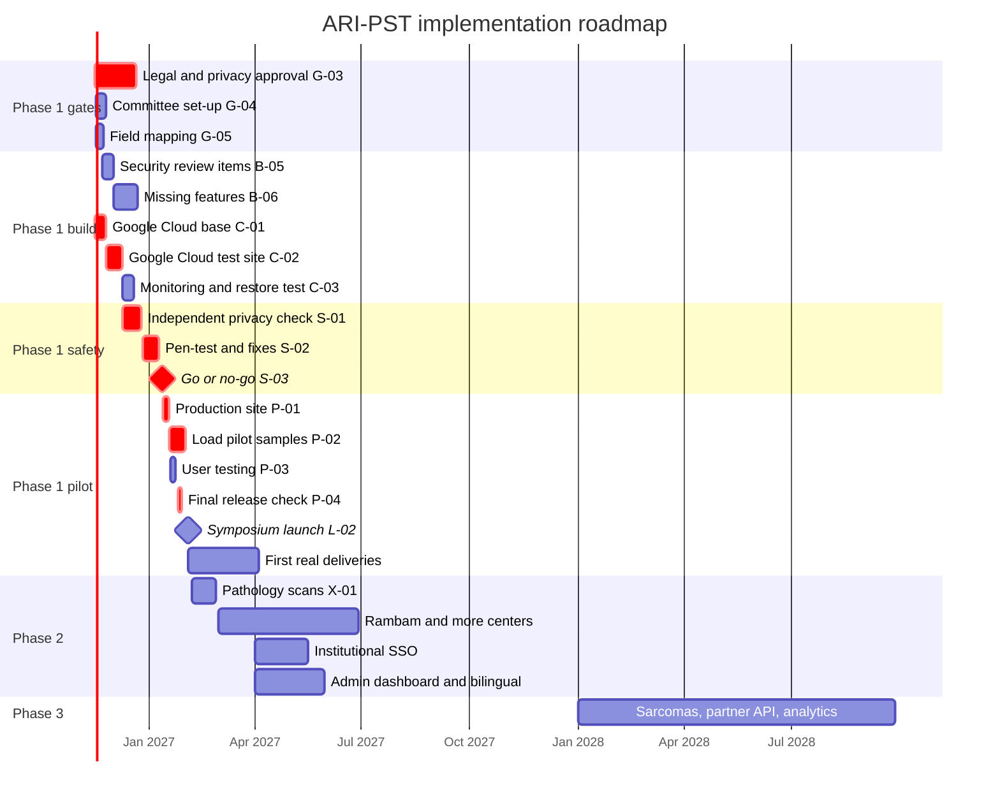

# Implementation roadmap

Date: 2026-11-14. Status base: [`validation/REQUIREMENTS-VALIDATION.md`](validation/REQUIREMENTS-VALIDATION.md).
Phases follow spec §9 ([`requirements/concept-and-spec-v1.0.md`](requirements/concept-and-spec-v1.0.md)). Phase 1 dates follow the timeline workbook [`planning/ARI_PST_2027_Development_Timeline.xlsx`](planning/ARI_PST_2027_Development_Timeline.xlsx) (launch at the symposium on 2027-02-03). Timeline task IDs (G-, B-, C-, S-, P-, L-, X-) are given next to each work package.

Rules for all phases:
- Synthetic data only until `GATE-PROD-DATA` closes (S-03 go / no-go). Use test data on stage at the symposium.
- Every legal or regulatory item is marked **needs legal review**. This plan is not legal advice.
- Efforts are rough human hours. 1 person-day = 6 productive hours (workbook setting). Phase 2 and 3 efforts are order-of-magnitude estimates.
- Owner roles are the timeline team roles: Physician (clinical lead), Consultant & Admin, Study Coordinator 1, Study Coordinator 2, Developer, Project & Product Lead, Designer, T4C Lead.

## 1. Overview

| Phase | Goal | Exit criterion (spec §9) | Target |
|---|---|---|---|
| 1 — completion | Pilot live with real, coded index data from Shaare Zedek and Madgam | Access requests completed the full path to actual delivery | Go-live 2027-01 (P-01), launch 2027-02-03 (L-02), exit after the first real deliveries |
| 2 — expansion | More centers, institutional SSO, pathology scans, admin dashboard, full bilingual | Three or more centers feed the index regularly | 2027 Q2 to Q4 (estimate) |
| 3 — national | Sarcomas, partner API, analytics and AI on standardized data | The portal is the basis of a clinical trial on Israeli data | 2028 onwards (estimate) |

## 2. Phase 1 completion (to pilot go-live with real data)

**Goal.** The built Phase 1 system runs on the production platform (Google Cloud, Tel Aviv `me-west1`, per the timeline) with real coded index data from the two pilot centers. Researchers complete requests to actual delivery.

**Entry criteria (already met).**
- Phase 1 scope works end to end with synthetic data: 39 of 39 flow steps pass ([`qa/flows/REPORT.md`](qa/flows/REPORT.md)).
- All CI checks pass; 0 Phase 1 requirements "Not met" (validation report).
- Draft schema v1 and collection rules agreed (timeline G-01, owner report).

**Work packages.**

| WP | Description (plain technical terms) | REQ | Timeline | Owner (support) | Effort (h) |
|---|---|---|---|---|---|
| P1-01 | Legal and privacy approval: Israeli privacy law (Amendment 13), HIPAA / GDPR applicability, DPA scope (Cloud SQL, Cloud Run, Cloud Storage), MTA/DTA templates, privacy policy, terms, analytics and accessibility notices, retention periods (C-07). **Needs legal review.** | 026, 047, 049, 050, 051, 052, 054 | G-02, G-03 | Consultant & Admin (Project & Product Lead) | 60 |
| P1-02 | Access committee: members, N-of-M rule, approval criteria; load them as configuration (two-person change). | 017, 034 | G-04 | Physician (Project & Product Lead) | 12 |
| P1-03 | Schema sign-off `GATE-SCHEMA`: record the signed field list and collection-protocols document in the repo; decide if `ethics_approval_ref` is required per record (then a forward-only migration plus import rule change). | 029, 040, 061 | G-01 | Physician (Study Coordinator 1, Developer) | 10 |
| P1-04 | Google Cloud base and test site: projects, private network, Cloud SQL PostgreSQL with no public address, KMS keys, Secret Manager, Cloud Run for the API and SPA, static hosting for the public site, scheduled jobs, domain, TLS. Same-origin model (C-03) kept. Region decision `GATE-REGION`: **needs legal review**. | 043, 052, 053, 069, 070 | C-01, C-02 | Developer (T4C Lead) | 96 |
| P1-05 | Verify encryption at rest on the target (Cloud SQL, storage, backups) and record the evidence. | 043 | C-01 | Developer | 4 |
| P1-06 | Monitoring and recovery: uptime checks, alerts (also for failed jobs, `ALERT_WEBHOOK_URL`), daily backups, a real restore drill with counts and checksums (RPO 15 min, RTO 4 h), a full-dump role or provider path (KNOWN-ISSUES M-8). | 048, 072 | C-03 | Developer | 32 |
| P1-07 | Mail and object store on the deployed stack: e-mail for invites, verification and notices (HTTPS mail adapter exists); shared object store for import staging (KNOWN-ISSUES H-1). | 013, 034, 056 | B-06 | Developer | 12 |
| P1-08 | Independent privacy check of the count engine (differencing, small cells, donor counts). Fix all findings. | 033, 032 | S-01 | Consultant & Admin (external expert, Developer) | 40 |
| P1-09 | Security review items: trusted proxy hops for the rate limit (R-04, behind the Google load balancer), MFA challenge race (R-05), locked-account answer (R-07), remaining low items (R-06, R-08 to R-12). Then the external pen-test and fixes of high and critical findings. | 044, 045, 054 | B-05, S-02 | Developer (external tester) | 40 + 60 |
| P1-10 | Production go-live: go / no-go with all gate evidence; production site with locked access; release check on production (flows, leak scan, speed); a rehearsed rollback. | 054, 062, 069, 072 | S-03, P-01, P-04 | Project & Product Lead (T4C Lead, Physician, Consultant & Admin, Developer) | 8 + 16 + 24 |
| P1-11 | Content and design: real texts, neuroblastoma and brain-tumor research areas, sarcomas as "later", publications and calls, native Hebrew review of site and app, partner logo permissions, fonts licence, editor trial with staff, screen-reader test, Lighthouse run. | 004, 019, 020, 022, 024, 071 | D-01, B-03 | Project & Product Lead (Designer, Physician) | 40 + 24 |
| P1-12 | Accessibility statement and standard edition (`OPEN-A5-02`). **Needs legal review.** | 022 | D-01 | Consultant & Admin | 6 |
| P1-13 | Field mapping: RedCAP and Madgam fields to the import template; a test file passes the dry run. | 029, 055, 056 | G-05 | Study Coordinator 1 (Study Coordinator 2) | 48 |
| P1-14 | Load real pilot samples: coded, de-identified; centers keep the link keys (result map); zero personal data in checks. | 003, 038, 042 | P-02 | Study Coordinator 1 (Study Coordinator 2, Physician) | 80 |
| P1-15 | Pilot operation to the exit: support the first requests through committee, center coordination, MTA/DTA and delivery; record request-to-delivery times. | 063, 066 | after L-02 | Project & Product Lead (Study Coordinators, Physician) | 40 |
| P1-16 | Missing screens: password reset (contract-first: new API operation with `x-roles`), invite accept page, sample edit page, audit export page, withdraw and appeal in the tracker, Excel import in the UI, ethics file reference upload. | 013, 034, 046, 067 | B-06 | Developer (Designer) | 80 |
| P1-17 | Metrics: add field completeness, request completion rate, request-to-delivery time, studies and publications (manual entry) to `GET /metrics`; a metrics page for coordinator, committee and admin (counts only, no k threshold shown). | 017, 066 | — | Developer (Project & Product Lead) | 24 |
| P1-18 | Clinician "value" view: home tiles for the own center (records, stale records, requests that involve the center, delivered requests). | 068 | — | Developer (Designer) | 8 |
| P1-19 | User guides and training for researchers, coordinators and committee; user testing (90 % of tasks without help); demo script on test data. | 007, 068 | D-02, P-03, L-01 | Study Coordinator 2 / Project & Product Lead (Designer) | 24 + 48 + 24 |

Total Phase 1 remaining effort: about 860 h (the workbook shows 826 h for its tasks; P1-05, P1-12, P1-15, P1-17 and P1-18 are added here).

**Dependencies.** Critical path (workbook): C-01 → C-02 → S-01 / S-02 → S-03 → P-01 → P-02 → P-04 → L-02. P1-14 needs P1-13 and P1-10. P1-08 and P1-09 need the Google Cloud test site (P1-04). P1-10 needs P1-01, P1-06, P1-08, P1-09.

**Risks.**

| Risk | Effect | Mitigation |
|---|---|---|
| Developer load above 100 % (workbook "Team" sheet: 102 %) | Launch moves | Add a second developer for P1-04 / P1-16, or move P1-16 items after launch |
| Holiday period for the privacy check and the pen-test | S-01, S-02 slip | Book the external expert and tester by 2026-11-30 |
| Legal approval time (P1-01) | No real data at launch | Run the launch on test data; keep the gate closed |
| Proxy hop count on Google Cloud unknown (R-04) | Rate limit bypass | Verify on the test site before the change; account lock-out still holds |
| Re-identification from counts | Privacy breach | k ≥ 5 distinct donors, neighbour rule, independent check (P1-08) |
| Stale index after the first load (spec §11) | Low researcher trust | Staleness job and digest; named freshness owner |

**Exit criteria.**
- Spec §9: access requests completed the full path to actual delivery (REQ-063), with real data.
- `GATE-PROD-DATA` signed (S-03): DPA, region, legal review, backup and restore drill, privacy check, pen-test with no open high or critical findings.
- Phase 1 acceptance checklist sections A to K pass ([`plan/04-product-workflow/07-phase1-acceptance-checklist.md`](../plan/04-product-workflow/07-phase1-acceptance-checklist.md)).

## 3. Phase 2 — expansion

**Goal.** Grow from 2 to 3 or more feeding centers and remove manual work.

**Entry criteria.** Phase 1 exit met. Pilot has run at least one quarter. Owner decision on `GATE-PATHOLOGY` (will centers upload scans) and the SSO identity providers. Budget for Phase 2 (`GATE-BUDGET`).

**Work packages.**

| WP | Description (plain technical terms) | REQ | Owner (support) | Effort (h) |
|---|---|---|---|---|
| P2-01 | Onboard Rambam and further centers (Madgam hospitals; Beilinson and Sheba when they join): center record, ethics approvals, DTA/MTA (**needs legal review**), field mapping, first import, staff accounts and training. Per center. | 064, 003, 051, 056 | Study Coordinator 1 (Physician, Consultant & Admin) | 60 per center |
| P2-02 | Scheduled feed per center: repeatable import (SFTP or object-store drop, same dry-run rules), per-center freshness targets, a feed report. | 064, 067 | Developer (Study Coordinator 2) | 80 |
| P2-03 | Institutional SSO: OIDC adapter behind `AuthPort`; map institution claims to roles with the existing second-approver rule; MFA from the IdP or kept locally; keep local accounts for researchers without SSO. | 059, 044, 045 | Developer (T4C Lead) | 120 |
| P2-04 | Digital pathology scans: separate object storage bucket (Tel Aviv region), upload with consent flag per center, de-identification check of image metadata, tiled viewer for authorized roles only, audit of every view and download. Timeline X-01. | 057, 046 | Developer (Designer) | 80 to 160 |
| P2-05 | Admin and governance dashboard: request volume and times, centers feeding, freshness, k-screen health, audit summary. Counts only. | 017, 018, 066 | Developer (Designer, Project & Product Lead) | 60 |
| P2-06 | Full bilingual: native Hebrew and English review of every screen, e-mail and public page; translation workflow in the CMS; bilingual vocabulary sign-off. | 020, 024 | Project & Product Lead (Designer, Physician) | 60 |
| P2-07 | Scale and resilience: 2 API instances, shared rate-limit and cache store, search at 100 k records (C-12), load test. | 072 | Developer | 40 |

**Dependencies.** P2-01 needs P2-02 for more than 2 centers. P2-04 needs `GATE-PATHOLOGY`, storage budget and legal review. P2-03 needs the institutions' IdP contacts.

**Risks.** Centers do not join (spec §11): show pilot value first. Pathology images carry identifiers in metadata: strip and check before storage. SSO role mapping errors: second approver stays required.

**Exit criteria.** Spec §9: three or more centers feed the index regularly (each center has a successful feed in each of the last 3 months).

## 4. Phase 3 — national

**Goal.** National scope across pediatric solid tumors, connected to global partners, and a data basis for a clinical trial.

**Entry criteria.** Phase 2 exit met. Standardized fields in use at all feeding centers (completeness target met). Decisions: `GATE-GENOMICS` (full sequences or aggregation only), data-sharing agreements with partners (**needs legal review**).

**Work packages.**

| WP | Description (plain technical terms) | REQ | Owner (support) | Effort (h) |
|---|---|---|---|---|
| P3-01 | Sarcomas: vocabulary extension (WHO soft tissue and bone), new collection protocols, public research area, synthetic data profile. | 065, 008, 028 | Physician (Study Coordinator 1, Developer) | 80 |
| P3-02 | Partner API for global partners (PNOC, SickKids, Stanford, CBTN): versioned, read-only aggregate endpoints from the same OpenAPI contract, client credentials, per-partner quotas, same k-screen, audit. | 060, 032, 033 | Developer (T4C Lead) | 160 |
| P3-03 | Standardization layer: mapping to a common data model for exchange (choice by ADR), data quality rules and completeness reports. | 008, 066 | Developer (Study Coordinators) | 120 |
| P3-04 | Analytics and AI on standardized data: a separate analytics zone with its own access rules, aggregate or approved-cohort data only, no identifiers; feasibility queries for trial design. Privacy review before any model use. **Needs legal review.** | 011, 065 | Developer (Physician, Consultant & Admin) | 300+ |
| P3-05 | Trial support: cohort feasibility for a defined trial protocol, linkage requests through the centers (the portal still stores no link key). | 065 | Physician (Project & Product Lead) | 80 |

**Risks.** Re-identification grows with richer data: keep the privacy engine as the only path for external counts. Cross-border transfer rules for partners: **needs legal review**. Analytics on non-standard data gives wrong results: P3-03 first.

**Exit criteria.** Spec §9: the portal serves as the basis for a clinical trial on Israeli data (a trial protocol cites the index as its feasibility or cohort source).

## 5. Success metrics (spec §10)

| Metric (spec §10) | How it is measured | Source today | Target owner |
|---|---|---|---|
| Medical centers connected and feeding regularly | Centers with at least one import or new record per month; `centersFeeding` | `GET /metrics` | Study Coordinator 1 |
| Sample records in the index, and field completeness | `samplesTotal`; share of optional fields filled per record (to add) | `GET /metrics` (completeness: P1-17) | Study Coordinator 1 |
| Registered researchers and number of searches | `registeredResearchers`; `searchesLast30d` | `GET /metrics` | Project & Product Lead |
| Access requests, completion rate, time from request to delivery | `requestsByStatus`; closed-delivered / closed (to add); median days submit → delivered from the request history (to add) | `GET /metrics` (rate and time: P1-17) | Project & Product Lead |
| Share of entry done by a research coordinator, not a treating doctor | `coordinatorEnteredShare` (records created by `national_coordinator`) | `GET /metrics` | Study Coordinator 2 |
| Studies and publications based on the index | Manual register maintained by the coordinator, shown on the metrics page (to add) | P1-17 | Physician |

All metrics are counts. No metric shows a value below the k-screen to an external role.
