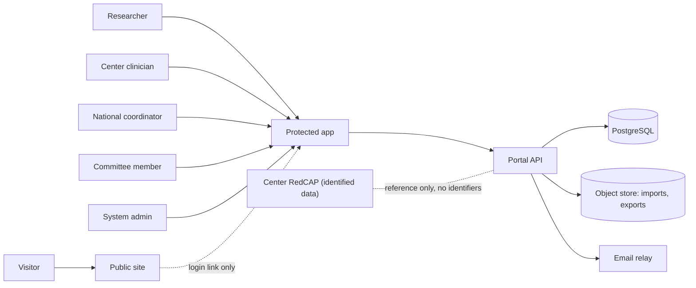
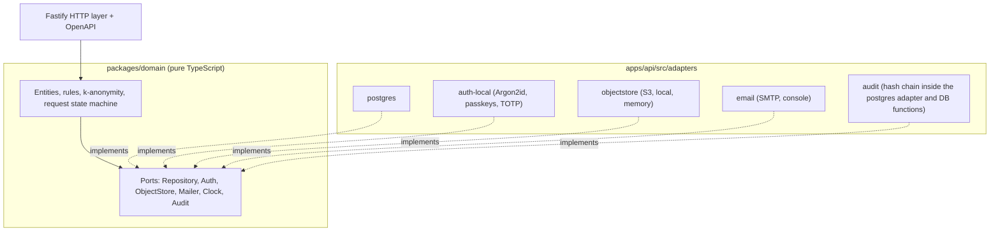
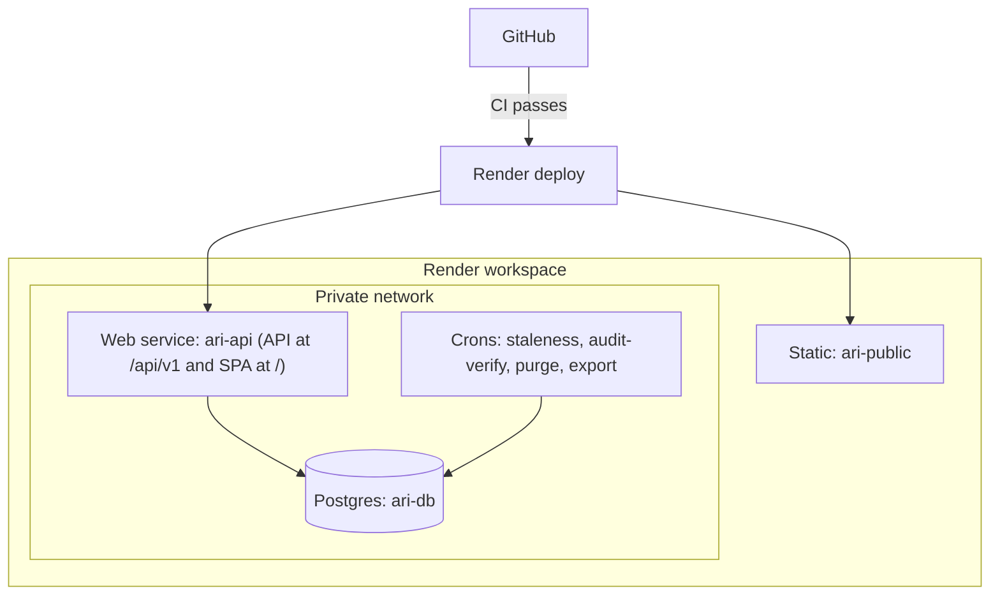

# ARI-PST Portal — Architecture

Status: Phase 1 as built (synthetic data only). Summary of `plan/01-architecture/`, updated to the code and to `plan/11-integration/canonical-decisions.md`.
Rule: this file is a summary. The ADRs in `plan/01-architecture/adr/` and the canonical decisions are the authority; if code and plan disagree, the canonical decisions decide.

## 1. Goal
One portal, two layers (REQ-001):
- **Public site.** Shows the national initiative. No data path.
- **Protected area.** A searchable index of de-identified samples. Roles. A request workflow.

Core rule: the portal holds an **index**, not identified clinical data (REQ-002, REQ-041). Identity stays in the centers.

## 2. System context

## 3. Style: modular monolith with ports and adapters
- One API deployable (`apps/api`). Ten modules with clear boundaries.
- The domain core (`packages/domain`) imports no database, auth, storage, email or search library.
- Adapters hold all platform code. A move from Render to another host changes adapters only.

CI enforces this. An architecture test (dependency-cruiser) fails the build if the domain imports a platform library.

## 4. Modules
| Module | Job |
|---|---|
| `public-site` | Static site, content from Git |
| `identity-access` | Accounts, MFA, sessions, roles |
| `sample-index` | Sample records (coded, de-identified) |
| `search-discovery` | Search, filters, k-anonymous counts |
| `access-requests` | Cart, form, committee decision, delivery |
| `audit-log` | Append-only, hash-chained events |
| `center-ingestion` | Coordinator entry, CSV import, staleness |
| `admin-governance` | Users, roles, committee settings |
| `notifications` | Email and in-app messages |
| `observability` | Logs, metrics, traces, no identifiers |

## 5. Security-critical design points
- **Roles:** `anonymous`, `researcher_il`, `researcher_intl`, `center_clinician`, `national_coordinator`, `committee_member`, `system_admin`.
- **Row-Level Security** by center. External roles have **no** grant on the sample table. They reach counts only through `SECURITY DEFINER` functions that apply k-anonymity (k >= 5 enforced by a CHECK, distinct-donor counts, neighbour and complement suppression). The UI shows "Too few to show" and never the threshold (C-08, C-09). Changing `k` or a role grant needs a second approver.
- **Separation of duties:** `system_admin` cannot approve requests or read sample data.
- **Two-step coding:** the portal issues random code blocks. Centers map them locally. No link key is stored in the portal.
- **Clinician view:** full coded record of the own center, plus a link out to the center's own system.
- **Audit:** every view, download and decision is logged in a keyed hash chain (action names: `plan/02-security-privacy/07-audit-log.md`, C-11).
- **Sessions and origin (C-02, C-03):** one origin. SPA at `/`, API at `/api/v1`. Cookies `__Host-sid` (Secure, HttpOnly, SameSite=Strict) and `__Host-csrf` (double submit). No CORS in production, with one exception: the static public site may `POST /api/v1/public/forms/*` from `PUBLIC_SITE_ORIGIN`, without credentials. CSP has no `unsafe-eval` (zod 4 runs in jitless mode in `apps/web`). Idle 15 min staff, 30 min researchers. Absolute 4 h admin, 8 h others. Step-up MFA within 5 min.
- **Request states (C-01):** `draft, submitted, precheck, needs_info, committee_review, appeal_review, approved, rejected, center_coordination, agreements, delivery, closed`. `withdrawn` and `expired` are close reasons. Enforced by DB triggers and functions, mirrored in `packages/domain/src/request-state.ts`.
- **DB roles (C-06):** `app_migrator` (owns objects, runs migrations only), `app_runtime` (API, cannot `SET ROLE`), `app_audit_writer`, `app_readonly_bg`, `app_break_glass`. Schemas `portal`, `audit`, `search`, `ext`, `agg`.
- **Health (C-05):** `/livez` (process alive) and `/readyz` (DB reachable, migrations at expected level), both JSON with `version`. `/readyz` reads `portal.migration_level()` and passes when the applied level is at least the level built into the API. Render health check uses `/readyz`.

## 6. Render topology (Frankfurt, pending legal review)

There is no separate `ari-app` static site and no `ari-internal` service (C-04, deviation B5). A static site on another host would break the `__Host-` cookie, so `ari-api` builds and serves `apps/web/dist`. Production runs 2 `ari-api` instances. Details: `docs/deployment.md`, `render.yaml`.

The demo that runs today is smaller: `infra/render.free.yaml` (Blueprint `ari-pst-demo`) creates one free web service `ari-demo-api-7teo` (API and SPA) and one free Postgres `ari-demo-db-7teo`, in Frankfurt, with synthetic data. No public site, no crons, no second instance. See `docs/deployment.md` section 13.

| Environment | Trigger | Data |
|---|---|---|
| Preview (per PR) | Pull request | Synthetic only |
| Staging | `staging` branch | Synthetic only |
| Production, public site | `main`, after CI | Public content |
| Production, protected area | `main`, after CI **and** manual approval | Synthetic until `GATE-PROD-DATA` closes |

## 7. Portability to Base44 (later, TBD)
Move in stages. Public site first. Protected front end second. Back end and data last, and only after the entry conditions are met (DPA, region control, full export, migration path). Contracts (OpenAPI, SQL schema) and the export/import round trip keep the move cheap.

## 8. Not in Phase 1
Analytics or AI layer, pathology scan viewer, institutional SSO, partner API, genomics data (flag only). The ports exist. The features do not.

## 9. Open items
See `plan/decision-register.md` for gates and assumptions and `docs/KNOWN-ISSUES.md` for build gaps. Render facts (plan slugs, PITR window, `IS_PULL_REQUEST`) are UNVERIFIED until checked against live Render docs.
