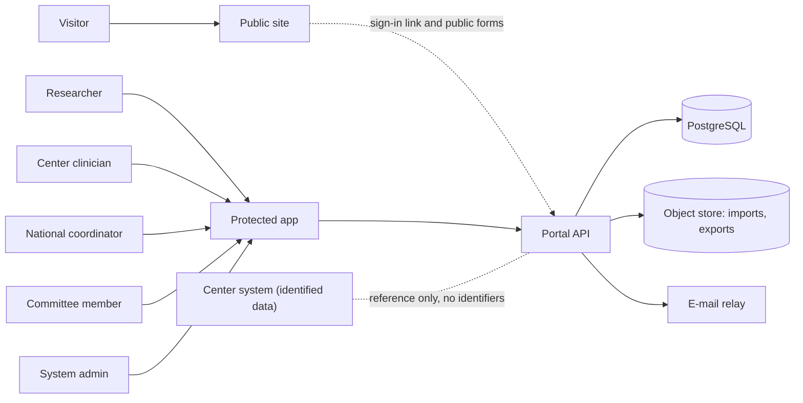
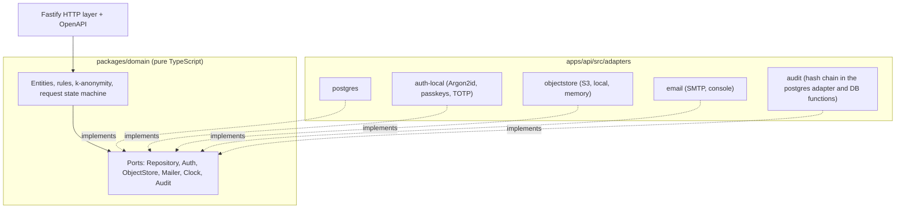
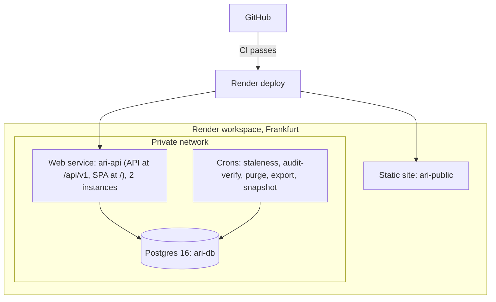

# Architecture

Scope: the Phase 1 system as built. Data is synthetic only.
Authority: if this file and [`plan/11-integration/canonical-decisions.md`](../plan/11-integration/canonical-decisions.md) differ, the canonical decisions win. The ADRs are in [`plan/01-architecture/adr/`](../plan/01-architecture/adr/).

## 1. Goal

One portal with two layers (REQ-001):

| Layer | Purpose | Data path |
|---|---|---|
| Public site | Shows the national initiative | None, except credential-free public forms |
| Protected area | Searchable index of de-identified samples, roles, request workflow | API on the same origin |

Core rule: the portal holds an **index**, not identified clinical data (REQ-002, REQ-041). Identity stays in the centers.

## 2. System context

## 3. Style: modular monolith with ports and adapters

- One API deployable (`apps/api`) with ten modules.
- The domain core (`packages/domain`) imports no database, auth, storage, e-mail or search library.
- Adapters hold all platform code. A move to another host changes adapters and deploy files only.
- `pnpm arch` (dependency-cruiser) fails CI if the domain imports a platform library.

## 4. Modules

| Module | Job |
|---|---|
| `public-site` | Public form intake |
| `identity-access` | Accounts, MFA, sessions, roles |
| `sample-index` | Sample records (coded, de-identified) |
| `search-discovery` | Search, filters, k-anonymous counts |
| `access-requests` | Cart, form, committee decision, delivery |
| `audit-log` | Append-only, hash-chained events |
| `center-ingestion` | Coordinator entry, CSV import, staleness |
| `admin-governance` | Users, roles, committee settings, `k` policy |
| `notifications` | E-mail and in-app messages (outbox) |
| `observability` | Logs, metrics, health. No identifiers |

Cron jobs in `apps/api/src/jobs/`: `staleness`, `audit-verify`, `purge`, `export`, `snapshot`, `seed-synthetic`.

## 5. Security design

| Topic | Design |
|---|---|
| Roles | `anonymous`, `researcher_il`, `researcher_intl`, `center_clinician`, `national_coordinator`, `committee_member`, `system_admin`. One table (`packages/domain/src/capabilities.ts`) generates the OpenAPI `x-roles`, the authz matrix test and the route guards. |
| Row-Level Security | By center. External roles have **no** grant on the sample table. |
| k-anonymity | Counts come only from `SECURITY DEFINER` functions: k ≥ 5 (CHECK), distinct-donor counts, neighbour and complement suppression. The UI shows "Too few to show" and never the threshold (C-08, C-09). |
| Separation of duties | `system_admin` cannot approve requests or read sample data. `k` changes and role grants need a second approver. |
| Two-step coding | The portal issues random code blocks. Centers map them locally. The portal stores no link key. |
| Clinician view | Full coded record of the own center, plus a link out to the center's own system. |
| Audit | Every view, download and decision is logged in a keyed hash chain (C-11). Action names: [`plan/02-security-privacy/07-audit-log.md`](../plan/02-security-privacy/07-audit-log.md). |
| Origin and cookies (C-02, C-03) | One origin. SPA at `/`, API at `/api/v1`. `__Host-sid` (Secure, HttpOnly, SameSite=Strict) and `__Host-csrf` (double submit). |
| CORS | None in production, with one exception: `POST /api/v1/public/forms/*` from `PUBLIC_SITE_ORIGIN`, without credentials. |
| CSP | Strict, no `unsafe-eval`. zod 4 runs in jitless mode (`apps/web/src/zod-config.ts`, imported first). |
| Session timeouts | Idle: 15 min staff, 30 min researchers. Absolute: 4 h admin, 8 h others. Step-up MFA within 5 min for sensitive operations. |
| Request states (C-01) | `draft, submitted, precheck, needs_info, committee_review, appeal_review, approved, rejected, center_coordination, agreements, delivery, closed`. `withdrawn`, `expired` and others are close reasons, not states. DB triggers enforce the moves; `packages/domain/src/request-state.ts` mirrors them. |
| Database roles (C-06) | `app_migrator` (owns objects, runs migrations), `app_runtime` (API, cannot `SET ROLE`), `app_audit_writer`, `app_readonly_bg` (crons), `app_break_glass`. Schemas: `portal`, `audit`, `search`, `ext`, `agg`, `authn`, `ops`. Details: [`db/README.md`](../db/README.md). |
| Health (C-05) | `/livez` (process alive) and `/readyz` (database reachable and migrations at the expected level). Both return JSON with `version`. `/readyz` reads `portal.migration_level()`. Render health checks use `/readyz`. |

## 6. Render topology

### 6.1 Production Blueprint (`render.yaml`, not applied)

`ari-api` builds and serves `apps/web/dist`. A separate static host for the SPA would break the `__Host-` cookie (C-04).

### 6.2 Free demo (`infra/render.free.yaml`, live)

| Resource | Name | Note |
|---|---|---|
| Blueprint | `ari-pst-demo` | Branch `main`, manual deploy |
| Web service | `ari-demo-api-7teo` | API and SPA. <https://ari-demo-api-7teo.onrender.com> |
| Database | `ari-demo-db-7teo` | Free Postgres 16, synthetic data |

No public site, no crons, one instance. Details: [`deployment.md`](deployment.md#13-free-demo).

### 6.3 Environments

| Environment | Trigger | Data |
|---|---|---|
| Free demo | Manual deploy | Synthetic only |
| Preview (per PR) | Pull request | Synthetic only |
| Staging | `staging` branch | Synthetic only |
| Production, public site | `main`, after CI | Public content |
| Production, protected area | `main`, after CI **and** two approvers | Synthetic until `GATE-PROD-DATA` closes |

Region: Frankfurt. The region choice needs legal review (GATE-REGION).

## 7. Portability

The contracts (OpenAPI, SQL schema) and the export and import round trip keep a host move cheap.

- Google Cloud: step-by-step guide in [`migration/google-cloud.md`](migration/google-cloud.md).
- Base44: a later option. Move in stages: public site, then protected front end, then back end and data, only after the entry conditions (DPA, region control, full export, migration path).

## 8. Not in Phase 1

Analytics or AI layer, pathology scan viewer, institutional SSO, partner API, genomics data (flag only). The ports exist. The features do not.

## 9. Open items

Gates and assumptions: [`plan/decision-register.md`](../plan/decision-register.md). Build gaps and unverified Render facts: [`KNOWN-ISSUES.md`](KNOWN-ISSUES.md).
