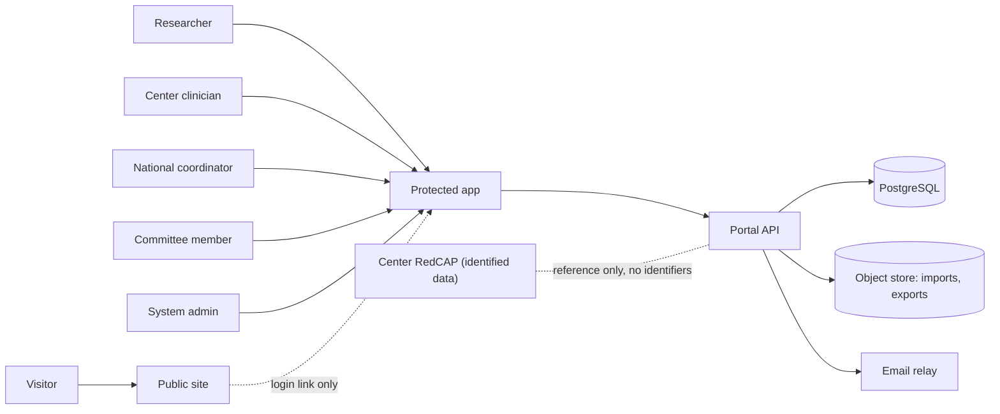
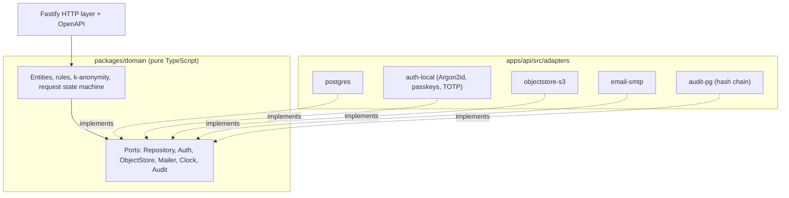
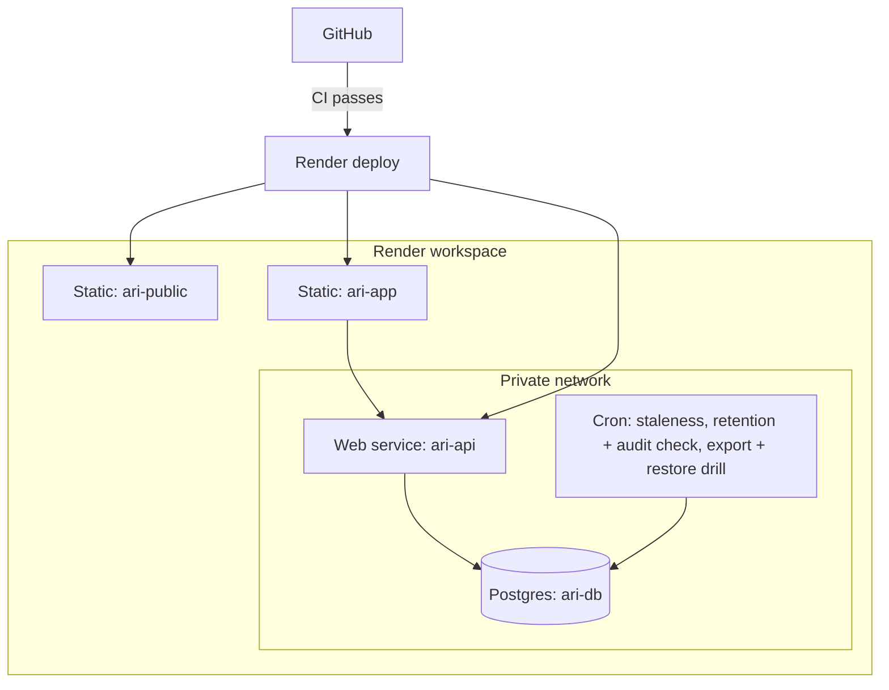

# ARI-PST Portal — Architecture

Status: draft, built from the plan in `plan/01-architecture/`. Wave 2 review may change it.
Rule: this file is a summary. The ADRs in `plan/01-architecture/adr/` are the authority.

## 1. Goal
One portal, two layers (REQ-001):
- **Public site.** Shows the national initiative. No data path.
- **Protected area.** A searchable index of de-identified samples. Roles. A request workflow.

Core rule: the portal holds an **index**, not identified clinical data (REQ-002, REQ-041). Identity stays in the centers.

## 2. System context

## 3. Style: modular monolith with ports and adapters
- One API deployable (`apps/api`). Ten modules with clear boundaries.
- The domain core (`packages/domain`) imports no database, auth, storage, email or search library.
- Adapters hold all platform code. A move from Render to another host changes adapters only.

CI enforces this. An architecture test (dependency-cruiser) fails the build if the domain imports a platform library.

## 4. Modules
| Module | Job |
|---|---|
| `public-site` | Static site, content from Git |
| `identity-access` | Accounts, MFA, sessions, roles |
| `sample-index` | Sample records (coded, de-identified) |
| `search-discovery` | Search, filters, k-anonymous counts |
| `access-requests` | Cart, form, committee decision, delivery |
| `audit-log` | Append-only, hash-chained events |
| `center-ingestion` | Coordinator entry, CSV import, staleness |
| `admin-governance` | Users, roles, committee settings |
| `notifications` | Email and in-app messages |
| `observability` | Logs, metrics, traces, no identifiers |

## 5. Security-critical design points
- **Roles:** `anonymous`, `researcher_il`, `researcher_intl`, `center_clinician`, `national_coordinator`, `committee_member`, `system_admin`.
- **Row-Level Security** by center. External roles have **no** grant on the sample table. They reach counts only through functions that apply k-anonymity (default k = 5).
- **Separation of duties:** `system_admin` cannot approve requests or read sample data.
- **Two-step coding:** the portal issues random code blocks. Centers map them locally. No link key is stored in the portal.
- **Clinician view:** full coded record of the own center, plus a link out to the center's own system.
- **Audit:** every view, download and decision is logged in a hash chain.

## 6. Render topology (Frankfurt, pending legal review)

| Environment | Trigger | Data |
|---|---|---|
| Preview (per PR) | Pull request | Synthetic only |
| Staging | `staging` branch | Synthetic only |
| Production, public site | `main`, after CI | Public content |
| Production, protected area | `main`, after CI **and** manual approval | Synthetic until `GATE-PROD-DATA` closes |

## 7. Portability to Base44 (later, TBD)
Move in stages. Public site first. Protected front end second. Back end and data last, and only after the entry conditions are met (DPA, region control, full export, migration path). Contracts (OpenAPI, SQL schema) and the export/import round trip keep the move cheap.

## 8. Not in Phase 1
Analytics or AI layer, pathology scan viewer, institutional SSO, partner API, genomics data (flag only). The ports exist. The features do not.

## 9. Open items
See `plan/decision-register.md` (created in Wave 3) for gates and assumptions. Render facts are UNVERIFIED until checked against official Render docs.
