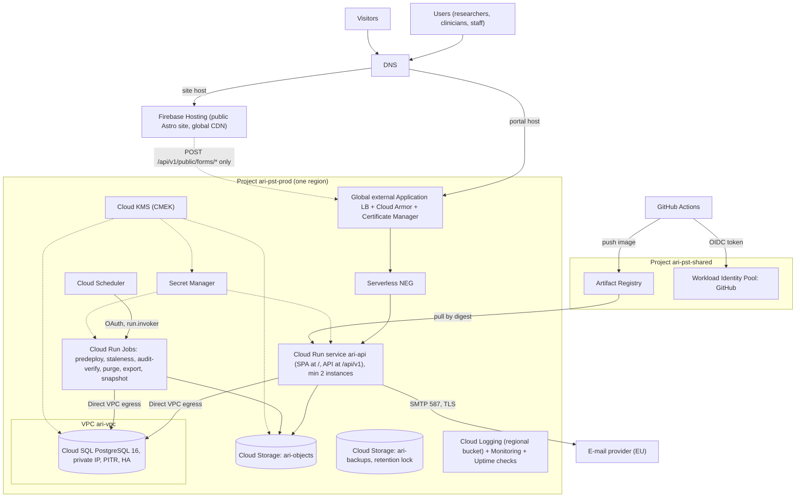
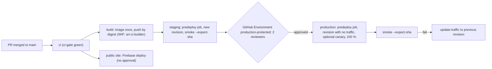
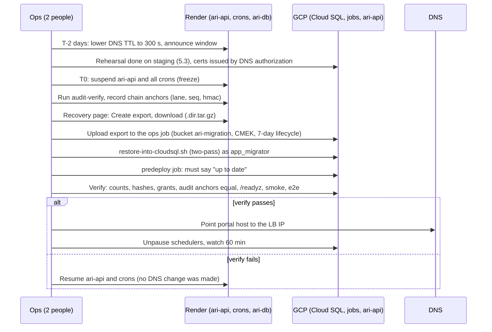

# Migration guide: Render to Google Cloud

Status: plan, not a decision. Prepared 2026-11-14. Synthetic data only.
Supporting files: [`gcp/`](gcp/).
Rule: `plan/11-integration/canonical-decisions.md` wins over this guide. This guide changes no canonical decision.

This guide tells you how to move every part of the ARI-PST Portal from Render to Google Cloud (GCP).
It covers the protected app and API, the database, the public site, cron jobs, secrets, object storage, e-mail, CI/CD, DNS and TLS, logs and monitoring, backups and restore, and IAM.

Words used in this guide:

| Word | Meaning |
|---|---|
| MUST | Do it. The migration is not safe without it. |
| SHOULD | Do it unless you write down why not. |
| VERIFIED-LOCAL | We ran it on this repo on 2026-11-14 (local PostgreSQL 16 and Docker). |
| VERIFIED-DOCS | A Google or Render documentation page says so. Source and date are in [section 11](#11-sources-and-verification-status). |
| UNVERIFIED | Not checked against a live GCP project or a current official page. Check it before you depend on it. |
| Needs legal review | A legal or regulatory statement. It is not advice. |

Network note: `docs.cloud.google.com` was not reachable from the build session. Facts marked VERIFIED-DOCS come from search-engine extracts of the official pages, not from a full page read. Treat them as "probably current". Re-check them on the day you start.

---

## 0. Summary and decision gates

### 0.1 Summary

- The app is already portable. The domain core has no platform code. Only adapters, deploy files and runbooks change. The API code does **not** need a change for this move.
- Target shape on GCP:
  - **Cloud Run service `ari-api`**: one container serves `/api/v1` and the protected SPA on one host (C-03, C-04). Two warm instances.
  - **Cloud SQL for PostgreSQL 16**: private IP only, PITR, regional HA in production.
  - **Cloud Run Jobs + Cloud Scheduler**: predeploy (roles + migrations) and the five crons.
  - **Secret Manager**, **Cloud Storage** (objects and locked backups), **Artifact Registry**, **Cloud KMS** (CMEK).
  - **Global external Application Load Balancer + Cloud Armor** in front of `ari-api`, with a Certificate Manager certificate.
  - **Firebase Hosting** for the public Astro site (recommended over Cloud Storage + Cloud CDN, see [1.3](#13-public-site-firebase-hosting-or-cloud-storage--cloud-cdn)).
  - **GitHub Actions with Workload Identity Federation**. No service-account keys. Production deploy waits for the GitHub Environment `production-protected` (2 reviewers), as today.
- Database move: Render logical export (`pg_dump` directory format) → restore into Cloud SQL with a **two-pass restore** script that keeps every owner, grant, policy and trigger. We rehearsed it locally: row counts, content hashes, 406 owner/grant/RLS/policy/trigger facts, the audit hash chain and `/readyz` all matched (VERIFIED-LOCAL, [5.3](#53-local-rehearsal-what-we-proved)).
- A plain `pg_restore` is **not safe** here. It silently drops the function grants and leaves `EXECUTE` open to `PUBLIC`. Use `docs/migration/gcp/restore-into-cloudsql.sh`.
- Three findings that need an owner decision before real data (details in [5.6](#56-findings-that-need-a-decision)):
  1. On Cloud SQL **no customer role can take a full logical dump** (no superuser, no `BYPASSRLS`, and the owner has no read grant on the audit tables by design). Offsite logical backups (`scripts/backup-export.sh`, DR-4) need a new design.
  2. PostgreSQL 16 may be offered only on Cloud SQL **Enterprise Plus** (higher cost). UNVERIFIED.
  3. `node-pg` treats `sslmode=require` as `verify-full`. Cloud SQL's server certificate does not carry the private IP, so `require` fails. Phase 1 uses `no-verify` (encrypted, not verified). Before real data use `verify-ca` with the Cloud SQL CA ([4.2.6](#426-tls-from-the-app-to-cloud-sql)).

### 0.2 Decision gates

Nothing in this guide closes a gate. The defaults in `plan/00-contract-pack.md` stay until a gate closes.

| Gate | What it means for this move | Default until closed |
|---|---|---|
| Move decision (new ADR) | The contract pack names Render as host. A move to GCP needs an owner decision and an ADR. Exit triggers EX-01..EX-06 in `plan/01-architecture/07-migration-and-exit-plan.md` start the review. | Stay on Render. Use this guide for a synthetic rehearsal only. |
| `GATE-REGION` | Picks the region. Options: `europe-west3` (Frankfurt) or `me-west1` (Tel Aviv). See [section 2](#2-region-choice-and-data-residency). Needs legal review. | `europe-west3` (same city as the provisional Render choice). |
| `GATE-PROD-DATA` | Real index data. Needs DPA with Google, region control, export/import round trip, migration path, legal review, pen-test. | Synthetic only. `DATA_CLASSIFICATION=synthetic` everywhere. |
| `GATE-BUDGET` | Cloud SQL edition and HA drive the cost ([section 8](#8-cost-drivers)). | Lean option for staging; HA for production. |
| `GATE-OPERATOR` | Who signs the Google Cloud agreement and the DPA. | Assume Tech4Cancer. Needs legal review. |

### 0.3 Order of work

```mermaid
flowchart LR
  A["0. ADR + gates"] --> B["1. Org, projects, IAM, network"]
  B --> C["2. Cloud SQL + preinit"]
  C --> D["3. Image + Cloud Run + jobs"]
  D --> E["4. LB, Armor, certs, Firebase"]
  E --> F["5. CI/CD with WIF"]
  F --> G["6. Synthetic rehearsal on GCP staging"]
  G --> H["7. Freeze, final export, restore, verify"]
  H --> I["8. DNS cutover"]
  I --> J["9. Warm standby on Render 30 days"]
  J --> K["10. Decommission Render"]
```



---

## 1. Target architecture on GCP

### 1.1 Picture



### 1.2 Component map: Render → GCP

| Render today | GCP target | Why this choice |
|---|---|---|
| Web service `ari-api` (Node native runtime, 2 instances, `healthCheckPath: /readyz`) | **Cloud Run service** `ari-api`, container image, `minScale: 2`, startup probe `/readyz`, liveness probe `/livez` | Managed, scales, revision-based rollback and traffic split. Keeps one host for SPA + API, so `__Host-` cookies work and no CORS is needed (C-03). |
| `preDeployCommand: node scripts/render-predeploy.mjs` | **Cloud Run Job** `ari-job-predeploy`, run with `--wait` **before** traffic moves | Same script, no change. The owner URL and migrator password live only on this job, not on the API service. This closes the Render residual risk in `docs/deployment.md` section 4. |
| 5 cron services (`staleness`, `audit-verify`, `purge`, `export`, `snapshot`) | **Cloud Run Jobs** + **Cloud Scheduler** (same cron strings, time zone `Etc/UTC`) | Jobs run to completion and exit non-zero on failure, like Render crons. Scheduler calls the Run Admin API with an OAuth token. |
| Render Postgres 16, private network, PITR | **Cloud SQL for PostgreSQL 16**, private IP only (`--no-assign-ip`), PITR, `REGIONAL` HA in production, CMEK option | Managed PostgreSQL with the same major version. Private IP keeps the "private network only" rule (`ipAllowList: []`). |
| Render private network | **VPC** `ari-vpc` + **Direct VPC egress** from Cloud Run (no Serverless VPC Access connector) | Direct VPC egress has no connector VMs to run or pay for. Use a connector only if Direct VPC egress is not available in your region. |
| `generateValue` / `sync: false` env vars | **Secret Manager**, one secret per value, user-managed replication in the chosen region, version pinned in production | Per-secret IAM. Audit logs on every access. No secrets in Git or in service YAML. |
| S3-compatible bucket (`S3_*`) | **Cloud Storage** bucket `ari-objects` through the **S3-compatible XML API** (existing S3 adapter, HMAC key). A second bucket `ari-backups` with a **retention policy (Bucket Lock)** | No code change now. Later: a native GCS adapter with workload identity removes the HMAC key ([6](#6-security-hardening-checklist)). |
| SMTP provider (`SMTP_URL`) | Same provider (EU region), `SMTP_URL` in Secret Manager. Port 587 or 465 | GCP has no general SMTP relay product. Outbound port 25 is blocked on GCP; 587/465 work (UNVERIFIED for Cloud Run, check with your provider). |
| Render CDN + TLS for the static site | **Firebase Hosting** (recommended) | Closest match to Render static: headers, redirects, rewrites, preview channels per PR, managed TLS. See [1.3](#13-public-site-firebase-hosting-or-cloud-storage--cloud-cdn). |
| Render TLS for `ari-api` | **Global external Application Load Balancer** + **Certificate Manager** (DNS authorization) | Cloud Run domain mapping is Preview and only in some regions (VERIFIED-DOCS). A load balancer works in every region, carries Cloud Armor, and lets you issue the certificate **before** the DNS switch. |
| (none) | **Cloud Armor** security policy on the LB backend | WAF rules, rate limits per IP, optional geo rules. Render had none (RT-11 said no proxy in Phase 1). |
| Render builds from Git | **GitHub Actions** builds the image once, pushes to **Artifact Registry**, deploys by digest | Build once, promote the same digest to staging and production. Cloud Build is a valid alternative ([4.10](#410-cicd-github-actions-with-workload-identity-federation)). |
| GitHub Environment approval + Render deploy hook | GitHub Environment `production-protected` approval + `gcloud run deploy --no-traffic` + traffic shift | Same gate. Rollback = move traffic back to the previous revision in seconds. |
| Render logs and metrics | **Cloud Logging** (regional log bucket), **Cloud Monitoring**, **Uptime checks**, alerting policies | Logs stay in the region. The app already logs JSON without identifiers. |
| Render PITR + manual exports | **Cloud SQL automated backups + PITR**, backup location pinned to the region, plus cross-instance restore drills | See [section 7](#7-observability-backups-and-dr-drills) and finding F-1. |
| Render workspace roles | **Cloud IAM**: groups, least-privilege service accounts, org policies, Privileged Access Manager for just-in-time admin | Separation of duties stays: no GCP admin role gives sample access through the app. |

### 1.3 Public site: Firebase Hosting or Cloud Storage + Cloud CDN

| Point | Firebase Hosting | Cloud Storage + Cloud CDN behind the HTTPS LB |
|---|---|---|
| Headers per path (CSP, HSTS, cache) | `firebase.json` `headers` (same shape as `_headers`) | LB custom response headers per backend bucket (less granular per path) |
| Rewrites `/he/*` → `/he/index.html`, redirect `/app/*` | Native (`rewrites`, `redirects`) | URL map rules; wildcard-to-file rewrites are awkward |
| Trailing slash, directory index | `trailingSlash: true` | Bucket website config (`MainPageSuffix`) |
| PR previews | Preview channels with expiry (`--expires 3d`) | Build your own (extra buckets) |
| TLS | Managed, automatic | Certificate Manager on the shared LB |
| Cloud Armor in front | No | Yes |
| Region pin of stored files | No. Global CDN, content stored by Firebase (UNVERIFIED where) | Bucket in the chosen region; cached at the edge |
| Cost at this size | Very low (Blaze plan, small free quota) | LB rule + CDN egress; LB is shared with the portal, so small extra |
| Decap CMS (`/admin/*`) | Works (static files) | Works |

**Recommendation: Firebase Hosting.** The public site holds no personal data and no data path (REQ-001). Firebase gives a near 1:1 mapping of `render.yaml` (headers, rewrites, redirect, previews) with the least work. Put it in its own project (`ari-pst-site`) so a global-location exception for Firebase does not weaken the location policy of the data project. Choose Cloud Storage + CDN instead if legal says even public static content must stay in-region, or if you need Cloud Armor in front of the site.
Ready-made config: `docs/migration/gcp/firebase/firebase.json` (mirrors `apps/public-site/public/_headers` and the `render.yaml` routes; replace `PORTAL_HOST`).

---

## 2. Region choice and data residency

Needs legal review. This section is not advice. `GATE-REGION` stays open.

| Point | `europe-west3` Frankfurt | `me-west1` Tel Aviv |
|---|---|---|
| Same as current provisional choice | Yes (Render Frankfurt) | No |
| Data stays in Israel | No. EU. Israel has an EU adequacy decision; the reverse transfer rules for Israeli data abroad need counsel (`08-compliance-map.md` L8, LQ-3) | Yes, the region is in Israel |
| Cloud Run | Available | Listed (VERIFIED-DOCS, Cloud Run locations, Tier 1 pricing) |
| Cloud SQL PostgreSQL | Available | Listed for Enterprise and Enterprise Plus (VERIFIED-DOCS, region availability page) |
| Cloud Scheduler, Artifact Registry, Secret Manager regional replication, Cloud KMS, Certificate Manager, Cloud Armor | Available (UNVERIFIED per product, but Frankfurt is a large region) | UNVERIFIED. Check each with the commands below |
| Cloud Run domain mapping | Not needed (we use the LB) | Not needed (we use the LB) |
| Zones | 3 | 3 (`me-west1-a/b/c`, launch-time source) |
| Exit trigger it answers | EX-01 | EX-02 ("legal requires Israel-resident hosting and Render has none") |

Check product availability for a region (run in Cloud Shell; read-only):

```bash
REGION=me-west1   # or europe-west3
gcloud run regions list --format='value(locationId)' | grep -x "$REGION"
gcloud sql tiers list --format='value(tier,region)' | grep -c "$REGION"
gcloud scheduler locations list --format='value(locationId)' | grep -x "$REGION"
gcloud artifacts locations list --format='value(name)' | grep -x "$REGION"
gcloud kms locations list --format='value(locationId)' | grep -x "$REGION"
gcloud secrets locations list --format='value(locationId)' 2>/dev/null | grep -x "$REGION"   # command may differ by gcloud version
gcloud certificate-manager locations list --format='value(locationId)' | grep -E "^(global|$REGION)$"
```

Residency rules that apply in either region. Each one is a MUST, because GCP defaults are often multi-region or global:

1. Set the organization policy `constraints/gcp.resourceLocations` on the data projects to the chosen region (for example `in:europe-west3-locations`). Leave the site project (`ari-pst-site`) outside it or allow `global` there only.
2. Cloud SQL backups: set `--backup-location=$REGION`. The default is a multi-region near the instance.
3. Secret Manager: `--replication-policy=user-managed --locations=$REGION`. The default `automatic` replicates globally.
4. Cloud Logging: create the `_Default` and `_Required` sink targets as **regional log buckets**, or set the organization default storage location for logs to the region **before** you create the projects. Log entries carry no identifiers (hard rule), but request metadata is still personal data under GDPR (needs legal review).
5. Artifact Registry repository in the region. Images hold no data, but keep them close for pull speed.
6. Cloud Storage buckets: single region, not `EU` multi-region.
7. Firebase Hosting serves from a global CDN. The site is public content only. Confirm with counsel that this is acceptable (needs legal review).
8. Google support and SRE access: consider Access Transparency and Access Approval (premium support needed, UNVERIFIED price). Needs legal review for the DPA.

---

## 3. Prerequisites

### 3.1 Organization, billing, people

1. A Google Cloud **organization** (Cloud Identity or Google Workspace) under the operator (GATE-OPERATOR). Do not use a personal account.
2. At least **2 organization admins**, each with a hardware security key (same rule as RT-14 for Render).
3. A **billing account** owned by the operator. Set a **budget and alerts** (GATE-BUDGET) on every project.
4. Google Cloud **Data Processing Addendum** (CDPA) accepted for the organization, and the sub-processor list reviewed. Needs legal review.
5. Groups (no single-person grants): `ari-org-admins`, `ari-platform-admins`, `ari-release-approvers` (also the GitHub reviewers), `ari-oncall`, `ari-security-auditors`, `ari-billing`.

### 3.2 Projects, one per environment

| Project | Holds |
|---|---|
| `ari-pst-shared` | Artifact Registry, Workload Identity Pool for GitHub, the image build service account |
| `ari-pst-stg` | Staging: Cloud Run, Cloud SQL (zonal, small), jobs, buckets, secrets |
| `ari-pst-prod` | Production: same, with HA and CMEK |
| `ari-pst-site` | Firebase Hosting for the public site (and its preview channels) |

Project IDs are global and may be taken. Replace them everywhere if so.

### 3.3 Variables used below

```bash
export ORG_ID=000000000000            # gcloud organizations list
export BILLING=000000-000000-000000   # gcloud billing accounts list
export REGION=europe-west3            # GATE-REGION default. me-west1 is the alternative.
export PROJECT=ari-pst-stg            # repeat the build for ari-pst-prod
export SHARED=ari-pst-shared
export PORTAL_HOST=portal-stg.ari-pst.example   # placeholder domain
export SITE_HOST=www.ari-pst.example
```

### 3.4 Create projects and enable APIs

```bash
for P in "$SHARED" ari-pst-stg ari-pst-prod ari-pst-site; do
  gcloud projects create "$P" --organization "$ORG_ID"
  gcloud billing projects link "$P" --billing-account "$BILLING"
done

gcloud services enable --project "$SHARED" \
  artifactregistry.googleapis.com iam.googleapis.com iamcredentials.googleapis.com sts.googleapis.com \
  cloudresourcemanager.googleapis.com

for P in ari-pst-stg ari-pst-prod; do
gcloud services enable --project "$P" \
  run.googleapis.com sqladmin.googleapis.com compute.googleapis.com servicenetworking.googleapis.com \
  secretmanager.googleapis.com cloudscheduler.googleapis.com cloudkms.googleapis.com \
  storage.googleapis.com logging.googleapis.com monitoring.googleapis.com \
  certificatemanager.googleapis.com iam.googleapis.com iamcredentials.googleapis.com \
  cloudresourcemanager.googleapis.com artifactregistry.googleapis.com
done

gcloud services enable --project ari-pst-site firebase.googleapis.com firebasehosting.googleapis.com
```

### 3.5 Organization policies (data projects)

```bash
for P in ari-pst-stg ari-pst-prod; do
  gcloud resource-manager org-policies enable-enforce iam.disableServiceAccountKeyCreation --project "$P"
  gcloud resource-manager org-policies enable-enforce sql.restrictPublicIp --project "$P"
  gcloud resource-manager org-policies enable-enforce storage.uniformBucketLevelAccess --project "$P"
  gcloud resource-manager org-policies enable-enforce storage.publicAccessPrevention --project "$P"
  gcloud resource-manager org-policies allow gcp.resourceLocations "in:${REGION}-locations" --project "$P"
done
```

`gcloud resource-manager org-policies` is the older command group. Newer gcloud versions use `gcloud org-policies set-policy` with a YAML file. Use the one your gcloud accepts (UNVERIFIED which is current on the day).

---

## 4. Step-by-step build

Build **staging first**. Repeat for production with the production values in the tables. Every step is idempotent or says so.

### 4.1 Network

```bash
gcloud config set project "$PROJECT"
gcloud compute networks create ari-vpc --subnet-mode=custom
# Subnet for Cloud Run Direct VPC egress. /24 gives room for instance churn during deploys.
gcloud compute networks subnets create "ari-run-$REGION" --network ari-vpc --region "$REGION" \
  --range 10.10.0.0/24 --enable-private-ip-google-access
# Private services access range for Cloud SQL (peering).
gcloud compute addresses create ari-psa --global --purpose=VPC_PEERING --prefix-length=20 --network=ari-vpc
gcloud services vpc-peerings connect --service=servicenetworking.googleapis.com --ranges=ari-psa --network=ari-vpc
# Firewall: deny by default, allow only Postgres from the Cloud Run tags to the Cloud SQL range.
gcloud compute firewall-rules create ari-egress-sql --network ari-vpc --direction EGRESS \
  --action ALLOW --rules tcp:5432 --destination-ranges "$(gcloud compute addresses describe ari-psa --global --format='value(address)')/20" \
  --target-tags ari-api,ari-jobs --priority 1000
gcloud compute firewall-rules create ari-egress-deny-private --network ari-vpc --direction EGRESS \
  --action DENY --rules all --destination-ranges 10.0.0.0/8,172.16.0.0/12,192.168.0.0/16 --priority 2000
```

Egress setting on Cloud Run: `private-ranges-only`. Only private addresses go into the VPC. Internet traffic (SMTP, heartbeat URLs) goes out directly. If your SMTP provider needs a fixed source IP, switch to `all-traffic` and add Cloud NAT with a static IP.

### 4.2 Cloud SQL for PostgreSQL 16

#### 4.2.1 Edition check (do this first)

A search extract of the Cloud SQL instance-settings page lists `POSTGRES_16` under **Enterprise Plus** and only 17/18 under **Enterprise** (VERIFIED-DOCS, but the extract may be incomplete). Test it:

```bash
gcloud sql instances create ari-edition-probe --database-version=POSTGRES_16 --edition=ENTERPRISE \
  --tier=db-custom-1-3840 --region="$REGION" --no-assign-ip --network=ari-vpc --async --dry-run 2>&1 | head -5 \
  || true   # if --dry-run is not supported, create and delete a tiny instance in staging instead
```

- If Enterprise accepts PostgreSQL 16: use **Enterprise** for staging, and decide for production by budget (Enterprise PITR max 7 days, Enterprise Plus max 35 days, VERIFIED-DOCS).
- If not: use **Enterprise Plus**, or open an ADR to move to PostgreSQL 17. Do **not** silently change the major version: `render.yaml`, the DB tests and CLAUDE.md pin 16.

#### 4.2.2 Create the instance

```bash
# CMEK (production SHOULD; staging MAY). Key ring and key in the same region.
gcloud kms keyrings create ari-kr --location "$REGION"
gcloud kms keys create ari-sql --keyring ari-kr --location "$REGION" --purpose encryption --rotation-period 90d \
  --next-rotation-time "$(date -u -d '+90 days' +%Y-%m-%dT%H:%M:%SZ)"
gcloud beta services identity create --service=sqladmin.googleapis.com --project "$PROJECT"
SQL_SA="service-$(gcloud projects describe "$PROJECT" --format='value(projectNumber)')@gcp-sa-cloud-sql.iam.gserviceaccount.com"
gcloud kms keys add-iam-policy-binding ari-sql --keyring ari-kr --location "$REGION" \
  --member "serviceAccount:$SQL_SA" --role roles/cloudkms.cryptoKeyEncrypterDecrypter

gcloud sql instances create ari-db \
  --database-version=POSTGRES_16 --edition=ENTERPRISE_PLUS --tier=db-perf-optimized-N-2 \
  --region="$REGION" --availability-type=REGIONAL \
  --network=projects/$PROJECT/global/networks/ari-vpc --no-assign-ip --allocated-ip-range-name=ari-psa \
  --storage-type=SSD --storage-size=20 --storage-auto-increase \
  --backup-start-time=01:00 --backup-location="$REGION" --retained-backups-count=35 \
  --enable-point-in-time-recovery --retained-transaction-log-days=7 \
  --ssl-mode=ENCRYPTED_ONLY \
  --maintenance-window-day=SUN --maintenance-window-hour=3 \
  --deletion-protection \
  --disk-encryption-key="projects/$PROJECT/locations/$REGION/keyRings/ari-kr/cryptoKeys/ari-sql"
```

| Setting | Staging | Production | Why |
|---|---|---|---|
| Edition / tier | Enterprise `db-custom-1-3840` if PG16 is offered, else smallest Enterprise Plus | Enterprise Plus `db-perf-optimized-N-2` (or Enterprise `db-custom-2-8192`) | Sizing UNVERIFIED. Phase 1 data is small. |
| `--availability-type` | `ZONAL` | `REGIONAL` | HA = the second Render instance's purpose, at the DB layer. |
| `--retained-backups-count` | 7 | 35 | C-07: backups 35 days (needs legal review). |
| `--retained-transaction-log-days` (PITR) | 7 | 7 (Enterprise) or up to 35 (Enterprise Plus) | RB-02 target RPO 15 min. |
| `--backup-location` | region | region | Residency ([section 2](#2-region-choice-and-data-residency)). |
| `--ssl-mode` | `ENCRYPTED_ONLY` | `ENCRYPTED_ONLY` | No plaintext connections. Client certificates are not used (password auth over TLS). |
| `--no-assign-ip` | yes | yes | No public IP. The org policy `sql.restrictPublicIp` enforces it. |
| CMEK | optional | SHOULD | Key control and crypto-shredding option. |
| Query Insights | off, or on without client address | SHOULD be off until reviewed | Normalized query text is safe; tags and client IPs are not needed. |

Do **not** set `log_statement` to `ddl` or `all`, and do not enable `pgaudit` class `role`, without a review: the predeploy step runs `ALTER ROLE ... PASSWORD`, and those statements would land in the logs.

#### 4.2.3 The `postgres` user and the role model on Cloud SQL

What Cloud SQL gives you (VERIFIED-DOCS): the default `postgres` user is a member of `cloudsqlsuperuser` and has `CREATEROLE`, `CREATEDB` and `LOGIN`. It is **not** a superuser and has no `REPLICATION`. `BYPASSRLS` is not listed (assume no).

This is the same shape that `scripts/render-predeploy.mjs` already expects on Render: a non-superuser owner with `CREATEROLE`. So the script works unchanged. How each step behaves on Cloud SQL:

| Step in `render-predeploy.mjs` / `db/bootstrap.sql` | What happens on Cloud SQL |
|---|---|
| Login check: refuses if the owner URL is an `app_*` role | Use the `postgres` user (or a dedicated admin user that is a member of `cloudsqlsuperuser`) in `DATABASE_URL_OWNER`. |
| `CREATEROLE` check | Passes (`postgres` has `CREATEROLE`). |
| `CREATE ROLE app_migrator/app_runtime/app_readonly_bg LOGIN NOSUPERUSER NOCREATEDB NOCREATEROLE NOBYPASSRLS NOINHERIT PASSWORD ...` | Allowed. In PostgreSQL 16 the creating role automatically gets `ADMIN OPTION` on the roles it creates. |
| `GRANT app_migrator TO CURRENT_USER WITH INHERIT TRUE, SET TRUE` (temporary) | Allowed because of that `ADMIN OPTION`. It is revoked at the end. |
| `bootstrap.sql`: `CREATE ROLE app_audit_writer/app_break_glass/app_core/app_agg` | Allowed. |
| `GRANT app_core, app_agg, app_audit_writer TO app_migrator WITH INHERIT FALSE, SET TRUE` | Allowed (ADMIN OPTION on the new roles). |
| `ALTER DATABASE ... OWNER TO app_migrator` | Needs: be the owner (or a member of the owner), `CREATEDB`, and be able to `SET ROLE app_migrator`. A database made with `gcloud sql databases create` is owned by `cloudsqlsuperuser` (UNVERIFIED; we rehearsed exactly that case), and `postgres` is a member. Passes. |
| `REVOKE ALL ON DATABASE ... FROM PUBLIC`, `GRANT CONNECT ... TO app_*` | Allowed as the (new) owner via the temporary membership. Cloud SQL's own agents connect as internal superusers and are not affected (UNVERIFIED, watch the Cloud SQL monitoring after this step). |
| `REVOKE ALL ON SCHEMA public FROM PUBLIC`; `GRANT USAGE, CREATE ON SCHEMA public TO app_migrator`; `GRANT USAGE ON SCHEMA public TO app_core` | The owner of `public` is `pg_database_owner` (PostgreSQL 15+ default) or `cloudsqlsuperuser` (UNVERIFIED). In both cases the script runs as a member of the owner: after the hand-over `app_migrator` owns the database, so it is `pg_database_owner`, and `postgres` holds `app_migrator` temporarily. The explicit `GRANT ... CREATE ... TO app_migrator` covers the managed-host case where the schema owner is not the database owner. Check with `\dn+ public` after bootstrap. |
| `GRANT CONNECT ... TO CURRENT_USER` | Keeps `postgres` able to connect for the next deploy. |
| Checks 1c (no elevated `app_*` role, `app_runtime` member of nothing, owner = `app_migrator`, `PUBLIC` cannot connect) | Same checks, same result. A failure stops the job and no traffic moves. |
| `node db/migrate.mjs` as `app_migrator` | Migration 0001 runs `CREATE EXTENSION IF NOT EXISTS pg_trgm/unaccent/pgcrypto SCHEMA ext`. On Cloud SQL, `CREATE EXTENSION` may be limited to `cloudsqlsuperuser` members (UNVERIFIED for these trusted extensions). The **preinit** below creates them first, so 0001 finds them and does nothing. |

#### 4.2.4 Create the database and run the preinit once

Create the database and set the `postgres` password (prompted, not on the command line):

```bash
gcloud sql databases create ari_portal --instance ari-db
gcloud sql users set-password postgres --instance ari-db --prompt-for-password
```

Create the role passwords as secrets ([4.3](#43-secrets)) **before** the preinit, then run `docs/migration/gcp/sql/cloudsql-preinit.sql` **once** as `postgres`. It:

1. creates `app_migrator`, `app_runtime`, `app_readonly_bg` with the passwords from Secret Manager (psql variables, never in the file),
2. takes the same temporary membership as the predeploy script, runs `db/bootstrap.sql` unchanged,
3. creates schema `ext` owned by `app_migrator` and the three extensions in it,
4. revokes the temporary membership and prints the checks (expect zero elevated roles, owner `app_migrator`, `public_connect = f`).

The database is private. Run the preinit as a one-off **Cloud Run Job** with the `ops` image ([4.4](#44-container-image)), which has `psql` 16:

```bash
gcloud run jobs create ari-ops-preinit --region "$REGION" \
  --image "$REGION-docker.pkg.dev/$SHARED/ari/ari-ops:$SHA" \
  --service-account "ari-migrator@$PROJECT.iam.gserviceaccount.com" \
  --network ari-vpc --subnet "ari-run-$REGION" --vpc-egress private-ranges-only --network-tags ari-jobs \
  --set-secrets "ADMIN_URL=ari-db-url-owner-libpq:latest,PW_MIG=ari-db-password-migrator:1,PW_RT=ari-db-password-runtime:1,PW_BG=ari-db-password-bg:1" \
  --max-retries 0 --task-timeout 600 \
  --command bash --args=-c,'psql "$ADMIN_URL" -v ON_ERROR_STOP=1 -v pw_migrator="$PW_MIG" -v pw_runtime="$PW_RT" -v pw_bg="$PW_BG" -f docs/migration/gcp/sql/cloudsql-preinit.sql'
gcloud run jobs execute ari-ops-preinit --region "$REGION" --wait
```

Keep two owner URL secrets, because Node and `psql` read `sslmode` differently ([4.2.6](#426-tls-from-the-app-to-cloud-sql)):

| Secret | Used by | Value |
|---|---|---|
| `ari-db-url-owner` | predeploy job (Node) | `postgres://postgres:<password>@<private-ip>:5432/ari_portal?sslmode=no-verify` |
| `ari-db-url-owner-libpq` | ops jobs (`psql`, `pg_restore`) | same, with `?sslmode=require` (libpq: encrypt, no verification). libpq does not know `no-verify`. |

After the preinit, a **fresh** install continues with the predeploy job ([4.6](#46-cloud-run-jobs-predeploy-and-crons)). A **migration from Render** continues with the restore in [section 5](#5-data-migration) and runs the predeploy job after it.

#### 4.2.5 Where the GRANTs come from

You do not write GRANTs by hand. They come from three places, all in Git:

| Source | Grants |
|---|---|
| `db/bootstrap.sql` | Role memberships for `app_migrator`, database `CONNECT`, `public` schema `USAGE/CREATE`, `app_runtime` timeouts |
| `db/migrations/*.sql` | Schema `USAGE`, table and function privileges, RLS policies, owner hand-over through `portal._assign_owners()` |
| `db/migrate.mjs` | `GRANT SELECT ON public.schema_migrations TO app_core` (backs `/readyz`) |

On a restore, `docs/migration/gcp/restore-into-cloudsql.sh` replays the privileges from the dump under the right owner ([5.2](#52-restore-into-cloud-sql)).

#### 4.2.6 TLS from the app to Cloud SQL

`node-pg` (`pg-connection-string` 2.14.1 in this repo) treats `sslmode=require`, `prefer` and `verify-ca` as **`verify-full`**. Cloud SQL's server certificate names the instance, not the private IP. Result (VERIFIED-LOCAL, with a certificate built the same way):

| `sslmode` in the URL | Result against a private IP |
|---|---|
| `require` | FAIL: `unable to verify the first certificate` |
| `verify-full&sslrootcert=<ca>` | FAIL: IP is not in the certificate names |
| `no-verify` | OK, encrypted, server **not** verified |
| `verify-ca&uselibpqcompat=true&sslrootcert=/etc/ari/db-ca/server-ca.pem` | OK, encrypted, CA verified (hostname not checked) |

- Phase 1 (synthetic, private VPC): `DB_SSLMODE=no-verify`. Accepted risk: a host inside the VPC could pose as the DB. The VPC has no other hosts.
- Before `GATE-PROD-DATA` (MUST): use full URLs, because `DB_SSLMODE` is URL-encoded by `apps/api/src/lib/db-url.ts` and cannot carry `&`:
  - `DATABASE_URL` (API, `app_runtime`), `DATABASE_URL_BG` (crons, `app_readonly_bg`), `DATABASE_URL_OWNER` (predeploy) as secrets, each ending in `?sslmode=verify-ca&uselibpqcompat=true&sslrootcert=/etc/ari/db-ca/server-ca.pem`.
  - Store the Cloud SQL server CA (`gcloud sql instances describe ari-db --format='value(serverCaCert.cert)'`) as secret `ari-db-server-ca` and mount it as a file at `/etc/ari/db-ca/server-ca.pem`.
  - The predeploy script derives the migrator URL from the owner URL and keeps the query string, so it inherits the setting.
  - Cleaner option for later: ask the API owner for a `DB_SSLROOTCERT` variable in `db-url.ts` (open change, not done).
- Alternative: the Cloud SQL Auth Proxy as a sidecar (`--private-ip`) on `127.0.0.1:5432`. It adds IAM-checked mTLS. Community reports show issues with private-IP-only setups; test before you choose it (UNVERIFIED).

### 4.3 Secrets

One secret per value. User-managed replication in the region. Production SHOULD use CMEK for Secret Manager too.

```bash
mk() { gcloud secrets create "$1" --replication-policy=user-managed --locations="$REGION" --labels=app=ari-pst; }
put() { gcloud secrets versions add "$1" --data-file=-; }   # value on stdin, never on the command line
gen() { openssl rand -base64 36 | tr -d '\n='; }
for s in ari-db-password-migrator ari-db-password-runtime ari-db-password-bg ari-seed-user-password; do mk "$s"; gen | put "$s"; done
mk ari-ip-hash-salt; mk ari-secrets-key            # values: see the migration rule below
mk ari-db-url-owner; mk ari-db-url-owner-libpq; mk ari-smtp-url; mk ari-gcs-hmac-id; mk ari-gcs-hmac-secret
mk ari-db-url-breakglass                            # empty until an approved break-glass window
for j in AUDIT_VERIFY EXPORT STALENESS PURGE SNAPSHOT; do mk "ari-heartbeat-$(echo $j | tr A-Z_ a-z-)"; done
```

Rules:

- **`SECRETS_KEY` and `IP_HASH_SALT` MUST be copied from Render** (Dashboard, `ari-api`, Environment) when you migrate data. `SECRETS_KEY` encrypts TOTP secrets at rest: a new key locks every TOTP user out. A new `IP_HASH_SALT` breaks continuity of hashed IPs in the audit and rate data. Copy them by hand into `put`, on a trusted machine, never through chat or tickets.
- For a fresh staging install (no data move) generate new ones with `gen`.
- Copy `SEED_USER_PASSWORD` too if you want `scripts/seed-credentials.mjs` to keep working for the migrated synthetic users.
- DB role passwords may be new: the roles are created fresh on Cloud SQL (a dump holds no roles).
- Pin numeric versions in production (`ari-secrets-key:1`). A rotation is then a reviewed change. Staging may use `latest`.
- Bind `roles/secretmanager.secretAccessor` **per secret** to the one service account that needs it ([6.1](#61-service-accounts-least-privilege)). Never at project level.

### 4.4 Container image

Render runs the native Node runtime today. Cloud Run needs a container. The Dockerfile is `docs/migration/gcp/Dockerfile` (not at the repo root, so Render is not affected). Its ignore file is `docs/migration/gcp/Dockerfile.dockerignore`, which BuildKit picks up by name.

```bash
docker build -f docs/migration/gcp/Dockerfile --target runtime --build-arg APP_VERSION="$SHA" -t ari-api:$SHA .
docker build -f docs/migration/gcp/Dockerfile --target ops -t ari-ops:$SHA .
```

What it does:

| Stage | Job |
|---|---|
| `base` | `node:22.21.1-bookworm-slim` (same version as `NODE_VERSION` in `render.yaml`), pnpm 10.28.0 through corepack |
| `manifests` | Copies only `package.json` files and the lockfile, so dependency layers stay cached when only source changes |
| `build` | `pnpm install --frozen-lockfile`, then `pnpm --filter "@ari/api..." build` and `pnpm --filter @ari/web build` (the same commands as `render.yaml`). Fails if `server.js`, `openapi.yaml` or the SPA `index.html` is missing |
| `prod-deps` | `pnpm install --frozen-lockfile --prod --filter @ari/api --filter @ari/db`: only runtime dependencies (`argon2` native binary included) |
| `runtime` | Copies the API bundle, the SPA, `db/` (bootstrap, migrations, seeds, `lib`), `scripts/render-predeploy.mjs` and `openapi.yaml`. Runs as user **`node`** (uid 1000), not root. `CMD node apps/api/dist/server.js`. No shell tools are added |
| `ops` | `postgres:16-bookworm` + the Node binary + the same `/app` + `age`. Only for one-off jobs: preinit, restore, dumps. Runs as user `postgres`. Never serves traffic |

The same `runtime` image runs the service, the predeploy job and every cron job (different `command`). Build once per commit; deploy by **digest**.

Test result (VERIFIED-LOCAL, 2026-11-14, Docker 29.9.2): the `runtime` target built (469 MB). In the container: the predeploy script created roles, migrated and seeded synthetic data against a simulated Render database, a second run reported `up to date`, the API passed `scripts/smoke.sh --expect-sha`, `/` returned the SPA, the `audit-verify` and `staleness` jobs succeeded, and `id` showed `uid=1000(node)`. The first build found a gap (the seed job imports `db/lib/workflow.mjs` at run time); the Dockerfile now copies `db/lib`. The `ops` target built and ran (`node v22.21.1`, `pg_restore 16.16`), **except** the `apt-get install age` layer, which could not be tested because the build session blocks `deb.debian.org`. The local test used a build-context CA for the session proxy; that is not in the Dockerfile.

Before production: pin both base images by digest, scan the image (Artifact Registry vulnerability scanning), and consider a distroless Node base for `runtime`.

### 4.5 Cloud Run service `ari-api`

Template: `docs/migration/gcp/cloudrun/ari-api.service.yaml`. Create the service once from it (`gcloud run services replace`). CI then changes only the image and `APP_VERSION`.

Key settings and why:

| Setting | Value | Why |
|---|---|---|
| Ingress | `internal-and-cloud-load-balancing` | Only the LB (with Cloud Armor) can reach it. The `*.run.app` URL is closed. |
| Invoker | `allUsers` get `roles/run.invoker` | The app does its own auth (sessions, MFA). Ingress still forces traffic through the LB. Alternatively disable the invoker IAM check (`--no-invoker-iam-check`) where available (UNVERIFIED flag name/GA). |
| `minScale` | 2 (staging 1) | Matches `numInstances: 2` (C-04). Zero downtime during revision switches. No cold start for logins. |
| `maxScale` | 6 | Caps cost and DB connections (6 × `DB_POOL_MAX` 10 = 60 < Cloud SQL limit). |
| CPU | always allocated (`cpu-throttling: false`) | The outbox worker sends e-mail every `OUTBOX_INTERVAL_MS` inside the process. With request-only CPU it would stall between requests. |
| Concurrency | 40 | Argon2id uses ~19 MiB per login; 40 parallel logins fit in 1 GiB. |
| Startup probe | `GET /readyz`, every 5 s, 36 failures (3 min) | `/readyz` checks DB reachability and that the migration level equals the build's level (C-05). A revision that fails it never gets traffic. This replaces Render's `healthCheckPath: /readyz`. |
| Liveness probe | `GET /livez`, every 15 s, 4 failures | Restarts a hung process only. Liveness starts after the startup probe passes (VERIFIED-DOCS). Not on `/readyz`: a short DB outage must not restart every instance. |
| Readiness probe | `/readyz` (optional) | Preview at last official check; a third-party page says GA on 2026-06-29 (UNVERIFIED). Add it when your gcloud accepts it. |
| Shutdown | `SIGTERM`, then ~10 s | `server.ts` handles `SIGTERM` (stops the worker, closes the server and pool). Render allowed 60 s; long requests (imports) SHOULD finish within 10 s or be retried. UNVERIFIED grace period on the day. |
| `trustProxy: true` (in code) | unchanged | Behind GFE + LB the client IP is in `X-Forwarded-For`. `trustProxy: true` trusts the left-most value, which a client can forge. Same as on Render. Cloud Armor rate limits use the real client IP. A hop-count setting is an open code change (review R-04). |

Create from the template:

```bash
IMAGE="$REGION-docker.pkg.dev/$SHARED/ari/ari-api@sha256:<digest>"
DB_IP=$(gcloud sql instances describe ari-db --format='value(ipAddresses[0].ipAddress)')
sed -e "s/PROJECT_ID/$PROJECT/g" -e "s/REGION/$REGION/g" -e "s#IMAGE_DIGEST#$IMAGE#g" -e "s/GIT_SHA/$SHA/g" \
    -e "s/DB_PRIVATE_IP/$DB_IP/g" -e "s/PORTAL_HOST/$PORTAL_HOST/g" -e "s/SITE_HOST/$SITE_HOST/g" \
    docs/migration/gcp/cloudrun/ari-api.service.yaml > /tmp/ari-api.yaml
gcloud run services replace /tmp/ari-api.yaml --region "$REGION"
gcloud run services add-iam-policy-binding ari-api --region "$REGION" --member allUsers --role roles/run.invoker
```

Do not deploy the service before the predeploy job has run once: the startup probe would fail on a database without migrations, which is the intended behaviour.

### 4.6 Cloud Run Jobs: predeploy and crons

Predeploy template: `docs/migration/gcp/cloudrun/ari-job.predeploy.yaml` (service account `ari-migrator`, the only identity that can read the owner URL and the migrator password).
Set `SEED_SYNTHETIC=true` only in staging and previews. Production: remove it by ADR when `GATE-PROD-DATA` closes (same rule as `render.yaml`).

Crons: one job each, same image, different command, service account `ari-jobs` (export: `ari-export`).

```bash
COMMON=(--region "$REGION" --image "$IMAGE" --network ari-vpc --subnet "ari-run-$REGION" --vpc-egress private-ranges-only
        --network-tags ari-jobs --max-retries 0 --task-timeout 900
        --set-env-vars "NODE_ENV=production,DATA_CLASSIFICATION=synthetic,DB_HOST=$DB_IP,DB_PORT=5432,DB_NAME=ari_portal,DB_SSLMODE=no-verify,APP_VERSION=$SHA")
for j in staleness audit-verify purge snapshot; do
  HB="HEARTBEAT_URL_$(echo $j | tr a-z- A-Z_)=ari-heartbeat-$j:latest"
  gcloud run jobs create "ari-job-$j" "${COMMON[@]}" --service-account "ari-jobs@$PROJECT.iam.gserviceaccount.com" \
    --set-secrets "DB_PASSWORD_BG=ari-db-password-bg:1,$HB" --command node --args "apps/api/dist/jobs/$j.js"
done
# Export: break-glass only. It loads the full API config, so it needs the runtime secrets and PUBLIC_ORIGIN.
gcloud run jobs create ari-job-export "${COMMON[@]}" --service-account "ari-export@$PROJECT.iam.gserviceaccount.com" \
  --update-env-vars "PUBLIC_ORIGIN=https://$PORTAL_HOST,OBJECT_STORE=s3,S3_BUCKET=$PROJECT-ari-objects,S3_ENDPOINT=https://storage.googleapis.com,S3_REGION=auto,S3_FORCE_PATH_STYLE=true,AWS_REQUEST_CHECKSUM_CALCULATION=WHEN_REQUIRED,AWS_RESPONSE_CHECKSUM_VALIDATION=WHEN_REQUIRED" \
  --set-secrets "DATABASE_URL_BREAKGLASS=ari-db-url-breakglass:latest,DB_PASSWORD_RUNTIME=ari-db-password-runtime:1,IP_HASH_SALT=ari-ip-hash-salt:1,SECRETS_KEY=ari-secrets-key:1,AWS_ACCESS_KEY_ID=ari-gcs-hmac-id:latest,AWS_SECRET_ACCESS_KEY=ari-gcs-hmac-secret:latest,HEARTBEAT_URL_EXPORT=ari-heartbeat-export:latest" \
  --command node --args apps/api/dist/jobs/export.js
```

Note: `render.yaml` gives `ari-cron-export` no `PUBLIC_ORIGIN`. `loadConfig()` requires it in production, and Render sets `RENDER_EXTERNAL_URL` only on web services (UNVERIFIED). So the export cron on Render may also fail at config load, not only at break-glass. On GCP we set it. Tell the DevOps owner.

### 4.7 Cloud Scheduler

Same schedules as `render.yaml`, time zone UTC. Scheduler calls the Run Admin API v2 `:run` endpoint with an **OAuth** token (not OIDC) of a dedicated service account that has `roles/run.invoker` on each job (VERIFIED-DOCS).

```bash
gcloud iam service-accounts create ari-scheduler
declare -A CRON=( [snapshot]="5 * * * *" [audit-verify]="35 * * * *" [staleness]="10 5 * * *" [purge]="40 2 * * *" [export]="20 2 * * *" )
for j in "${!CRON[@]}"; do
  gcloud run jobs add-iam-policy-binding "ari-job-$j" --region "$REGION" \
    --member "serviceAccount:ari-scheduler@$PROJECT.iam.gserviceaccount.com" --role roles/run.invoker
  gcloud scheduler jobs create http "ari-sch-$j" --location "$REGION" --schedule "${CRON[$j]}" --time-zone "Etc/UTC" \
    --http-method POST --uri "https://run.googleapis.com/v2/projects/$PROJECT/locations/$REGION/jobs/ari-job-$j:run" \
    --oauth-service-account-email "ari-scheduler@$PROJECT.iam.gserviceaccount.com" \
    --oauth-token-scope "https://www.googleapis.com/auth/cloud-platform" --attempt-deadline 60s
done
gcloud scheduler jobs pause ari-sch-export --location "$REGION"   # fails by design until break-glass; same as suspending ari-cron-export on Render
```

If Cloud Scheduler is not offered in the chosen region, create the scheduler jobs in the nearest region; the call still targets the job's region. Scheduler stores only the schedule and the URL (no data).
VPC Service Controls: Scheduler cannot call a job inside a perimeter directly (VERIFIED-DOCS). If you add VPC-SC ([6.4](#64-optional-vpc-service-controls)), route through a small Cloud Run proxy service.

Previews and crons: on Render, crons do not run in previews. Same here: create no scheduler entries in preview setups.

### 4.8 Public site on Firebase Hosting

1. In `ari-pst-site`: `firebase projects:addfirebase ari-pst-site`, then create the Hosting site.
2. Replace `PORTAL_HOST` in `docs/migration/gcp/firebase/firebase.json` (CSP `connect-src` and `form-action`, and the `/app/*` redirect).
3. Build with the new values: `PUBLIC_PORTAL_URL=https://$PORTAL_HOST/` and `PUBLIC_API_BASE=https://$PORTAL_HOST`.
4. Deploy with the example workflow `docs/migration/gcp/github/public-site-firebase.yml` (WIF; PR preview channels expire after 3 days).
5. Custom domain: Firebase console, Hosting, Add custom domain, `$SITE_HOST`. Use the "advanced" path that issues the certificate before you move the A records (UNVERIFIED wording on the day).
6. On the API side set `PUBLIC_SITE_ORIGIN=https://$SITE_HOST` (the only cross-origin caller, only `POST /api/v1/public/forms/*`).
7. Check headers after deploy: `curl -sI https://$SITE_HOST/he/ | grep -i content-security` and `curl -sI https://$SITE_HOST/admin/ | grep -i -E 'content-security|robots'`. Firebase applies every matching header rule; confirm that `/admin/*` gets the admin CSP and not the global one (UNVERIFIED precedence).

`scripts/verify-render-yaml.py` compares `render.yaml` headers to `_headers`. Add the same comparison for `firebase.json` when you adopt it (open change).

### 4.9 Load balancer, Cloud Armor, custom domains and certificates

```bash
# 1. Static IP and serverless NEG
gcloud compute addresses create ari-lb-ip --global
gcloud compute network-endpoint-groups create ari-api-neg --region "$REGION" \
  --network-endpoint-type=serverless --cloud-run-service=ari-api
gcloud compute backend-services create ari-api-be --global --load-balancing-scheme=EXTERNAL_MANAGED --protocol=HTTPS
gcloud compute backend-services add-backend ari-api-be --global --network-endpoint-group=ari-api-neg --network-endpoint-group-region="$REGION"
gcloud compute url-maps create ari-urlmap --default-service ari-api-be

# 2. Certificate before DNS cutover: Certificate Manager with DNS authorization
gcloud certificate-manager dns-authorizations create ari-portal-dnsauth --domain="$PORTAL_HOST"
gcloud certificate-manager dns-authorizations describe ari-portal-dnsauth   # add the CNAME it prints to your DNS now
gcloud certificate-manager certificates create ari-portal-cert --domains="$PORTAL_HOST" --dns-authorizations=ari-portal-dnsauth
gcloud certificate-manager maps create ari-certmap
gcloud certificate-manager maps entries create ari-portal --map=ari-certmap --certificates=ari-portal-cert --hostname="$PORTAL_HOST"

# 3. HTTPS proxy with a modern TLS policy; HTTP only redirects
gcloud compute ssl-policies create ari-tls --profile=MODERN --min-tls-version=1.2
gcloud compute target-https-proxies create ari-https --url-map=ari-urlmap --certificate-map=ari-certmap --ssl-policy=ari-tls
gcloud compute forwarding-rules create ari-https-fr --global --load-balancing-scheme=EXTERNAL_MANAGED \
  --address=ari-lb-ip --target-https-proxy=ari-https --ports=443
# (add an HTTP-to-HTTPS redirect URL map + target-http-proxy on port 80)

# 4. Cloud Armor
gcloud compute security-policies create ari-armor --description "ARI-PST portal"
gcloud compute security-policies rules create 1000 --security-policy ari-armor \
  --expression "evaluatePreconfiguredWaf('sqli-v33-stable', {'sensitivity': 1})" --action deny-403
gcloud compute security-policies rules create 1010 --security-policy ari-armor \
  --expression "evaluatePreconfiguredWaf('xss-v33-stable', {'sensitivity': 1})" --action deny-403
gcloud compute security-policies rules create 2000 --security-policy ari-armor \
  --src-ip-ranges='*' --action throttle --rate-limit-threshold-count 600 --rate-limit-threshold-interval-sec 60 \
  --conform-action allow --exceed-action deny-429 --enforce-on-key IP
gcloud compute backend-services update ari-api-be --global --security-policy ari-armor
```

- Start every WAF rule in **preview** mode (`--preview`) on staging. The SPA sends JSON with search filters; check for false positives in the logs before you enforce.
- Rule names (`sqli-v33-stable`) change over time (UNVERIFIED current names: `gcloud compute security-policies list-preconfigured-expression-sets`).
- App rate limits stay (in-memory, per instance). Cloud Armor adds a shared edge limit. Tighter limits on `/api/v1/auth/*` SHOULD mirror `RATE_TIGHT_PER_MIN`.
- HSTS: the API sets its own security headers. Keep them; the LB does not add any.

### 4.10 CI/CD: GitHub Actions with Workload Identity Federation

Recommendation: **GitHub Actions + Workload Identity Federation (WIF)**, no service-account keys. Reason: the gates (`ci-gate`, two-reviewer Environment, `DEPLOY_PAUSED`, smoke) already live in GitHub. Cloud Build would need a second approval system (Cloud Build has its own approvals, but the reviewers and branch rules are in GitHub).



Set up WIF once in `ari-pst-shared`:

```bash
gcloud iam workload-identity-pools create github --project "$SHARED" --location global --display-name "GitHub Actions"
gcloud iam workload-identity-pools providers create-oidc ari-repo --project "$SHARED" --location global \
  --workload-identity-pool github --issuer-uri "https://token.actions.githubusercontent.com" \
  --attribute-mapping "google.subject=assertion.sub,attribute.repository=assertion.repository,attribute.ref=assertion.ref,attribute.environment=assertion.environment" \
  --attribute-condition "assertion.repository == 'OWNER/REPO'"
POOL="projects/$(gcloud projects describe $SHARED --format='value(projectNumber)')/locations/global/workloadIdentityPools/github"
# Builder: any workflow run of this repo on main may push images.
gcloud iam service-accounts add-iam-policy-binding "ari-ci-builder@$SHARED.iam.gserviceaccount.com" --project "$SHARED" \
  --role roles/iam.workloadIdentityUser --member "principalSet://iam.googleapis.com/$POOL/attribute.ref/refs/heads/main"
# Deployers: only jobs that run in the matching GitHub Environment.
gcloud iam service-accounts add-iam-policy-binding "ari-deployer@ari-pst-prod.iam.gserviceaccount.com" --project ari-pst-prod \
  --role roles/iam.workloadIdentityUser --member "principalSet://iam.googleapis.com/$POOL/attribute.environment/production-protected"
gcloud iam service-accounts add-iam-policy-binding "ari-deployer@ari-pst-stg.iam.gserviceaccount.com" --project ari-pst-stg \
  --role roles/iam.workloadIdentityUser --member "principalSet://iam.googleapis.com/$POOL/attribute.environment/staging"
```

Replace `OWNER/REPO`. The attribute condition is the main guard: without it any GitHub repository could use the pool. Binding the production deployer to `attribute.environment/production-protected` means only a job that passed the two-reviewer approval gets a production token. This is the GCP equivalent of the Render deploy hook living only in the Environment secrets.

Files:

| File | Purpose |
|---|---|
| `docs/migration/gcp/github/deploy-gcp.yml` | Example workflow: build once → staging → approval → production with rollback. Copy to `.github/workflows/` only after the move is approved. Pin actions to SHAs first. Validated with `actionlint` and PyYAML. |
| `docs/migration/gcp/github/rollout.sh` | Order of a rollout: predeploy job (wait) → revision with `--no-traffic` (startup probe `/readyz` must pass) → optional canary → 100 % → cron jobs get the new image. |
| `docs/migration/gcp/github/public-site-firebase.yml` | Public site deploy after CI; PR preview channels. |

**Rollback** is by revision. Cloud Run keeps old revisions. `gcloud run services update-traffic ari-api --to-revisions <previous>=100` moves all traffic back in seconds. The database is never rolled back by a code rollback (forward-only, expand/contract), so the previous revision MUST stay compatible with the new schema. This is the same rule as RB-01 today.

**Traffic splitting**: `CANARY_PERCENT=10` sends 10 % to the new revision for `CANARY_SECONDS`. Sessions live in the database, so a user may move between revisions without losing the session.

Previews: Render creates a preview per PR with its own database. On GCP the protected-area previews are **not** reproduced 1:1. Options: (a) staging only (simplest); (b) a per-PR Cloud Run service plus a per-PR database `pr_<n>` on the staging instance. Note for (b): PostgreSQL roles are cluster-wide, so all PR databases share the staging role passwords. Acceptable only because staging holds synthetic data.

### 4.11 Environment variable mapping

Source column: **Env** = plain env var on the service or job; **Secret** = Secret Manager (`--set-secrets`); **SQL** = derived from the Cloud SQL instance; **Build** = build-time variable; **Drop** = not used on GCP.

| Variable | Read by | Render source | GCP source | Value / note |
|---|---|---|---|---|
| `NODE_ENV` | API, jobs | group `ari-common` | Env (also in image) | `production` |
| `NODE_VERSION` | Render build | group | Drop | Pinned by the base image tag |
| `LOG_FORMAT` | platform | group | Env | `json` |
| `REGION_PIN` | platform, checks | group | Env | the GCP region, e.g. `europe-west3` |
| `DATA_CLASSIFICATION` | API, seed | group | Env | `synthetic` until `GATE-PROD-DATA` |
| `GATE_PROD_DATA_CLOSED` | API, seed | not set | Env | Only by ADR after the gate |
| `DEMO_MODE` | API | free Blueprint | Env | `false` (unset) |
| `PORT` | API | set by Render | Set by Cloud Run | `8080` |
| `HOST` | API | default | Env (image) | `0.0.0.0` |
| `PUBLIC_ORIGIN` | API, export, seed | `sync: false` or `RENDER_EXTERNAL_URL` | Env | `https://$PORTAL_HOST`. MUST be set: there is no `RENDER_EXTERNAL_URL` |
| `RENDER_EXTERNAL_URL` | API fallback | set by Render | Drop | |
| `RENDER_GIT_COMMIT` | API version | set by Render | Drop | Replaced by `APP_VERSION` |
| `APP_VERSION` | API `/livez`, `/readyz` | fallback | Env, set by CI to the git SHA | `deploy-gcp.yml` and `smoke.sh --expect-sha` compare it |
| `IS_PULL_REQUEST` | predeploy | set by Render in previews | Drop | Use `SEED_SYNTHETIC=true` in preview/staging jobs |
| `PUBLIC_SITE_ORIGIN` | API (CORS for public forms) | value | Env | `https://$SITE_HOST` |
| `WEB_DIST_DIR` | API | value | Env (image) | `/app/apps/web/dist` |
| `COOKIE_SECURE` | API | default | default | keep `true` |
| `WEBAUTHN_RP_ID`, `WEBAUTHN_RP_NAME`, `WEBAUTHN_ORIGIN` | API | default from origin | default | Passkeys bind to `PORTAL_HOST`. Keep the same host across the move ([5.4](#54-cutover-runbook)) |
| `DATABASE_URL` | API | not set | Secret (phase 2) | Full `app_runtime` URL with `verify-ca` ([4.2.6](#426-tls-from-the-app-to-cloud-sql)) |
| `DB_HOST` | API, jobs, predeploy | `fromDatabase host` | SQL | Cloud SQL private IP |
| `DB_PORT` | API, jobs | `fromDatabase port` | SQL | `5432` |
| `DB_NAME` | API, jobs | `fromDatabase database` | SQL | `ari_portal` |
| `DB_SSLMODE` | API, jobs | not set | Env | `no-verify` in phase 1 |
| `DB_PASSWORD_RUNTIME` | API, predeploy, export | generated | Secret `ari-db-password-runtime` | |
| `DB_PASSWORD_BG` | crons, predeploy | generated | Secret `ari-db-password-bg` | |
| `DATABASE_URL_BG` | crons | not set | Secret (phase 2) | Full `app_readonly_bg` URL with `verify-ca` |
| `DATABASE_URL_OWNER` | predeploy only | `fromDatabase connectionString` | Secret `ari-db-url-owner` (job `ari-job-predeploy` only) | `postgres` user of Cloud SQL |
| `DB_PASSWORD_MIGRATOR` | predeploy only | generated | Secret (predeploy job only) | Never on the API service |
| `DATABASE_URL_MIGRATOR` | migrate, seed | derived by predeploy | derived by predeploy | |
| `PREDEPLOY_SKIP_BOOTSTRAP` | predeploy | optional | Env (optional) | `true` only if roles are managed by hand |
| `DATABASE_URL_BREAKGLASS` | export job | `sync: false` | Secret `ari-db-url-breakglass` (export job only) | Empty until an approved window |
| `DB_POOL_MAX` | API | value | Env | `10` (× maxScale 6 = 60 connections) |
| `DB_SET_LOCAL_ROLE` | API | default | default | `false` |
| `SEED_SYNTHETIC` | predeploy | `"true"` | Env on the predeploy job (staging) | Remove by ADR at `GATE-PROD-DATA` |
| `SEED_PROFILE` | predeploy | `preview` | Env | `preview` (staging) |
| `SEED_USER_PASSWORD` | predeploy, seed | generated | Secret `ari-seed-user-password` (predeploy only) | Copy from Render to keep sign-in lists |
| `IP_HASH_SALT` | API, seed, export | generated | Secret, **copied from Render** | |
| `SECRETS_KEY` | API, seed, export | generated | Secret, **copied from Render** | Changing it locks out TOTP users |
| `SMTP_URL` | API | `sync: false` | Secret `ari-smtp-url` | EU provider, port 587/465 |
| `MAIL_TRANSPORT` | API | default | default | `smtp` when `SMTP_URL` is set |
| `MAIL_FROM` | API | `sync: false` | Env | |
| `CONTACT_INBOX` | API | `sync: false` | Env | |
| `OBJECT_STORE` | API, export | default | Env | `s3` |
| `OBJECT_STORE_DIR` | API | default | Drop | Not used with `s3` |
| `S3_BUCKET` | API, export | `sync: false` | Env | `$PROJECT-ari-objects` |
| `S3_ENDPOINT` | API, export | `sync: false` | Env | `https://storage.googleapis.com` |
| `S3_REGION` | API, export | `sync: false` | Env | `auto` |
| `S3_FORCE_PATH_STYLE` | API, export | default | Env | `true` |
| `AWS_ACCESS_KEY_ID`, `AWS_SECRET_ACCESS_KEY` | AWS SDK | `sync: false` | Secret (HMAC key of SA `ari-objects-hmac`) | Rotate every 90 days |
| `AWS_REQUEST_CHECKSUM_CALCULATION`, `AWS_RESPONSE_CHECKSUM_VALIDATION` | AWS SDK v3 | not set | Env | `WHEN_REQUIRED`. Newer SDK v3 versions (repo: 3.1168.0) send checksum headers that the GCS XML API may reject (UNVERIFIED today; test upload + download in staging) |
| `BACKUP_AGE_PUBLIC_KEY` | export (not read yet) | `sync: false` | Env | Public key only |
| `HEARTBEAT_URL_<JOB>` | jobs | `sync: false` | Secret per job | Or replace with Cloud Monitoring alerts on job failure ([7.1](#71-monitoring-and-alerts)) |
| `OUTBOX_INTERVAL_MS` | API | default | Env | `15000` |
| `RATE_TIGHT_PER_MIN`, `RATE_GENERAL_PER_MIN` | API | default | default | |
| `ARGON_MEMORY_KIB`, `ARGON_TIME_COST`, `ARGON_PARALLELISM` | API | default | default | |
| `VALIDATE_RESPONSES` | API | default | default | `false` in production |
| `OPENAPI_PATH` | API | not set | not set | The bundle finds `dist/openapi.yaml` |
| `DEBUG_FATAL` | API | not set | not set | Never in production (prints stacks) |
| `PUBLIC_PORTAL_URL`, `PUBLIC_API_BASE` | public site build | build env | Build (GitHub vars) | `https://$PORTAL_HOST/`, `https://$PORTAL_HOST` |

---

## 5. Data migration

### 5.1 Method



Why a logical export from Render and not `db/export.mjs` or a live replication:

| Option | Fit |
|---|---|
| **Render "Create export" (logical, `pg_dump` directory format, taken by Render with full rights)** | Recommended. Complete (all schemas, including `authn`, `ops`, `audit`). Render keeps exports 7 days and has none on the Free plan (VERIFIED-DOCS). |
| `pg_dump` by us against Render | Not possible: `ari_owner` has no access to the app schemas, `app_migrator` has no read grant on the audit tables, and no role bypasses `FORCE ROW LEVEL SECURITY` (VERIFIED-LOCAL: `permission denied for schema portal` / `for table audit_events`). |
| `db/export.mjs` → `db/import.mjs` | A **check**, not the move. It exports only the index tables (it excludes `authn.*`, `ops.*`, `agg.*` and keys), needs a two-approver break-glass window, and `db/import.mjs` needs a superuser (`session_replication_role`, `SET SESSION AUTHORIZATION`), which Cloud SQL does not give. Use it for the REQ-070 round trip into a local scratch PostgreSQL ([5.5](#55-the-req-070-round-trip-check)). |
| Database Migration Service (continuous) | Needs logical replication rights on the Render side. Render support is UNVERIFIED. Not worth it for the Phase 1 data size (export takes minutes). |

If Render gives a plain `.sql.gz` instead of a directory export: restore it into a **local scratch PostgreSQL 16 as superuser**, then `pg_dump -Fd` from there, and continue with the directory dump.

### 5.2 Restore into Cloud SQL

Script: `docs/migration/gcp/restore-into-cloudsql.sh` (run it in the `ops` image as a Cloud Run Job, or from a trusted host with access to the VPC).

Precondition: the preinit ran ([4.2.4](#424-create-the-database-and-run-the-preinit-once)) and the database has **no tables**. Do **not** run the predeploy job before the restore (it would migrate and create tables).

```bash
# In the ops job: MIGRATOR_URL=postgres://app_migrator:<pw>@<private-ip>:5432/ari_portal?sslmode=require  (libpq)
bash docs/migration/gcp/restore-into-cloudsql.sh /work/export-dir /work/restore
gcloud run jobs execute ari-job-predeploy --region "$REGION" --wait   # expect: roles ok, "up to date", vocabulary present, seed not requested
```

What the script does, and why a plain `pg_restore` is wrong here:

1. `sql/restore-pre.sql` (as `app_migrator`): refuses a non-empty target; creates the app schemas; grants `CREATE` on them to `app_core`, `app_agg`, `app_audit_writer` for the duration. Reason: `ALTER FUNCTION ... OWNER TO app_agg` needs the new owner to have `CREATE` on the schema. The migrations use the same window in `portal._assign_owners()`. Without it the restore stops at the first definer function (VERIFIED-LOCAL).
2. Builds the table of contents and drops the entries the target already has: schemas, extensions, the `public` schema ACL.
3. Pass 1: all objects and data, in **one transaction**, `--exit-on-error`. Data loads before RLS, policies, triggers and foreign keys, because `pg_dump` puts those in the post-data section.
4. `sql/restore-post.sql`: revokes the temporary `CREATE` grants and checks that no internal role can still create objects.
5. Pass 2: every `ACL` and `DEFAULT ACL` entry, each under `SET ROLE <owner of that object>`. Reason: `GRANT`/`REVOKE` on a function owned by `app_core` run as `app_migrator` does **nothing** and gives only a warning ("no privileges were granted"). We saw the effect in the rehearsal: 70+ functions kept `EXECUTE` for `PUBLIC` and lost the `app_runtime` grants. That would have switched the privacy model off for those functions. The script treats any such warning as an error.

### 5.3 Local rehearsal: what we proved

Script: `docs/migration/gcp/rehearse-cloudsql-restore.sh` (needs PostgreSQL 16 binaries and a built API; synthetic data only).
Result on 2026-11-14 (VERIFIED-LOCAL):

| Check | Result |
|---|---|
| Source like Render (non-superuser owner with `CREATEROLE`): predeploy + synthetic seed `tiny` | OK |
| Target like Cloud SQL (`postgres` = member of `cloudsqlsuperuser`, `CREATEROLE`, `CREATEDB`, no superuser; database owned by `cloudsqlsuperuser`): `cloudsql-preinit.sql` | OK: no elevated app role, owner `app_migrator`, `PUBLIC` cannot connect |
| Two-pass restore as `app_migrator` | OK |
| Predeploy after restore | `roles ok`, `up to date`, vocabulary `present` |
| Row count + content hash of 47 tables, source vs target | identical |
| 406 facts: owners and effective ACLs of schemas, tables, sequences, functions; RLS and FORCE flags; policies; triggers | identical |
| `SECURITY DEFINER` functions by owner | `app_core` 69, `app_agg` 11, `app_audit_writer` 8 (same as source) |
| `audit-verify` job as `app_readonly_bg` | OK, 8 lanes |
| API in production mode on the target + `scripts/smoke.sh --expect-sha` | OK |

Limits: a local cluster cannot copy every Cloud SQL rule (for example the `CREATE EXTENSION` restriction or the exact owner of schema `public`). Repeat the full flow on the GCP staging project with a real Render synthetic export before the production window.

### 5.4 Cutover runbook

Before the window (MUST):

1. **Same host names before and after.** Put custom domains on Render first (`$PORTAL_HOST` for `ari-api`, `$SITE_HOST` for `ari-public`, `docs/deployment.md` section 3 step 6), and run on them for at least one week. Reason: WebAuthn passkeys are bound to the RP ID (the host), `__Host-` cookies are bound to the host, and the CSP of the site names the portal host. A host change at cutover would break every passkey.
2. Lower the DNS TTL of both hosts to 300 s, 48 hours before.
3. Issue the GCP certificates by DNS authorization ([4.9](#49-load-balancer-cloud-armor-custom-domains-and-certificates)) and Firebase's certificate, so TLS works the moment DNS moves.
4. Full rehearsal on GCP staging with a Render synthetic export: restore, verify, e2e. Record the time each step takes.
5. Secrets: `SECRETS_KEY`, `IP_HASH_SALT`, `SEED_USER_PASSWORD` copied from Render to Secret Manager. Two people check the values match (compare a SHA-256 of each value, never the value itself).
6. Production `ari-api` and jobs exist on GCP with the release SHA that runs on Render; schedulers are **paused**.

During the window (freeze, ~1 hour for Phase 1 size, UNVERIFIED):

1. Post the maintenance notice. `DEPLOY_PAUSED=true` in GitHub.
2. On Render: suspend `ari-api` and every cron. There is no read-only mode in the API, and a login writes (sessions), so a full stop is the clean freeze.
3. On Render: run the audit-verify cron once by hand (Dashboard, Trigger Run) **before** suspending it, and record the anchor output (`lane`, `seq`, `hmac` per lane). These are hash values, not data.
4. Render Dashboard, `ari-db`, Recovery, **Create export**. Download it to the trusted ops host. Record its SHA-256.
5. Upload to `gs://$PROJECT-ari-migration/` (single region, CMEK, lifecycle delete after 7 days, uniform access, only `ari-migrator` can read).
6. Run the restore job ([5.2](#52-restore-into-cloud-sql)), then the predeploy job.
7. Verify (all MUST pass):
   - `ari-job-audit-verify` output on GCP: same lanes, `seq` and `hmac` as recorded on Render in step 3. This proves the audit log arrived unchanged.
   - Completeness: pass 1 of the restore runs in one transaction with `--exit-on-error`, so every table loaded in full or nothing loaded. No Cloud SQL role can count every table afterwards (finding F-1), so prove the content in two other ways: the audit anchors above (all audit events), and the `db/export.mjs` manifest comparison for the index tables ([5.5](#55-the-req-070-round-trip-check)). To prove the export file itself is complete, restore it into a local scratch PostgreSQL as superuser and run the fingerprint query from `rehearse-cloudsql-restore.sh`.
   - `/readyz` on the GCP LB with a host override: `curl --resolve "$PORTAL_HOST:443:<lb-ip>" https://$PORTAL_HOST/readyz` shows `migrations: ok` and the release SHA.
   - `BASE_URL=https://$PORTAL_HOST bash scripts/smoke.sh --expect-sha <SHA>` with the same `--resolve` (or from a host with a hosts-file entry).
   - One synthetic sign-in per role with password + TOTP (TOTP proves `SECRETS_KEY` matches).
8. Go/no-go by the incident commander and the privacy lead.
9. DNS: point `$PORTAL_HOST` A/AAAA to the LB IP. Point `$SITE_HOST` to Firebase. Keep the old records written down.
10. Unpause the Cloud Scheduler jobs (not `ari-sch-export`). Set `DEPLOY_PAUSED=false` only after the GCP deploy workflow is live.
11. Watch for 60 minutes: error rate, latency, job runs, `/readyz` uptime check.

### 5.5 The REQ-070 round trip check

`GATE-PROD-DATA` needs a tested export/import round trip. On GCP:

1. Approve a break-glass window (two approvers, `portal.breakglass_*`). Enable `app_break_glass` login for the window as `postgres` (`ALTER ROLE app_break_glass LOGIN PASSWORD ...`, then `NOLOGIN` again).
2. Run `node db/export.mjs --out <dir>` in the `ops` image against Render (before the move) and against Cloud SQL (after the move). Compare the two `manifest.json` files: every table `sha256` and `rows` MUST be equal (tables are exported in primary-key order, so equal data gives equal hashes).
3. Run `node db/import.mjs --in <dir>` into a **local scratch PostgreSQL 16 as superuser** (it needs `session_replication_role` and `SET SESSION AUTHORIZATION`, which Cloud SQL does not give). It checks hashes, counts and, with `--include-keys`, the audit chain.
4. Record the result in `docs/drills/` (counts and hashes only, no data).

### 5.6 Findings that need a decision

| ID | Finding | Effect | Proposed path (owner decides) |
|---|---|---|---|
| F-1 | No Cloud SQL role can take a full logical dump: no superuser, no `BYPASSRLS` (assumed), `app_migrator` has no read grant on audit tables, `FORCE ROW LEVEL SECURITY` on 30 tables (VERIFIED-LOCAL with the role model). | `scripts/backup-export.sh` (DR offsite dump, DR-4 cold standby, exit path back to Render) does not work on Cloud SQL. The same is true on Render today (only Render's own export has full rights). | (a) Test `gcloud sql export sql --offload` on staging: it may run with internal rights (UNVERIFIED). (b) Use Cloud SQL backups + cross-project restore for DR. (c) The database owner designs an audited export role (like break-glass, but for all tables). Log in `docs/KNOWN-ISSUES.md`. |
| F-2 | PostgreSQL 16 may need Cloud SQL Enterprise Plus. | Higher cost, or an ADR for PostgreSQL 17. | Check with 4.2.1. |
| F-3 | TLS: `sslmode=require` fails against Cloud SQL private IP in `node-pg`. | Phase 1 uses `no-verify`. | Before real data: `verify-ca` with the instance CA (4.2.6), or a `DB_SSLROOTCERT` variable (API owner). |
| F-4 | `render.yaml` export cron has no `PUBLIC_ORIGIN`. | The Render export cron may fail at config load. | DevOps owner to check; GCP job sets it. |
| F-5 | A plain `pg_restore` as a non-superuser silently drops function grants. | Any restore runbook that uses plain `pg_restore` (RB-02 offsite path, `scripts/restore-drill.sh` with `--no-owner --no-privileges`) yields a database with the wrong privilege model. | Use the two-pass restore. `restore-drill.sh` runs on a scratch superuser DB, where it is fine for counts, but its result MUST NOT become production. |

### 5.7 Rollback during the migration

| When | Action | Data effect |
|---|---|---|
| Verify fails in the window | Do not touch DNS. Resume `ari-api` and the crons on Render. Delete the Cloud SQL database (or keep it for analysis). | None. Render never stopped being the source of truth. |
| Problems within hours after DNS cutover, before real writes | Point DNS back to Render (TTL 300 s). Resume Render. | Writes made on GCP in that period are lost unless moved back (next row). |
| Writes happened on GCP | Freeze GCP (scale `ari-api` to 0 with ingress closed, pause schedulers). Move the data back: Cloud SQL logical export is blocked by F-1, so a reverse move needs F-1 solved first, or must accept losing the GCP writes. Write this down in the go/no-go. | Depends on F-1. |

Because of F-1, keep the first weeks after cutover **synthetic only** (this is already the rule until `GATE-PROD-DATA`).

---

## 6. Security hardening checklist

### 6.1 Service accounts (least privilege)

| Service account | Used by | Roles (scope) |
|---|---|---|
| `ari-api` | Cloud Run `ari-api` | `secretmanager.secretAccessor` on: runtime password, IP salt, secrets key, SMTP URL, HMAC id/secret (per secret). `logging.logWriter`, `monitoring.metricWriter` (project). Nothing else. |
| `ari-migrator` | `ari-job-predeploy`, ops jobs (preinit, restore) | Accessor on owner URL(s), migrator/runtime/bg passwords, seed password, salt, key. Read on `ari-migration` bucket. |
| `ari-jobs` | staleness, audit-verify, purge, snapshot | Accessor on bg password and heartbeat secrets. |
| `ari-export` | export job | Accessor on break-glass URL, runtime password, salt, key, HMAC secrets. |
| `ari-objects-hmac` | owner of the HMAC key | `storage.objectUser` on bucket `ari-objects` only. No project role. |
| `ari-backup-writer` | backup job (if F-1 is solved) | `storage.objectCreator` on `ari-backups` only (no delete, no read). |
| `ari-scheduler` | Cloud Scheduler | `run.invoker` on each job. |
| `ari-deployer` (per env) | GitHub Actions, via WIF, Environment-bound | `run.developer` (project), `iam.serviceAccountUser` on `ari-api`, `ari-migrator`, `ari-jobs`, `ari-export` only. `artifactregistry.reader` on the shared repo. |
| `ari-ci-builder` | GitHub Actions build | `artifactregistry.writer` on the `ari` repository only. |
| `ari-site-deployer` | public site deploy | `firebasehosting.admin` on `ari-pst-site` only. |

Checklist:

- [ ] No service-account keys anywhere (org policy `iam.disableServiceAccountKeyCreation`). The only long-lived key is the GCS HMAC key; replace it with a native GCS adapter using the service account (open change).
- [ ] No basic roles (`Owner`, `Editor`, `Viewer`) for people on `ari-pst-prod`. Use groups and predefined roles. Use **Privileged Access Manager** (just-in-time, approved, time-boxed) for admin and DB access (UNVERIFIED availability per org tier).
- [ ] Separation of duties stays: the GCP role that runs the app has no path to sample data outside the app's own DB rules. GCP admins can still read Secret Manager and connect to the DB; treat GCP org admin as a break-glass identity with alerts on use.
- [ ] Role grants and `k` changes still need a second approver in the app (unchanged). IAM changes on `ari-pst-prod` need a PR (if you manage IAM in Terraform) or a two-person change ticket.
- [ ] Cloud SQL: no public IP (org policy), `ENCRYPTED_ONLY`, deletion protection, CMEK, IAM DB auth not needed (password logins per C-06).
- [ ] Cloud Storage: uniform access, public access prevention, CMEK, versioning on `ari-objects`, **retention policy + Bucket Lock** on `ari-backups` (35 days, C-07; locking is irreversible, so lock only after legal review).
- [ ] Secret Manager: user-managed replication in region, CMEK (production), pinned versions, rotation every 90 days for HMAC and deploy credentials (RT-14 rule).
- [ ] Cloud Armor in front of `ari-api`: WAF rules (start in preview), rate limits, optional geo rules (needs a decision: researchers can be international).
- [ ] TLS policy `MODERN`, TLS 1.2 minimum, HTTP only redirects.
- [ ] Cloud Run ingress `internal-and-cloud-load-balancing`; `run.app` URL closed.
- [ ] Binary Authorization (optional): only images built by `ari-ci-builder` may deploy.
- [ ] Artifact Registry vulnerability scanning on; base images pinned by digest.
- [ ] **Audit logs**: Admin Activity is always on. Turn on **Data Access** audit logs for Secret Manager, Cloud SQL Admin, Cloud KMS, IAM and Cloud Storage (`ari-backups`, `ari-migration`). Send them to a locked log bucket in the region.
- [ ] Security Command Center (Standard tier at least) for misconfiguration findings.
- [ ] Essential Contacts set for security and billing notices.
- [ ] DPA (Google Cloud Data Processing Addendum), sub-processor list, region commitments, breach notice terms: **needs legal review** before `GATE-PROD-DATA`. Same for the e-mail provider.
- [ ] Access Transparency / Access Approval decision (needs legal review; premium support).
- [ ] Pen-test of the GCP setup (part of `GATE-PROD-DATA`).

### 6.2 Network

- [ ] VPC firewall: only `tcp:5432` from tags `ari-api`, `ari-jobs` to the Cloud SQL range; deny other private egress.
- [ ] No VMs, no bastion. Admin DB access only through ops jobs (logged) or Cloud SQL Studio with IAM (if allowed by the private-IP setup; UNVERIFIED).

### 6.3 CMEK

- [ ] Key ring per environment in the region. Keys: `ari-sql`, `ari-gcs`, `ari-secrets`, `ari-logs` (if CMEK for log buckets). 90-day rotation.
- [ ] Only the Google service agents get `cryptoKeyEncrypterDecrypter`. People get `cloudkms.viewer` at most.
- [ ] Disabling or destroying a key makes the data unreadable. Write a key-loss runbook (link to RB-04).

### 6.4 Optional: VPC Service Controls

A perimeter around `ari-pst-prod` (Cloud SQL Admin, Secret Manager, Cloud Storage, KMS) blocks data exfiltration through Google APIs with stolen credentials. Cost: more setup; Cloud Scheduler then needs a proxy to start jobs (VERIFIED-DOCS); CI access needs ingress rules. Recommended before real data; not needed for the synthetic phase.

---

## 7. Observability, backups and DR drills

### 7.1 Monitoring and alerts

| Signal | GCP tool | Alert |
|---|---|---|
| Portal up | Uptime check on `https://$PORTAL_HOST/readyz` (content match `"status":"ok"`), from 3+ locations | 2 failures in 5 min → page on-call |
| Public site up | Uptime check on `https://$SITE_HOST/he/` | 2 failures in 5 min |
| Error rate | LB / Cloud Run request metrics, 5xx ratio | > 2 % for 5 min |
| Latency | Cloud Run request latency p95 | > 1.5 s for 10 min (SLO targets from `plan/09-sre`) |
| Job failed | Cloud Run Jobs execution status (log-based metric on `"ok":false` or failed executions) | Any failure of `audit-verify`, `purge`, `snapshot`; 2 in a row of `staleness` |
| Job did not run | Scheduler job last attempt status; or keep `HEARTBEAT_URL_*` to an outside monitor | Missing run within schedule + 15 min |
| Audit chain | `audit-verify` failure | Page + RB-07 |
| Cloud SQL | CPU, memory, disk, connections, replication/HA state, backup success | Disk > 80 %, connections > 80 % of max, backup failed |
| Certificates | Certificate Manager expiry | < 21 days |
| Budget | Billing budget | 50 / 90 / 100 % |
| Security | Cloud Armor blocked-request spike, IAM policy changes on prod, Secret access by a person | Notify security group |

Logs: Cloud Run writes stdout JSON to Cloud Logging. The app logs no identifiers (hard rule). Route all logs of `ari-pst-prod` to a **regional log bucket** with retention set per C-07 (needs legal review) and a locked bucket for audit logs. Restrict `logging.viewer` to on-call and security.

### 7.2 Backups

| Layer | GCP mechanism | Setting |
|---|---|---|
| Database, short term | Cloud SQL PITR | 7 days (Enterprise) or up to 35 (Enterprise Plus). RPO target 15 min (RB-02). |
| Database, daily | Cloud SQL automated backups | 35 retained, location = region, CMEK. |
| Database, before risky changes | On-demand backup (`gcloud sql backups create`) | Before each production migration (add to `rollout.sh` for prod if desired). |
| Database, offsite logical | Blocked by F-1 | Decide F-1. Until then document the gap. |
| Objects | Cloud Storage versioning + soft delete on `ari-objects` | Soft-delete window 7 days (default, UNVERIFIED). |
| Secrets | Secret Manager versions | Keep old versions disabled, not destroyed, for 35 days. |
| Config | Git (`docs/migration/gcp/*`, later Terraform) | |

### 7.3 Runbooks mapped to GCP

| Runbook | What changes on GCP |
|---|---|
| RB-01 Bad deploy | Rollback = `gcloud run services update-traffic ari-api --to-revisions <previous>=100`. Cron jobs: `gcloud run jobs update <job> --image <previous digest>`. Pause: `DEPLOY_PAUSED=true`. |
| RB-02 Database restore | Cloud SQL PITR restores to a **new** instance (`gcloud sql instances clone ari-db ari-db-restore --point-in-time <UTC>`). Then point `DB_HOST` (and URL secrets) at it and deploy a new revision. Never in place. Offsite path: blocked by F-1. |
| RB-03 Data exposure | Add: Cloud Audit Logs (Data Access) for Secret Manager, Cloud SQL Admin, Storage; Cloud Armor logs; LB logs (no bodies). |
| RB-04 Credential compromise | Rotate: Secret Manager new version + redeploy (pinned versions), Cloud SQL role passwords via the predeploy job, HMAC key (create new, switch, delete old), WIF: remove the binding. Disable the compromised Google account in Cloud Identity. |
| RB-05 Failed ingestion | Objects in `gs://…-ari-objects`. Logs in Cloud Logging. |
| RB-06 Stale index | `ari-job-staleness` executions and logs. |
| RB-07 Audit-chain break | `ari-job-audit-verify` output; Cloud SQL PITR clone for forensics. |
| RB-08 Region outage | Cold standby in a second region: restore the newest Cloud SQL backup into another region (cross-region restore, UNVERIFIED per edition; needs legal review for the region), deploy the same image digest there, move DNS. Single region stays an accepted risk (RISK-A9-01). |

### 7.4 DR drills

| Drill | On GCP |
|---|---|
| DR-1 PITR | Clone to a point in time 10 min ago into `ari-db-drill`; run the fingerprint and `audit-verify` against it (via a drill job); measure RTO; delete the clone. |
| DR-2 Backup restore | Restore the newest automated backup into a new instance; same checks. |
| DR-3 Revision rollback | Deploy a known-bad build to staging; check the startup probe blocks it; roll back by traffic. |
| DR-4 Cold standby | Second region restore (see RB-08). Blocked in part by F-1 if a logical copy is required. |
| DR-6 Secrets loss | Restore a disabled secret version; confirm TOTP still works (proves `SECRETS_KEY`). |
| Migration drill | `rehearse-cloudsql-restore.sh` locally, then the full section 5 flow on staging. |

Run DR-1, DR-2, DR-3, DR-6 once on GCP before any real data (same rule as `docs/deployment.md` section 8).

---

## 8. Cost drivers

All numbers are rough list-price orders of magnitude for one production environment in a Tier 1 region, per month, in USD. **UNVERIFIED.** Use the Google Cloud pricing calculator with the real region and edition.

| Driver | Why it costs | Rough |
|---|---|---|
| Cloud SQL edition, size, HA | Biggest item. HA doubles compute. Enterprise Plus costs more than Enterprise. | 200–600 |
| Cloud Run `ari-api`: 2 always-on instances, CPU always allocated, 1 vCPU, 1 GiB | Instance-based billing for min instances and always-on CPU | 80–160 |
| Global external Application LB | Forwarding rule + data processed | 20–40 |
| Cloud Armor (Standard) | Per policy, per rule, per million requests | 10–30 |
| Cloud Run Jobs (5 crons) | Short runs | < 5 |
| Cloud Scheduler | Per job beyond the free ones | < 1 |
| Secret Manager, KMS | Per secret version, per key version, per operation | 5–15 |
| Cloud Storage, Artifact Registry | Small data | < 10 |
| Cloud Logging / Monitoring | Free allotment, then per GiB ingested | 0–30 |
| Firebase Hosting | Small site, free quota covers most | 0–5 |
| Network egress to the internet | Per GiB | small |
| Premium support, Access Approval, SCC Premium (optional) | Fixed or percentage fees | 0 to several hundred |

Staging lean option: Cloud SQL zonal, smallest tier; `minScale: 0` or 1 with request-based CPU (then the outbox only runs during requests, acceptable for synthetic staging); no CMEK; LB shared or Cloud Run domain mapping where the region supports it.

---

## 9. Verification checklist

Mark each with date, person and result. Counts and hashes only, no data.

- [ ] `python3 -c "import yaml; …"` passes for `docs/migration/gcp/**/*.yaml|yml`; `actionlint` passes for the two example workflows.
- [ ] `docker build -f docs/migration/gcp/Dockerfile --target runtime .` and `--target ops` succeed in CI (the `ops` `apt-get` layer is untested so far).
- [ ] Image runs as non-root (`uid 1000`) and contains no `.env` or keys (`docker run --rm IMAGE ls -la /app`).
- [ ] Cloud SQL: `\du` shows `app_*` roles with no `SUPERUSER`, `CREATEROLE`, `CREATEDB`, `BYPASSRLS`; `app_runtime` member of nothing; database owner `app_migrator`; `PUBLIC` cannot connect.
- [ ] Predeploy job: `roles ok`, migrations applied or `up to date`.
- [ ] `/readyz` through the LB: `status: ok`, `migrations: ok`, `version` = release SHA, `data: synthetic`.
- [ ] `BASE_URL=https://$PORTAL_HOST bash scripts/smoke.sh --wait 120 --expect-sha <SHA>` → `OK`.
- [ ] Full-stack e2e against the new URL: the browser flow of `scripts/e2e-fullstack.mjs` (every role signs in with password + TOTP; a researcher searches and submits; the request goes to `closed`). Run it against the new host: `BASE_URL=https://$PORTAL_HOST SEED_USER_PASSWORD=... node scripts/e2e-fullstack.mjs` (needs a seeded stack with synthetic users).
- [ ] External researcher roles see "Too few to show" for small cells, never a number below k and never the threshold.
- [ ] Public site: headers equal `apps/public-site/public/_headers` plus the portal origin in `connect-src`/`form-action`; `/app/` redirects; join/contact forms reach `POST /api/v1/public/forms/*`; CORS allows only `$SITE_HOST`.
- [ ] Each cron job executed once by hand (`gcloud run jobs execute … --wait`) → `"ok":true`; Scheduler next-run times correct in UTC.
- [ ] Object store: an import upload and an export download work through the S3 adapter on GCS (proves HMAC + checksum settings).
- [ ] E-mail: an invite arrives (outbox worker runs with always-on CPU).
- [ ] Restore drill: Cloud SQL PITR clone + fingerprint + `audit-verify` OK; RTO recorded.
- [ ] Revision rollback drill on staging works in < 1 min.
- [ ] Cloud Armor in enforce mode without false positives on the e2e run.
- [ ] Residency: `gcloud asset search-all-resources --project ari-pst-prod --format='value(location)' | sort -u` lists only the region (and `global` for IAM/LB objects).
- [ ] Data Access audit logs on; alerts fire in a test.

---

## 10. Rollback to Render

Keep the Render stack warm for **30 days** after cutover (exit plan, stage 3).

1. During the 30 days: Render `ari-db` and services stay **suspended**, not deleted. Do not let the Render plan lapse (a deleted database cannot come back).
2. Keep `render.yaml`, `infra/render.*.yaml` and the Render GitHub workflow (`deploy-protected.yml`) in Git, disabled by `DEPLOY_PAUSED=true`, not deleted.
3. To go back with **no** GCP writes worth keeping: resume Render services, point DNS back (TTL 300 s), pause GCP schedulers, scale GCP `ari-api` to 0.
4. To go back **with** GCP writes: needs a full logical export from Cloud SQL (finding F-1) and a restore into a new Render database with Render's own restore tools (`pg_restore` into an empty database, per Render docs). Until F-1 is solved this path is not available; the go/no-go must say so.
5. After 30 days and a signed-off review: delete Render resources, record the deletion, revoke Render API keys and deploy hooks, remove Render from the sub-processor list (needs legal review).

---

## 11. Sources and verification status

Retrieved 2026-11-14 through web search extracts (the docs host itself was blocked in the session). Re-check on the day.

| # | Fact used | Source | Status |
|---|---|---|---|
| S1 | Cloud SQL `postgres` user: member of `cloudsqlsuperuser`; `CREATEROLE`, `CREATEDB`, `LOGIN`; no `SUPERUSER`, no `REPLICATION` | Google Cloud, "About PostgreSQL users and roles" (docs.cloud.google.com/sql/docs/postgres/users) | VERIFIED-DOCS |
| S2 | PostgreSQL 16 listed under Enterprise Plus; Enterprise lists 17 and 18 | Google Cloud, Cloud SQL "About instance settings" (docs.cloud.google.com/sql/docs/postgres/instance-settings) | VERIFIED-DOCS (extract), **confirm** |
| S3 | PITR retention: 1–35 days Enterprise Plus, 1–7 days Enterprise | Google Cloud, "Configure point-in-time recovery" (docs.cloud.google.com/sql/docs/postgres/backup-recovery/configure-pitr) | VERIFIED-DOCS |
| S4 | `me-west1` available for Cloud SQL PostgreSQL (Enterprise and Enterprise Plus) | Google Cloud, Cloud SQL "Region availability overview" (cloud.google.com/sql/docs/postgres/region-availability-overview) | VERIFIED-DOCS (localized extracts) |
| S5 | Cloud Run startup probes (HTTP/TCP/gRPC), liveness (HTTP/gRPC), liveness waits for startup, HTTP/1 endpoint | Google Cloud, "Configure container health checks for services" (docs.cloud.google.com/run/docs/configuring/healthchecks) | VERIFIED-DOCS |
| S6 | Readiness probes for services: Preview; GA on 2026-06-29 claimed by a third party | Cloud Run release notes; ecorpit.com | Preview VERIFIED-DOCS; GA UNVERIFIED |
| S7 | `me-west1` in Cloud Run locations (Tier 1 pricing) | Google Cloud, "Cloud Run locations" (docs.cloud.google.com/run/docs/locations) | VERIFIED-DOCS |
| S8 | Scheduler → Cloud Run Job: POST to `run.googleapis.com/v2/.../jobs/JOB:run`, OAuth token, `run.invoker`; no direct trigger inside VPC-SC | Google Cloud, "Execute jobs on a schedule"; Cloud Scheduler HTTP target auth; VPC-SC codelab | VERIFIED-DOCS |
| S9 | Cloud Run domain mapping: Preview / limited regions; use LB or Firebase Hosting | Google Cloud, "Mapping custom domains" (docs.cloud.google.com/run/docs/mapping-custom-domains); community answers | VERIFIED-DOCS |
| S10 | GCS XML API is S3-compatible with HMAC keys, endpoint `storage.googleapis.com` | Google Cloud, "Interoperability with other storage providers" (docs.cloud.google.com/storage/docs/interoperability) | VERIFIED-DOCS |
| S11 | Render: Recovery page "Create export", directory format `.dir.tar.gz` (changelog Feb 2025), kept 7 days, none on Free plan, restore into an empty DB | render.com/docs/postgresql-backups; render.com/changelog (logical exports directory format) | VERIFIED-DOCS |
| S12 | WIF for GitHub: attribute condition on `assertion.repository` is the main guard; job needs `id-token: write` | google-github-actions/auth README; Google Cloud blog on identity federation; third-party guides | VERIFIED-DOCS (secondary) |
| S13 | Firebase Hosting: global CDN, headers in `firebase.json`, redeploy clears cache | firebase.google.com/docs/hosting/manage-cache | VERIFIED-DOCS |
| S14 | `CREATE EXTENSION` limited to `cloudsqlsuperuser` members | Only found for Google Distributed Cloud, not Cloud SQL | UNVERIFIED (preinit handles both cases) |
| S15 | `session_replication_role` needs `REPLICATION` attribute on Cloud SQL | Community answer quoting the flags page | UNVERIFIED (not used by our path) |
| S16 | Managed `gcloud sql export sql` and RLS / owner-less tables | No source found | UNVERIFIED (finding F-1) |
| L1 | Two-pass restore, role model, 47 tables, 406 privilege facts, audit chain, smoke | `docs/migration/gcp/rehearse-cloudsql-restore.sh` | VERIFIED-LOCAL |
| L2 | `node-pg` TLS modes against a cert without IP SAN | local test with PostgreSQL 16 + OpenSSL | VERIFIED-LOCAL |
| L3 | Runtime image build and run; `ops` image except `apt` layer | local Docker 29.9.2 | VERIFIED-LOCAL (partial for `ops`) |

Not verified at all (check before use): availability of Scheduler, Artifact Registry, Secret Manager regional replication, KMS, Certificate Manager and Cloud Armor in `me-west1`; current Cloud Armor rule-set names; Cloud Run shutdown grace period; Firebase header precedence; GCS behaviour with AWS SDK v3 checksums; costs in [section 8](#8-cost-drivers).

---

## 12. Files in `docs/migration/gcp/`

| File | What it is | Tested |
|---|---|---|
| `Dockerfile`, `Dockerfile.dockerignore` | Multi-stage image (`runtime`, `ops`) | Built and run locally (ops `apt` layer not tested) |
| `sql/cloudsql-preinit.sql` | One-time role, bootstrap and extension setup as Cloud SQL `postgres` | Rehearsal |
| `sql/restore-pre.sql`, `sql/restore-post.sql` | CREATE window for owner hand-over during restore | Rehearsal |
| `restore-into-cloudsql.sh` | Two-pass restore that keeps owners and grants | Rehearsal |
| `rehearse-cloudsql-restore.sh` | Local end-to-end rehearsal (Render-like → Cloud SQL-like) | Passed 2026-11-14 |
| `cloudrun/ari-api.service.yaml` | Cloud Run service template | YAML parsed; not applied to GCP |
| `cloudrun/ari-job.predeploy.yaml` | Predeploy job template | YAML parsed; not applied to GCP |
| `github/deploy-gcp.yml`, `github/rollout.sh` | Example gated deploy with WIF and revision rollback | `actionlint` + YAML parse + `bash -n`; not run |
| `github/public-site-firebase.yml` | Public site deploy and PR previews | `actionlint` + YAML parse; not run |
| `firebase/firebase.json` | Firebase Hosting config mirroring `_headers` and `render.yaml` routes | JSON parsed; not deployed |
