# End-to-end flows on the production build (E2E-2)

Date: 2026-11-14. Data: synthetic only (`SEED_SYNTHETIC=true`, profile `preview`: 600 samples, 3 centers).

## 1. Summary

- 39 steps ran against the real API and the built SPA. 38 pass. 1 is a product gap. 0 fail.
- The full request life cycle works from search to "Closed (delivered)".
- The UI covers search, cart, request form, pre-check and committee votes.
- The UI does **not** cover center coordination, MTA/DTA and delivery. The script does these 3 steps through the API, from inside the signed-in browser session. See section 5.
- 53 screenshots are in [`screenshots/`](screenshots/). Raw results are in [`results.json`](results.json).
- All sanity checks pass (section 4).
- 1 small display bug and 4 observations are in section 5. No app code was changed.

## 2. Environment

| Item | Value |
|---|---|
| Database | PostgreSQL 16, fresh cluster on port 55450. One `NOSUPERUSER` owner, like Render (`scripts/sim-render-db.sh`). |
| Pre-deploy | `scripts/render-predeploy.mjs`: bootstrap, migrate (level 0010), synthetic seed. |
| API | `node apps/api/dist/server.js` on port 18100. `NODE_ENV=production`, `RENDER_EXTERNAL_URL=http://localhost:18100`, `DATA_CLASSIFICATION=synthetic`, `DEMO_MODE=true`, `WEB_DIST_DIR=apps/web/dist`. |
| Public site | `apps/public-site/dist`, static server on port 18101. |
| Browser | Playwright Chromium (pre-installed). Desktop 1280x800, mobile 390x844. Device scale factor 2. |
| Sign-in | Password + TOTP. The TOTP secret uses the same derivation as `scripts/seed-credentials.mjs`. |

## 3. How to reproduce

```
pnpm install --frozen-lockfile
pnpm -r build                 # once; the script rebuilds apps/web and apps/public-site itself
pnpm test:e2e:flows           # = node scripts/e2e-flows.mjs
```

- The script rebuilds `apps/web` and `apps/public-site` first. Add `--no-build` to skip this.
- It starts the database, the API and the public site. It stops all of them at the end.
- It deletes old screenshots and writes new ones. It writes `results.json`.
- Exit code 0 means no failed step. A product gap does not fail the run.
- `node scripts/e2e-flows.mjs --serve` only starts the stack, for manual checks.
- Selectors use roles, labels and text. They do not use colours or class names, so a new visual theme does not break them.

Each step also checks:
- no console errors, no page errors, no failed network requests, no unexpected HTTP status 400 or higher;
- no national-ID-like number, phone number or e-mail address in the main content.

Expected errors are declared per step (for example the 404 for another center's record).

## 4. Sanity results

| Command | Result |
|---|---|
| `pnpm install --frozen-lockfile` | OK (lockfile up to date) |
| `pnpm arch` | OK, no dependency violations (105 modules, 181 dependencies) |
| `pnpm -r --if-present typecheck` | OK |
| `pnpm -r --if-present lint` | OK |
| `pnpm -r --if-present build` | OK |
| `pnpm -r --if-present test` | **454 passed, 0 failed** |
| - packages/api-client | 5 passed (1 file) |
| - packages/design-system | 114 passed (3 files) |
| - packages/domain | 35 passed (2 files) |
| - packages/i18n | 5 passed (1 file) |
| - packages/synthetic-data | 9 passed (1 file) |
| - db (RLS, privacy, migrations; real roles) | 134 passed (10 files) |
| - apps/api (integration, authz matrix, IDOR) | 54 passed (9 files) |
| - apps/web (unit) | 48 passed (13 files) |
| - apps/public-site (`pnpm --filter @ari/public-site test`) | 50 passed (5 files) |
| `pnpm --filter @ari/web test:e2e` (Playwright on the mock API) | **30 passed, 0 failed** |
| `pnpm test:e2e:full` (real API + simulated Render DB) | **24 passed, 0 failed** |
| `pnpm test:e2e:flows` (this report) | **38 passed, 1 gap, 0 failed** |

## 5. Issues found

1. **Gap: no UI for center coordination, MTA/DTA and delivery (flow f).**
   - The coordinator sees a "Center coordination" card with a "Mark coordination done" button on an approved request.
   - The button sends `PATCH /requests/{id}/steps/center_coordination` with `{status: "done"}` and no `centerId`.
   - The API needs `centerId` for a coordinator, so it returns a validation error. The UI shows "Some fields need attention". The request stays "approved". See [34](screenshots/34-f-delivery-coordination-button-he.png).
   - Also missing in the UI: resolve the requested samples (`PUT /resolved-samples`), start center coordination (`POST /transition`), record an MTA/DTA with a kind and a document reference, move to delivery.
   - `center_clinician` cannot open `/requests` or `/requests/:id` (route table in `apps/web/src/routes/route-table.tsx`). So the clinician cannot accept a request or confirm delivery in the UI.
   - The script does these steps with `[api]` calls inside the signed-in browser session (same cookie and CSRF header as the SPA). The researcher tracker is checked in the UI after each step.
   - Not fixed: the fix needs new screens and a design decision. It is not a small change.
2. **Observation: the link-out to the center system is text only.** The record page says "use your center's own system". There is no hyperlink, because the index stores no URL per center ([42](screenshots/42-g-clinician-sample-detail-he.png)).
3. **Observation: a record of another center shows a generic error page.** The clinician gets HTTP 404, which is correct. The page title is "Something went wrong" with "We did not find the page" ([43](screenshots/43-g-clinician-other-center-hidden-he.png)). A plain "not found" title would be clearer.
4. **Observation: import gives "ethics reference missing" for every row.** This also happens when `ethics_approval_ref` has a value (`HC-2024-0012`). It is a warning, not a rejection. Please check whether the reference must match a registered ethics approval and whether the message is correct ([47](screenshots/47-h-ingest-import-dry-run-report-he.png)).
5. **Bug (small, not fixed): the cart shows a raw token.** The cart card says "Number at add time: `10_plus`" ([18](screenshots/18-c-request-cart-he.png)). `CartPage.tsx` prints `snapshot.label` as it is. The API sends the bucket code (`lt10` or `10_plus`, `apps/api/src/modules/access-requests/service.ts` line 34). The UI should map it to a localized label, for example "10 or more". Not fixed here, because another agent is editing `apps/web` at the same time.
6. **Observation: the request has one extra item.** Researcher A's seeded cart already held one item ("pediatric-type diffuse low-grade gliomas"). The request therefore has 2 items. This is seed data, not a bug.

No app code was changed.

## 6. Results per step

Screenshot names: `NN-<flow>-<step>-<locale>.png`. "[api]" marks a step that uses the API because no screen exists (section 5, item 1).

| # | Flow | Step | Result | Detail | Screenshots |
|---|---|---|---|---|---|
| 1 | setup | build apps/web and apps/public-site | Pass | apps/web and apps/public-site rebuilt |  |
| 2 | setup | start Render-like DB, predeploy with synthetic seed, API (production build), public site | Pass | readyz ok, version flows-local-sha, migration 0010; seed: {"job":"predeploy","step":"seed","msg":"ok"} |  |
| 3 | a-signin | researcher_il signs in with password + TOTP (he), lands on role home | Pass |  | [01](screenshots/01-a-signin-login-he.png) [02](screenshots/02-a-signin-mfa-he.png) [03](screenshots/03-a-signin-home-he.png) |
| 4 | a-signin | researcher_il signs out (he) | Pass |  | [04](screenshots/04-a-signin-signed-out-he.png) |
| 5 | a-signin | researcher_il (second user) signs in and out in English | Pass |  | [05](screenshots/05-a-signin-login-en.png) [06](screenshots/06-a-signin-mfa-en.png) [07](screenshots/07-a-signin-home-en.png) |
| 6 | a-signin | mobile 390x844: sign-in and MFA screens (he) | Pass |  | [08](screenshots/08-a-signin-mobile-login-he.png) [09](screenshots/09-a-signin-mobile-mfa-he.png) [10](screenshots/10-a-signin-mobile-home-he.png) |
| 7 | b-search | researcher_il signs in again and opens Search from the navigation | Pass |  | [11](screenshots/11-b-search-start-he.png) |
| 8 | b-search | plan: pick a diagnosis, sample type and age band that exist in the synthetic seed | Pass | diagnosis mb_shh + FFPE = 26; adding age band 0_lt1 is suppressed |  |
| 9 | b-search | filter diagnosis + sample type FFPE: count tile shows a number | Pass | tile 26 | [12](screenshots/12-b-search-filtered-count-he.png) |
| 10 | b-search | add an age band: tile shows "Too few to show", no number, add-to-cart disabled | Pass |  | [13](screenshots/13-b-search-suppressed-too-few-he.png) |
| 11 | b-search | clear the age band again, add the search to the request cart | Pass |  | [14](screenshots/14-b-search-added-to-cart-he.png) |
| 12 | b-search | English: same search shows the count and the suppressed tile | Pass |  | [15](screenshots/15-b-search-filtered-count-en.png) [16](screenshots/16-b-search-suppressed-too-few-en.png) |
| 13 | b-search | mobile 390x844: search with filters (he) | Pass |  | [17](screenshots/17-b-search-mobile-filtered-count-he.png) |
| 14 | c-request | open the cart and start a request | Pass | req_01M7CQ90E3BED798Z8ZEPNX7JY | [18](screenshots/18-c-request-cart-he.png) |
| 15 | c-request | identifier guard: an ID-number-like string is refused and nothing is sent | Pass | שדה אחד דורש תשומת לב שאלת המחקר | [19](screenshots/19-c-request-identifier-refused-he.png) |
| 16 | c-request | fill research question, IRB/Helsinki reference (bad format refused, then valid), planned use, funding | Pass |  | [20](screenshots/20-c-request-ethics-ref-format-he.png) [21](screenshots/21-c-request-review-he.png) |
| 17 | c-request | submit; confirmation; the tracker shows 8 steps | Pass | status precheck, current step "3 בדיקה מקדימה השלב הנוכחי רכז/ת בודק/ת שהבקשה שלמה." | [22](screenshots/22-c-request-sent-he.png) [23](screenshots/23-c-request-tracker-submitted-he.png) |
| 18 | d-precheck | national_coordinator signs in; home shows the pre-check queue | Pass |  | [24](screenshots/24-d-precheck-home-he.png) |
| 19 | d-precheck | open the request from the requests list and the pre-check page | Pass |  | [25](screenshots/25-d-precheck-request-detail-he.png) |
| 20 | d-precheck | tick the checklist, choose "Send to the committee", save | Pass |  | [26](screenshots/26-d-precheck-precheck-form-he.png) [27](screenshots/27-d-precheck-forwarded-he.png) |
| 21 | e-committee | committee member A (he) opens the queue and votes approve | Pass | tally "0 מתוך 2 אישורים נדרשים (3 חברים) דחייה: 0. נמנעים: 0." -> "1 מתוך 2 אישורים נדרשים (3 חברים) דחייה: 0. נמנעים: 0." | [28](screenshots/28-e-committee-vote1-before-he.png) [29](screenshots/29-e-committee-vote1-after-he.png) |
| 22 | e-committee | committee member B (en) votes approve; quorum reached; records approval | Pass | 2 of 2 approvals needed (3 members) Reject: 0. Abstain: 0. | [30](screenshots/30-e-committee-vote2-before-en.png) [31](screenshots/31-e-committee-vote2-after-en.png) [32](screenshots/32-e-committee-queue-after-en.png) |
| 23 | e-committee | researcher tracker shows "Approved", committee step done | Pass |  | [33](screenshots/33-e-committee-tracker-approved-he.png) |
| 24 | f-delivery | coordinator: "Center coordination" card on the approved request (UI button) | **Gap** | UI GAP: the button does not move the request (status still "approved"; alert: חלק מהשדות דורשים תשומת לב). No UI exists to resolve samples, start center coordination, record an MTA/DTA or mark delivery; the clinician can | [34](screenshots/34-f-delivery-coordination-button-he.png) |
| 25 | f-delivery | [api] coordinator resolves samples and starts center coordination (no screen for this) *(uses [api])* | Pass |  | [35](screenshots/35-f-delivery-tracker-coordination-he.png) |
| 26 | f-delivery | [api] clinician accepts for the center; coordinator records the MTA (no screen for this) *(uses [api])* | Pass |  | [36](screenshots/36-f-delivery-tracker-agreements-he.png) [37](screenshots/37-f-delivery-tracker-delivery-he.png) |
| 27 | f-delivery | [api] clinician confirms delivery; researcher tracker shows "Closed" (delivered) *(uses [api])* | Pass | 8 steps; last step "סגורה הושלם הבקשה הושלמה." | [38](screenshots/38-f-delivery-tracker-closed-he.png) [39](screenshots/39-f-delivery-tracker-closed-en.png) |
| 28 | f-delivery | mobile 390x844: researcher tracker at "Closed" (he) | Pass |  | [40](screenshots/40-f-delivery-mobile-tracker-closed-he.png) |
| 29 | g-clinician | clinician lands on samples: own center only, coded records | Pass | 10 rows, all "מרכז סינתטי א" | [41](screenshots/41-g-clinician-samples-own-center-he.png) |
| 30 | g-clinician | clinician opens a record: coded id, month-only date, no identity, pointer to the center system | Pass | Link-out to the center system is a text pointer, not a hyperlink (no URL per center in the index) | [42](screenshots/42-g-clinician-sample-detail-he.png) |
| 31 | g-clinician | another center's record is not visible to the clinician (404) | Pass | משהו השתבש /  | [43](screenshots/43-g-clinician-other-center-hidden-he.png) |
| 32 | h-ingest | coordinator adds one coded record through the form | Pass | smp_01M7CQB1A79RNN625RXMPG0WEZ | [44](screenshots/44-h-ingest-sample-entry-he.png) [45](screenshots/45-h-ingest-sample-created-he.png) |
| 33 | h-ingest | CSV import dry-run: good and bad rows, rejection report | Pass | total 4, accepted 0, warnings 1, rejected 3 (dry run, not committed) | [46](screenshots/46-h-ingest-import-upload-he.png) [47](screenshots/47-h-ingest-import-dry-run-report-he.png) |
| 34 | i-admin | system_admin signs in; home says the role sees no sample data | Pass |  | [48](screenshots/48-i-admin-home-he.png) |
| 35 | i-admin | audit log lists the events of this flow; chain verification says intact | Pass | 50 rows read; flow actions seen: request.deliver, request.state_changed, request.vote | [49](screenshots/49-i-admin-audit-verified-he.png) |
| 36 | i-admin | admin cannot open sample data (UI 403 page, and API 403) *(uses [api])* | Pass |  | [50](screenshots/50-i-admin-samples-forbidden-he.png) |
| 37 | j-public | public site home (he) | Pass |  | [51](screenshots/51-j-public-home-he.png) |
| 38 | j-public | public site home (en) | Pass |  | [52](screenshots/52-j-public-home-en.png) |
| 39 | j-public | public site home (he, mobile) | Pass |  | [53](screenshots/53-j-public-mobile-home-he.png) |

## 7. Key screenshots

### a. Sign in (password, then TOTP)


### b. Search with a count, and a suppressed "Too few to show" tile


### c. Request form: identifier guard, ethics reference format, tracker


### d. Pre-check


### e. Committee votes (2 of 3)


### f. Coordination gap and the closed tracker
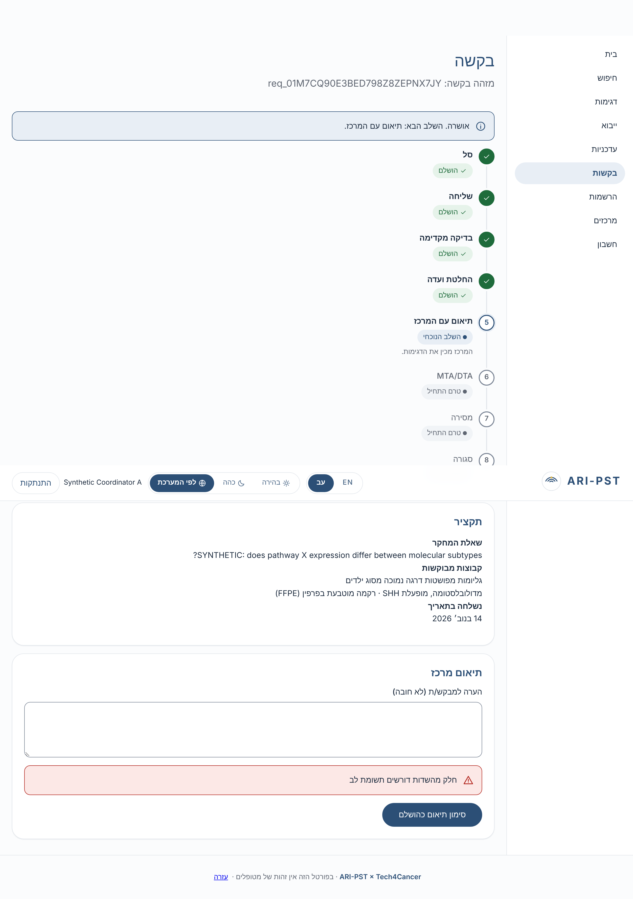
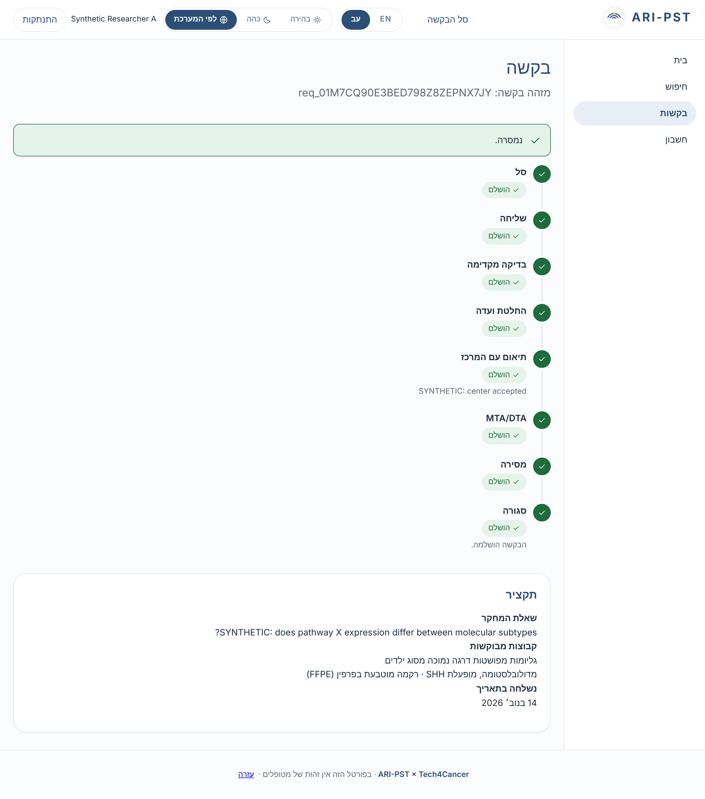
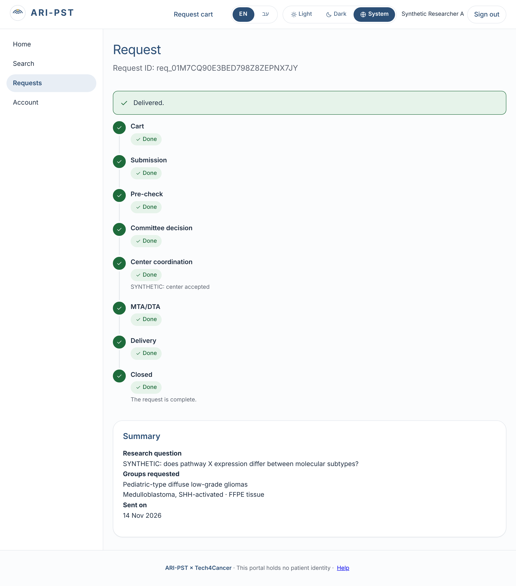
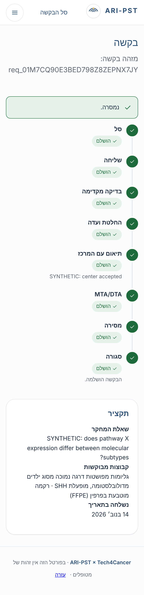

### g. Clinician: own center only
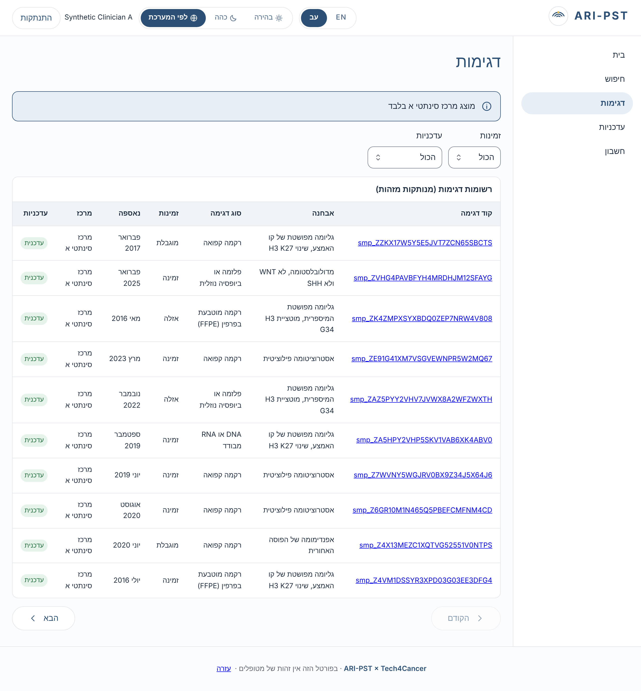
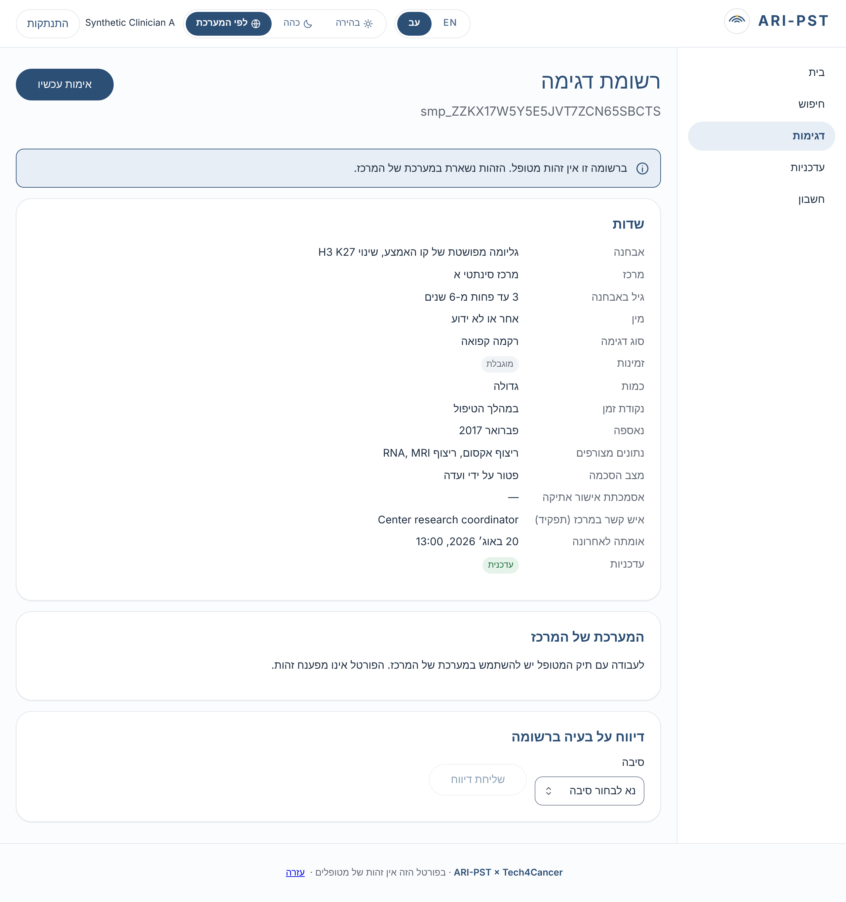
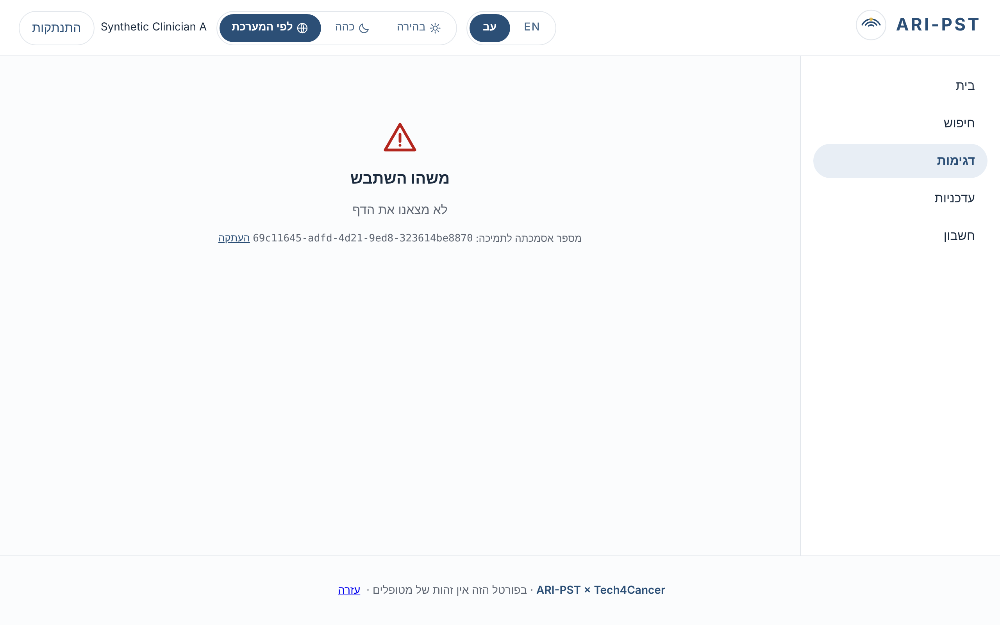

### h. Import dry run with rejection report
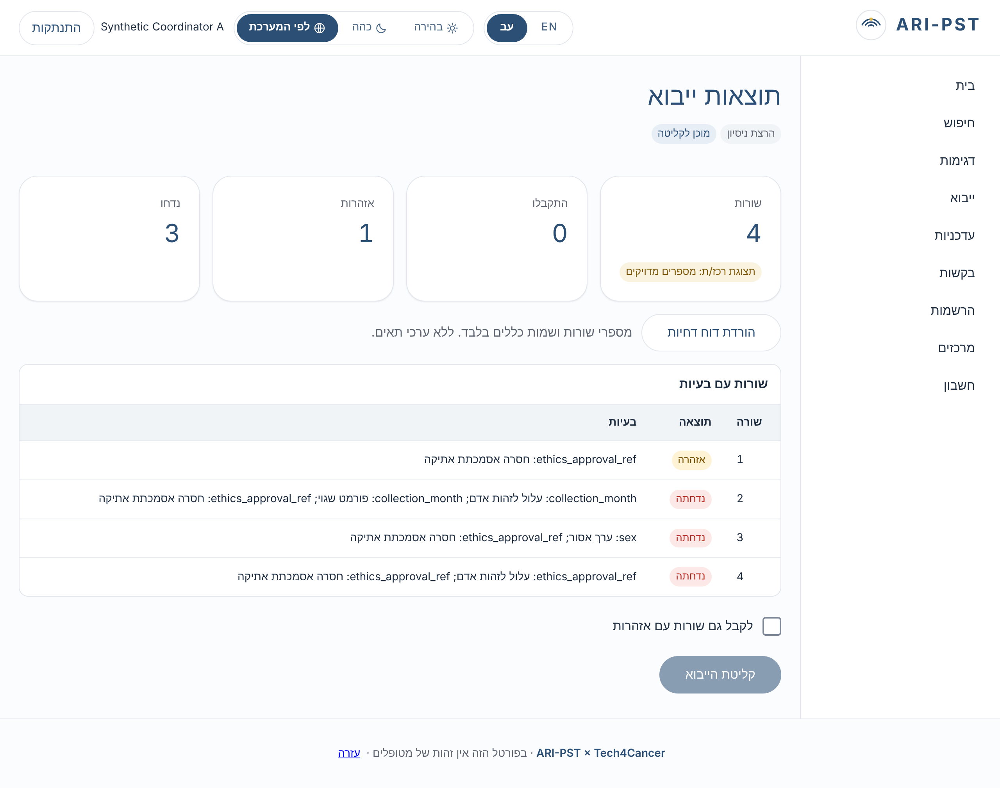

### i. Admin: audit log verified, no sample data
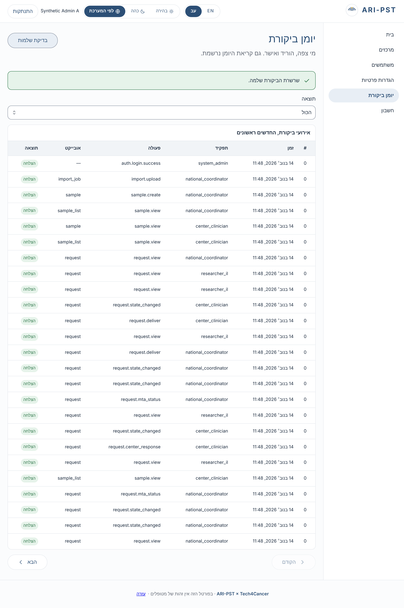


### j. Public site
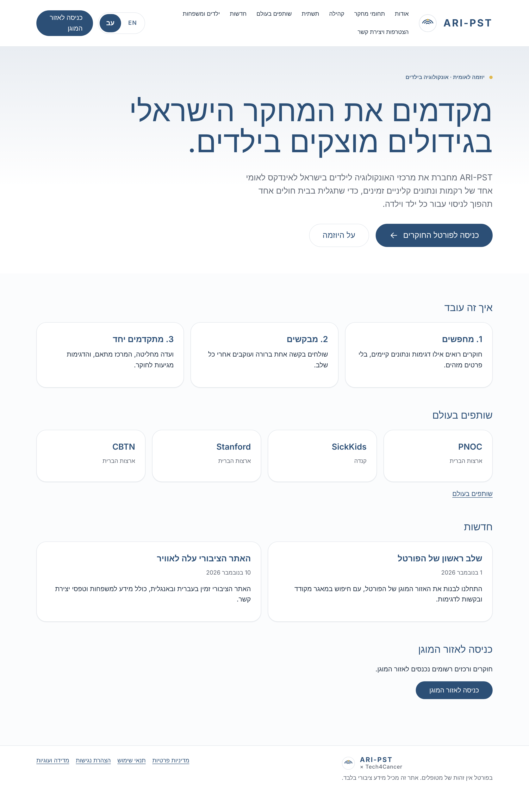
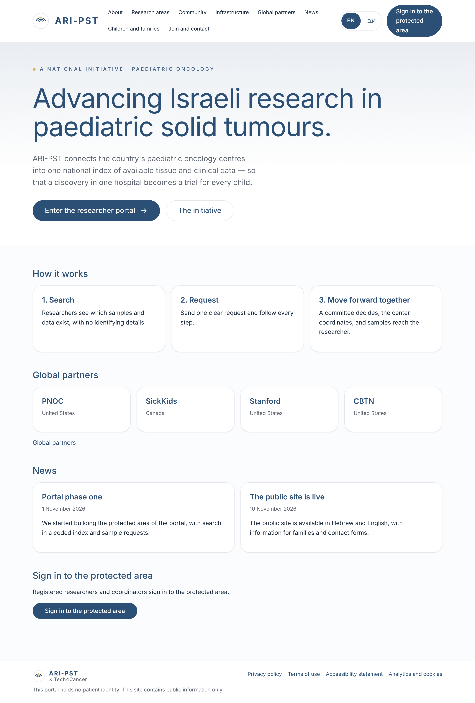
