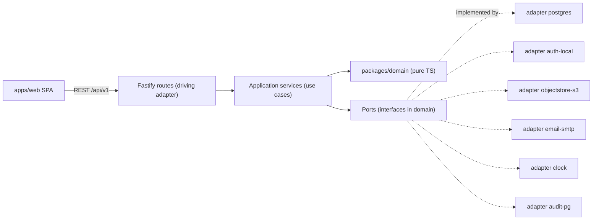
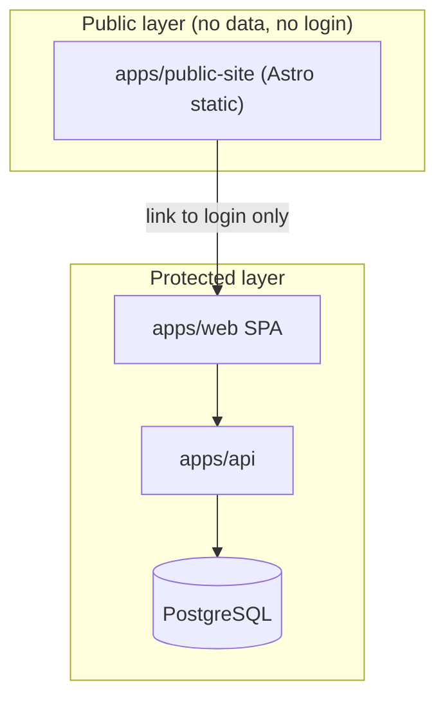
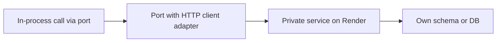

# 01 — Target architecture

Covers: REQ-001, REQ-041, REQ-053, REQ-069, REQ-070, REQ-072.

## 1. Style
- One deployable API (`apps/api`) = modular monolith.
- Ten modules from the contract pack. Each module is a folder with its own domain, ports, and adapters.
- Hexagonal (ports and adapters) for the protected area.
- Public site is separate: static Astro. It has no runtime link to the API or DB.

## 2. Why a modular monolith
| Driver | Effect |
|---|---|
| Team of 3-6 (ASSUMPTION-06) | One deploy, one on-call, low ops load |
| Strong consistency needed (requests + audit in one transaction) | One DB, one transaction |
| Portability to Base44 later | Few moving parts to move |
| Privacy | One place to enforce RLS and audit |

## 3. Layers inside the protected area

Rules:
- Arrows point inward. Domain knows nothing about adapters.
- Fastify is a driving adapter. It maps HTTP to use cases. No business rule lives in a route.
- Ports are interfaces owned by the domain: `AuthPort`, `ObjectStorePort`, `EmailPort`, `ClockPort`, `AuditPort`, `SampleRepository`, `RequestRepository`, `SearchPort`, `IdGeneratorPort`.
- Composition root is `apps/api/src/main.ts`. It is the only place that wires adapters.

## 4. Where code lives
| Concern | Location |
|---|---|
| Entities, value objects, policies (k-anonymity, role rules, request state machine) | `packages/domain` |
| Use cases per module | `apps/api/src/modules/<module>/application` |
| Ports | `packages/domain/src/ports` |
| Adapters | `apps/api/src/adapters/<name>` |
| HTTP routes | `apps/api/src/modules/<module>/http` |
| Contract | `packages/contracts` (OpenAPI 3.1 + JSON Schema) |
| Generated client | `packages/api-client` |

## 5. Public vs protected split (REQ-053)

- Public site never calls the API for data. It links to `/app/login`.
- Different origin per layer (`www.` and `app.`). Different cookies. Different CSP.

## 6. When a module may become a service
A module may split out only if at least two triggers are true and a written ADR exists.

| Trigger | Threshold (starting values) |
|---|---|
| Independent scaling | Module uses >60% of API CPU for 7 days |
| Independent release cadence | Module changes in >70% of releases and blocks others |
| Fault isolation | Module caused 2+ SEV-2 incidents in a quarter |
| Team ownership | A separate team owns the module |
| Compliance | Module needs a different region or key custody |
| Tech fit | Module needs another runtime (e.g. pathology viewer) |

Likely first candidates: `search-discovery` (heavy reads), `center-ingestion` (CSV jobs), `notifications` (async mail).
Never split first: `audit-log`, `identity-access` (security-critical, shared by all).

How to split (steps):
1. Module already has only a public interface (see doc 03). Check with arch test.
2. Replace in-process calls with a client that implements the same port. Keep the contract in `packages/contracts`.
3. Move module tables to its own schema, then its own database. Use expand/contract migrations.
4. Replace cross-module SQL joins with API or event reads.
5. Run both paths behind a flag. Compare results. Cut over. Keep rollback for one release.
6. Add the new service to `infra/render.yaml` as a private service (ADR-001).

## 7. Design hooks for later phases (no build in Phase 1)
| Hook | Phase | Port or flag |
|---|---|---|
| Institutional SSO (REQ-059) | 2 | `AuthPort` OIDC adapter |
| Pathology scans (REQ-057) | 2 | `ObjectStorePort` + separate bucket + `FEATURE_PATHOLOGY` |
| Partner API (REQ-060) | 3 | Versioned `/api/v1` + API-key scope on `identity-access` |
| Analytics/AI (REQ-011, REQ-065) | 3 | Read-only export port, off by default |
