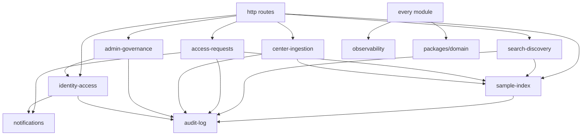

# 03 — Modules, interfaces, dependency rules

Covers: REQ-041, REQ-045, REQ-046, REQ-070, REQ-072.

## 1. Module table
| Module | Purpose | Public interface (TS, in `modules/<m>/index.ts`) | May call |
|---|---|---|---|
| `public-site` | Static pages, he/en (lives in `apps/public-site`) | none (no runtime API) | nothing |
| `identity-access` | Accounts, 2FA, sessions, roles, center scope | `AuthService.authenticate`, `AccessPolicy.can(actor, action, resource)` | `audit-log`, `notifications` |
| `sample-index` | Sample records, schema v1, center scope | `SampleIndexApi.get/list/upsert/markVerified` | `audit-log` |
| `search-discovery` | Text search, filters, aggregate counts, k-anonymity | `DiscoveryApi.search`, `DiscoveryApi.facets` | `sample-index`, `audit-log` |
| `access-requests` | Cart, form, state machine, votes, tracking | `RequestsApi.create/submit/precheck/vote/track` | `sample-index`, `notifications`, `audit-log` |
| `audit-log` | Append-only audit events | `AuditPort.record(event)`, `AuditApi.query` | nothing |
| `center-ingestion` | Entry screen, CSV/XLSX import, staleness | `IngestionApi.importBatch/staleReport` | `sample-index`, `audit-log` |
| `admin-governance` | User admin, config (k, N-of-M), retention | `AdminApi.*` | `identity-access`, `audit-log` |
| `notifications` | Email templates, outbox | `NotifyPort.enqueue` | nothing |
| `observability` | Logging, metrics, traces, health | `Logger`, `Metrics` | nothing |

## 2. Dependency graph (allowed edges only)

No cycles. `audit-log`, `notifications`, `observability` are leaves.

## 3. Dependency rules
| ID | Rule |
|---|---|
| DR-01 | `packages/domain` imports no third-party runtime lib except an allow-list (`ulid`, `zod` if used for pure validation). Never `pg`, `fastify`, `@aws-sdk/*`, `nodemailer`, `argon2`, `@simplewebauthn/*`, `otplib`, `node:fs`, `node:net`, `node:http`. |
| DR-02 | `packages/domain` does not import `apps/*` or `adapters`. |
| DR-03 | A module imports another module only through its `index.ts`. No deep imports. |
| DR-04 | No cycles. |
| DR-05 | Only `apps/api/src/adapters/**` may import `pg`, `@aws-sdk/*`, `nodemailer`, `argon2`. |
| DR-06 | Only `apps/api/src/modules/*/http` and `main.ts` may import `fastify`. |
| DR-07 | `apps/web` imports only `packages/api-client`, `packages/design-system`, `packages/i18n`. Never `packages/domain` internals or `apps/api`. |
| DR-08 | `apps/public-site` imports no `packages/domain`, no `packages/api-client`. |
| DR-09 | `packages/contracts` has no imports from other workspace packages. |
| DR-10 | Only `audit-pg` adapter writes to `audit_*` tables. Module code uses `AuditPort`. |
| DR-11 | SQL for a table lives only in the owner module's repository (see doc 04). |
| DR-12 | `packages/synthetic-data` is a dev/test dependency only. Production build fails if it is imported. |

## 4. dependency-cruiser config (illustrative)
File: `.dependency-cruiser.cjs`.
```js
/** @type {import('dependency-cruiser').IConfiguration} */
const PLATFORM_LIBS =
  '^(pg|pg-.*|fastify|@fastify/.*|@aws-sdk/.*|aws-sdk|nodemailer|argon2|' +
  '@simplewebauthn/.*|otplib|ioredis|redis|pino|node:(fs|net|http|https|child_process))$';

module.exports = {
  forbidden: [
    { name: 'domain-no-platform-libs', severity: 'error',
      comment: 'DR-01: domain must stay pure',
      from: { path: '^packages/domain/' },
      to: { path: PLATFORM_LIBS, dependencyTypes: ['npm', 'npm-dev', 'npm-peer', 'core'] } },
    { name: 'domain-no-app-or-adapter', severity: 'error',
      from: { path: '^packages/domain/' },
      to: { path: '^(apps|adapters)/|/adapters/' } },
    { name: 'platform-libs-only-in-adapters', severity: 'error',
      comment: 'DR-05',
      from: { path: '^apps/api/src/', pathNot: '^apps/api/src/(adapters/|main\\.ts)' },
      to: { path: '^(pg|@aws-sdk/.*|nodemailer|argon2)$', dependencyTypes: ['npm', 'core'] } },
    { name: 'fastify-only-in-http', severity: 'error',
      comment: 'DR-06',
      from: { path: '^apps/api/src/', pathNot: '^apps/api/src/(modules/[^/]+/http/|main\\.ts|http/)' },
      to: { path: '^(fastify|@fastify/.*)$' } },
    { name: 'module-public-interface-only', severity: 'error',
      comment: 'DR-03',
      from: { path: '^apps/api/src/modules/([^/]+)/' },
      to: { path: '^apps/api/src/modules/([^/]+)/(?!index\\.ts$)',
            pathNot: '^apps/api/src/modules/$1/' } },
    { name: 'web-uses-client-only', severity: 'error',
      comment: 'DR-07',
      from: { path: '^apps/web/' },
      to: { path: '^(packages/domain|apps/api|adapters)/' } },
    { name: 'public-site-isolated', severity: 'error',
      comment: 'DR-08',
      from: { path: '^apps/public-site/' },
      to: { path: '^(packages/(domain|api-client)|apps/(api|web))/' } },
    { name: 'no-circular', severity: 'error', from: {}, to: { circular: true } },
    { name: 'no-prod-synthetic', severity: 'error', comment: 'DR-12',
      from: { path: '^apps/[^/]+/src/', pathNot: '\\.(test|spec)\\.ts$|/test/' },
      to: { path: '^packages/synthetic-data/' } },
  ],
  options: {
    tsConfig: { fileName: 'tsconfig.base.json' },
    doNotFollow: { path: 'node_modules' },
    enhancedResolveOptions: { exportsFields: ['exports'], conditionNames: ['import', 'require', 'node', 'default'] },
  },
};
```
CI step: `pnpm depcruise --config .dependency-cruiser.cjs apps packages` must exit 0. A second test, `arch.test.ts` (Vitest), reads `packages/domain/package.json` and fails if `dependencies` holds anything outside the allow-list. Cruiser regex is a starting point. A8 owns the test cases.

## 5. Other automatic checks
| Check | Tool | Fails build when |
|---|---|---|
| OpenAPI lint | Spectral | Missing problem+json, missing idempotency header on create-request |
| Contract drift | generated client diff | `packages/api-client` differs from regenerated output |
| RLS present | SQL test | A table with `center_id` lacks a policy |
| Audit coverage | integration test | A read of sample data writes no audit event |
| Portability | CI job | Test suite fails on plain Postgres container without Render features |
