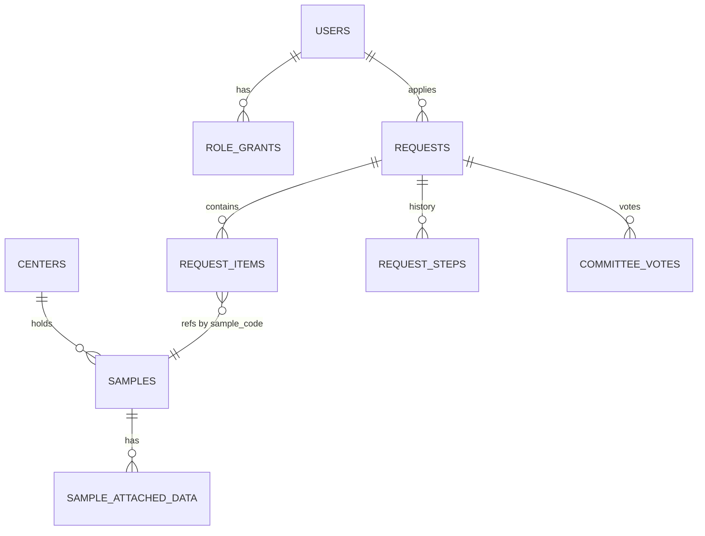

# 04 — Data ownership per module

Rule: one module owns each table. Others read through the public interface only (DR-11). Table names are illustrative. A3 owns the schema detail.
Covers: REQ-028, REQ-038, REQ-041, REQ-042, REQ-046.

| Module | Owns tables | RLS key | Notes |
|---|---|---|---|
| `identity-access` | `users`, `credentials`, `webauthn_keys`, `totp_secrets`, `sessions`, `role_grants`, `invitations` | `user_id` (self) | Secrets encrypted. Argon2id hashes. |
| `sample-index` | `centers`, `samples`, `sample_attached_data`, `ethics_approvals_ref` | `center_id` | Only coded data. No identifiers (REQ-042). |
| `search-discovery` | `sample_search_index` (generated column or materialized view), `k_policy` (read from config) | none (reads via policy) | No own source data. Rebuildable. |
| `access-requests` | `requests`, `request_items`, `request_steps`, `committee_votes`, `request_documents_ref` | `applicant_id`, `center_id` | Step history is append-only. |
| `audit-log` | `audit_events` | none; insert-only role | Hash chain per partition. No UPDATE/DELETE grant. |
| `center-ingestion` | `import_batches`, `import_rows_staging`, `staleness_state` | `center_id` | Staging purged by cron. |
| `admin-governance` | `config_entries` (k, N-of-M, retention), `retention_jobs` | none | Criteria are data (GATE-COMMITTEE). |
| `notifications` | `outbox`, `email_templates` | none | Outbox has no clinical data, only template key + user ref. |
| `observability` | none (external logs/metrics) | n/a | Logs carry no identifiers. |
| `public-site` | none (Git content) | n/a | Content in Git. |

Cross-module references use IDs only (`smp_`, `usr_`, `ctr_`). No cross-owner foreign keys are required, except within one module. If a cross-module FK is kept for integrity, it is declared in the owner of the referencing table and listed in `db/migrations` review.

## Roles in the database
| DB role | Used by | Rights |
|---|---|---|
| `app_migrator` | CI migration job | DDL |
| `app_runtime` | API | DML, subject to RLS; no BYPASSRLS |
| `app_audit_writer` | `audit-pg` adapter | INSERT on `audit_events` only |
| `app_readonly_report` | Cron reports | SELECT on aggregates |
| `app_admin_break_glass` | Human, time-boxed | Approved, logged (A2 defines) |

The API sets `SET LOCAL app.user_id`, `app.role`, `app.center_id` per transaction. RLS policies read these settings (ADR-008).
