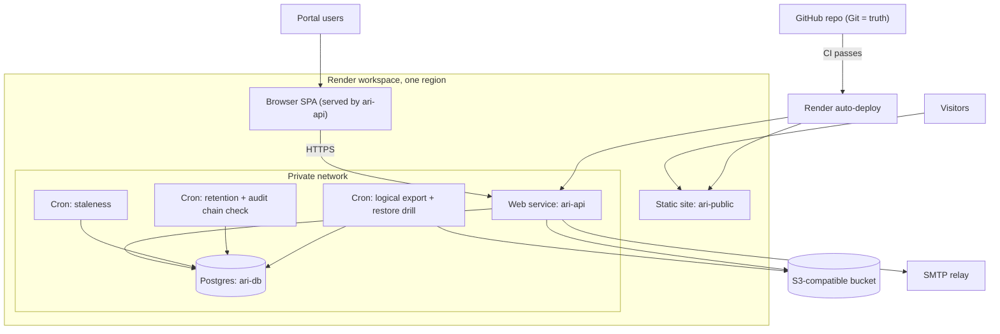
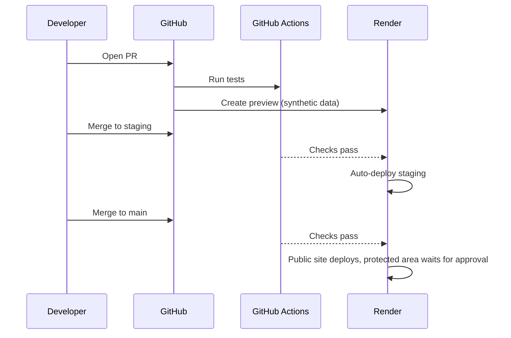

# 05 — Render service topology

> **Superseded in part by canonical-decisions C-03/C-04.** There is no `ari-app` static site: `ari-api` serves the SPA and the API from one host. Read the diagram below with `APP` and `API` merged into one web service `ari-api`. Crons as built: `ari-cron-staleness`, `ari-cron-audit-verify` (hourly), `ari-cron-purge` (nightly), `ari-cron-export`. See `docs/deployment.md` and `render.yaml`.

Covers: REQ-043, REQ-048, REQ-053, REQ-069, REQ-072. See ADR-001, ADR-002.

Notes: Render has no built-in S3 store in our knowledge (UNVERIFIED). Use an external S3-compatible bucket in the same region family. A DPA is needed for it too (needs legal review).

## Components and the problem each solves
| Component | Problem solved | Req |
|---|---|---|
| `ari-public` static | Public site stays fast, cheap, up even if API is down; no data path | REQ-019, REQ-053 |
| ~~`ari-app` static~~ | Not built. SPA is served by `ari-api` (same origin, C-03) | REQ-053 |
| `ari-api` web service | One place for business rules, RLS context, audit | REQ-041, REQ-045, REQ-046 |
| `ari-db` Postgres | Durable store, RLS, FTS, PITR | REQ-043, REQ-048 |
| Private network | DB not exposed to internet; API to DB traffic stays internal | REQ-043 |
| Cron staleness | Finds records not verified in N days; stale-data risk | REQ-067 |
| Cron retention + chain check | Applies retention; detects audit tampering | REQ-047, REQ-046 |
| Cron export + restore drill | Portable dump; proves backups restore | REQ-048, REQ-054, REQ-072 |
| External object bucket | CSV staging and exports behind `ObjectStorePort` | REQ-054 |
| Environments (prod, staging, preview) | Safe releases; synthetic data in non-prod | REQ-069, REQ-072 |

## Optional components (not in Phase 1)
| Component | Add only if | Problem it would solve |
|---|---|---|
| Background worker | CSV imports exceed API request time (> 30 s p95) or email outbox lag > 60 s | Long jobs without blocking API |
| Key Value (Valkey) | Rate limiting or cache needed across 2+ API instances | Shared counters |
| Private service | A module is split (doc 01 s6) | Internal API |
| Read replica | Search load hurts writes | Read scaling |

Rate limits and sessions start in Postgres to avoid Key Value (ADR-004).

## Deploy flow

- Render auto-deploy option "After CI Checks Pass" (Blueprint key `autoDeployTrigger: checksPass`, per search summary 2026-11-13; confirm in Blueprint spec). Render does not deploy if zero checks exist or one fails. Neutral/skipped count as pass.
- Manual approval gate for the protected area: set protected services to `autoDeployTrigger: off` and deploy by Deploy Hook from a GitHub Actions job that uses a GitHub Environment with required reviewers. Needs A7 confirmation.
- Migrations run as a pre-deploy command (Render pre-deploy; UNVERIFIED) or CI job before deploy. A7 decides.
