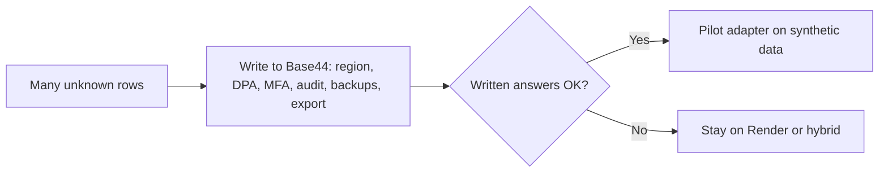

# 06 — Render vs Base44 capability map

Purpose: support a later, undecided choice (GATE-PLATFORM is closed to Git+Render now; Base44 later TBD).
Date of research: 2026-11-13. Method: web search summaries. Official Render pages could not be fetched in this session (host blocked). Base44 official pages were only seen as search snippets.
Legend: equal / gap / unknown. UNVERIFIED = not confirmed on an official page.

| Capability | Render (our target) | Base44 | Rating | Workaround or blocker |
|---|---|---|---|---|
| Hosting model | Static sites, web services, cron, private services; Docker or native runtimes (Render docs) | Managed app platform; frontend plus Deno-based backend functions (docs.base44.com backend features, 2026) | gap | Backend must fit Base44 function model. Fastify monolith does not run as is. Needs adapter rewrite or hybrid (doc 07). |
| Database | Managed PostgreSQL, standard SQL | Built-in entity store (docs describe entities with RLS/FLS). SQL access and Postgres extensions: UNVERIFIED | gap | Schema in plain SQL must be mapped to entities. Search with `pg_trgm` may not exist. |
| Auth + MFA | Own adapter (we build): Argon2id, WebAuthn, TOTP | Built-in auth; SSO listed on higher tiers (sources disagree: Superblocks vs Base44 billing page). MFA enforcement: not found | unknown | Ask Base44 in writing for MFA enforcement. Else keep auth in own service (hybrid). |
| RBAC | Own `AccessPolicy` | Entity-level rules and roles (docs). Depth for 7 roles + center scope: UNVERIFIED | unknown | Prototype all 7 roles on synthetic data. |
| Row-level security | PostgreSQL native RLS | Entity RLS and FLS with conditions per operation (docs.base44.com entities security). Third-party PDF claims `asServiceRole` does not bypass RLS (UNVERIFIED, vendor file) | unknown | Test cross-center denial and aggregate-only views. |
| Audit logs | Own `audit_events` (hash chain) | Audit Logs API at Enterprise plan only (Base44 enterprise page, changelog 2026-03-31) | gap | Need Enterprise plan, or keep own audit store. Per-record view/download logging: UNVERIFIED. |
| File storage | External S3-compatible bucket via port | Built-in file storage: UNVERIFIED region and encryption controls | unknown | Keep `ObjectStorePort`; adapter for Base44 storage if allowed. |
| Region control | Region picked per service; list UNVERIFIED (assumed Oregon, Ohio, Virginia, Frankfurt, Singapore) | No official data on data region found. Business tier "data residency" claimed by a third party (Superblocks), UNVERIFIED | unknown | Blocker for GATE-PROD-DATA until Base44 confirms in writing. |
| DPA | Public DPA at render.com/dpa; GDPR DPA available to all workspaces; SOC 2 Type 2 for Pro+ after NDA (Render certifications docs, via search 2026-11-13). Docs sources disagree on tier. HIPAA workspaces via BAA, plan and surcharge UNVERIFIED | Not found. Enterprise plan likely. | gap | Request DPA and sub-processor list from Base44. Blocker for real data. |
| Backups / PITR / HA | Postgres backups and PITR (3 days Hobby, 7 days Pro+ per Render article); HA on Pro-class and above (Render docs via search). UNVERIFIED on official pages | Not found | gap | Ask for backup frequency, RPO/RTO, restore test. Keep nightly own dump if possible. |
| Export | Standard `pg_dump`; full control | Code ZIP / GitHub sync (Builder plan+, per migration guide). Records export CSV per table; secrets not included (Superblocks guide, UNVERIFIED) | gap | Need full-fidelity export (all entities, files, audit). CSV per table is weak for RLS and relations. |
| Custom-code limits | Any Node.js (Docker allowed) | Backend functions on Deno, serverless. Numeric limits (timeout, memory, quota) not found | unknown | Check limits for CSV import and search. Native Node libs (argon2 native) may not run. |
| CI/CD hooks | GitHub integration, auto-deploy On Commit / After CI Checks Pass / Off, Deploy Hooks, Blueprint, previews (Render deploy docs via search) | GitHub sync of frontend code; backend via CLI: UNVERIFIED. No preview envs known | gap | Deploy from Git to Base44 would need CLI in CI. Confirm. |
| IaC | `render.yaml` Blueprint + Terraform provider | Not found | gap | Manual config. Document as runbook. |
| Private networking | Private network between services in a region (UNVERIFIED details) | Not applicable (managed) | unknown | n/a if all in platform. |

## Reading the map

Blockers for real data on Base44 (until closed in writing): region control, DPA, backups and restore, full export, audit of reads. These match Doc §8 entry conditions.

## Sources (date 2026-11-13)
- Render DPA: https://render.com/dpa
- Render compliance: https://render.com/docs/certifications-compliance
- Render HIPAA: https://render.com/docs/hipaa-compliance
- Render PITR article: https://render.com/articles/postgres-features-that-matter-for-production-pitr-read-replicas-and-native-exten.md
- Render HA: https://render.com/docs/postgresql-high-availability
- Render backups: https://docs.render.com/postgresql-backups
- Render deploys / CI option: https://render.com/docs/deploys and https://render.com/changelog/skip-auto-deploying-if-ci-checks-fail
- Base44 entity security: https://docs.base44.com/developers/backend/resources/entities/security
- Base44 backend features: https://docs.base44.com/developers/backend/overview/features
- Base44 enterprise: https://docs.base44.com/Enterprise/Base44-for-enterprises
- Base44 billing: https://docs.base44.com/Getting-Started/Billing-and-plans
- Third-party (low trust): superblocks.com migrate-from-base44 and base44-enterprise; Base44 platform limitations PDF on media.base44.com.
