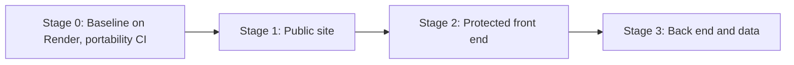
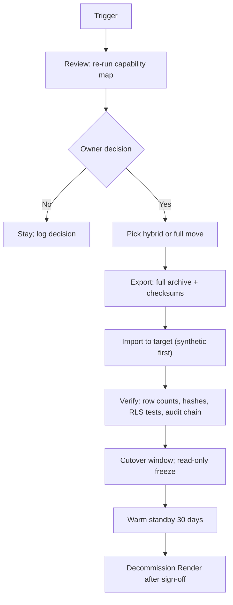

# 07 — Staged migration and exit plan

This plan does NOT decide a move. It prepares one. Covers: REQ-054, REQ-070.

## 1. Stages (layer by layer)

| Stage | Move | Why this order | Entry check | Rollback | Effort (ASSUMPTION, 3-6 engineers) |
|---|---|---|---|---|---|
| 0 | Nothing moves. Keep capability map, export/import round trip, portability CI | Prepares exit | Phase 1 done | n/a | Built in Phase 1 |
| 1 | Public site (Astro static + Git CMS) to target host | No data, low risk, Git-based | Target serves static + he/en + a11y parity | DNS back to Render (TTL 300 s) | 1-2 weeks |
| 2 | Protected SPA (`apps/web`) to target host, still calling Render API | UI only, contract-first client | CORS and cookie domain plan; CSP | DNS back; old build kept | 2-3 weeks |
| 3 | API + DB + files | Highest risk; needs entry conditions | All Doc §8 conditions met on target; written answers on region, DPA, MFA, audit, backup, export; dress rehearsal | Keep Render stack warm (read-only) for 30 days; reverse export/import | 8-14 weeks if API must be rewritten to target functions; 3-5 weeks if target runs Node + Postgres |

## 2. Hybrid options
| Option | Shape | Pro | Con |
|---|---|---|---|
| H1 | Public site on Base44 or other host; protected area stays on Render | Lowest risk; no data moves | Two platforms to run |
| H2 | Protected SPA on target; API+DB on Render | Uses target UI tools | Cross-site cookies, CORS; two vendors |
| H3 | Target hosts UI and workflows; own API+DB stays on Render via contract | Keeps data and RLS under our control | Target may lack custom-API hooks (UNVERIFIED) |
| H4 | Auth stays own service; rest on target | Solves MFA/SSO unknowns | Extra service |
| H5 | Everything stays on Render | Zero migration cost | Forgoes target benefits |

## 3. Adapter inventory (what changes per port)
| Port | Render adapter | Replacement work on target |
|---|---|---|
| Repositories | `postgres` | Entity-store adapter or keep Postgres |
| `AuthPort` | `auth-local` | Target auth adapter; reset credentials |
| `ObjectStorePort` | `objectstore-s3` | Target storage adapter |
| `EmailPort` | `email-smtp` | Target mail or same SMTP |
| `AuditPort` | `audit-pg` | Target audit or keep own store |
| `SearchPort` | `search-pg` | Target query adapter; may lose fuzzy search |

## 4. Exit plan
Triggers (any one starts an exit review, not an automatic move):
| ID | Trigger |
|---|---|
| EX-01 | Render cannot give a DPA or region acceptable to legal |
| EX-02 | Legal requires Israel-resident hosting and Render has none |
| EX-03 | Monthly cost > agreed budget cap (GATE-BUDGET) for 2 months |
| EX-04 | 2+ SEV-1 platform incidents in 6 months |
| EX-05 | Owner decides to adopt Base44 and all rows in doc 06 for stage 3 are "equal" in writing |
| EX-06 | Render ends a feature we rely on |

Exit steps:

Rollback: keep the DB in read-only freeze; if verify fails, unfreeze Render stack and point DNS back. Data written on target during window is exported back (reverse path tested in rehearsal).
Total exit effort (ASSUMPTION, UNVERIFIED): 6-14 weeks for stage 3 plus 2-3 weeks for stages 1-2. Export of the archive itself: under 1 hour for the Phase 1 data size.

Needs legal review for any data transfer between processors.
