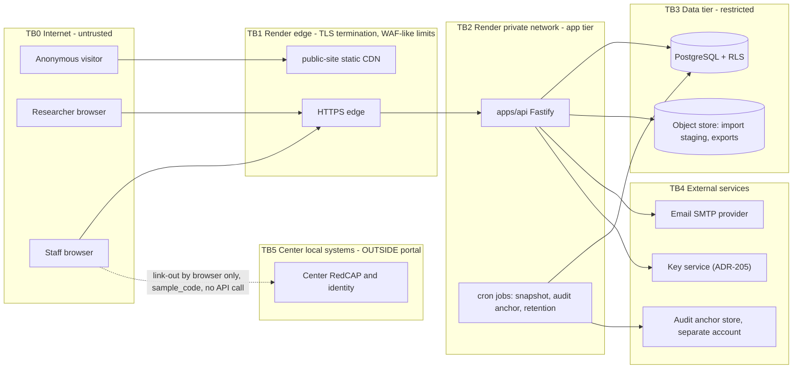
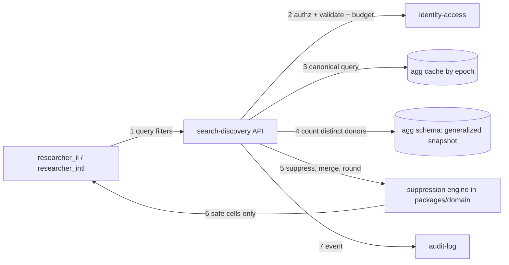
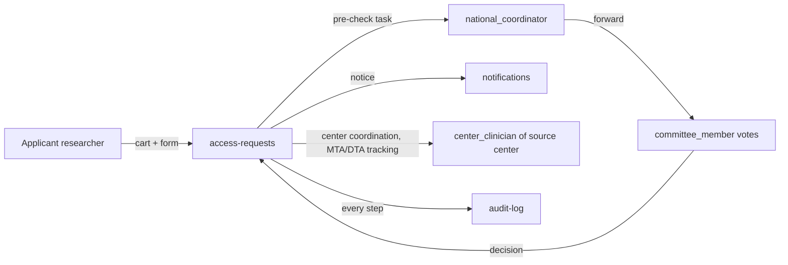

# 01 — Threat model (STRIDE per module)

Method: STRIDE = Spoofing, Tampering, Repudiation, Information disclosure, Denial of service, Elevation of privilege.
Scope: modules from the contract pack. Phase 1. Synthetic data until `GATE-PROD-DATA`.

## 1. Assets
| ID | Asset | Why it matters |
|---|---|---|
| AS-1 | Sample index records (coded) | Rare pediatric cohort. Small cells can single out a child. |
| AS-2 | Aggregate answers | Differencing can rebuild AS-1. |
| AS-3 | User accounts, credentials, MFA secrets | Account takeover opens AS-1. |
| AS-4 | Access requests and decisions | Contain research plans and applicant details. |
| AS-5 | Audit log | Proof of who did what. |
| AS-6 | Keys and secrets | Open everything else. |
| AS-7 | Center local systems (outside portal) | Hold the identities. The portal must never point to them in a harmful way. |

## 2. Actors
Anonymous visitor, researcher (IL, intl), clinician, coordinator, committee member, system admin, platform operator (Render), insider with repo access, external attacker, malicious researcher (inference attacks), compromised dependency.

## 3. System context and trust boundaries

Rules for boundaries:
- TB0→TB1: TLS 1.2+ only. Rate limits. No direct DB access from the internet (IP allow list empty, see file 10).
- TB1→TB2: only HTTPS to `apps/api`. The public site has no path to the API's protected routes (REQ-053).
- TB2→TB3: three DB roles: `app_runtime` (RLS enforced; was `app_api`), `app_audit_writer` (insert only), `app_migrator` (CI only).
- TB5: no network path from the portal to the center system. Only a browser link-out (file 04).

## 4. Data-flow diagram: aggregate search (highest privacy risk)

Trust boundary note: researchers have **no** grant on the `sample` table. They read only `agg.*` functions.

## 5. Data-flow diagram: access request

Request documents (IRB approval PDF) go to `ObjectStorePort` only if Phase 1 enables upload. Default: store the approval **reference number** only, not the file (data minimization).

## 6. STRIDE tables

Format: Threat → Mitigation → Control ID (testable in file 02 / A8).

### 6.1 public-site
| STRIDE | Threat | Mitigation | ID |
|---|---|---|---|
| S | Fake site (phishing clone) | HSTS, CAA records, one canonical domain, passkeys are origin-bound | PS-01 |
| T | Defacement via Git CMS account | Branch protection, PR review for content, CMS accounts need MFA | PS-02 |
| R | Unknown editor of content | Git history is the log | PS-03 |
| I | Analytics leaks visitor data | Consent banner, no analytics before consent, no PII, IP truncation | PS-04 |
| I | Contact form collects patient details | Form text warns. Server rejects ID/phone/email patterns in free text fields. Messages go to staff mailbox, not the portal DB | PS-05 |
| D | Traffic flood | Static CDN | PS-06 |
| E | Public build pulls protected data | Separate Astro build. No API token in the build. Architecture test | PS-07 |

### 6.2 identity-access
| STRIDE | Threat | Mitigation | ID |
|---|---|---|---|
| S | Credential stuffing | Argon2id, throttle, MFA mandatory, passkeys | IA-01 |
| S | Phished TOTP | Passkeys required for admin, coordinator, committee | IA-02 |
| S | Account recovery abuse | Recovery codes only; support cannot disable MFA alone (two-person) | IA-03 |
| T | Session fixation / CSRF | Rotate session id on login; `__Host-` cookie; CSRF token + Origin check | IA-04 |
| R | Role change denied later | Role grants are audit events with actor | IA-05 |
| I | User enumeration | Same response and timing for unknown user | IA-06 |
| D | Lockout of real users | Progressive delay, no permanent lockout | IA-07 |
| E | Self-grant of role | Role changes need `system_admin` + second approver (national_coordinator for researcher roles) | IA-08 |
| E | Admin reads sample data | No RLS policy for role; DB grant absent | IA-09 |

### 6.3 sample-index
| STRIDE | Threat | Mitigation | ID |
|---|---|---|---|
| S | Fake record insert | Writes only by `national_coordinator`; import is signed-off by two steps | SI-01 |
| T | Silent edit of a record | Row version + audit before/after hash (no values of identifiers; there are none) | SI-02 |
| R | Who changed availability | Audit event `sample.update` | SI-03 |
| I | Direct identifier typed into a field | Schema allow-list, enum fields, validators (file 10) | SI-04 |
| I | Rare combination exposes a child | Generalized fields, `collection_month` hidden from external roles | SI-05 |
| D | Huge CSV import | Size and row caps, staging, async | SI-06 |
| E | Clinician reads other center | RLS on `source_center_id` | SI-07 |

### 6.4 search-discovery
| STRIDE | Threat | Mitigation | ID |
|---|---|---|---|
| S | Shared researcher account to multiply budget | Budget per user and per institution domain; unusual-device alert | SD-01 |
| T | Cache poisoning | Cache key includes epoch and role class; server-side only | SD-02 |
| R | Disputed query | Audit event `search.aggregate` with canonical query hash | SD-03 |
| I | Differencing, tracker, homogeneity attacks | Algorithms in file 02 | SD-04 |
| I | Error text reveals counts | Masked answer identical for 0..k-1 | SD-05 |
| I | Free-text search matches rare terms | No free text on records; free-text search only over controlled vocabulary labels; results are aggregated | SD-06 |
| D | Expensive queries | Max 4 predicates, 2 group-by, timeouts, rate limit | SD-07 |
| E | Researcher calls record-level endpoint | Endpoint absent for external roles; RLS denies | SD-08 |

### 6.5 access-requests
| STRIDE | Threat | Mitigation | ID |
|---|---|---|---|
| S | Applicant impersonation | MFA; institution email check | AQ-01 |
| T | Edit after submit | Submitted form is immutable; amendments are new versions | AQ-02 |
| R | Committee member denies vote | Signed vote events | AQ-03 |
| I | Applicant sees others' requests | ABAC: owner only | AQ-04 |
| I | Conflict of interest vote | Recusal check (same institution) | AQ-05 |
| D | Request spam | Daily cap per user | AQ-06 |
| E | Approver approves own request | Rule: approver ≠ applicant; `system_admin` has no approve permission | AQ-07 |

### 6.6 audit-log
| STRIDE | Threat | Mitigation | ID |
|---|---|---|---|
| T | Delete or edit entries | Insert-only role, trigger, hash chain, external anchor | AU-01 |
| R | Missing event | Audit write is in same DB transaction as the action | AU-02 |
| I | Log leaks data | Structured fields only; no identifiers; no free text | AU-03 |
| D | Log flood | Sampling is forbidden for security events. Storage alerts | AU-04 |
| E | Admin rewrites chain | Anchors in separate account; verify job | AU-05 |

### 6.7 center-ingestion
| STRIDE | Threat | Mitigation | ID |
|---|---|---|---|
| S | Fake center file | Upload only by authenticated coordinator; checksum recorded | CI-01 |
| T | Tampered CSV | Staging area, validation report, dry run, two-step commit | CI-02 |
| I | File contains identifiers | Header allow-list; value validators; reject the whole file on any hit; file quarantined and deleted | CI-03 |
| I | Staging file remains | Auto-delete after 24 h | CI-04 |
| D | Zip bomb, formula injection | Size cap, no archives, CSV formula escaping on export | CI-05 |
| E | Import overwrites other center | Import is bound to one `center_id` and checked | CI-06 |

### 6.8 admin-governance
| STRIDE | Threat | Mitigation | ID |
|---|---|---|---|
| S | Stolen admin session | Passkey, 4 h absolute session, step-up for role changes | AG-01 |
| T | Change of k threshold | Lowering k below 5 needs two approvers and is audited; floor in code | AG-02 |
| R | Config change denied | Config is versioned in DB with actor | AG-03 |
| I | Admin reads sample data | Not possible (IA-09) | AG-04 |
| E | Admin grants self committee role | Role incompatibility rule | AG-05 |

### 6.9 notifications
| STRIDE | Threat | Mitigation | ID |
|---|---|---|---|
| S | Spoofed sender | SPF, DKIM, DMARC | NO-01 |
| I | Email contains sensitive content | Templates carry only status and link. No counts, no codes | NO-02 |
| T | Link tampering | Signed, single-use, short TTL tokens | NO-03 |
| D | Mail flood to a victim | Per-user rate limit | NO-04 |

### 6.10 observability
| STRIDE | Threat | Mitigation | ID |
|---|---|---|---|
| I | Logs or traces hold identifiers or query values | Structured logging allow-list of fields; redaction; canary test | OB-01 |
| I | Error tracker receives request bodies | Body capture off | OB-02 |
| T | Metrics tampering | Read-only dashboards | OB-03 |
| D | Alert storm | Rate-limited alerts | OB-04 |
| E | Dashboard shows per-user query data to wide team | Role-limited; only counts of events | OB-05 |

## 7. Residual risks
| ID | Risk | Owner | Note |
|---|---|---|---|
| RISK-S01 | Very small pilot data: most cells are suppressed. Utility is low | A4/A8 | Accept. Report suppression rate. |
| RISK-S02 | Insider at center misuses link-out | Center | Out of portal scope. Needs DTA clause. |
| RISK-S03 | Platform operator access to disk | A7 | DPA, region, encryption layer (file 06). |
| RISK-S04 | Collusion of several researchers (pooled queries) | A2 | Budget per institution; detective review. |
