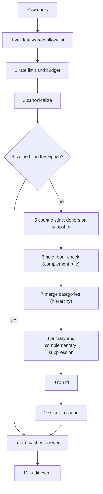

# 02 — Re-identification controls for aggregate counts

Goal (REQ-032, REQ-033): an external researcher sees counts only. No count may single out a child.
All parameters are config. Defaults are in the table. Code lives in `packages/domain` (pure functions, no DB import).

## 1. Parameters
| Name | Default | Floor / rule |
|---|---|---|
| `K` | 5 | Floor 5. Lower needs ADR-201 amendment (file 03). Per field set it can only go up. |
| `MAX_PREDICATES` | 4 | Filters plus group-by dimensions combined |
| `MAX_GROUPBY` | 2 | |
| `MAX_OR_VALUES` | 3 | Values in one OR set |
| `ROUND_STEP` | 5 | Displayed counts ≥ K are rounded to the nearest multiple of 5 |
| `EXACT_ABOVE` | off | Optional: show exact counts above N. Default off (differencing safety) |
| `SHOW_ZERO` | false | A true zero is masked like 1..K-1 |
| `EPOCH` | daily 02:00 UTC | Aggregates come from a frozen snapshot per epoch |
| `Q_RATE` | 20 per minute per user | Token bucket |
| `Q_DAY_COST` | 300 | Cost units per user per rolling 24 h |
| `Q_30D_COST` | 3000 | Cost units per user per rolling 30 days |
| `INST_30D_COST` | 8000 | Per institution (email domain) per 30 days |
| `MASK_LABEL` | `Too few to show` (no number; C-09 supersedes the earlier `<K` label) | Same text for 0..K-1. The API sends only `masked: true`; the UI supplies the words |

Cost of a query = 1 + number of predicates. A repeat of a canonical query in the same epoch costs 0 (cache hit).

## 2. What is counted
- Count unit: **distinct donors** (`donor_ref`), not samples. One child may have several samples. Counting samples would hide a 1-child cell behind "5 samples".
- `donor_ref` is an opaque random ID. It is internal. No API returns it. See file 04. (ASSUMPTION-S1; request A2-to-A3.)
- Also reported: "samples" count, but masking uses the **donor** count of the same cell. A cell is shown only if donors ≥ K.

## 3. Generalization (who sees what)
| Field | researcher_il, researcher_intl, center_clinician (other centers) | national_coordinator, clinician (own center) |
|---|---|---|
| `age_band_at_diagnosis` | fixed bands (ASSUMPTION-01); adjacent merge allowed | same bands |
| `collection_month` | year only (`YYYY`) | `YYYY-MM` |
| `diagnosis_code` | hierarchy level chosen by engine: entity → group → family → all | full code |
| `source_center_id` | allowed as filter. Shown only when cell passes | full |
| `sex` | allowed | allowed |
| `consent_status`, `ethics_approval_ref`, `contact_ref` | never as facet | visible in records |
| exact dates, any free text | do not exist in the portal | do not exist |

Only fixed bands and hierarchy nodes can be filtered. No arbitrary numeric ranges and no custom date ranges. Reason: arbitrary ranges allow differencing at any boundary.

Hierarchies (data owned by A3, used here):
- Diagnosis: `entity → group → family → all`.
- Age: bands merge only with the adjacent band (e.g. `1–<3` + `3–<6` = `1–<6`). Merge order: smallest neighbour first.
- Time: `year → 2-year range → all`.
- Center: `center → all centers`.
- Sample type: `type → solid_tissue_group (ffpe, frozen) / fluid_group (csf, plasma_or_liquid_biopsy) / nucleic_acid`.

## 4. Pipeline


## 5. Algorithms (pseudocode)

### 5.1 Validate and canonicalize
```
function validate(q, role):
  allowed = FACET_ALLOWLIST[role]               // e.g. researcher: diagnosis, age_band, sex, sample_type, center,
                                                //  availability, attached_data, clinical_timepoint, collection_year
  require q.filters.keys ⊆ allowed AND q.groupBy ⊆ allowed
  require |q.filters| + |q.groupBy| ≤ MAX_PREDICATES
  require |q.groupBy| ≤ MAX_GROUPBY
  for each (facet, values) in q.filters:
    require |values| ≤ MAX_OR_VALUES
    require every v ∈ values is a node in HIERARCHY[facet]    // no free ranges
  require q.freeText is empty OR q.freeText maps only to vocabulary labels (resolved to nodes first)
  return OK

function canonicalize(q):
  sort facets alphabetically; sort values within each facet; dedupe
  replace free text by resolved nodes
  return stableJson(q)                           // key = sha256(stableJson || role_class || epoch)
```

### 5.2 Budget and rate
```
function charge(user, q_key, cost):
  if cacheHit(q_key): return OK                  // cost 0
  if not tokenBucket(user).take(1):            return DENY(429, "rate")
  if spent(user, 24h)  + cost > Q_DAY_COST:    return DENY(429, "budget_day")
  if spent(user, 30d)  + cost > Q_30D_COST:    return DENY(429, "budget_30d")
  if spent(inst(user), 30d) + cost > INST_30D_COST: return DENY(429, "budget_inst")
  record(user, q_key, cost); return OK
```
Denials give no count. A denial is audited. Budget exhaustion alerts the `national_coordinator`.

### 5.3 Neighbour (complement) rule — differencing defense
Neighbours of a query `q` are the queries a user could subtract from `q` to isolate a small group.
```
function neighbours(q):
  N = []
  for each filter f in q.filters:      N += q without f                 // drop one predicate
  for each filter f with |values|>1:   for v in values: N += q with f.values − {v}   // remove one OR value
  for each filter f:                   N += q with f replaced by parent(f) in hierarchy  // go up one level
  return N

function complementSafe(cell c, q):
  for each q' in neighbours(q):
    c' = countDonors(q', same cell coordinates)      // from the same snapshot
    rest = c' − c
    if unsafeRest(rest, c'):          // rule below
        return false
  return true
```
Note on `rest = 0`: it means "everyone in the wider group is in this cell". That discloses a trait of everyone in the wider group (homogeneity). Default: treat `rest = 0` as unsafe only when the wider group is itself ≥ 1 but < 2K. For large groups `rest = 0` is a plain fact and stays visible. Parameter `HOMOGENEITY_LIMIT = 2*K`.
```
unsafe if (rest ≥ 1 and rest < K) or (rest == 0 and c' < HOMOGENEITY_LIMIT)
```
If a cell is unsafe by this rule it is **masked** like a small cell.

### 5.4 Category merging
Run before suppression, per group-by dimension.
```
function mergeToSafe(cells, dim):             // cells: map node -> donorCount
  loop:
    small = nodes with count < K   (including 0)
    if small is empty: break
    pick s = smallest node in small
    target = best sibling to merge with:
             for age/time: adjacent neighbour with the smaller count
             for diagnosis/sample type/center: sibling under same parent; if none, parent
    merge s into target (counts add; label becomes the merged label)
    if only one node left: break
  return cells
```
If after merging a node is still < K and no merge is possible, it goes to suppression (5.5). A merged label is built only from hierarchy nodes, e.g. "Age 1–<6". The user sees that a merge happened (`merged: true`) but not which original cells were small.

### 5.5 Primary and complementary suppression
```
function suppress(table):           // table = list of cells with count, plus marginal total if displayed
  for c in cells: c.masked = (c.count < K) OR NOT complementSafe(c)
  // complementary: a single masked cell is recoverable from a shown total
  repeat until stable:
    for each line L of the table (row, column, or whole group-by):
       masked = cells in L with masked
       if |masked| == 1 and (L.total is displayed or derivable):
          mask the smallest unmasked cell in L (by donor count)          // complementary suppression
  // totals
  if any cell in the line is masked: do not show an exact total; show "≥ sum(shown)" band or omit
  return table
```
Default: totals are **not shown** for tables that have any masked cell. For a single-number query (no group-by) the number is simply masked or shown.

### 5.6 Rounding (stable, noise-free)
```
function roundDisplay(n):            // n ≥ K and not masked
  return ROUND_STEP * floor((n + ROUND_STEP/2) / ROUND_STEP)      // half-up, deterministic
```
Rounding is deterministic. No random noise. Repeating a query cannot average the noise away. Rounded counts are never below K (n ≥ 5 → ≥ 5).
Rounding applies to cells and to shown totals. Shown totals equal the sum of rounded cells only if that is consistent; otherwise totals are omitted (consistency rule).

### 5.7 Stable epoch snapshot
```
nightly job:  build agg.snapshot_{epoch} from sample table:
                 only generalized columns (age band, year, diagnosis nodes, sample group, center, sex, ...)
                 plus donor_ref (internal)
              publish by atomic swap; epoch += 1
queries read only the current snapshot. Cache key includes epoch.
```
Effect: inserting or deleting one record cannot be seen by two queries minutes apart. An attacker cannot "add yourself and watch the count change" within an epoch. Records appear next epoch.
Also: if a record is deleted and the cell drops below K, the cell is masked in the next epoch automatically.

### 5.8 Answer shape (API)
```
cell: { coordinates, display: "30" | null, masked: bool   // masked cells carry no number and no threshold (C-09), merged: bool }
No donor lists, no ids, no raw count for masked cells, no "suppressed because" detail beyond `masked`.
```
The same body and same HTTP status are used for 0 and for 1..K-1.

## 6. Other defenses
| Attack | Defense |
|---|---|
| Differencing across queries | Neighbour rule (5.3), fixed hierarchy filters, epoch stability, rounding |
| Tracker (add and subtract predicates) | Predicate limit, neighbour rule, budget |
| Homogeneity (all in cell share a trait) | `rest = 0` guard, diagnosis hierarchy merge |
| Averaging noise | No noise. Deterministic rounding |
| Query reformulation to get same cell with different wording | Canonicalization maps to one key and one answer |
| Pooled queries by several accounts | Institution budget, shared-device alert, detective review of `Q_30D` outliers |
| Boundary probing with free-text | Free text resolves to vocabulary nodes only |
| Timing | No result-dependent branching before response; masked cells take the same path |
| Download of results at scale | No CSV export of aggregate tables for external roles in Phase 1; screen only |
| Repeat refresh to see new records | Epoch |
| Small center identification | Center facet obeys the same K. With only 2 centers, "center" as group-by is always allowed but each cell passes K |

## 7. Testable properties (for A8)
Property tests use fast-check with synthetic data generators. Each ID is a test case family.

| ID | Property |
|---|---|
| P-01 | For every generated dataset and query, every displayed count is ≥ K (after rounding). |
| P-02 | No displayed cell equals a count in [0, K-1]. Masked cells give identical JSON for any true count in [0, K-1]. |
| P-03 | Exact-count leak: for any shown number `s` there exists at least K distinct donors whose change would keep `s` the same (rounding bucket test). |
| P-04 | Complement rule: for any query `q` and any neighbour `q'`, shown(q') − shown(q) is never in [1, K-1] when both are shown, and `true(q') − true(q)` is never in [1, K-1] for shown cells. |
| P-05 | Complementary suppression: in any table with ≥1 masked cell and a shown total, ≥ 2 cells in each affected line are masked, or the total is omitted. |
| P-06 | Idempotence: the same canonical query in the same epoch returns byte-identical output. |
| P-07 | Order independence: permuting filter order or value order gives identical output (canonicalization). |
| P-08 | Epoch stability: inserting or deleting records between epochs does not change answers until epoch swap. |
| P-09 | Monotone safety: raising K never makes a masked cell visible. |
| P-10 | Merging only uses hierarchy nodes. Merged output never reveals which sub-cell was small. |
| P-11 | Budget: with `Q_DAY_COST = c`, the (c+1)th unit of distinct cost is denied; cache hits cost 0; denial is audited. |
| P-12 | Filter limits: queries over `MAX_PREDICATES`, `MAX_OR_VALUES`, unknown facet, or free range are rejected with Problem Details and no count. |
| P-13 | Role gating: external roles can never call a record-level endpoint (OpenAPI contract test plus RLS test: `SELECT` on `sample` as `researcher_il` DB role fails). |
| P-14 | Attack simulation: a scripted attacker with budget `Q_DAY_COST` and known membership of 1 target child cannot determine the target's value of a hidden trait with probability above the baseline + ε on 1,000 random synthetic datasets (ε config, start 0.05). |
| P-15 | Generalization: external responses never contain month-level dates, `donor_ref`, `sample_code`, or `contact_ref` (canary scan). |
| P-16 | Config floor: setting `K < 5` is rejected at config load and at runtime. |
| P-17 | Zero handling: a true-zero cell and a 3-donor cell are indistinguishable in status, body, and (within tolerance) latency. |
| P-18 | Utility report: suppression rate per query class is measured and published to A4 (not pass/fail). |

## 8. Implementation notes for A3 and code
- `agg.snapshot` is a separate schema. DB role `app_api` has `SELECT` on `agg.*`; per-role views add the generalization.
- Count queries run `COUNT(DISTINCT donor_ref)` with `GROUP BY` on generalized columns only.
- The neighbour check needs up to `MAX_PREDICATES + MAX_OR_VALUES*...` extra counts. Bound is ≤ 20 count queries. Use one query with `GROUPING SETS` per request.
- Pure TypeScript functions: `canonicalize`, `neighbours`, `mergeToSafe`, `suppress`, `roundDisplay`. Port-free. They get the counts through a `CountPort`.
