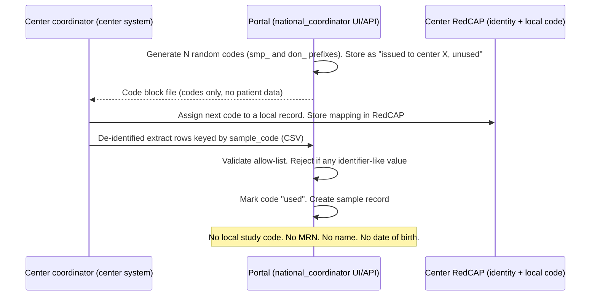
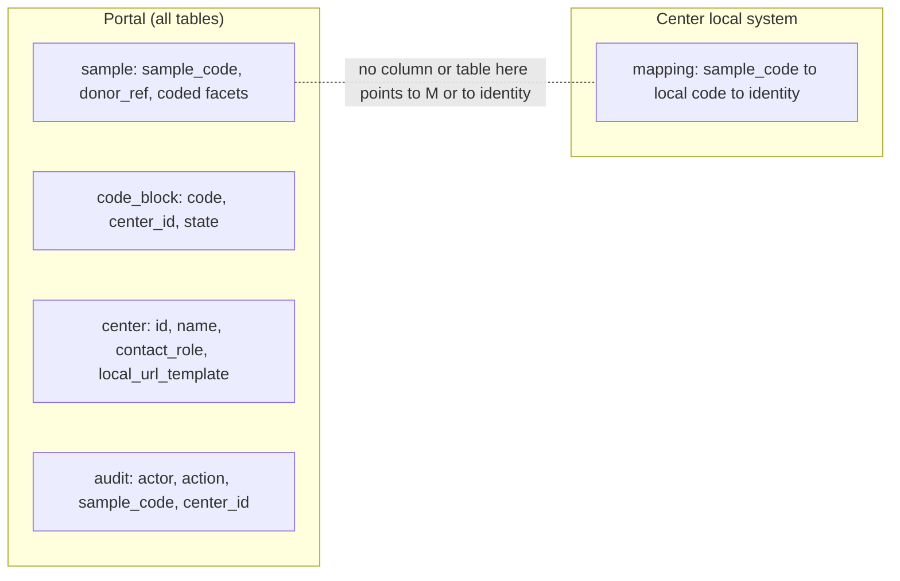
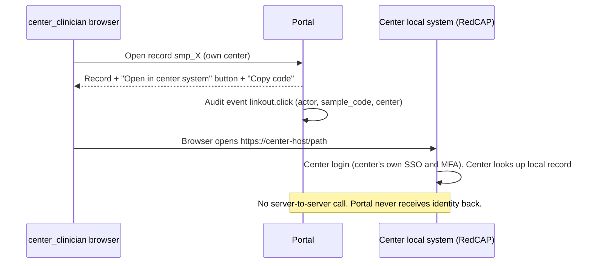

# 04 — Two-step coding, no link keys, clinician access (GATE-CLINICIAN-ID)

REQ-038, REQ-039, REQ-041, REQ-042, REQ-015.

## 1. Definitions
- **Identity data**: names, ID numbers, DOB, contact data, MRN. Lives only in the center.
- **Step 1 code (local)**: the center's own study code in the center's RedCAP. It links identity to the clinical record. It never leaves the center.
- **Step 2 code (global)**: `sample_code` (opaque ULID-style). It is the only key in the portal.
- **Link key**: any value or table that lets someone, using only data held by the portal, map a portal record to an identity or to a record in a center's local system. **The portal stores none.**
- **`donor_ref`**: opaque random ID of one donor, used only to count distinct donors. Internal. Never exposed. (ASSUMPTION-S1.)

## 2. Design: codes are issued by the portal, assigned by the center
The portal issues blocks of random unused codes. The center assigns them locally. The mapping exists only at the center.

Properties:
- Codes come from a CSPRNG (128 bits entropy in the random part). Not derived from any patient data (REQ-028).
- The portal table `code_block` holds: `code`, `center_id`, `block_id`, `state` (`unused`,`used`,`void`). It has **no** field for local record reference.
- The extract has a header allow-list. Any extra column, such as `local_id` or `mrn`, rejects the file (file 10).
- If a center loses its mapping, the sample cannot be traced back. The portal cannot help. This is by design. The center must back up its mapping (DTA clause).
- The coordinator's entry screen (REQ-007) works from center extracts. The coordinator never types identity data.

## 3. Proof sketch that no link key is stored

Argument:
1. Schema allow-list (file 10) lists every column. None holds local code, MRN, name, or date of birth. A CI test diffs the real schema against the allow-list.
2. Import validators reject unknown columns and identifier-shaped values.
3. `local_url_template` is a URL **template**. It has one placeholder `{sample_code}`. It holds no per-record data.
4. Audit rows reference `sample_code` only.
5. Backups, logs, exports use the same schema. Logs are field-allow-listed.
6. Canary tests (file 10) insert fake identifiers and prove rejection at every entry point.
7. A re-link needs the center's mapping. It is outside the portal. A full portal breach alone yields coded records without identity.

Residual: a breach of both portal and center mapping re-identifies. Mitigation: separate keys, separate hosting, DTA obligations. Quasi-identifier risk: coded records with rare diagnosis + age band + center + month can be re-identified by someone with outside knowledge. Mitigated for external roles by file 02. Inside roles (`national_coordinator`, own-center clinician) are covered by RBAC, audit, and agreements.

## 4. GATE-CLINICIAN-ID resolution (default design)
Doc §4 says the clinician sees "full access including identification". Doc §6.5 and §7 say the portal holds no identifiers. The design below satisfies both: the clinician gets full access to the **center's own coded records** and a **one-click path to the center's local system**, where identity is resolved.

### 4.1 What `center_clinician` can see
| Item | Access |
|---|---|
| Records where `source_center_id` = own `center_id` | Full coded record: all fields in contract §4, `YYYY-MM` collection month, `consent_status`, `ethics_approval_ref`, `contact_ref` |
| Records of other centers | Aggregates only, same rules as `researcher_il` (file 02) |
| Own-center staleness and completeness dashboard | Yes (REQ-068 repeat value) |
| Access requests that name own-center samples | Yes: request id, requested sample codes, decision status, MTA/DTA status. Not the applicant's personal details beyond name role and institution (ASSUMPTION-S2) |
| Identity of the patient | **Never in the portal.** Resolved in the center's system |
| Edit records | Read-only by default. May "verify" (sets `last_verified_at`) and "flag for correction" (coded reason from enum). `national_coordinator` edits. (ASSUMPTION-S3; A4 to confirm.) |
| Export | Own-center coded list as CSV (to reconcile with RedCAP). Rate limited, audited. |

### 4.2 Link-out to the center's local system

Rules:
- `center.local_url_template` is set by `system_admin`, approved by the center's `center_clinician` lead (two-person). Must be `https://`, host on a per-center allow-list, exactly one `{sample_code}` placeholder, and the placeholder only in the **fragment** or a path segment configured by the center (default: fragment).
- Link has `rel="noopener noreferrer"` and `Referrer-Policy: no-referrer`.
- Only `sample_code` crosses. It is opaque.
- The portal never embeds the center system in an iframe and never proxies it.
- If the center has no local system URL, the UI shows "Copy code" only.
- Auditing: each click is logged in the portal. The center logs its own lookups. Needs DTA wording (needs legal review).
- Center-side options (A3/centers decide): RedCAP search on a field that stores `sample_code`; a bookmarklet; or a manual copy-paste.

### 4.3 Open decisions (stay open until the owner closes GATE-CLINICIAN-ID)
- If the owner wants identity shown **inside** the portal, that contradicts REQ-002/041/042 and Phase-1 DPA/legal status. Do not build. Raise an ADR and a legal review.
- Whether the clinician needs write access to some fields (ASSUMPTION-S3).

## 5. Test links
- TC family "no-link-key": schema diff test; import rejects extra columns; logs scan; `code_block` has no unexpected column.
- TC family "clinician scope": RLS test `center_clinician` of center A cannot read center B record; link-out URL validator rejects `http://`, other hosts, two placeholders; click is audited.
