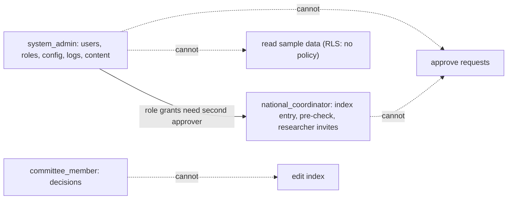
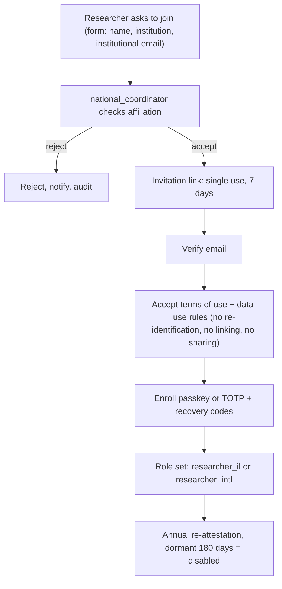

# 05 — Identity and access

REQ-044, REQ-045, REQ-037, REQ-018. Port: `AuthPort`. Adapter: `auth-local` (Phase 1). OIDC adapter Phase 2 (REQ-059).

## 1. Authentication
| Topic | Rule |
|---|---|
| Passwords | Argon2id. Tune to ≥ 250 ms on the prod instance. Floor: m = 19 MiB, t = 2, p = 1 (OWASP cheat-sheet value, UNVERIFIED for 2026; re-check). Unique salt. Optional pepper (HMAC key in secret store). |
| Password policy | Min 12 chars, no composition rules, check against a local breached-password list, no forced rotation (NIST SP 800-63B approach; UNVERIFIED current revision). |
| MFA is mandatory | Every account in the protected area. No MFA, no session. |
| Passkeys (WebAuthn) | Preferred. Required for `system_admin`, `national_coordinator`, `committee_member`. User verification = required. Attestation: none. Register ≥ 2 authenticators or passkey + recovery codes. |
| TOTP fallback | RFC 6238, SHA-1 6 digits 30 s (app compatibility), ±1 step. Secret encrypted at rest (file 06). Allowed for `researcher_il`, `researcher_intl`, `center_clinician` only. Replay of used code blocked. |
| Recovery | 10 single-use recovery codes, shown once, stored hashed. Lost all factors: identity re-proofing by `national_coordinator` (researchers, clinicians) or two admins (staff). Never by one person alone. |
| Throttle | Per account and per IP: exponential delay after 5 failures. No permanent lock. Alert on bursts. |
| Enumeration | Same message and timing for unknown user, wrong password, and unverified email. |
| Step-up | Re-auth with passkey/TOTP (≤ 5 min old) for: role change, k change, committee vote, request approval, key or export operations, link template change. |

## 2. Sessions
Server-side sessions in PostgreSQL (or Render Key Value later). No JWT as session.
| Setting | Value |
|---|---|
| Cookie | `__Host-sid`, `Secure`, `HttpOnly`, `SameSite=Strict` (C-03), `Path=/`, no `Domain`. Plus `__Host-csrf` double-submit cookie |
| ID | 256-bit random, stored as SHA-256 hash |
| Idle timeout | 15 min (`system_admin`, `national_coordinator`, `committee_member`, `center_clinician`); 30 min (researchers) |
| Absolute timeout | 4 h (`system_admin`); 8 h (others) |
| Rotation | New id on login, after step-up, on role change |
| Concurrent | Max 3 per user. Oldest revoked. |
| Revocation | Logout, password or factor change, role change, admin action: all revoke |
| CSRF | Double-submit `__Host-csrf` token (header `X-CSRF-Token`) + `Origin` check on every state-changing request (C-03) |
| Headers | CSP strict (no inline script), `X-Content-Type-Options`, `Referrer-Policy: no-referrer`, `frame-ancestors 'none'`, COOP/CORP |
| Device note | Show "last login" and active sessions to user |

## 3. Roles and RBAC (names from the pack)
Legend: R = read, W = write, A = approve, — = none, "agg" = aggregate view with file-02 rules, "own" = own center only / own records.

| Capability | anonymous | researcher_il | researcher_intl | center_clinician | national_coordinator | committee_member | system_admin |
|---|---|---|---|---|---|---|---|
| Public site | R | R | R | R | R | R | R |
| Aggregate search | — | agg | agg | agg (other centers) | R (record-level, de-identified) | agg | — |
| Sample records (coded) | — | — | — | R own center | R/W all centers | — | **—** |
| Create/edit samples, import | — | — | — | verify/flag own | W | — | — |
| Submit access request | — | W | — (ASSUMPTION-S4) | — | — | — | — |
| Pre-check request | — | — | — | — | A (pre-check) | — | — |
| Decide request | — | — | — | — | — | A (vote) | **—** |
| Center coordination on request | — | — | — | W own center | W | — | — |
| Own requests | — | R own | — | — | — | — | — |
| All requests | — | — | — | own-center samples only | R | R | metadata only, no content (ASSUMPTION-S5) |
| Dashboard | — | — | — | own center | R | R | system health |
| Users and roles | — | — | — | — | invite/approve researchers | — | W (with second approver) |
| Audit log | own actions | own actions | own actions | own actions | R (data events) | R (summary on admin actions) | R (all) |
| Config (k, limits, templates) | — | — | — | — | propose | approve lowering | W (with approvals) |
| Public content / CMS | — | — | — | — | — | — | W (via Git workflow) |

ASSUMPTION-S4: `researcher_intl` has no request right in Phase 1 (REQ-014: aggregate view only). A4 confirms.
ASSUMPTION-S5: admin sees request metadata (status, dates) for support, not research content.

### Incompatible duties (enforced in code and tested)
- One user cannot hold `system_admin` together with `committee_member` or `national_coordinator`.
- `committee_member` has no write on `sample`.
- The approver of a request cannot be its applicant, nor from the applicant's institution (recusal list).
- Role grants need two people: the grantor and a second approver.

## 4. ABAC (center-scoped and context rules)
Attributes: `user.role`, `user.center_id`, `user.institution`, `resource.source_center_id`, `request.state`, `request.applicant_id`, `session.mfa_age`, `session.assurance` (passkey or TOTP).
```
allow read sample(s) if
    role == national_coordinator
 or (role == center_clinician and s.source_center_id == user.center_id)
allow vote on request r if
    role == committee_member and r.state == "in_committee"
    and user.institution != r.applicant_institution and user.id != r.applicant_id
    and not already_voted(user, r)
allow approve/stepup action if session.mfa_age <= 5 min and (role requires passkey -> assurance == passkey)
deny everything else
```
Policy engine: a small pure `authorize(subject, action, resource)` function in `packages/domain`, plus RLS as second line.

## 5. Row-Level Security (RLS) approach
Two layers: application authorizes; the database enforces again. A bug in the app must not leak rows.

- DB roles: `app_migrator` (owns objects, used by migrations only; was `app_owner`), `app_runtime` (was `app_api`; no `BYPASSRLS`, not owner, no superuser), `app_audit_writer` (INSERT only on `audit`), `app_readonly_bg` (break-glass, created on demand, file section 7).
- `ALTER TABLE ... ENABLE ROW LEVEL SECURITY; ALTER TABLE ... FORCE ROW LEVEL SECURITY;` on every table with scoped data.
- Per-request transaction sets context: `SET LOCAL app.user_id = '...'; SET LOCAL app.role = '...'; SET LOCAL app.center_id = '...';` using `set_config(..., true)`. The API opens one transaction per request. Pool connections never keep context (`SET LOCAL` ends at commit).
- Policy sketch (illustrative):
```sql
CREATE POLICY sample_select ON sample FOR SELECT TO app_api USING (
  current_setting('app.role', true) = 'national_coordinator'
  OR (current_setting('app.role', true) = 'center_clinician'
      AND source_center_id = current_setting('app.center_id', true))
);
-- no policy for researcher_*, committee_member, system_admin => zero rows (default deny)
CREATE POLICY sample_write ON sample FOR ALL TO app_api
  USING (current_setting('app.role', true) = 'national_coordinator')
  WITH CHECK (current_setting('app.role', true) = 'national_coordinator');
```
- `agg.*` objects: `GRANT SELECT` to `app_api`, but the functions apply role-based generalization and are `SECURITY DEFINER` only if audited and with fixed `search_path`.
- Missing context = deny: `current_setting('app.role', true)` returns NULL when unset; policies compare false.
- Tests (A8): for each role and each table, a matrix test runs `SELECT/INSERT/UPDATE/DELETE` as `app_api` with that context and asserts the expected allow/deny. A test proves `system_admin` context reads zero rows from `sample`. A test proves that without context all reads return zero rows.

## 6. Admin separation of duties

Extra controls: admin actions are audited and summarized monthly to the committee chair. Admin accounts are named (no shared accounts). Admin passkeys are hardware-bound (recommended).
DB or platform access (Render dashboard, `psql`) is separate from app roles. See break-glass.

## 7. Break-glass
There is **no** app-level break-glass that lets `system_admin` read sample data. That is by design.
Operational break-glass (BG-OPS) for incidents only:
1. Trigger: a Sev-1 incident that needs direct DB inspection. Engineer files a ticket with reason.
2. Approval: a second named person (not the requester) approves. Both are logged.
3. Access: create a time-boxed DB role `app_readonly_bg` (≤ 4 h), with access to the **audit and operational tables only**. Sample table access is excluded unless the owner and DPO co-approve in writing (needs legal review).
4. External DB access: Render Postgres IP allow list is empty by default. Temporarily add one `/32` for the session, then remove (`render pg update --ip-allow-list` replaces the list; source: Render docs, retrieved 2026-11-13).
5. Alert: any BG-OPS use pages the security owner.
6. Review: written review within 24 h. Entry in audit log with event `breakglass.use`.
7. Lockout of all admins: two sealed recovery credentials held by two different custodians. Use is a BG-OPS event.

## 8. Researcher onboarding (ASSUMPTION-03)

Rules:
- Israeli academic institution (`researcher_il`): institution email domain must be on a coordinator-maintained list. Manual check of affiliation.
- `researcher_intl`: coordinator approves each. Aggregate view only.
- Acceptance of the "no re-identification" term is stored with version and time. Breach of terms: account suspended; incident process; report to institution (needs legal review).
- No self-registration into any role above anonymous.
- Staff onboarding (coordinator, committee, clinician): created by `system_admin`, second approval by `national_coordinator`, passkey required, center binding for clinician.
- Offboarding: leavers disabled same day; quarterly access review (admin + coordinator).
