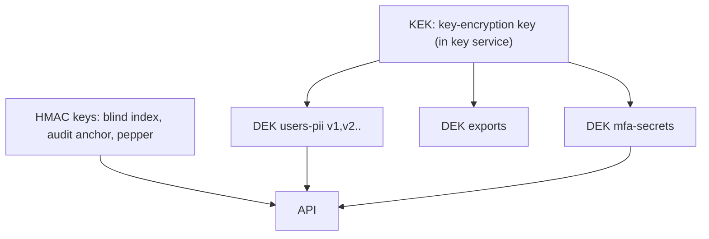

# 06 — Cryptography, keys, secrets

REQ-043. Facts about Render are marked with source and date, or UNVERIFIED. ADR-205 below.

## 1. TLS policy
| Item | Rule |
|---|---|
| Versions | TLS 1.2 minimum. TLS 1.3 preferred. No SSLv3/TLS 1.0/1.1. |
| Ciphers | AEAD only (AES-GCM, ChaCha20-Poly1305). ECDHE key exchange. |
| Certificates | Managed certificates on the custom domain (Render issues and renews; exact issuer UNVERIFIED). CAA DNS records restrict issuers. |
| HSTS | `max-age=63072000; includeSubDomains`. Add `preload` only after all subdomains are HTTPS and the owner approves. |
| HTTP | Redirect to HTTPS. (Render redirects HTTP to HTTPS by default: UNVERIFIED.) |
| Onrender subdomain | Disable the `*.onrender.com` URL for production protected services if Render allows. Verify in docs. |
| DB connection | External: TLS 1.2+ with `sslmode=require` or stricter; `verify-full` where possible (Render docs, retrieved 2026-11-13). Internal URL: Render docs state internal connections do not require TLS. **Decision:** the API connects with TLS on (`sslmode=require`) even on the internal URL if Render supports it; otherwise ADR-205 records the accepted risk (private network only). UNVERIFIED whether internal TLS is available. |
| Email | SMTP with STARTTLS/TLS required. MTA-STS recommended. |
| Object store | HTTPS only. |
| Testing | CI runs a TLS scan (testssl or equivalent) against staging. Fails below grade policy. |

## 2. Encryption at rest
| Layer | Control |
|---|---|
| Platform disk/DB encryption | Render states encryption at rest for databases. Sources disagree on AES-128 vs AES-256 (Render HIPAA docs vs product page, retrieved 2026-11-13). **UNVERIFIED**: confirm with Render in the DPA process. |
| Backups | Platform-managed. Confirm they are encrypted and in the chosen region (GATE-REGION). |
| Application-layer (field) encryption | Required for: TOTP secrets, recovery-code hashes (hash, not encrypt), user email and name fields, access-request free text, export files, staging uploads. Sample coded fields are **not** field-encrypted (needed for queries; they hold no identifiers). |
| Searchable encrypted fields | Email lookups use a blind index: `HMAC-SHA-256(key_idx, lower(email))`. |
| Exports and staging files | Encrypted with a per-file data key. Short-lived download links. Auto-delete. |

Reason for field encryption: the platform operator and a stolen DB snapshot must not read credential seeds or user contact data.

## 3. Algorithms
- Data encryption: AES-256-GCM, 96-bit random nonce, unique per encryption, AAD = `table|column|row_id|key_id`.
- Hash for integrity and audit chain: SHA-256. HMAC-SHA-256 for anchors and blind indexes.
- Passwords: Argon2id (file 05).
- Randomness: Node `crypto.randomBytes` (CSPRNG). No `Math.random` for security. Lint rule.
- Library: Node built-in `crypto` or a vetted library. No custom primitives. Crypto behind `CryptoPort` (portability to Base44).

## 4. Key management (ADR-205, proposed)
Hierarchy:

Options:
| Option | Description | Cost / risk |
|---|---|---|
| **A (recommended when budget allows)** | KEK in an external KMS in an EU region (e.g. a cloud KMS). API calls it to unwrap DEKs at start. | Extra vendor, extra DPA, cost. Best separation. |
| B (lean) | KEK stored as a Render secret (env var or secret file). DEKs are stored wrapped in DB. | Operator with env access can read the KEK. Weaker. Accept only for synthetic-data phase. |
Rule: before `GATE-PROD-DATA`, Option A must be decided (needs owner and DPA).

Rotation:
| Key | Schedule | On compromise |
|---|---|---|
| KEK | 12 months | Immediately. Re-wrap all DEKs. |
| DEKs | 12 months. New writes use new key; old keys stay for decrypt; background re-encrypt job | Immediate re-encrypt |
| HMAC blind-index key | 24 months (re-index job needed) | Immediate |
| Session secrets / CSRF secret | 90 days, with overlap | Immediate |
| Database passwords | 90 days | Immediate |
| API keys of third parties (SMTP, etc.) | 180 days | Immediate |
Ciphertext carries `kid`. Key use is audited (wrap/unwrap events). Rotation is tested yearly in staging as a drill (RB runbook with A9).

## 5. Secrets handling
- No secret in Git. Not in `render.yaml` values (use `sync: false` or secret generators; verify keywords in Render Blueprint docs).
- Separate secrets per environment. Preview environments get **no** production secrets and no real data.
- Secrets reach the app as env vars or Render secret files; read once at start; never logged; never returned in errors.
- Least privilege: each service gets only the secrets it needs.
- Access to the Render dashboard: SSO/MFA required, named users, quarterly review. (Render team MFA enforcement: UNVERIFIED.)
- CI secrets in GitHub Actions secrets or OIDC (no long-lived cloud keys where possible); environment-scoped; required reviewers on `production` environment.

## 6. Secret scanning
| Control | Where |
|---|---|
| GitHub secret scanning and push protection | Repo setting; enabled for all branches |
| `gitleaks` pre-commit hook + CI job | Fails PR on any finding. Custom rules for our token formats |
| Scan of Docker layers/build artifacts | CI step on build output |
| Scan of logs in tests | Canary test: known fake secret must never appear in logs |
| Response | Finding → treat as leaked → rotate within 1 hour (production) or 24 h (non-prod) → record in incident log → purge history only after rotation |
| Allow-list | Only synthetic fixtures with a `FAKE_` marker, reviewed by CODEOWNERS |

## 7. Test links
Crypto round trip; wrong AAD fails; nonce uniqueness property test; key-rotation drill; TLS scan; gitleaks CI gate; canary secret in logs.
