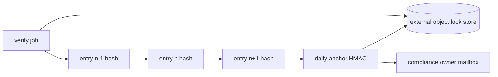

# 07 — Audit log

REQ-046, REQ-047. Module: `audit-log`. Adapter: `audit-pg`. Port: `AuditPort`.

## 1. Events (minimum set)
Every event has: `seq`, `event_id` (ULID), `occurred_at` (UTC ISO 8601), `actor_id` (`usr_...`), `actor_role`, `actor_center_id`, `action`, `resource_type`, `resource_id`, `outcome` (`allow`,`deny`,`error`), `trace_id`, `ip_hash` (salted, rotating salt; not raw IP), `session_id_hash`, `detail` (small allow-listed JSON), `prev_hash`, `entry_hash`.

| Group | Actions |
|---|---|
| Authentication | `auth.login.success`, `auth.login.fail`, `auth.mfa.enroll`, `auth.mfa.fail`, `auth.recovery.use`, `auth.logout`, `auth.session.revoke`, `auth.password.change` |
| Access control | `authz.deny`, `role.grant`, `role.revoke`, `user.invite`, `user.disable`, `user.enable` |
| Views | `sample.view` (record view by coordinator/clinician), `search.aggregate` (canonical query hash, role class, masked-cell count, budget cost), `search.denied_budget` |
| Downloads | `export.create`, `export.download`, `import.upload`, `import.commit`, `import.reject` (reason code only) |
| Data changes | `sample.create`, `sample.update` (field names + before/after hash), `sample.void`, `code_block.issue` |
| Link-out | `linkout.click` (sample_code, center_id) |
| Requests | `request.submit`, `request.precheck`, `request.vote`, `request.decide`, `request.mta_status`, `request.deliver`, `request.view` |
| Admin and config | `config.change` (key, old/new value hash and value if non-sensitive), `k.change`, `template.change`, `key.rotate`, `breakglass.request`, `breakglass.use` |
| Audit itself | `audit.verify.ok`, `audit.verify.fail`, `audit.anchor.publish`, `audit.read` (who read the log) |
| Retention | `retention.purge` |

Never in an event: identifiers (none exist), passwords, TOTP codes, session tokens, free text from users, raw IP, request bodies.
"Who viewed, who downloaded, who approved" (REQ-046) = `*.view`, `export.download`, `request.decide`.

## 2. Tamper evidence: hash chain
```
entry_hash_n = SHA-256( prev_hash_{n-1} || canonical_json(entry_n without hash fields) )
genesis prev_hash = SHA-256("ARI-PST-audit-genesis-v1")
```
- One global chain, ordered by `seq` (gapless; assigned in the insert transaction using a lock or a single writer function). Gap = alarm.
- DB: table `audit.entry`; role `app_audit_writer` has INSERT only; `UPDATE`, `DELETE`, `TRUNCATE` revoked and blocked by trigger. Owner role is not used by the app.
- Write path: audit insert is in the **same transaction** as the business change. If the audit insert fails, the action fails (fail-closed for data changes, downloads, approvals). Read-only events may use a short retry queue; loss is itself an alarm.
- Daily anchor: a cron job computes `anchor = HMAC(key_anchor, last_entry_hash || seq || date)` and writes it to a **separate** append-only location: an object store bucket in a separate account with object lock (retention mode), and an email to the compliance owner. (Alternative for lean option: a signed Git tag in a private repo with restricted write.)
- Verify job: hourly verify of new entries; weekly full verify; on-demand verify from the admin UI (read-only). Mismatch → Sev-1 alert + `audit.verify.fail`.



## 3. Retention
| Data | Retention | Basis |
|---|---|---|
| Security and access audit events | 7 years (proposal) | Research record norms; **needs legal review**. Israeli Data Security Regulations require keeping access logs for a minimum period; reported as 24 months in secondary summaries (UNVERIFIED; check Regulation text). We keep ≥ the longer. |
| Request-process events | Life of request + 7 years | Proof of governance |
| `auth.login.fail` bulk | 13 months | Noise reduction (proposal) |
| Anchors | Same as chain | |
| Purge | Only by the retention job, in whole segments from the start of the chain, with a signed "chain truncation record" holding the last purged hash so verification continues | |
Deletion of a user: `actor_id` stays (pseudonymous `usr_` ID). User PII (email, name) is erased from `user` table; audit keeps no PII.

## 4. Who reads the log
| Reader | Scope |
|---|---|
| Any user | Own security events (logins, sessions) and own request history |
| `national_coordinator` | Data events for samples and requests (view, export, import, change) |
| `committee_member` | Request-process events and monthly summary of admin actions |
| `system_admin` | All events (REQ-018). Cannot write. Cannot alter. Own actions are included. |
| Independent reviewer (external auditor, DPO) | Read-only signed export, quarterly |
| App/DB | No other reader. Developers have no prod read access. |
Every read of the audit log creates `audit.read`. Compensating control for admin self-review: automated alerts + monthly summary to the committee chair + anchor verification by someone other than admin.

## 5. Alerts (detective controls)
Examples: login from new country; >N failed MFA; role grant outside business rules; export volume spike; `search.denied_budget` repeated; any `breakglass.*`; chain verify failure; audit write errors; bulk `sample.view` by one coordinator or clinician.

## 6. Test links
Chain verification property (flip any byte → verify fails); `UPDATE/DELETE` as `app_audit_writer` fails; fail-closed test (force audit insert error → business action rolled back); seq gap detection; anchor verification; canary: no identifier-shaped value in any audit row.
