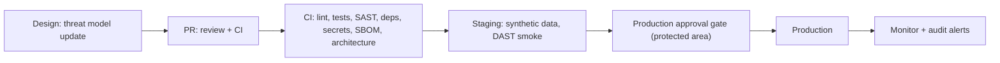

# 09 — Secure SDLC

Team: 3–6 engineers (ASSUMPTION-06). Keep it light and enforceable by CI. A7 implements pipelines; A8 writes tests; A2 sets the rules.

## 1. Gates

| Gate | Rule |
|---|---|
| G1 Threat-model gate | Any PR that adds an endpoint, a role, a data field, an integration, or a storage path must update `01-threat-model.md` (or link a "no change" note). Label `security-impact`. CODEOWNERS for `plan/02-security-privacy/**`, `db/migrations/**`, `packages/domain/privacy/**` require security reviewer. |
| G2 Schema gate | New or changed column must be in the allow-list (file 10) with a data-class tag. Otherwise CI fails. |
| G3 Authz gate | Every route has an authz declaration in OpenAPI (`x-roles`, `x-scope`). Spectral rule fails if missing. A contract test hits each route with each role. |
| G4 Privacy gate | Property tests P-01..P-17 pass. Canary tests pass. |
| G5 Merge | 1 reviewer minimum; 2 for `security-impact`. No self-merge. Signed commits recommended. Branch protection on `main`, `staging`. |
| G6 Release | Production (protected area) has a manual approval by someone other than the author. |
| G7 Go-live with real data | `GATE-PROD-DATA`: DPA, region, export/import round trip, migration path, legal review, pen-test all done. |

## 2. CI security jobs
SAST (CodeQL or Semgrep), dependency audit, secret scan (gitleaks), license check, SBOM generation, IaC scan of `render.yaml` and Terraform, container/Dockerfile lint (if used), OpenAPI Spectral, dependency-cruiser architecture rule, ZAP baseline against staging (DAST), TLS scan of staging. Fail on high or critical findings.

## 3. Dependency policy
- Lockfile (`pnpm-lock.yaml`) committed. Installs use `--frozen-lockfile`.
- Prefer few, mature, maintained packages. New dependency needs a PR note: purpose, maintainers, license, size, alternatives.
- Pin exact versions for production dependencies. Renovate/Dependabot grouped weekly PRs; security PRs immediate.
- Disallow install scripts by default (pnpm `ignore-scripts`; allow-list exceptions).
- Block copyleft licenses that conflict with distribution (A7 sets list; needs legal review).
- Check package age/provenance (npm provenance, minimum release age of a few days) to reduce supply-chain attacks. Control details: UNVERIFIED tool support; A7 verifies.
- Lockfile changes are reviewed. Registry: official npm only.
- Remove unused dependencies each quarter.

## 4. SBOM
- Generate CycloneDX SBOM per build (`@cyclonedx/cyclonedx-npm` or equivalent; verify tool). Store as build artifact with the release. Sign the artifact (Sigstore/cosign, optional).
- Re-scan stored SBOMs daily against vulnerability feeds (OSV, GitHub advisories).

## 5. Vulnerability SLAs
Severity by CVSS plus context (exposed? data touched?).
| Severity | Fix or mitigate | Notes |
|---|---|---|
| Critical (actively exploited or CVSS ≥ 9, reachable) | 48 h | Hotfix path; owner notified |
| High (CVSS 7–8.9) | 7 days | |
| Medium | 30 days | |
| Low | 90 days or accept with note | |
| Secret leak | 1 h rotate (prod) | file 06 |
Exceptions: written risk acceptance with expiry, approved by the security owner. Tracked as `RISK-` IDs. Metric: median time to fix per severity.

## 6. Pen-test plan
| When | What | Who |
|---|---|---|
| Before `GATE-PROD-DATA` | Full web/API pen-test, authz matrix tests (horizontal/vertical), RLS bypass attempts, session/MFA tests, **inference/differencing attack on the aggregate engine**, import-file attacks, link-out validation | Independent external firm (budget: GATE-BUDGET; lean option: a smaller scoped test plus internal red-team week) |
| Yearly | Repeat, scoped to changes | External |
| After a major change (new role, new center type, SSO) | Targeted test | External or internal |
| Continuous | ZAP baseline in CI, dependency scans | CI |
Rules of engagement: staging with synthetic data only. Findings go to the private tracker. Re-test of fixes is included. Report summary goes to the owner and committee chair.
Pen-test is a gate item, not the only control.

## 7. Incident response (security)
- Roles: incident lead, comms lead, scribe. On-call list kept by A9.
- Steps: detect → contain (revoke sessions, rotate keys, disable accounts) → assess (what data, which users) → notify → recover → post-mortem (blameless, 5 days).
- Internal notification target: owner and operator within 24 h of confirmation; regulator and centers' notice timeline set by counsel (UNVERIFIED; the Data Security Regulations include breach notice to the PPA for severe incidents, per secondary summaries).
- Runbook IDs: RB-SEC-01 (suspected account takeover), RB-SEC-02 (secret leak), RB-SEC-03 (suspected re-identification or inference attack), RB-SEC-04 (audit chain failure), RB-SEC-05 (identifier found in the portal: quarantine, purge incl. backups, notify center). A9 owns the runbook format.

## 8. Bug-report (vulnerability disclosure) policy
- Public page `/.well-known/security.txt` (RFC 9116) with a contact mailbox and policy link. Contact: a role mailbox, not a person.
- Scope: protected app, API, public site. Out of scope: social engineering, DoS, third-party services.
- Safe harbor statement for good-faith research (needs legal review).
- Rules for reporters: do not access real patient data; stop and report if you see data; no data download beyond proof.
- Our promise: acknowledge in 3 business days; triage in 7; status updates every 14 days; fix per SLA; credit on request. No bounty in Phase 1 (budget).
- Internal handling: private issue, CVE request if needed, advisory after fix.

## 9. Other practices
- Training: yearly security and privacy training for all staff (the Regulations expect periodic training for medium/high databases; file 08).
- Yearly security meeting; external audit every 2 years (file 08, L6; UNVERIFIED details).
- Privacy by design: DPIA-style review at Phase 0 and before each phase gate (needs legal review whether formally required).
- Environments: preview and staging use synthetic data only (`packages/synthetic-data`). A CI check blocks any prod DB URL in preview configuration.
- Developer access: no standing production DB access (BG-OPS only).
