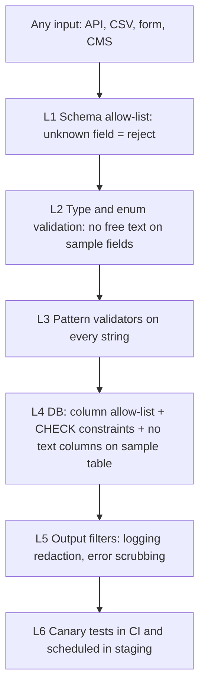

# 10 — "Never in the portal" and Render hardening

REQ-041, REQ-042, REQ-053, REQ-054.

## 1. Never in the portal (binding list)
Contract pack §4 plus extensions. Not in any table, log, file, error, cache, search index, email, backup, analytics event, or test fixture (except obvious fakes in `packages/synthetic-data`).

| # | Forbidden data | Why |
|---|---|---|
| N1 | Names (patient, parent, family) | Direct identifier |
| N2 | National ID number, passport number, any government ID | Direct identifier |
| N3 | Date of birth, any exact date tied to a patient (diagnosis date, collection day, surgery date) | Quasi-identifier. Only `collection_month` (`YYYY-MM`) and age bands are allowed. |
| N4 | Address, city of residence, postal code | Identifier |
| N5 | Phone numbers, emails of patients or families | Identifier |
| N6 | Medical record number (MRN), hospital patient number, RedCAP record ID | Link key |
| N7 | Link keys of any kind: local study code, mapping tables, hashes of identifiers | REQ-038 |
| N8 | Free-text clinical notes or descriptions | Can hold anything |
| N9 | Photos, scans with burned-in text, pathology slide labels (Phase 2 storage is separate) | Identifier risk |
| N10 | Genetic sequences (Phase 1: availability flag only) | GATE-GENOMICS |
| N11 | Names of treating doctors tied to a patient | Indirect identifier |
| N12 | Raw IP addresses in audit or app logs (use salted hash) | Personal data |
| N13 | Secrets, keys, tokens in any data field | Security |
| N14 | Researcher free text containing patient details (request form, contact form) | Must be blocked by validators |

## 2. Technical controls that enforce it

### L1 Schema allow-list
- File `packages/contracts/schema-allowlist.json` lists every table and column with: type, `data_class` (`coded`, `account`, `operational`, `audit`), and `free_text: false`.
- CI test `TC-SEC-SCHEMA`: introspect the migrated DB; every column must be in the list; any extra column or any `text` column on `sample`, `code_block`, `audit.entry` that is not allow-listed fails the build.
- OpenAPI: `additionalProperties: false` on every request schema (Spectral rule). Unknown JSON fields → 400 `unknown_field`.
- CSV import: header must exactly equal the allow-listed header set. Unknown column = reject whole file.

### L2 Types
- `sample` fields are enums, codes, or bounded numbers. The only strings are `sample_code`, `source_center_id`, `ethics_approval_ref`, `contact_ref` (role code), each with a strict format regex.
- `ethics_approval_ref`: `^[A-Z0-9][A-Z0-9\-\/]{2,39}$` (opaque). Contract with centers: it carries no patient data.
- `contact_ref`: a role slug from a table, not a free string.

### L3 Pattern validators (reject, never "clean")
Applied to every string value in any request, import row, form, CMS content build, and log message in tests. A hit rejects the whole input with Problem Details `code: identifier_pattern_detected` and **no echo of the value**. The event is audited with a pattern ID only.

| ID | Pattern idea (regex sketches; tune with A3/A8) | Notes |
|---|---|---|
| V-ID9 | 9-digit run, with or without separators, also 7–9 digits with the Israeli ID check-digit algorithm (Luhn-like, weights 1,2) → stronger signal | Israeli ID number format. Also reject any 9-digit run if check passes. |
| V-DIGITS | Any digit run of ≥ 6 consecutive digits (after removing space, dash, dot) in a free-text field | MRN-like, phone-like |
| V-PHONE | `(\+?972|0)[\s\-]?(5\d|[2-4]|[7-9])[\s\-]?\d{3}[\s\-]?\d{4}` and general international `\+\d{8,15}` | Israeli and international |
| V-EMAIL | `[^\s@]+@[^\s@]+\.[^\s@]+` | Also reject obfuscated "at"/"[at]" forms |
| V-DATE-ISO | `\b\d{4}-\d{2}-\d{2}\b` | Exact date. `YYYY-MM` alone is allowed only in `collection_month`. |
| V-DATE-LOCAL | `\b\d{1,2}[./\-]\d{1,2}[./\-]\d{2,4}\b` | |
| V-DATE-TEXT | day + month name (he/en) + year; Hebrew calendar month names with day number | |
| V-URL | `https?://`, `www.` in sample or import fields | Not allowed in sample data |
| V-NAMELIST | In free-text fields of **forms only** (request, contact): detect personal-name-like tokens via a local list of common first names (he/en); warn and require edit | Weak control, best effort. Free text is minimized anyway. |
| V-SECRET | high-entropy tokens, `-----BEGIN`, `AKIA`-like prefixes | Avoid secrets in text |
Validators live in `packages/domain/privacy/validators` (pure). They are used by API, import, logger, and CMS build check. Also Unicode normalization (NFKC), strip zero-width characters, convert Hebrew/Arabic-Indic digits to ASCII before matching.

Free text policy:
- Sample records: **no free text at all**.
- Access request form: free text only in `research_question`, `planned_use`, `funding_sources`. Max lengths. Validators on. Warning banner "Do not enter patient details".
- Public contact form: not stored in the portal DB. Sent to a staff mailbox; validators warn visitors.

### L4 Database
- `sample` table: no `text`/`jsonb` free columns. `CHECK` constraints for enums and `collection_month ~ '^\d{4}-(0[1-9]|1[0-2])$'`.
- No column named like `name`, `dob`, `birth`, `id_number`, `phone`, `email`, `mrn`, `address` on `sample`-related tables: CI name-deny check (belt and braces).
- `created_at/updated_at` are stored; exposed to external roles never; shown to clinician/coordinator at date granularity.
- Extensions: none that exfiltrate (no `dblink`, `postgres_fdw`, `file_fdw`).

### L5 Output side
- Logging: Pino with a field allow-list serializer. Request and response bodies are never logged. Errors scrubbed (RFC 9457 with no values).
- Error tracker: body and query capture off. Query strings stripped in URLs (no filter values in URLs for POST search; prefer POST body).
- Analytics: only after consent; URL path only, no query; no user ID.
- Emails: templates have no data fields besides names of roles, status, and signed link.

### L6 Canary tests (A8 implements; A2 specifies)
| ID | Test |
|---|---|
| CAN-01 | Synthetic fake identifiers (fake ID with valid check digit, fake phone, fake email, fake date strings in he/en) are sent to **every** write endpoint, import path, form, and CMS build. Expect 4xx with `identifier_pattern_detected` and zero rows written. |
| CAN-02 | Same values placed in a CSV extra column and in a valid column. Expect whole-file rejection and staging file deletion. |
| CAN-03 | Canary token string `CANARY_FAKE_ID_0000` is put in every accepted free-text field; after the test run, grep DB dump, logs, audit, error tracker mock, emails, caches, and exports. It must appear only where intended (request form text) and nowhere else. |
| CAN-04 | A planted fake identifier in a staging table (simulating a bug) is found by the nightly **scanner job**, which scans all text columns with validators and raises a Sev-1 alert + RB-SEC-05. |
| CAN-05 | Schema drift: add an unlisted column in a test migration. CI fails. |
| CAN-06 | Public site build scans all content (Markdown/JSON) with validators. A planted email or phone pattern fails the build (except allow-listed organization contacts in a reviewed file). |
| CAN-07 | Log scan: run the full e2e suite; grep logs for any validator hit. Zero tolerance. |
| CAN-08 | Backup/export scan: scan an export file and a DB dump from staging with validators. |
Scheduled: CAN-04 runs nightly in staging and (after go-live) in production in read-only mode with alerts.

### L7 Process controls
- DTA obliges centers to export only coded data (file 08).
- Coordinator training: "what never goes in".
- Incident RB-SEC-05 for any identifier found.

## 3. Render-specific hardening list
Facts come from the web check of 2026-11-13 (WebSearch; Render docs pages as indexed). Items without a source are **UNVERIFIED** and need a check against the current Render docs before use. A7 owns the Blueprint; A2 sets the requirements.

| # | Hardening item | Status / source |
|---|---|---|
| R1 | Postgres: set the **IP allow list to empty** (no external access) by default. The default is `0.0.0.0/0` with valid credentials, so this must be changed. Use `render pg update --ip-allow-list` (replaces whole list) or `--clear-ip-allow-list`. | VERIFIED: Render docs "Create and connect to Render Postgres", "Inbound IP rules"; retrieved 2026-11-13 |
| R2 | API connects to DB over the **internal URL** (same region and workspace). Allow list does not apply to internal connections. | VERIFIED (Render connection-strings tutorial) |
| R3 | Internal connections do not require TLS per Render. Enable TLS to the DB if supported; else document accepted risk. | VERIFIED statement; TLS-on-internal support UNVERIFIED |
| R4 | External connections (migrations from CI, BG-OPS): TLS 1.2+, `sslmode=verify-full` where possible. | VERIFIED (Render tutorial) |
| R5 | Make the API a web service and the DB, cron, workers **private** (not publicly reachable). Cron jobs reach DB via internal network. | Private services/private network exist: VERIFIED-SECONDARY; exact settings UNVERIFIED |
| R6 | Same region for all services of an environment (private network requires same region and workspace). Region choice: Frankfurt assumed (GATE-REGION). Check region list and that data-residency commitments exist. Israel region UNVERIFIED. | Private network rule VERIFIED-SECONDARY; region list UNVERIFIED |
| R7 | Separate Render **workspaces/projects and environments** for production vs staging/preview, so preview services cannot reach the production private network. | UNVERIFIED (check project/environment isolation docs) |
| R8 | Preview environments: synthetic data only; separate DB instance per preview or shared synthetic staging DB; no production secrets; auto-expire previews. | Design; Render preview features UNVERIFIED |
| R9 | Secrets: use `sync: false` for secret env vars in `render.yaml`, env groups per environment, secret files for keys. Never commit values. | UNVERIFIED keyword details; see Render env-vars skill/docs |
| R10 | Auto-deploy "After CI Checks Pass" for staging; production protected area manual approval. | Contract pack §1; setting name UNVERIFIED |
| R11 | Disable the default `onrender.com` URL on production services when a custom domain is set (if supported). | UNVERIFIED |
| R12 | Custom domain + managed TLS; CAA records; HSTS header set by the app/static headers. | Static-site custom headers: UNVERIFIED details |
| R13 | Static site security headers (CSP etc.) via `render.yaml` `headers`. Check supported. | UNVERIFIED |
| R14 | Render account: SSO/MFA for all workspace members, least-privilege roles, quarterly member review, API keys scoped and rotated. | MFA enforcement and role granularity UNVERIFIED |
| R15 | Backups: enable paid Postgres plan with point-in-time recovery; test restore. Retention window by plan (third-party article says up to 7 days on Pro and up; UNVERIFIED). Matches ASSUMPTION-05 RPO 15 min only if PITR granularity allows: A9 verifies. | UNVERIFIED |
| R16 | Encryption at rest: Render states it. AES-128 vs AES-256 conflict in sources. Get confirmation in DPA process. Add app-layer encryption (file 06). | UNVERIFIED (conflicting sources) |
| R17 | Compliance: Render lists SOC 2 Type II, ISO 27001, HIPAA (BAA on request, HIPAA-enabled workspaces) per search summary of Render pages. Confirm certificates and DPA before relying. | VERIFIED-SECONDARY (search summary); confirm on trust center |
| R18 | HIPAA-enabled workspace features may constrain/add controls (e.g. region exclusions). Decide with counsel whether needed (G1). | VERIFIED-SECONDARY |
| R19 | Rate limiting and DDoS: Render provides edge protections (details UNVERIFIED). Add app-level rate limits (file 02, 05). | UNVERIFIED |
| R20 | Disks: the app does not use persistent disks for data. Staging files go to the object store, auto-deleted. | Design |
| R21 | Logs: Render log streams retain limited time; stream to a log sink without identifiers (file 09). Check what Render log retention is. | UNVERIFIED |
| R22 | Shell/SSH access to production services disabled for normal staff; use BG-OPS. | UNVERIFIED how to restrict |
| R23 | Health checks and deploy rollback: keep previous deploy for rollback; no manual prod changes (contract §1). | Contract |
| R24 | Object store: if Render has no S3-compatible store, use an external S3-compatible provider in the same legal region; bucket private, lifecycle delete, object lock for audit anchors in a **separate** account. | Render lacks managed object storage: UNVERIFIED |
| R25 | Egress: restrict where possible (only SMTP, KMS, anchor store). Render outbound restrictions UNVERIFIED; use app-level allow-list for HTTP clients. | UNVERIFIED |

## 4. Test links
Schema allow-list diff, OpenAPI `additionalProperties:false` lint, validator unit + property tests (generate valid-checksum IDs, phone and date variants in he/en), CAN-01..08.
