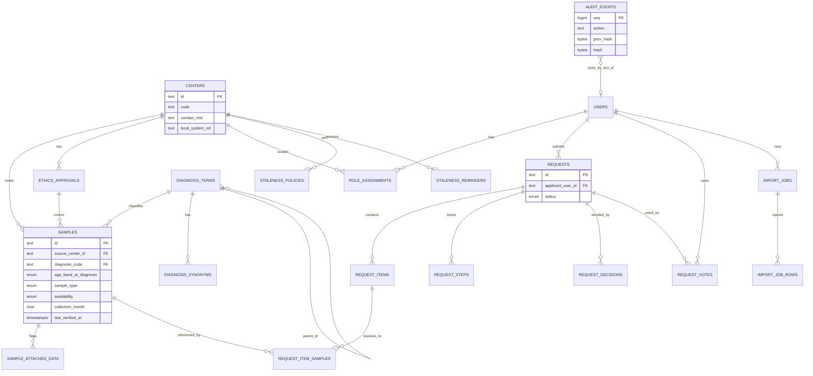

# 03 Data model, RLS and migrations

Covers REQ-027, REQ-037, REQ-041, REQ-043, REQ-045, REQ-046, REQ-054, REQ-067. DDL is real and tested on PostgreSQL 16.15.

## Files (apply in order)
| File | Content |
|---|---|
| `sql/001_core.sql` | Schemas, enums, tables, indexes, triggers, audit hash chain |
| `sql/002_roles_rls.sql` | DB roles, grants, RLS policies |
| `sql/003_search.sql` | FTS and trigram indexes, k-anonymous functions, smart search |
| `sql/004_views_clinician_value.sql` | Center summary and completeness views (REQ-068) |
| `sql/005_expand_contract_example.sql` | Illustration only |
| `sql/seed/010_diagnosis_vocabulary_starter.sql` | Starter vocabulary (draft) |
| `sql/tests/test_rls_k.sql` | Executable checks for RLS, k-rule, audit chain, separation of duties |

Test result (2026-11-13): applied 001 to 005 then the test file on PostgreSQL 16.15. Output `ALL CHECKS PASSED`. The test file runs as superuser and uses `SET ROLE` to act as each app role.

## Logical model


## Physical notes
- Schemas: `portal` (data), `audit` (chain), `search` (functions), `ext` (extensions), `authn` (credentials, owned by A2 adapter, not defined here).
- IDs are text with prefix and ULID (domain `ulid_text`). Chosen for portability (no DB-specific UUID type) and sortable by time.
- `samples.attached_data` is a denormalised array kept in sync by trigger from `sample_attached_data`. It makes facet queries fast (GIN index).
- `request_items` hold search criteria, not sample ids. The applicant never sees sample ids. The coordinator resolves items to samples in `request_item_samples`.
- `audit.audit_events` is append-only (triggers block UPDATE, DELETE, TRUNCATE). Rows are written only by `audit.append()`. Hash = SHA-256 of previous hash plus canonical row text. `audit.verify_chain()` recomputes it. The chain head is locked per insert, so writes are serial. Expected volume (low thousands per day) makes that acceptable. If it becomes a hot spot, shard by day with a daily anchor row (ADR).
- Audit `actor_user_id` is plain text, so deleting a user never breaks the chain.
- Anchoring: A2/A9 export the latest hash daily to object storage (write-once bucket) to detect full-chain rewrite.

## Access matrix (DB level)
| Object | external (anon, researcher_il/intl) | clinician | coordinator | committee | admin |
|---|---|---|---|---|---|
| `samples` rows | NO privilege | SELECT own center (RLS) | ALL (RLS true) | NO privilege | NO privilege |
| `sample_attached_data` | NO | SELECT own center | ALL | NO | NO |
| aggregate functions `search.*` | EXECUTE | EXECUTE | EXECUTE | EXECUTE | no |
| `requests` | own rows | rows with a step at own center | ALL | non-draft, post-precheck | NO |
| `request_steps` | own, no `internal_note` (column grant) | own center steps, no `internal_note` | ALL | SELECT | NO |
| `request_item_samples` | NO | NO | ALL | NO | NO |
| `import_*` | NO | NO | ALL | NO | NO |
| `audit_events` | NO | NO | NO | NO | SELECT |
| `users`, `role_assignments` | self | self | read all; may add researcher roles | self | ALL |
| `centers` | SELECT | SELECT | SELECT | SELECT | INSERT/UPDATE |

Three layers protect external roles from sample rows: (1) no GRANT, (2) FORCE RLS with no policy for them, (3) the API never exposes a sample endpoint to them (OpenAPI). Test `TC` in `sql/tests/test_rls_k.sql` section 1 checks layer 1.

How the API uses roles:
```sql
BEGIN;
SET LOCAL ROLE portal_clinician;                      -- from the session role
SELECT set_config('app.user_id',   'usr_...', true);  -- transaction local
SELECT set_config('app.center_id', 'ctr_...', true);  -- only for center_clinician
-- queries ...
COMMIT;
```
(Superseded by canonical-decisions C-06: the login role is `app_runtime`, it is a member of no role and cannot `SET ROLE`; privacy functions are SECURITY DEFINER. The `SET LOCAL ROLE` model below survives only as the adapter option `DB_SET_LOCAL_ROLE`.) The login role `portal_app` has no table privileges. If the API forgets `SET LOCAL ROLE`, queries fail closed. A user holding two roles (for example researcher and clinician) uses one role per request, chosen by the session's active role.

Separation of duties in DB (trigger): `system_admin` cannot also hold clinician, coordinator or committee roles. `committee_member` cannot also be `national_coordinator`. `system_admin` has no grant on sample data or requests.

## Retention hooks in the model
`samples.deleted_at`, `import_jobs.expires_at`, `import_job_rows` (cascade on job delete). See 08.

## Migration strategy (expand / contract)
Rules:
1. SQL files in `db/migrations`, named `NNNN_description.sql`. Plain SQL. Forward-only. No down scripts. Recovery = restore (RPO/RTO in ASSUMPTION-05) or a new forward fix.
2. Each migration is one transaction unless it uses `CREATE INDEX CONCURRENTLY` (then it is alone in its file).
3. Three kinds, marked in the file header: `-- kind: expand`, `-- kind: backfill`, `-- kind: contract`.
4. **Expand** (safe with old code): add nullable column or new table, add index concurrently, add enum value, add view. No lock longer than 1 second (`SET lock_timeout = '3s'`).
5. **Backfill**: batched job (1000 rows, sleep between), idempotent, resumable. Not in a deploy-blocking migration.
6. **Contract** (only after old code is gone): drop column, drop trigger, set NOT NULL (via validated CHECK first). Runs at least one release after the code stopped using the old shape, and only after a green export/import round trip.
7. Release order: migrate (expand) -> deploy new code -> backfill -> deploy code that stops using the old shape -> contract.
8. CI: spin up Postgres, apply all migrations from empty, run `sql/tests`, then apply to a snapshot of the previous release schema (upgrade test). Lint: fail on `DROP`, `ALTER COLUMN TYPE`, `NOT NULL` without default in an expand file. Fail if a migration edits a file already merged.
9. Staging gets every migration first. Production applies under the protected-area approval gate (contract pack section 1).
10. Each migration records `schema_migrations(version, checksum, applied_at)`. Checksum mismatch stops the deploy.
11. Base44 portability: migrations use only standard SQL features plus RLS, `pg_trgm`, `unaccent` and plpgsql. Platform-specific parts are listed here: RLS and role model, plpgsql functions in `search` and `audit`, `pg_trgm`. A target without these needs the adapter fallback (app-side policy checks, app-side k-rule). The capability map is A1's.
12. Example: `sql/005_expand_contract_example.sql`.

## Indexes (summary)
Samples: center, diagnosis, (type, availability), (age, sex, timepoint), GIN on `attached_data`, (center, last_verified_at). All partial `WHERE deleted_at IS NULL`. Vocabulary: trigram and FTS on normalised labels and synonyms. Audit: time, actor, object, action. Requests: status, applicant. Import: user, active status. Expected sizes in Phase 1 are small (thousands to tens of thousands of samples). These indexes are enough. Re-check with `EXPLAIN` at 100k samples (A9 load test).
