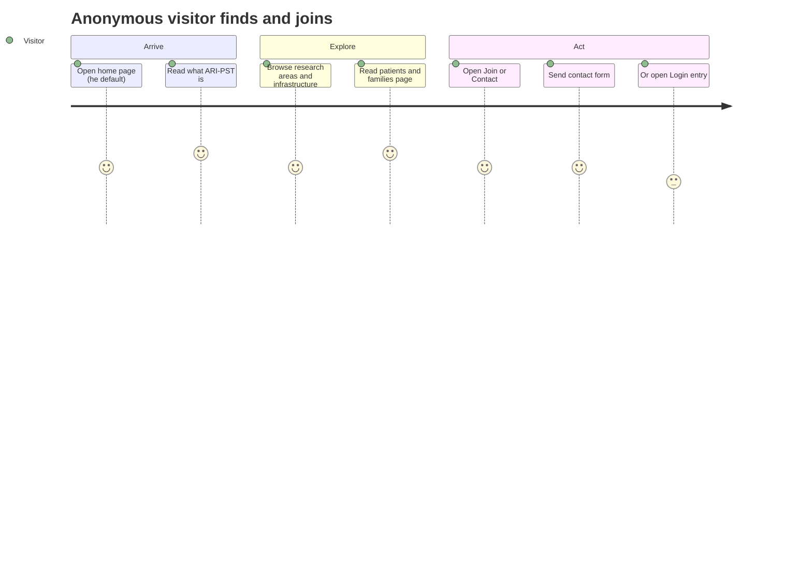
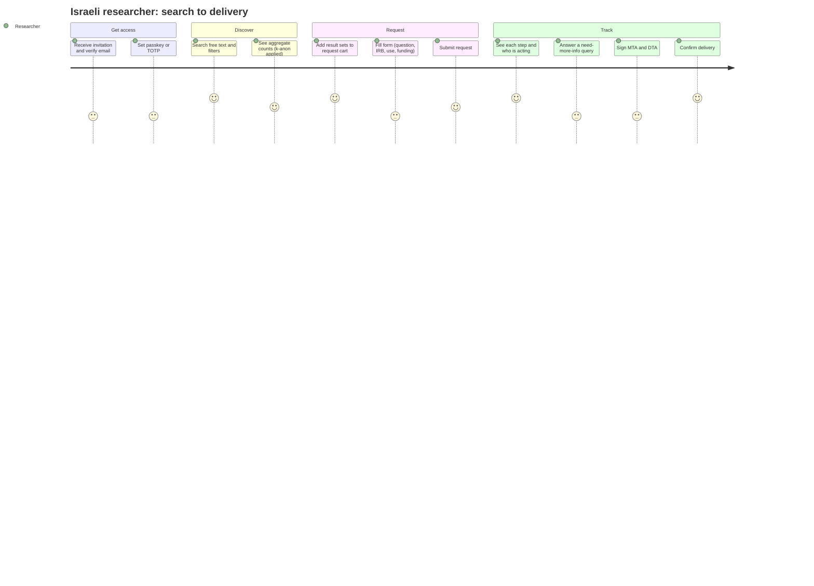
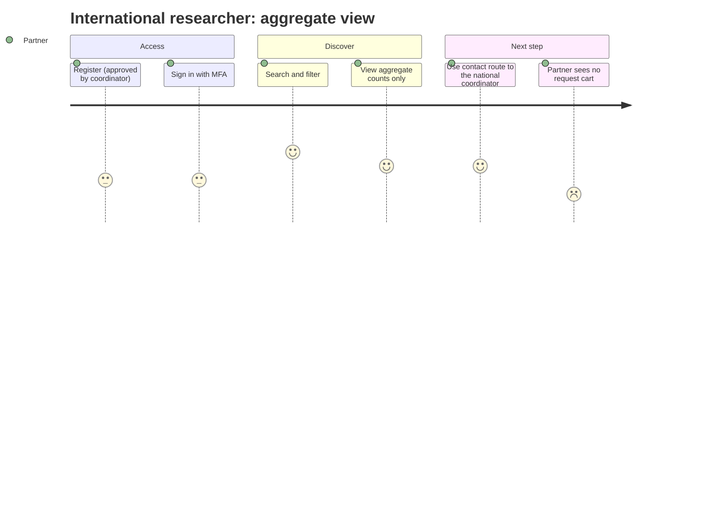
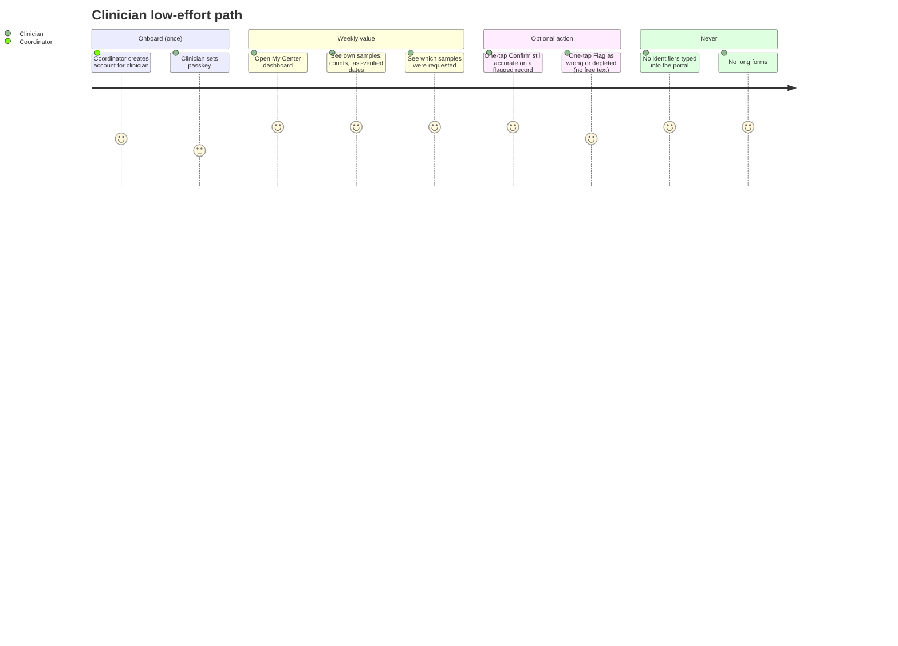
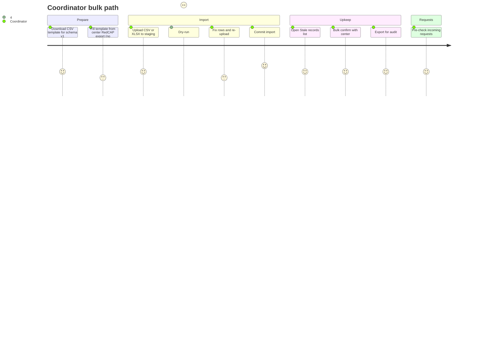
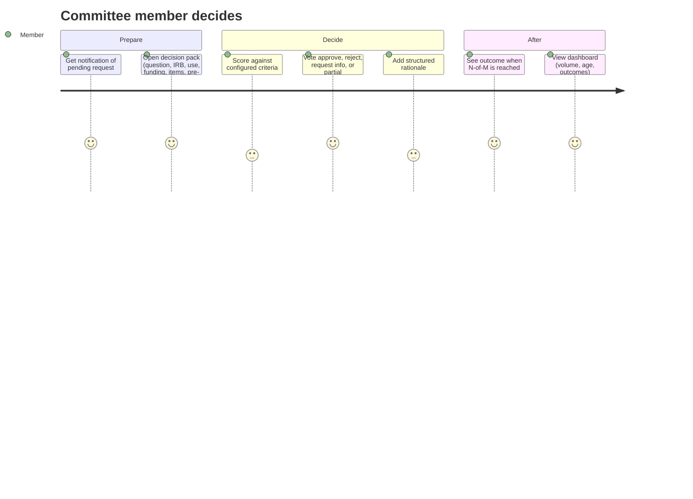
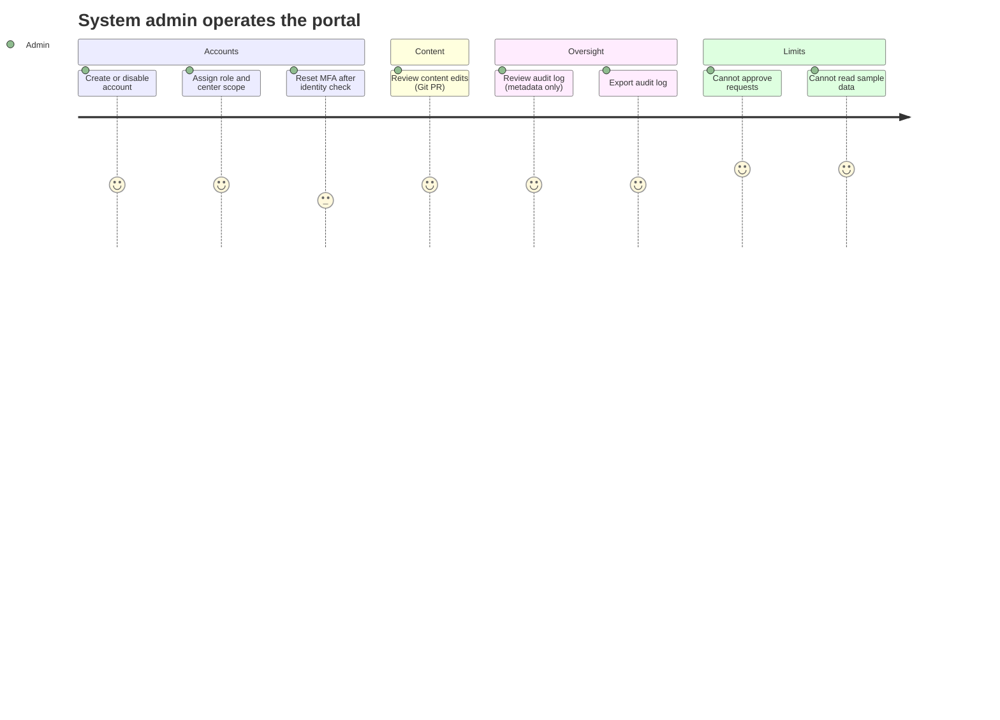

# 01 — Personas and Journeys

Scope: REQ-004, 005, 006, 007, 012–018, 037, 068. All names are synthetic.
Roles use the canonical names from the contract pack §5.

## 1. Persona summary

| Role | Persona (synthetic) | Goal | Main fear | Success signal |
|---|---|---|---|---|
| `anonymous` | "Visitor Noa" (parent or student) | Understand what ARI-PST is. Find how to join or contact. | Jargon. Feeling data is exposed. | Finds a clear page in 2 clicks. |
| `researcher_il` | "Dr. Researcher Alef" | Find out if samples exist. Send a request. Track it. | Long forms. No status. | Request sent in one session. Status visible. |
| `researcher_intl` | "Dr. Researcher Beta" (partner lab) | See aggregate counts. Judge fit for collaboration. | Hidden data. Slow access. | Counts and a contact path. |
| `center_clinician` | "Clinician Gimel" (Synthetic Center A) | Know own center's samples. Spend near-zero time. | Extra work. Privacy risk. | Needs under 5 minutes a week. Sees own data back. |
| `national_coordinator` | "Coordinator Dalet" | Keep the index current. Run pre-checks. Help researchers. | Stale data. Manual rework. | Bulk import works. Stale list is short. |
| `committee_member` | "Committee Member Hey" | Decide fast, with the right facts. | Missing context. Unclear criteria. | Decision in one sitting. Record is clear. |
| `system_admin` | "Admin Vav" | Manage accounts, roles, content, logs. | Breaking separation of duties. | Can act without seeing sample data. |

Design rule from REQ-007 and REQ-068: the treating clinician is never the data-entry worker. The coordinator does entry. The clinician only verifies and sees value.

## 2. Role boundaries (reminder)
- `system_admin` cannot approve requests. `system_admin` cannot read sample data.
- `committee_member` cannot edit the index.
- `center_clinician` sees the coded record of own center only. Identity is resolved in the center's own system (GATE-CLINICIAN-ID).
- `researcher_intl` sees aggregate counts only (REQ-014, REQ-032).

## 3. Journey: anonymous visitor (REQ-004, 012, 019)

Happy path: 3 pages, under 3 minutes. No login prompt blocks public content.

## 4. Journey: researcher_il (REQ-013, 034, 035, 036)

## 5. Journey: researcher_intl (REQ-014, 032)

Note: no cart for this role in Phase 1. A "collaboration inquiry" goes to the coordinator by contact form. See OPEN-401.

## 6. Journey: clinician low-effort path (REQ-007, 015, 068)

Design target: at most 5 minutes per week. No data entry by default.

Rules:
- Default screen is read-only value: counts, requests touching own samples, freshness.
- Allowed actions: `confirm_record`, `flag_record` with enum reason. No free text (REQ-042).
- Notifications are digests, weekly, with one link. No per-record emails.
- Repeat value: "Your center contributed to N requests this quarter" (aggregate, k-anon safe).
- Identity of a patient is looked up in the center's own system. The record shows a `contact_ref` and a link-out hint only.

## 7. Journey: national_coordinator bulk path (REQ-016, 027, 067, GATE-INGEST)

Rules:
- Dry-run is mandatory before commit.
- Files with suspected identifiers are rejected as a whole. Row detail never echoes the value.
- Every commit writes an audit event and a batch ID.
- Single-record screen exists for fixes. It has a minimal field set (REQ-068).

## 8. Journey: committee_member (REQ-017)

The member sees request content and aggregate item counts. The member never sees sample-level index records. The member cannot edit the index.

## 9. Journey: system_admin (REQ-018, 045, 046)

Role changes that give high power need a second approver (four-eyes). See `06-governance.md`.

## 10. Top journeys (ranked)

| # | Journey | Role | Phase 1 |
|---|---|---|---|
| J1 | Find samples with search and filters | `researcher_il` | Yes |
| J2 | Submit a request from cart | `researcher_il` | Yes |
| J3 | Track a request and answer questions | `researcher_il` | Yes |
| J4 | Bulk import and dry-run | `national_coordinator` | Yes |
| J5 | Pre-check a request | `national_coordinator` | Yes |
| J6 | Decide on a request | `committee_member` | Yes |
| J7 | Weekly value view and confirm | `center_clinician` | Yes |
| J8 | Aggregate view for partners | `researcher_intl` | Yes |
| J9 | Public browse and contact | `anonymous` | Yes |
| J10 | Manage accounts and logs | `system_admin` | Yes |
| J11 | Resolve stale records | `national_coordinator` | Yes |
