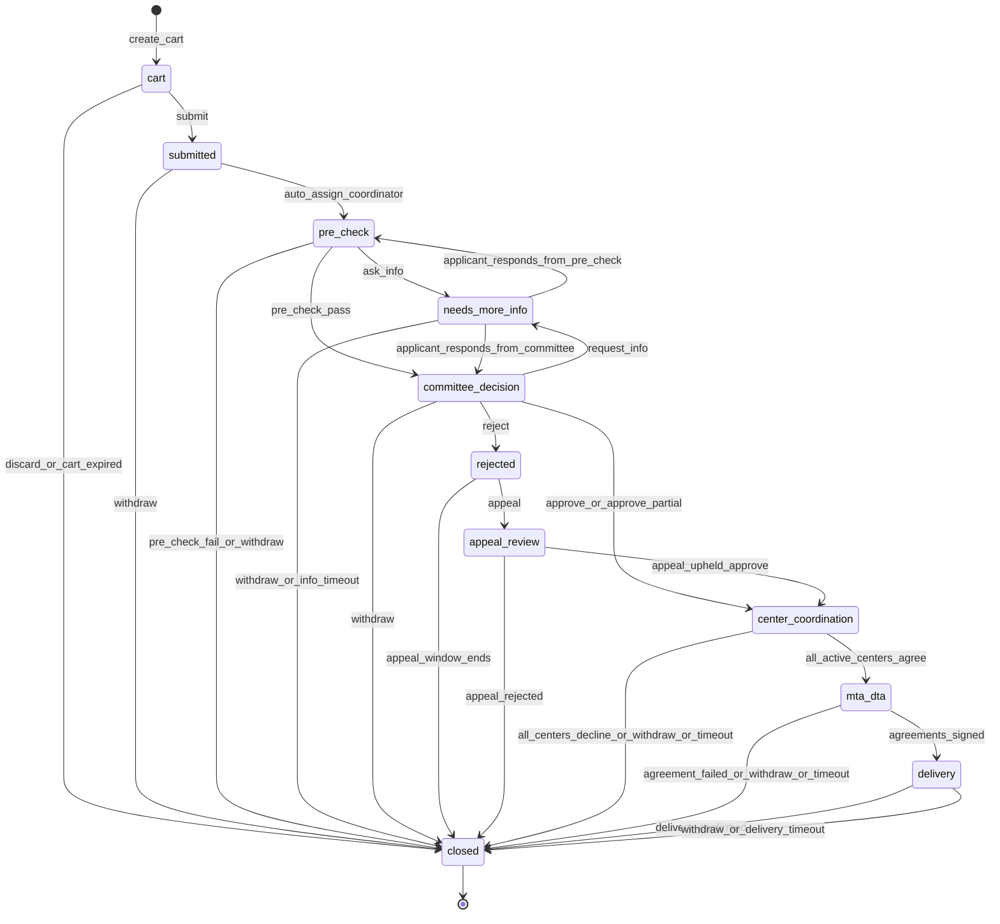

# 02 — Access-Request State Machine

Scope: REQ-006, 034, 035, 036, 051, 063. Module: `access-requests`.
Flow from the pack: search → cart → form → coordinator pre-check → committee decision → center coordination → MTA/DTA → delivery + tracking.

## 1. Canonical state enum (reusable by code)

```ts
export const REQUEST_STATES = [
  'cart',
  'submitted',
  'pre_check',
  'needs_more_info',
  'committee_decision',
  'rejected',
  'appeal_review',
  'center_coordination',
  'mta_dta',
  'delivery',
  'closed',
] as const;
export type RequestState = typeof REQUEST_STATES[number];

export const CLOSE_REASONS = [
  'delivered',
  'rejected',
  'appeal_rejected',
  'withdrawn',
  'expired',
  'center_declined',
  'agreement_failed',
  'cancelled_by_admin_policy',
] as const;
export type CloseReason = typeof CLOSE_REASONS[number];

export const ITEM_STATES = [
  'pending', 'approved', 'declined', 'unavailable', 'delivered',
] as const;
export type ItemState = typeof ITEM_STATES[number];

export const DECISIONS = ['approve', 'approve_partial', 'reject', 'request_info'] as const;
```

Notes:
- `withdrawn` and `expired` are close reasons, not states. They end in `closed`.
- `closed` is the only terminal state. It always has one `close_reason`.
- `rejected` is a short holding state. It lasts for the appeal window. Then it moves to `closed` with `rejected`.
- A request holds items (a snapshot of the cart). Each item has an `ItemState`. Partial approval uses item states.
- A cart item is a coded `sample_code` reference or a saved filter set. Only counts are shown until approval. Sample-level detail for approved items goes through the center (see section 7).

## 2. State diagram



## 3. Actors

| Actor | Role | Acts in |
|---|---|---|
| Applicant | `researcher_il` | cart, submitted, needs_more_info, rejected (appeal), mta_dta, delivery |
| Coordinator | `national_coordinator` | pre_check, needs_more_info, center_coordination, mta_dta, delivery |
| Committee | `committee_member` (N-of-M) | committee_decision, appeal_review |
| Center contact | `center_clinician` of the holding center | center_coordination (confirm or decline own items) |
| System | timers, rules engine | auto transitions, reminders, expiry |
| Admin | `system_admin` | none on decisions. Can only view metadata and handle policy cancels via `cancelled_by_admin_policy` (no sample data, no decision). See OPEN-402. |

## 4. Transition table

Guards use letters G1..G14 defined in section 5. SLA timers are configuration (not code). Defaults are shown. Defaults are ASSUMPTIONs (see ASSUMPTION-401).

| # | From | Event | To | Actor | Guards | Timer / SLA (default) | Notification | Audit event |
|---|---|---|---|---|---|---|---|---|
| T01 | (none) | `create_cart` | cart | Applicant | role is `researcher_il`; MFA session | cart idle expiry 30 days | none | `request.cart_created` |
| T02 | cart | `add_item` / `remove_item` (self-loop) | cart | Applicant | G1 | — | none | `request.cart_item_added`, `request.cart_item_removed` |
| T03 | cart | `submit` | submitted | Applicant | G1, G2, G3, G4 | — | applicant: receipt; coordinators: new request | `request.submitted` |
| T04 | cart | `discard_or_cart_expired` | closed (`withdrawn`) | Applicant or System | idle > 30 d or manual | 30 d idle (reminder at 21 d) | applicant: cart expiry notice | `request.cart_discarded` |
| T05 | submitted | `auto_assign_coordinator` | pre_check | System | at least one active coordinator | immediate; assign SLA 1 business day | coordinator: assigned | `request.pre_check_started` |
| T06 | submitted | `withdraw` | closed (`withdrawn`) | Applicant | G5 | — | coordinator: withdrawn | `request.withdrawn` |
| T07 | pre_check | `ask_info` | needs_more_info | Coordinator | G6 | info clock starts: 14 d | applicant: question | `request.info_requested` |
| T08 | pre_check | `pre_check_pass` | committee_decision | Coordinator | G7 | pre-check SLA 5 business days | committee: pending; applicant: status | `request.pre_check_passed` |
| T09 | pre_check | `pre_check_fail_or_withdraw` | closed (`rejected` or `withdrawn`) | Coordinator or Applicant | fail needs structured reason (G6) | — | applicant: outcome | `request.pre_check_failed` / `request.withdrawn` |
| T10 | needs_more_info | `applicant_responds` | pre_check or committee_decision (return to origin) | Applicant | G8 | resume origin SLA clock | origin actor: response received | `request.info_provided` |
| T11 | needs_more_info | `withdraw_or_info_timeout` | closed (`withdrawn` or `expired`) | Applicant or System | timeout 14 d (reminders at 7 d, 12 d) | 14 d | applicant: expiry notice | `request.info_expired` / `request.withdrawn` |
| T12 | committee_decision | `request_info` | needs_more_info | Committee | G9 | info clock 14 d | applicant: question | `request.info_requested` |
| T13 | committee_decision | `approve` / `approve_partial` | center_coordination | Committee | G10 (N-of-M), G11 | decision SLA 15 business days; reminder at 10 | applicant: decision; coordinator + centers: next step | `request.committee_decided` (decision, item list) |
| T14 | committee_decision | `reject` | rejected | Committee | G10, G12 (rationale required) | — | applicant: decision with rationale + appeal info | `request.committee_decided` |
| T15 | committee_decision | `withdraw` | closed (`withdrawn`) | Applicant | G5 | — | committee, coordinator | `request.withdrawn` |
| T16 | rejected | `appeal` | appeal_review | Applicant | G13 (within window; one appeal only) | appeal window 30 d | committee: appeal | `request.appeal_filed` |
| T17 | rejected | `appeal_window_ends` | closed (`rejected`) | System | window elapsed | 30 d | applicant: closed | `request.closed` |
| T18 | appeal_review | `appeal_upheld_approve` | center_coordination | Committee | G10 with different quorum rule (G14) | appeal SLA 20 business days | applicant, coordinator | `request.appeal_decided` |
| T19 | appeal_review | `appeal_rejected` | closed (`appeal_rejected`) | Committee | G10, G12 | — | applicant | `request.appeal_decided`, `request.closed` |
| T20 | center_coordination | `center_confirms_items` (self-loop per center) | center_coordination | Center contact | item belongs to own center | center SLA 10 business days; reminder 5 d; escalate to coordinator at 10 d | coordinator: progress | `request.center_item_confirmed` / `request.center_item_declined` |
| T21 | center_coordination | `all_active_centers_agree` | mta_dta | System | every approved item is `approved`, `declined` or `unavailable`; at least one `approved` | — | applicant: next step (agreements) | `request.center_coordination_done` |
| T22 | center_coordination | `all_centers_decline_or_withdraw_or_timeout` | closed (`center_declined`, `withdrawn`, or `expired`) | System or Applicant | no `approved` items left or timeout 45 d | 45 d total | applicant: outcome | `request.closed` |
| T23 | mta_dta | `agreements_signed` | delivery | Coordinator (records) | G3b: MTA/DTA for every involved center recorded with document ref | agreement SLA 30 d; reminders at 14, 25 d | applicant, centers: ready | `request.agreements_signed` |
| T24 | mta_dta | `agreement_failed_or_withdraw_or_timeout` | closed (`agreement_failed`, `withdrawn`, or `expired`) | Coordinator, Applicant, System | timeout 60 d | 60 d | applicant | `request.closed` |
| T25 | delivery | `item_delivered` (self-loop) | delivery | Center contact or Coordinator | item `approved` | delivery SLA 20 business days after agreements | applicant: item shipped | `request.item_delivered` |
| T26 | delivery | `delivery_confirmed` | closed (`delivered`) | Coordinator or Applicant | all `approved` items `delivered` or marked `unavailable` with reason | — | applicant, committee: closed | `request.delivered`, `request.closed` |
| T27 | delivery | `withdraw_or_delivery_timeout` | closed (`withdrawn` or `expired`) | Applicant or System | timeout 90 d | 90 d | all | `request.closed` |

Every transition also writes the generic audit event `request.state_changed` with `from_state`, `to_state`, `actor_role`, `request_id`. No identifiers beyond opaque IDs.

## 5. Guards

| ID | Guard |
|---|---|
| G1 | Actor owns the cart. Request is in `cart`. |
| G2 | Form complete: research question, IRB/Helsinki approval ref, planned use, funding sources (REQ-035). Cart has at least 1 item. |
| G3 | Applicant account is active, email verified, MFA enrolled (REQ-044). |
| G3b | MTA and DTA documents are recorded per involved center. Document body is not stored in the portal in Phase 1 (reference + status + date only). See OPEN-403. |
| G4 | Idempotency key present on submit (pack §8). |
| G5 | Request not yet in `closed`. Withdraw allowed until `delivery` confirmed. |
| G6 | Coordinator gives a structured reason code and a short message. Message has no identifiers (lint warning). |
| G7 | Pre-check checklist all ticked: form complete, IRB ref present and plausible, use matches consent scope, no identifier asked for, items exist. |
| G8 | Response within info window. Attachments size and type limits. |
| G9 | Committee member has no conflict of interest on this request (declared). |
| G10 | Quorum met: N approving or rejecting votes out of M eligible, per active committee config (ASSUMPTION-04). Votes are final once quorum is reached. |
| G11 | Item-level decisions recorded for partial approval. At least one approved item. |
| G12 | Rationale required: criteria results plus structured reason code. |
| G13 | Appeal filed in the window. One appeal per request. New facts or procedural reason stated. |
| G14 | Appeal quorum excludes members who voted on the first decision, if M permits. If M does not permit, config fallback applies. |

Separation of duties:
- `system_admin` cannot take any actor-role transition.
- The applicant cannot act as coordinator or committee on own request.
- A coordinator who is also an applicant cannot pre-check own request.
- A `committee_member` cannot vote on own request.

## 6. Timers and SLAs

All durations come from the `workflow_config` table (data, not code). Business days follow a configurable holiday calendar.

| Timer key | Default | On breach |
|---|---|---|
| `cart_idle_expiry_days` | 30 | close as `withdrawn` |
| `assign_sla_bd` | 1 | notify coordinator lead |
| `pre_check_sla_bd` | 5 | reminder, then escalate to coordinator lead |
| `info_response_days` | 14 | close as `expired` |
| `committee_decision_sla_bd` | 15 | reminder to chair; shown on dashboard |
| `appeal_window_days` | 30 | close as `rejected` |
| `appeal_sla_bd` | 20 | reminder to chair |
| `center_response_sla_bd` | 10 | escalate to coordinator |
| `center_coordination_max_days` | 45 | close as `expired` |
| `agreements_max_days` | 60 | close as `expired` |
| `delivery_sla_bd` | 20 | escalate |
| `delivery_max_days` | 90 | close as `expired` |

The timers feed the metric "request-to-delivery time" (REQ-066). SLAs are internal targets, not promises to applicants. All values are ASSUMPTION-401 until the owner sets them.

## 7. What each party sees (REQ-036)

The applicant sees a timeline of every step: state, date, actor role (not the name), and a short structured message. The applicant does not see individual committee votes or comments marked internal. The applicant sees committee rationale on decision.

Sample-level detail: after approval, the coordinator and the holding center see the `sample_code` list of approved items. The applicant sees counts per center until `delivery`. Whether the applicant sees `sample_code` of delivered items is OPEN-404 (default: yes after `delivery`, because the applicant already holds the physical or data item).

## 8. Edge cases

| Case | Handling |
|---|---|
| Withdrawn | Allowed in any state except `closed`. Ends in `closed` with `withdrawn`. Open tasks are cancelled. Centers are told if they already confirmed items. |
| Expired | Timer fires. Ends in `closed` with `expired`. Reminders go out first. Applicant can clone the request into a new cart (`cloned_from` link). |
| Partial approval | Committee decides per item (`approve_partial`). Declined items go to `declined`. Request moves on with approved items. Applicant sees per-item outcome and reasons. |
| Partial center outcome | A center declines or marks `unavailable`. Other centers continue. If at least one item remains `approved`, request moves to `mta_dta`. |
| Needs more info | Returns to its origin state on response (pre_check or committee_decision). SLA clock pauses while waiting. Max 3 info rounds per request (config). |
| Rejected | Applicant sees rationale. Can appeal once, or clone into a new cart. |
| Appeal | One appeal. New committee quorum rule (G14). No second appeal. |
| Sample becomes `depleted` after approval | Item moves to `unavailable`. Coordinator notified. Applicant told. Partial delivery proceeds. |
| Applicant loses eligibility (account disabled) | Request is put on hold flag `on_hold` (attribute, not state). Coordinator decides: continue or close as `cancelled_by_admin_policy`. |
| Committee member leaves mid-decision | Votes by that member remain. Eligible M is recomputed. If quorum is impossible, coordinator alerts the chair. |
| Duplicate submit | Idempotency key returns the same request. |
| Cart items change after submit | Items are a frozen snapshot at submit. Changes need `needs_more_info` flow. |
| Index record edited after submit | Item keeps its `sample_code`. Edits do not change decisions. A material change (availability to `depleted`) sets item to `unavailable`. |
| Identifier found in form text | Submit blocked by lint (warn with a masked hint). Coordinator may redact. Audit event `request.identifier_suspected` (no value stored). |
| Withdraw at `delivery` after some items delivered | Delivered items stay delivered. Close reason `withdrawn`. Audit shows split. |

## 9. Notifications catalog

Channel: email (SMTP adapter) plus in-app. Email text holds no sample data and no request content. It holds a link and a status only. Locale follows user preference (he default).

| Key | To | When |
|---|---|---|
| `request.submitted.receipt` | applicant | T03 |
| `request.assigned` | coordinator | T05 |
| `request.info_requested` | applicant | T07, T12 |
| `request.info_reminder` | applicant | day 7, 12 of info window |
| `request.pending_committee` | committee members | T08 |
| `request.committee_reminder` | chair | SLA warnings |
| `request.decision` | applicant | T13, T14 |
| `request.appeal_filed` | committee | T16 |
| `request.center_task` | center contact | T13 |
| `request.center_escalation` | coordinator | T20 breach |
| `request.agreements_needed` | applicant, coordinator | T21 |
| `request.delivery_update` | applicant | T25 |
| `request.closed` | applicant, coordinator | any close |

## 10. Data model hints (for A1 and A3)

- `access_request(id, state, close_reason, applicant_id, form jsonb, submitted_at, state_entered_at, on_hold, cloned_from, version)`
- `access_request_item(id, request_id, sample_code | saved_filter, center_id, item_state, reason_code)`
- `request_event(id, request_id, at, from_state, to_state, actor_role, actor_id, reason_code)` is append-only.
- `committee_vote(id, request_id, round, member_id, decision, criteria_scores jsonb, rationale_code, internal_note)`.
- `workflow_config(key, value, valid_from)` versioned.
- Optimistic locking via `version`. Transitions run in one DB transaction with the audit write.

A property test target: for any event sequence, the state is always in `REQUEST_STATES`, `closed` is absorbing, and each transition appears in the table above.
