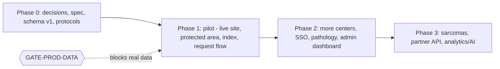

# 05 — Roadmap, Entry/Exit Criteria, Pilot Metrics

Source: Doc §9 (phases) and §10 (metrics) as captured in the pack (REQ-061..066). I did not have the Doc text. Wording follows the pack. Mark any difference as OPEN-406.

## 1. Roadmap

## 2. Phase 0 — Decisions and schema (REQ-061, 029, 049, 050, 052)

| Item | Detail |
|---|---|
| Scope | Close decisions. Write spec. Sign off schema v1 (GATE-SCHEMA). Write the unified collection-protocols document. Start legal review (REQ-049). Start DPA talks (REQ-050). Pick region (REQ-052). |
| Entry | Owner approves the plan. Clinical leads named. |
| Exit | Schema v1 signed by clinical leads. Collection-protocols document agreed. Committee composition draft (GATE-COMMITTEE). Legal review started. Region decision made or default kept. |
| Owners | Clinical leads, owner, legal counsel. |
| Note | Engineering can start Phase 1 build on synthetic data in parallel with Phase 0. Go-live with real data waits for gates. |

## 3. Phase 1 — Pilot, "fully functional" (REQ-062, 063)

| Item | Detail |
|---|---|
| Scope | Live public site. Protected area with login, MFA, roles, permissions. Index with Shaare Zedek + Madgam. Search and filters with k-anonymity. End-to-end request form and workflow. Audit log. Coordinator entry and bulk import. Pilot metrics. |
| Entry | Phase 0 schema draft available (use pack §4 as draft v1 if sign-off is late). Repo, CI, Render staging up. |
| Build entry (synthetic) | None beyond the above. |
| Go-live entry for real data | `GATE-PROD-DATA`: DPA, region control, export/import round trip, migration path, legal review, pen-test. Plus REQ-054 conditions: managed DB, auth, RBAC, audit logs, full export. |
| Exit (Doc §9) | Access requests have completed the full path through actual delivery (REQ-063). Evidence: at least the configured number of closed requests with reason `delivered` (default 1 per center, ASSUMPTION-402). |
| Acceptance | `07-phase1-acceptance-checklist.md`. |

## 4. Phase 2 — Expansion (REQ-064) — design hooks only in Phase 1

| Item | Detail |
|---|---|
| Scope | Ramban (רמב"ם) and other centers. Institutional SSO (OIDC adapter). Digital pathology scans (separate object storage + viewer). Admin dashboard. Full bilingual polish. |
| Entry | Phase 1 exit met. Pathology decision (GATE-PATHOLOGY). SSO partner IdP chosen. |
| Exit (Doc §9) | At least 3 centers feed the index regularly. "Regularly" = each center has at least one verified update per `stale_after_days` window (ASSUMPTION-403). |
| Hooks in Phase 1 | `AuthPort` OIDC slot. `ObjectStorePort`. `digital_pathology` flag. Multi-center data model. Feature flags `sso_oidc`, `pathology_viewer`. |

## 5. Phase 3 — Growth (REQ-065, 060, 011)

| Item | Detail |
|---|---|
| Scope | Sarcomas. Partner API. Analytics / AI layer. |
| Entry | Phase 2 exit met. GATE-COMPLIANCE confirmed. Budget decision. |
| Exit (Doc §9) | The index is the basis for a clinical trial. Evidence: a named trial protocol cites the index (ASSUMPTION-404). |
| Hooks in Phase 1 | Schema `disease_area` extension point. Versioned public API path `/api/v1`. No analytics code. |

## 6. Phase 1 milestones (suggested, product view)

| Milestone | Content |
|---|---|
| M-A | Public site live (synthetic content). Auth + RBAC skeleton. |
| M-B | Index, import, search, k-anon. |
| M-C | Request workflow end to end. Audit complete. |
| M-D | Hardening: pen-test fixes, restore drill, export round trip, a11y pass. |
| M-E | Acceptance on synthetic data. Gate review for real data. |
| M-F | Pilot with real data (only after GATE-PROD-DATA). Collect exit evidence. |

```mermaid
gantt
  title Phase 1 milestones (relative, not dated)
  dateFormat  X
  axisFormat  %s
  section Build
  M-A public site and auth   :a1, 0, 4
  M-B index and search       :a2, 3, 8
  M-C request workflow       :a3, 7, 13
  M-D hardening              :a4, 12, 16
  section Release
  M-E acceptance             :a5, 16, 18
  M-F pilot with real data   :a6, 18, 26
```

Durations are relative weeks for a 3–6 engineer team (ASSUMPTION-06). They are not a commitment.

## 7. Pilot success metrics (Doc §10, REQ-066)

Six metrics. Each has a definition, an event source, and a rule. Events are emitted by the server. No identifiers: only enums, counts, durations, opaque IDs. Event names follow `domain.action`. Common properties on every event: `occurred_at` (UTC), `env`, `locale`, `schema_version`.

| # | Metric (Doc §10) | Definition | Source events | Key properties | Computation |
|---|---|---|---|---|---|
| M1 | Centers feeding the index | Count of centers with at least one committed update in the last `stale_after_days` | `sample.import_committed`, `sample.created`, `sample.verified` | `center_id` (opaque), `row_count`, `batch_id` | Distinct `center_id` in window |
| M2 | Record count + field completeness | Total records. Share of required and optional fields filled | `index.snapshot_taken` (daily job) | `record_count`, `center_id`, `completeness_required_pct`, `completeness_optional_pct`, `stale_count` | Latest snapshot per center |
| M3 | Registered researchers + searches | Active registered researchers. Searches per week | `identity.user_registered`, `identity.login_succeeded`, `search.executed` | `role`, `filter_keys` (list of facet names), `result_bucket` (enum), `used_free_text` (bool) | Distinct opaque `user_id` per week. Count of searches |
| M4 | Requests + completion rate | Requests submitted. Share that reach `closed` with `delivered` | `request.submitted`, `request.closed` | `request_id`, `close_reason`, `item_count`, `center_count` | delivered / (closed excluding `cart`-stage discards) |
| M5 | Request-to-delivery time | Days from `submitted` to `delivered` (median and p90) | `request.submitted`, `request.delivered` | `request_id`, `days_to_delivery`, `days_in_pre_check`, `days_in_committee`, `days_in_center`, `days_in_agreements`, `days_in_delivery` | Per-stage durations from `request_event` |
| M6 | Share of coordinator-entered records | Records created by `national_coordinator` / all records | `sample.created`, `sample.import_committed` | `entered_by_role`, `row_count` | Sum rows by role |
| M7 | Studies/publications citing the index | Count of citations | `citation.recorded` (manual entry by coordinator) | `citation_type` (`publication`,`study`,`grant`), `year`, `request_id` (optional) | Count. Manual input. Not automatic. |

Doc §10 lists six metric themes in the pack: centers feeding; record count + completeness; researchers + searches; requests + completion + time; coordinator-entered share; citations. M4 and M5 split the one "requests + completion rate + request-to-delivery time" row, so there are seven measures.

Event contract rules:
- Names are a closed list in `packages/contracts`. A test fails if an unknown name is emitted.
- Properties allow-list per event. A test fails if a property outside the list is sent.
- `user_id` is an opaque ID. It is never an email or name. Analytics for the public site uses consent (REQ-025) and is separate from server metric events.
- Free text is never a property. Search text is not logged (`used_free_text` only).
- Small groups in the metrics view follow k-anonymity too, so a metric cannot reveal one person.

### Event catalog (names)

| Event | Emitted by | Properties |
|---|---|---|
| `identity.user_registered` | identity-access | `role`, `invited_by_role` |
| `identity.login_succeeded` | identity-access | `role`, `mfa_method` |
| `identity.login_failed` | identity-access | `reason_code` |
| `search.executed` | search-discovery | `role`, `filter_keys`, `result_bucket`, `used_free_text`, `k_suppressed` (bool) |
| `sample.created` | sample-index | `center_id`, `entered_by_role` |
| `sample.import_committed` | center-ingestion | `center_id`, `batch_id`, `row_count`, `error_count`, `entered_by_role` |
| `sample.verified` | sample-index | `center_id`, `verified_by_role` |
| `index.snapshot_taken` | observability job | see M2 |
| `request.submitted` | access-requests | `request_id`, `item_count`, `center_count` |
| `request.state_changed` | access-requests | `request_id`, `from_state`, `to_state`, `actor_role` |
| `request.committee_decided` | access-requests | `request_id`, `decision`, `round`, `approved_item_count` |
| `request.delivered` | access-requests | `request_id`, `days_to_delivery`, per-stage days |
| `request.closed` | access-requests | `request_id`, `close_reason` |
| `citation.recorded` | admin-governance | `citation_type`, `year` |

### Pilot targets
Targets are not in the pack. Set by owner (OPEN-407). Suggested placeholders:

| Metric | Placeholder target at Phase 1 exit |
|---|---|
| M1 | 2 centers (Shaare Zedek + Madgam source) |
| M2 | Required-field completeness at least 95% |
| M3 | Registered researchers and weekly searches trending up for 3 months |
| M4 | At least 1 delivered request per center; completion rate reported |
| M5 | Median reported with per-stage breakdown |
| M6 | Coordinator-entered share at least 90% (REQ-007) |
| M7 | Count reported |
