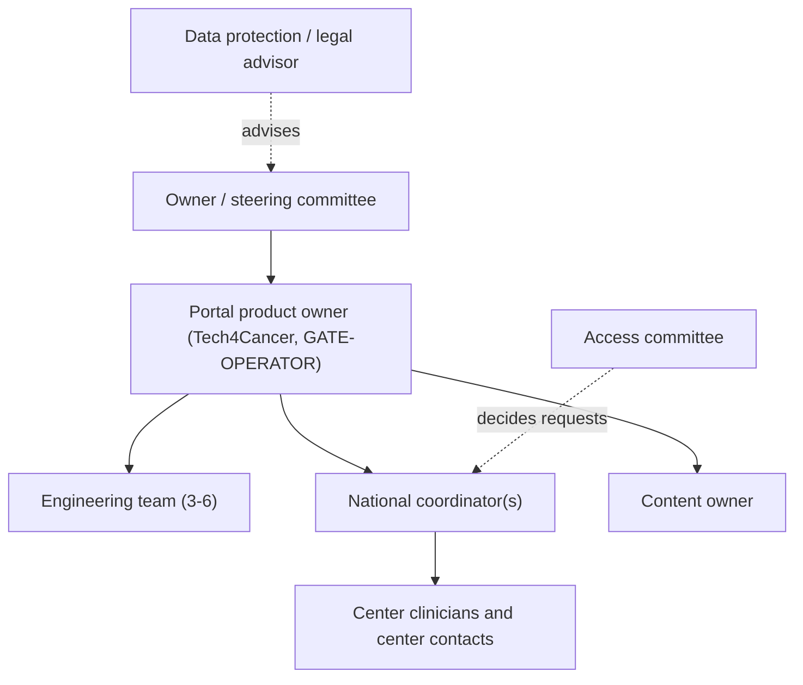
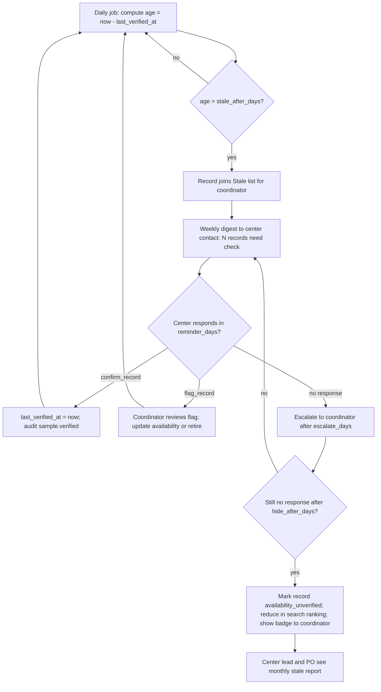

# 06 — Governance and Operating Model

Scope: GATE-COMMITTEE, ASSUMPTION-04, REQ-017, 067, 047, 049. Not legal advice. Items marked "needs legal review" go to counsel.

## 1. Principles
- Rules live in data, not code. The committee can change criteria and quorum without a release.
- Every change to rules is audited and versioned.
- Old decisions keep the rule version they used.
- The portal records decisions. It does not replace the committee's own minutes or the center's ethics process.

## 2. Access committee rules (GATE-COMMITTEE)

### 2.1 Composition (configurable)
Default until the owner closes the gate (ASSUMPTION-04, ASSUMPTION-405):

| Seat | Count | Notes |
|---|---|---|
| Chair | 1 | Runs the sitting. Breaks no ties unless config says so. |
| Clinical members | M minus others | From participating centers. |
| Scientific member | at least 1 | Research expertise. |
| Ethics/legal advisor | 1 (optional, non-voting) | Needs legal review of role. |
| Patient/family representative | 1 (optional) | OPEN-408. |

Quorum: N of M votes. Default N = 2, M = 3 (placeholder). Stored in `committee_config(n, m, valid_from)`. Appeals use a different quorum rule (G14 in `02`).

### 2.2 Conflict of interest
- A member declares a conflict per request. A declared member cannot vote or see the rationale draft of others.
- Applicants from the member's own lab count as a conflict by default.
- Declarations are audited as `governance.coi_declared`.

### 2.3 Criteria as data
Criteria are rows in `decision_criteria(id, key, label_he, label_en, scale, weight, required, version)`.

Seed criteria (placeholders, owner to confirm):

| Key | Question | Scale |
|---|---|---|
| `scientific_merit` | Is the question sound and clear? | 1–5 |
| `ethics_approval_valid` | Is a valid IRB/Helsinki approval referenced and in scope? | yes/no (required) |
| `consent_scope_match` | Does the use match the consent status of the items? | yes/no (required) |
| `feasibility` | Do the requested items exist in the needed amount? | 1–5 |
| `data_protection_plan` | Does the applicant protect the data? | yes/no |
| `fair_use_priority` | Is there conflict with other requests for scarce samples? | 1–5 |
| `public_benefit` | Does the work serve patients? | 1–5 |

Rules engine (configurable):
- "Required" criteria with a `no` block an `approve` vote.
- A minimum weighted score can be set.
- A vote always needs a structured rationale code. Free text is optional, marked internal, and linted for identifiers.

### 2.4 Decision outcomes
`approve`, `approve_partial`, `reject`, `request_info` (see state machine). The applicant sees the outcome and the rationale code with a standard text. Committee votes stay internal.

### 2.5 Appeal
One appeal per request, in 30 days (configurable). New quorum rule. The outcome is final in the portal.

### 2.6 Fair allocation for scarce samples
When two requests ask for the same scarce item, the coordinator flags a conflict. The committee ranks. The rule set is configurable. Default is first-complete-request-first. OPEN-409.

## 3. Operating model

Assumption: Tech4Cancer operates (GATE-OPERATOR). The legal owner is TBD. Contracts are outside this plan.

### 3.1 Cadence

| Rhythm | Meeting / action | Who |
|---|---|---|
| Daily | Coordinator checks pre-check queue and stale alerts | Coordinator |
| Weekly | Ops stand-up: queue, incidents, imports | PO, coordinator, tech lead |
| Weekly | Clinician digest sent (automatic) | System |
| Bi-weekly | Committee sitting (default) | Committee |
| Monthly | Metrics review (M1–M7). SLO review. | Owner, PO, tech lead |
| Quarterly | Access review (who has which role). Schema review. Retention run review. Restore drill. | Admin (not approver), PO, DPO |
| Yearly | Policy review. Legal review refresh. Pen-test. | Owner, counsel |

### 3.2 Content owners

| Area | Owner (role) | Backup |
|---|---|---|
| Public pages: About, Research areas, Community | Content owner (Tech4Cancer comms) | PO |
| Infrastructure, Global partners | National coordinator | Content owner |
| Patients and families | Clinical lead plus content owner | PO |
| News | Content owner | Coordinator |
| Privacy policy, terms | Owner with counsel (needs legal review) | DPO |
| Schema v1 and protocols | Clinical leads | Coordinator |
| Index data (per center) | Center contact, entered by coordinator | National coordinator |
| Committee rules | Committee chair | Owner |
| Workflow SLAs | Product owner | Coordinator |
| Translations he/en | Content owner | A6/i18n lead |

Content change flow: editor edits in CMS → PR → preview (synthetic) → review by a second person → merge → deploy (REQ-024, 069).

## 4. RACI

R responsible, A accountable, C consulted, I informed.

| Activity | Owner | PO | Coordinator | Committee | Center contact | Eng team | Admin | Counsel/DPO |
|---|---|---|---|---|---|---|---|---|
| Close decision gates | A | R | C | C | I | C | I | C |
| Schema v1 sign-off | A | C | R | I | C | C | I | I |
| Invite researchers | I | A | R | I | I | I | C | I |
| Index entry and import | I | A | R | I | C | I | I | I |
| Freshness loop (REQ-067) | I | A | R | I | R | C | I | I |
| Pre-check requests | I | A | R | I | I | I | I | I |
| Decide requests | I | I | C | A/R | C | I | I | C |
| Center coordination of items | I | I | A | I | R | I | I | I |
| MTA/DTA execution | A | I | R | C | C | I | I | R |
| Role grants (four-eyes) | I | A | C | I | I | I | R | C |
| Audit log review | I | A | I | I | I | C | R | C |
| Content updates | I | A | C | I | I | I | I | C (policies) |
| Releases and deploys | I | A | I | I | I | R | I | I |
| Incident response | I | A | I | I | I | R | C | C (if data) |
| Retention and deletion run | I | A | I | I | I | R | C | C |
| Restore drill | I | A | I | I | I | R | I | I |
| Compliance review (REQ-049) | A | R | I | C | I | C | I | R |
| Metrics reporting | A | R | C | I | I | R | I | I |

## 5. Staleness and update operating loop (REQ-067, GATE-INGEST)

Owner for freshness: the `national_coordinator` (accountable: product owner). Each center has a named center contact. Targets are configuration.

Defaults (data, ASSUMPTION-406): `stale_after_days` 180, `reminder_days` 7, `escalate_days` 21, `hide_after_days` 60 after first reminder.

Rules:
- Stale records stay searchable but carry a freshness badge for the coordinator. Researchers see counts of "recently verified" only as an aggregate filter, so no record is revealed.
- A record with `availability` changed to `depleted` leaves default counts.
- Bulk path: coordinator re-imports center export. Rows that match by `sample_code` update `last_verified_at` and fields (upsert by key, dry-run first).
- Monthly report: freshness % per center (share of records verified within the window). Feeds M2.
- Center no-show for 2 cycles triggers a PO conversation. This is the human step.
- Madgam sync: a scheduled update process aligns schema and refreshes records (REQ-056). The process owner is the coordinator. OPEN-410.

## 6. Role and access governance
- Quarterly access review. Admin lists role holders. PO confirms each. Unused accounts older than 90 days are disabled.
- Role grants for `system_admin`, `committee_member`, `national_coordinator` use four-eyes (FR-011).
- Joiner/mover/leaver steps are a checklist in the ops runbook (A9).

## 7. Data governance
- Portal holds de-identified index data only (REQ-041). Identity stays at the center.
- Retention: closed-request form text and uploaded files follow a configured period (canonical C-07: free text wiped at 24 months after close; the structured request record is kept 7 years after close; both need legal review). Index records follow center policy. Audit logs follow a longer period, set by A2.
- Deletion requests from a center for its records: coordinator marks records `withdrawn_by_center` (soft delete, then purge job). Audited.
- Consent withdrawal: the center flags the record. The coordinator retires it. Open requests that include it set the item to `unavailable`.

## 8. Escalation and change control
- Rule changes (criteria, quorum, SLAs) need chair approval and are audited.
- Schema changes need clinical lead sign-off, a new `schema_version`, and a migration (A3).
- Emergency access to production data: not allowed. Break-glass for export follows A2's procedure (OPEN-405).
