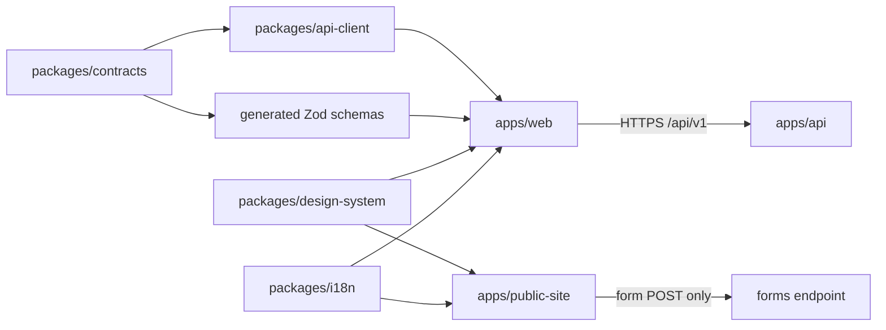
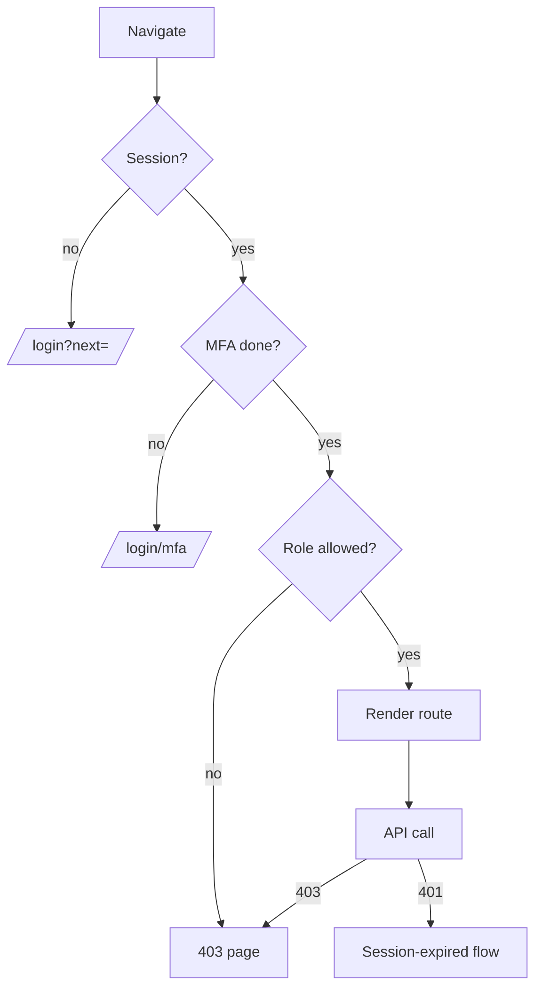

# 01 — Front-end architecture (apps/web + shared packages)

Scope: REQ-001, REQ-020, REQ-021, REQ-022, REQ-045, REQ-053, REQ-070, REQ-071.
Source of truth: `plan/00-contract-pack.md`.

## 1. Monorepo layout

```
apps/public-site      Astro static site (he/en). No API calls at runtime except forms.
apps/web              React 18 + Vite SPA. Talks only to packages/api-client.
packages/design-system  Tokens + React components + Astro-safe CSS. Owned by A5 (design), built here.
packages/i18n         Message catalogs (he, en), key lint, ICU helpers.
packages/api-client   Generated from packages/contracts OpenAPI 3.1. Never hand-edited.
packages/contracts    OpenAPI + JSON Schema (owned by A1/A3). Source for Zod schemas.
```

Rules:
- `apps/web` may import: `design-system`, `i18n`, `api-client`, `contracts` (schemas only).
- `apps/web` must not import `packages/domain`, `apps/api`, or any DB/auth library.
- `apps/public-site` may import: `design-system` (CSS + Astro-safe parts), `i18n`.
- `apps/public-site` must not import `api-client` or any code that sees protected data (REQ-053).
- dependency-cruiser enforces these rules in CI.



## 2. Generation pipeline (contracts first)

1. `packages/contracts/openapi.yaml` changes in a PR.
2. Spectral lints it.
3. `pnpm gen:api` runs `openapi-typescript` (types) + `openapi-fetch` (thin typed client). Output goes to `packages/api-client/src/generated`.
4. `pnpm gen:schemas` runs `json-schema-to-zod` on component schemas. Output goes to `packages/api-client/src/schemas`.
5. CI fails if generated files differ from committed files (`git diff --exit-code`).
6. Breaking change check: `oasdiff` in CI (A7 owns the job).

ASSUMPTION-A6-01: `openapi-typescript` + `openapi-fetch` are used. Reason: small, standard, no runtime codegen, portable (REQ-070).

## 3. Feature modules (one per pack module)

Folder: `apps/web/src/features/<module>/`. Each feature has `routes.tsx`, `api.ts` (query hooks), `components/`, `schemas.ts`, `i18n-keys.ts`, `index.ts`.
A feature exports only its `routes` and a few public hooks. Features do not import each other's internals. They share through `packages/*` or `apps/web/src/shared/`.

| Module | Feature folder | Main screens | i18n area |
|---|---|---|---|
| identity-access | `features/identity-access` | login, MFA challenge, passkey/TOTP enrolment, profile/security, session-expired | `auth` |
| sample-index | `features/sample-index` | record detail, record list (coordinator/clinician), entry/edit form | `samples` |
| search-discovery | `features/search-discovery` | search, filters, aggregate results, suppressed counts | `search` |
| access-requests | `features/access-requests` | cart, request form, my requests, tracker, pre-check, committee queue, decision | `requests` |
| audit-log | `features/audit-log` | audit viewer, filters, export | `audit` |
| center-ingestion | `features/center-ingestion` | CSV/XLSX import wizard, error report, staleness board | `ingest` |
| admin-governance | `features/admin-governance` | users, roles, centers, k settings, committee config, content status | `admin` |
| notifications | `features/notifications` | bell, inbox, preferences | `notify` |
| observability | `features/observability` | client error reporter, health badge (admin) | `ops` |
| public-site | not in `apps/web` | see `02-public-site.md` | `site` |

Shared (not a module): `shared/layout` (shell, nav), `shared/guards`, `shared/errors`, `shared/forms`, `shared/format` (dates, numbers via `Intl`), `shared/session`.

## 4. State and data fetching

Choice: **TanStack Query v5** for server state. Local UI state with React state. Cart and form drafts with a small store (Zustand or `useReducer`).

Why TanStack Query:
- The app is almost all server state: search, requests, audit.
- It gives cache, dedupe, retry, background refetch, and request cancel out of the box.
- It is standard and not tied to a platform (REQ-070).
- Cache keys give one place to clear data on logout (see `04-protected-app-security.md`).

Rules:
- Query key = `[module, resource, params]`. Example: `['search','aggregate',{filters}]`.
- `staleTime`: search 30 s; request status 10 s with refetch on focus; reference data (centers, enums) 1 h.
- `gcTime` default 5 min. On logout or session expiry: `queryClient.clear()`.
- Mutations that create requests send an `Idempotency-Key` header (UUID made once per form submit attempt).
- Retries: GET max 2 with backoff. POST never auto-retries unless it has an idempotency key.
- No query data persisted to storage. No `persistQueryClient`.
- Cursor pagination uses `useInfiniteQuery`.
- Errors: every non-2xx response is parsed as RFC 9457 Problem Details into `ApiProblem {type,title,status,detail,code,traceId}`. UI shows a localized message by `code`; falls back to `title`. `traceId` is shown as "reference code" for support.

Cart state: stored in server (`/api/v1/request-cart`) when the API offers it. Fallback: in-memory only, lost on reload. Never in `localStorage` (see security file). OPEN-A6-01 asks A4/A1.

## 5. i18n (he default, en)

Library: **FormatJS / react-intl** with ICU MessageFormat. Reason: ICU plural rules matter for Hebrew (one/two/other); `Intl` is native; works in Astro too via `@formatjs/intl`.

Rules:
- Locales: `he` (default, `dir="rtl"`), `en` (`dir="ltr"`).
- Key format: `area.screen.element`, lower camelCase segments allowed. Example: `search.filters.diagnosis.label`. A key lint rule (`packages/i18n/scripts/lint-keys.ts`) rejects other shapes.
- Files: `packages/i18n/messages/he.json`, `en.json`. Flat keys. One source of truth; `he` and `en` must have the same key set (CI check).
- Plurals via ICU: `{count, plural, one {# דגימה} two {# דגימות} other {# דגימות}}`.
- No string concatenation for sentences. No HTML in messages; use rich-text tags `<b>…</b>` mapped to components.
- Numbers, dates, lists via `Intl` with the active locale. Dates shown are UTC-based converted to `Asia/Jerusalem`. Collection month shown as month + year only.
- Keep Latin tokens (codes, sample_code) inside `<bdi>` or `dir="ltr"` spans to avoid bidi errors.
- Direction: use CSS logical properties only (`margin-inline-start`, etc.). Lint with Stylelint `liberty` plugin or `stylelint-use-logical`.
- Icons that imply direction (arrows, chevrons) flip in RTL via `[dir=rtl] .icon-dir { transform: scaleX(-1) }`.
- Locale choice: URL prefix in public site (`/he/…`, `/en/…`); in app: user preference stored on server profile; fallback to `Accept-Language`, then `he`.
- Pseudo-locale (`en-XA`) and a long-text test run in Storybook and Playwright to find truncation.
- Missing-key behavior: dev throws; prod falls back to `he`, logs a key (no user text) to observability.

## 6. Routing and guards

Router: React Router v6.x data router (`createBrowserRouter`). Routes are lazy-loaded per feature (`lazy: () => import(...)`).

Guard layers (client guards are UX only; the API enforces every rule):
1. `RequireSession` — no session → redirect to `/login?next=<safe path>`. `next` must be a same-origin path; validated against an allow-list pattern.
2. `RequireMfa` — session exists but MFA step not done → `/login/mfa`.
3. `RequireRole(roles[])` — role not allowed → 403 page (not a redirect loop). Menu items are filtered with the same table.
4. `RequireScope(center)` — for `center_clinician`; the center comes from the session, never from a URL param.
5. `RequireFeatureFlag(flag)` — for Phase 2/3 hooks. Flags come from `/api/v1/me`.

Route metadata lives in one typed table (`apps/web/src/routes/route-table.ts`); nav, guards, and breadcrumbs read from it. The table is in `07-route-table-and-components.md`.



## 7. Error boundaries

- Root `ErrorBoundary` in the shell: shows a branded "Something went wrong" screen with reference code and a reload button.
- Route-level boundaries via React Router `errorElement`: one per feature route group. A crash in `audit` does not blank the whole shell.
- Widget-level boundary around charts and result tables.
- Boundaries report to `observability`: error name, component stack hash, route id, app version, `traceId` if known. No props, no user input, no URLs with query strings.
- Network errors: offline banner; queries pause and resume.
- `401` handled centrally by the API client middleware (see session UX). `403` shows a "no access" panel. `404` shows "not found". `409` and `422` map to form errors.

## 8. Forms and validation

Stack: **React Hook Form + Zod** (`@hookform/resolvers/zod`).
- Zod schemas are generated from contracts (section 2). UI-only rules (for example "confirm" fields) are added by `.superRefine` in the feature `schemas.ts`. The generated part is not edited.
- The server is the final validator. Server errors with `code: "validation_failed"` carry a `errors[]` list `{pointer, code}`; the form maps `pointer` to the field.
- Error text comes from i18n keys: `requests.form.researchQuestion.error.required`.
- Accessibility: each field has a visible `<label>`; error text linked with `aria-describedby`; on submit failure focus moves to an error summary with links to fields (`role="alert"` container).
- Free-text fields: show a counter and a short notice "Do not enter patient names, ID numbers, or dates" (REQ-042). A client-side pattern warning (not a block) flags 9-digit sequences and e-mail-like strings; the server does the real check (A2 owns rules).
- Drafts: request form draft is kept in memory and, if the API supports it, as a server draft (`status=draft`). Not in browser storage.
- Double-submit protection: submit button disabled while pending + idempotency key.
- Unsaved-changes prompt on leaving a dirty form.

## 9. Build and tooling

- Vite 5+, `build.target: ['es2022','chrome109','firefox115','safari16.4']` (see matrix file).
- Source maps: uploaded to the error tracker, not served publicly (`build.sourcemap: 'hidden'`).
- Bundle split: vendor, router, intl, each feature lazy. Budgets in `05-budgets-and-ci.md`.
- Storybook for design-system and feature components (he/en, light/dark, RTL toggle). Chromatic-like visual tests are optional; use Playwright screenshots (free).
- Unit: Vitest + Testing Library. Property tests: fast-check for k-suppression display helpers and cart reducer.
- E2E: Playwright in he and en, desktop and mobile projects. axe runs in each e2e flow.
- Lint: ESLint (`jsx-a11y`, `react-hooks`), Stylelint (logical properties), custom rule "no direct `fetch`" (must use api-client), custom rule "no `localStorage`/`sessionStorage`/`indexedDB` in `apps/web`" (allowed only in `shared/ui-prefs.ts` for non-sensitive UI prefs).

## 10. Portability notes (REQ-070)

- Plain React + Vite + standard HTTP. No platform SDK in `apps/web`.
- Base-URL and CSP are config, not code.
- Auth is cookie-based and handled by the API. The SPA never reads tokens.
- Public site is plain static output (HTML/CSS/JS) and can move to any static host first.
