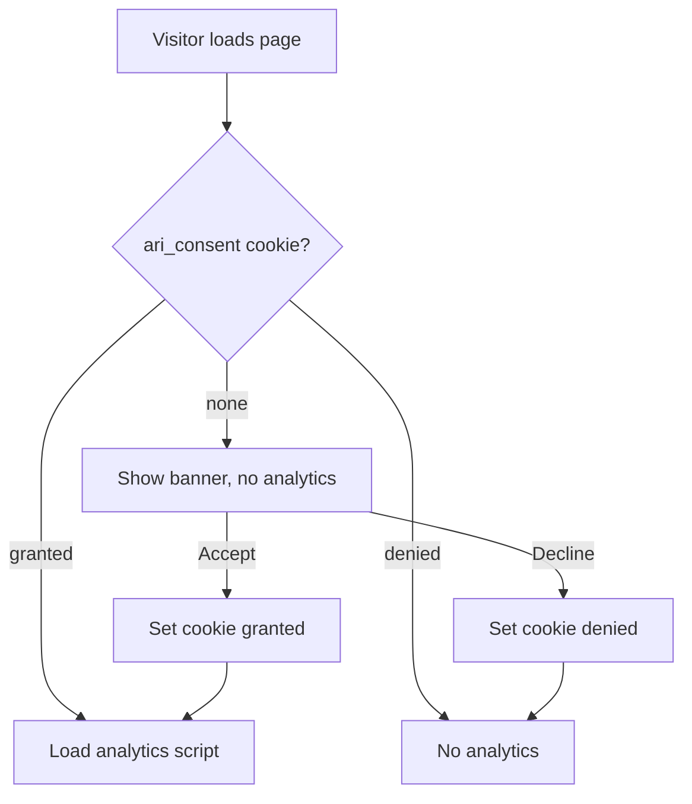
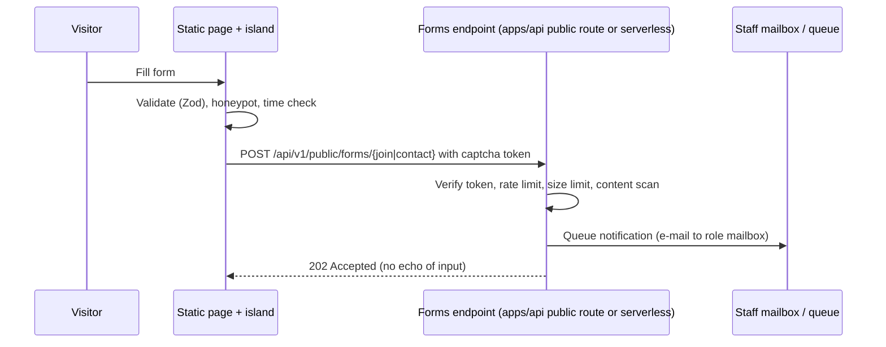

# 02 — Public site (apps/public-site, Astro)

Scope: REQ-004, REQ-012, REQ-019 to REQ-026, REQ-053, REQ-071. CMS choice: see `03-adr-cms-choice.md`.

## 1. Principles

- Static-first. Output is plain HTML + small CSS + near-zero JS.
- JS "islands" only where needed: language switch, consent banner, forms, mobile nav.
- No API calls to the protected backend. The only runtime call is the form endpoint (section 7).
- The public site holds no patient data, no sample data, no counts from the index. (Public stats, if shown later, are static numbers entered by editors.)
- Separate deploy from the protected app (REQ-053). Own domain or sub-path decided by A7. Default: `www.<domain>` for the site; the protected SPA is served by `ari-api` on its own host (same origin as the API, C-03/C-04). Login entry is a link to `app.<domain>/login`.

## 2. Structure

```
apps/public-site/
  astro.config.mjs        i18n: locales ['he','en'], defaultLocale 'he', routing prefixDefaultLocale true
  src/
    layouts/              BaseLayout, PageLayout, ArticleLayout
    components/           from packages/design-system (Astro wrappers)
    pages/[locale]/...    one page per model below
    content/config.ts     Astro content collections + Zod schemas (the content models)
    lib/seo.ts            hreflang, canonical, JSON-LD builders
  content/                (Git content edited by CMS)
    pages/{he,en}/*.md
    news/{he,en}/*.md
    people/ centers/ partners/ research-areas/ legal/ settings/
  public/admin/           Decap CMS (index.html + config.yml)
  public/uploads/         original images from CMS
```

URLs: `/he/` and `/en/`. Root `/` redirects by `Accept-Language` at the CDN edge, else `he` (static fallback page with both links). Slugs: Hebrew pages use ASCII slugs, the same in both locales (`/he/about`, `/en/about`). This keeps hreflang simple.

## 3. Content models for every REQ-019 page

Common front matter for all pages (`PageBase`):

| Field | Type | Rule |
|---|---|---|
| `title` | string (per locale) | required, ≤ 70 chars |
| `description` | string | required, ≤ 160 chars (meta description) |
| `slug` | string | ASCII kebab-case, same across locales |
| `locale` | `he`/`en` | required |
| `translation_status` | `complete`/`pending` | default `complete` |
| `draft` | bool | default false |
| `updated` | ISO date | set by CMS |
| `og_image` | image ref + alt | optional |
| `noindex` | bool | default false |

Per page:

| Page (EN / HE) | Collection | Specific fields |
|---|---|---|
| Home / דף הבית | `pages/home` | `hero` {headline, subline, cta_primary {label,url}, cta_secondary}; `value_props[]` (3 items {icon, title, text}); `highlights[]` (refs to news/research areas); `partner_logos[]` (refs); `login_teaser` {text} |
| About / אודות | `pages/about` | `mission` (md); `story` (md); `principles[]` {title,text}; `team[]` (refs to `people`); `governance` (md); `milestones[]` {year,text} |
| Research areas / תחומי מחקר | `research-areas` (one file per area) + `pages/research-index` | `name`, `summary`, `body` (md), `image`, `related_news[]`, `order` |
| Community / קהילה | `pages/community` | `intro`; `groups[]` {name, role, bio} (refs to `people`); `events[]` {title, date (day ok, public event), place text, link}; `join_cta` |
| Infrastructure / תשתית | `pages/infrastructure` | `intro`; `layers[]` {title, text, icon} (public vs protected explained); `centers[]` (refs to `centers`); `standards` (md); `how_it_works` (steps) |
| Global partners / שותפים בעולם | `partners` + `pages/partners-index` | `name`, `country`, `logo` + alt, `url`, `summary`, `type` |
| News / חדשות | `news` | `title`, `date`, `summary`, `body` (md), `cover` + alt, `tags[]`, `author` ref |
| Patients & families / חולים ומשפחות | `pages/patients` | `plain_intro` (reading level note); `what_is_registry` (md); `privacy_promise` (md); `faq[]` {q,a}; `support_links[]` {label,url,org}; `contact_cta` — **needs legal/clinical review before publish** |
| Join / Contact / הצטרפות ויצירת קשר | `pages/join` | `intro`; `forms` config {join, contact} (labels, consent text, success text); `office_role_emails` (role mailbox only, no personal address) |
| Login entry / כניסה | `pages/login-entry` | `intro`; `who_can_login[]` (roles in plain words); `request_access_text`; `app_login_url` (setting) |
| Privacy policy / מדיניות פרטיות | `legal/privacy` | `version`, `effective_date`, `body` (md) — **needs legal review** |
| Terms of use / תנאי שימוש | `legal/terms` | same as above — **needs legal review** |
| Accessibility statement / הצהרת נגישות | `legal/accessibility` | `standard` text, `conformance`, `known_issues[]`, `contact`, `last_review` (needed for Israeli requirements; legal review) |
| Cookie / analytics notice | `legal/analytics` | list of what is measured; link to consent settings |
| Site settings | `settings/site` | `site_name`, `nav[]` (labels per locale), `footer`, `social[]`, `default_og`, `analytics_enabled` flag |

Image field rule: `image` + `alt_he` + `alt_en` (alt required; empty only if `decorative: true`).
Real photos of children: only with documented consent on file (needs legal review). Default: illustrations (A5).

Content validation: Zod schemas in `content/config.ts` are the single definition; the Decap `config.yml` is generated from them by a script (`pnpm gen:cms-config`) so the two cannot drift. CI fails on drift.

## 4. SEO (REQ-023)

- `<html lang dir>` set per locale.
- `<link rel="alternate" hreflang="he|en|x-default">` on every page that has both locales. `x-default` points to the `he` page (default locale). If `translation_status: pending`, omit the missing alternate.
- Canonical URL on every page (absolute, https, no trailing-slash variation).
- Sitemap: `@astrojs/sitemap` with `i18n` option so each entry has `xhtml:link` alternates. `robots.txt` references it. `lastmod` from `updated`.
- Open Graph + Twitter card tags; per-locale `og:locale`.
- Structured data (JSON-LD), built in `lib/seo.ts`:
  - `Organization` (name "ARI-PST × Tech4Cancer", logo, sameAs) on all pages. Legal entity name per GATE-OPERATOR; placeholder until closed.
  - `WebSite` with `inLanguage`.
  - `BreadcrumbList` on inner pages.
  - `NewsArticle` for each news item.
  - `FAQPage` only for the Patients FAQ if the content is plain Q/A and reviewed.
  - `Event` for community events with public dates.
  - No `MedicalWebPage` claims, no medical advice markup.
- `noindex` on: preview builds, `/admin`, form success pages, login-entry optional (default index).
- Semantic headings (one `h1`), meaningful link text, short URLs.
- Performance is part of SEO (section 6).
- 404 page per locale. Redirect map file `content/settings/redirects.json` → Render redirect rules.

## 5. Analytics with consent (REQ-025, REQ-066)

Principles: privacy first, no personal data, consent before any measurement that sets identifiers.

Choice: **self-hosted Plausible Community Edition or Umami** (cookie-less, no cross-site tracking) as the target; start with the simplest.
Default decision: **Umami self-hosted on Render** (small web service + managed Postgres separate from the portal DB) — UNVERIFIED sizing. Alternative: Plausible CE. Alternative: none if the owner prefers (flag `analytics_enabled=false`).

Design:
- Cookie-less mode: no cookie, no localStorage, IP not stored, no cross-day visitor ID. Under many readings this needs no consent, but **needs legal review** for Israeli law and GDPR (REQ-049). Our default treats it as consent-based anyway.
- Consent banner (he/en): two buttons of equal weight: "Accept measurement" / "Decline". Default is no measurement. Choice stored in a first-party cookie `ari_consent` (value `v1:granted|denied`, 180 days, `SameSite=Lax`, `Secure`). This cookie is not an identifier.
- Footer link "Privacy settings" re-opens the banner. Withdraw is as easy as grant.
- Script loads only after `granted`. Respects `Do Not Track` and `Sec-GPC` (treated as denied).
- Events (no personal data): `page_view`, `cta_click` (id), `login_entry_click`, `join_form_submit_success`, `contact_form_submit_success`, `language_switch`. No form content. No query strings with free text.
- Metrics tied to REQ-066 that are public-site-related: visits, join form conversions. Protected-area metrics (searches, requests) come from server-side product events in the API (A9/A3), not from browser analytics, and are aggregated.
- The protected app (`apps/web`) has **no third-party analytics and no browser analytics scripts**.
- CSP allows only the analytics host (see `04-protected-app-security.md` for the site CSP).



## 6. Performance budget (public site)

Targets measured at p75 on mobile (Moto G Power class, Slow 4G) in lab; field data via CrUX/RUM if consented.

| Metric | Target | CI assertion |
|---|---|---|
| LCP | ≤ 2.0 s (Google "good" ≤ 2.5 s) | error > 2500 ms, warn > 2000 ms |
| INP | ≤ 200 ms | field only (lab uses TBT ≤ 150 ms) |
| CLS | ≤ 0.05 (good ≤ 0.1) | error > 0.1, warn > 0.05 |
| TBT | ≤ 150 ms | error > 200 ms |
| Total JS per page | ≤ 30 KB gzip (target 0 on most pages) | error > 50 KB |
| Total CSS | ≤ 40 KB gzip | error > 60 KB |
| Page weight (excl. lazy images) | ≤ 500 KB | error > 800 KB |
| Fonts | ≤ 2 families, ≤ 4 files, ≤ 120 KB total, `font-display: swap`, Hebrew subset | script check |
| Requests (initial) | ≤ 25 | warn |
| TTFB (CDN) | ≤ 400 ms | warn |
| Lighthouse scores (mobile) | Perf ≥ 0.95, A11y = 1.0 (as far as automatable), SEO ≥ 0.95, Best Practices ≥ 0.95 | error below |

Full JSON: `05-budgets-and-ci.md`.

## 7. Image strategy

- Originals uploaded through CMS into `public/uploads/` (max 6 MB, JPEG/PNG/SVG/WebP). CI rejects larger files.
- Astro `<Image>`/`<Picture>` generates AVIF + WebP + JPEG fallback, widths 320/640/960/1280/1920, `sizes` attribute set per layout slot.
- Always set `width` and `height` (no CLS). `loading="lazy"` and `decoding="async"` except the LCP image: `fetchpriority="high"`, no lazy.
- Strip EXIF/GPS metadata at build (privacy). Check in CI.
- Alt text per locale is required (section 3).
- Hero uses CSS-light illustration or SVG where possible (A5). SVGs are sanitized (SVGO, no scripts).
- Partner logos: SVG preferred; ≤ 20 KB each.
- No third-party image hosts. No hot-linking.
- No auto-playing video. Video (if any) is a click-to-load facade with privacy-enhanced embed; counts as third-party (needs consent entry in banner).

## 8. Forms: join and contact (no sensitive data)

What the forms collect:
- Join: name (free text), organization, role (select: researcher/clinician/center/partner/family/other), e-mail, message, interest areas (checkboxes), consent to be contacted.
- Contact: name, e-mail, subject (select), message.

What they never collect: patient data, diagnoses, sample details, ID numbers, health details. The form shows a visible notice in he/en: "Do not send medical or personal details about patients."
Patients & families page uses the contact form with a "general question" subject only. No intake of cases.

Flow:


Spam protection (layered):
1. Honeypot field (hidden, `tabindex=-1`, `autocomplete=off`).
2. Minimum fill time (≥ 3 s) signed timestamp token.
3. Privacy-friendly challenge: **Cloudflare Turnstile** or **ALTCHA** (self-hosted proof-of-work, no third-party calls). Default: ALTCHA (no third party, fits privacy stance). UNVERIFIED: confirm accessibility of ALTCHA widget (WCAG) in spike; fallback Turnstile non-interactive.
4. Server rate limit per IP hash (hash with daily salt; no raw IP stored): 5/hour.
5. Max body 8 KB; allowed fields only (strict schema); reject links > 2 in message.
6. Content scan: reject ID-like numbers and long digit strings.
7. Messages go to a mail queue (`notifications` module) and are deleted from the DB after delivery + 30 days (retention to confirm with A2).

Accessibility: labels, error summary, success message in `role="status"`, no CAPTCHA that needs image puzzles.
Consent text: links to privacy policy; checkbox required for "contact me back" (needs legal review).
The endpoint is a public route in `apps/api` (A1 decides) and CORS allows only the site origin. OPEN-A6-02.

## 9. Build and deploy

- `astro build` → `dist/` static. Render static site; auto deploy after CI. PR preview uses synthetic placeholder content in test fixtures only; real content is not synthetic-data sensitive (it is public by design), but previews are `noindex`.
- Security headers via Render `headers` in `render.yaml` (A7) — list in `04-protected-app-security.md` section 2.
- Cache: HTML `public, max-age=0, must-revalidate`; hashed assets `public, max-age=31536000, immutable`.
- Build-time checks: schema, links, image sizes, hreflang pairs, sitemap validity, JSON-LD validity (`schema-dts` types), a11y (pa11y/axe over built HTML), Lighthouse CI.
