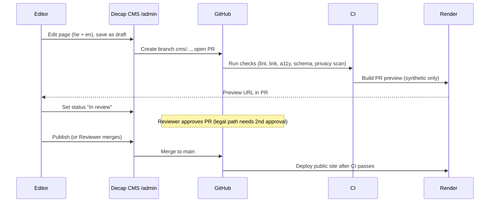

# ADR-A6-001 — Git-based CMS for the public site

ID note: the orchestrator may renumber this to `ADR-###`. Working ID: `ADR-A6-001`.
Status: Proposed. Date: 2026-11-13.
Covers: REQ-019, REQ-020, REQ-024, REQ-069.

## Context

- The non-technical team must edit pages in Hebrew and English (REQ-024).
- Git is the source of truth (contract pack section 1). Edits must be commits/PRs.
- Review and approval before publish are required (preview + approval via PR).
- Pack assumes Decap CMS. This ADR tests that.
- No real patient data is ever in the CMS.

## Options (facts UNVERIFIED unless noted; verify versions before build)

| Criterion | Decap CMS | TinaCMS | Keystatic | Sveltia CMS | Pages CMS |
|---|---|---|---|---|---|
| Stores content in Git | Yes | Yes | Yes | Yes | Yes |
| Self-host / no vendor DB | Yes (static admin app) | Partly (Tina Cloud or self-host backend) | Yes (local/GitHub mode) | Yes (static admin app) | Hosted service |
| Editorial workflow via PRs | Yes (`publish_mode: editorial_workflow`, draft/review/ready = PR + labels) | Yes (branch-based; cloud features) | Branch + PR via GitHub mode | Yes (Decap-config compatible) | Limited |
| Decap config compatible | Native | No | No | Yes (drop-in goal) | No |
| RTL / Hebrew editor UI | Weak. Content fields can hold RTL text; UI is LTR. Needs `dir` hints. | Similar | Similar | Better i18n, RTL support claimed (UNVERIFIED) | Unknown |
| i18n content (he/en) | Built-in `i18n` config (folder or file structure) | Manual | Manual | Same as Decap | Manual |
| Maturity / maintenance | Mature; community-maintained after Netlify (UNVERIFIED current cadence) | Active, commercial | Active, small team | Newer, fast-moving, small team | Newer |
| Auth without Netlify | Needs a GitHub OAuth proxy (self-hosted small service) | Tina Cloud or own | GitHub App/OAuth | Same as Decap | Own |
| Lock-in risk | Low (plain files) | Medium | Low | Low | Medium |
| Preview | Preview pane (React templates) + deploy-preview via PR | Visual editing | Basic | Preview pane | Basic |

## Decision

**Adopt Decap CMS as the primary.** Use Decap-compatible config so **Sveltia CMS can replace it** with no content migration.

Reasons:
- It matches the pack assumption and the Git/PR model with the least new moving parts.
- Plain Markdown/JSON files. Zero lock-in. Easy to leave (REQ-070).
- Built-in editorial workflow maps to PRs, which the owner requires.
- Built-in i18n config fits he/en.
- Exit path: Sveltia CMS (same config) if Decap maintenance or RTL UI becomes a problem.

Accepted weaknesses and mitigations:
- Editor UI is mostly LTR. Mitigation: field `hint` text in Hebrew; use `widget: markdown` with RTL preview CSS; train editors; evaluate Sveltia in a 1-day spike in Phase 1 week 1 (task `SPIKE-CMS-RTL`).
- Needs GitHub OAuth proxy. Mitigation: small self-hosted OAuth proxy on Render (stateless, no content). Owned by A7. See `plan/requests/A6-to-A7.md`.
- Editorial workflow in Decap uses branches named `cms/<collection>/<slug>`. Mitigation: CI treats `cms/*` as normal PR branches.

## Roles and workflow

Roles (GitHub-side; no portal accounts are used for the CMS):

| CMS role | Who | GitHub permission | Can do |
|---|---|---|---|
| Author | Content staff | Write on repo via fork-less branch, **no merge** | Create/edit drafts. Opens PR. |
| Reviewer | Content lead | Write; required reviewer (CODEOWNERS for `content/**`) | Review preview, approve PR. |
| Publisher | Content lead or admin | Merge rights | Merge to `main`. |
| Legal/Privacy reviewer | Named person | CODEOWNERS for `content/legal/**`, `content/patients/**` | Mandatory approval on those paths (needs legal review). |
| Developer | Engineers | Normal | Change templates and config. |

Rules:
- `main` is protected: PR required, 1 approval (2 for legal paths), CI green.
- Authors cannot approve their own PR.
- The CMS writes content only (`content/**`, `public/uploads/**`). CODEOWNERS blocks CMS-origin PRs that touch other paths (CI check `content-only-diff`).

Quality gates on every content PR:
- Schema validation of front matter (Zod, built from the content models).
- Both locales present for required fields, or an explicit `translation_status: pending` flag (page is then published in one language only, and hreflang for the missing one is omitted).
- Alt text required for every image.
- Link check, spell hints (he/en), PII scan (regex for ID-like numbers, e-mails, phones in content).
- Lighthouse CI + axe on the preview.
- Draft content is never built into production: `draft: true` is excluded.

## Consequences

- Editors learn a simple UI; developers keep full control of templates.
- Every publish has an audit trail (Git history).
- Rollback = revert the PR.
- A small OAuth proxy is an extra service to run (low risk; stateless).
- If RTL UI spike fails, switch to Sveltia with the same `config.yml`.

## Revisit triggers

- Decap has no release for 12 months, or a security advisory is unpatched.
- RTL editor UI blocks editors in the spike.
- Editorial team grows beyond 10 people (consider a hosted option).
