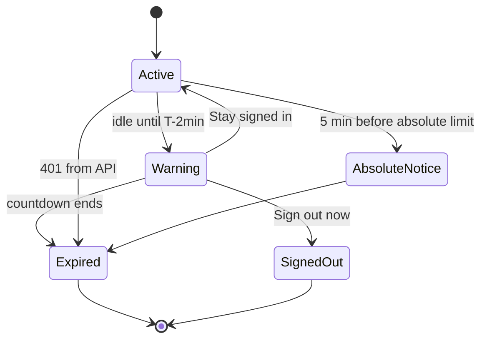
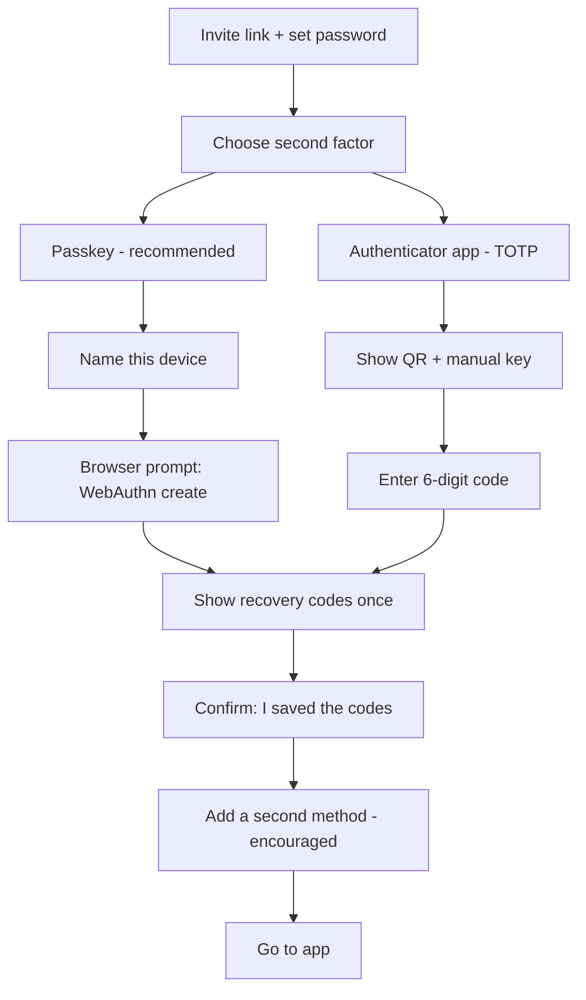

# 04 — Protected app: security, session, and behavior UX

Scope: REQ-006, REQ-033, REQ-034, REQ-036, REQ-042, REQ-043, REQ-044, REQ-045, REQ-046.
Server rules are owned by A2. This file states what the front end does and needs. Conflict → A2 wins; raise a request.

## 1. Origin model (decision input)

- SPA and API must share one origin for `__Host-` cookies: `https://app.<domain>/` serves the SPA; `https://app.<domain>/api/v1/*` is routed to the API service.
- **Decided (C-03, C-04):** the API web service `ari-api` serves the built SPA files itself (`WEB_DIST_DIR=apps/web/dist`) at `/` and the API at `/api/v1`. No Render rewrite or proxy is used. OPEN-A6-03 is closed. The host name is the custom domain or `<service>.onrender.com`, not necessarily `app.<domain>`.
- Public site is on a different host (`www.<domain>`). It shares no cookies with the app.
- No CORS needed for the app (same origin). CORS stays off on the API except the public forms route.

## 2. Security headers

For `apps/web` (HTML responses and assets):

```
Content-Security-Policy: default-src 'none'; script-src 'self'; style-src 'self'; img-src 'self' data:; font-src 'self'; connect-src 'self'; manifest-src 'self'; worker-src 'self'; frame-src 'none'; frame-ancestors 'none'; object-src 'none'; base-uri 'none'; form-action 'self'; upgrade-insecure-requests; require-trusted-types-for 'script'; trusted-types default; report-to csp-endpoint; report-uri /api/v1/csp-report
Reporting-Endpoints: csp-endpoint="/api/v1/csp-report"
Strict-Transport-Security: max-age=63072000; includeSubDomains; preload
X-Content-Type-Options: nosniff
Referrer-Policy: no-referrer
Permissions-Policy: accelerometer=(), camera=(), geolocation=(), gyroscope=(), magnetometer=(), microphone=(), payment=(), usb=(), publickey-credentials-get=(self), publickey-credentials-create=(self), clipboard-write=(self), interest-cohort=()
Cross-Origin-Opener-Policy: same-origin
Cross-Origin-Resource-Policy: same-origin
Cross-Origin-Embedder-Policy: require-corp
X-Frame-Options: DENY
Cache-Control (HTML): no-store
Cache-Control (hashed assets): public, max-age=31536000, immutable
```

Notes on the CSP:
- No `'unsafe-inline'` and no `'unsafe-eval'`. Vite production build emits external scripts and one CSS file per chunk. No inline `<script>`. Theme (light/dark) bootstrap is a small external file `/theme-init.js`, loaded first, to avoid flash.
- React sets `style={{}}` via the CSSOM, which CSP allows. Inline `<style>` tags and `style="..."` HTML attributes are not used. A lint rule bans `dangerouslySetInnerHTML`.
- `data:` in `img-src` is for tiny inline SVG icons only. If not needed, remove it.
- Trusted Types: `require-trusted-types-for 'script'` with a `default` policy that throws in dev and logs in prod. If a library breaks (check in spike), start in `Content-Security-Policy-Report-Only` for two weeks, then enforce. Safari support for Trusted Types is limited (UNVERIFIED); the directive is ignored where unsupported.
- `connect-src 'self'` blocks any call to third parties, including analytics and error trackers. The error reporter posts to `/api/v1/client-errors` (same origin).
- Fonts are self-hosted. No Google Fonts in the app.
- `frame-src 'none'`: no embeds. If a future pathology viewer needs a frame, add an ADR (Phase 2 hook).
- COEP `require-corp` is fine because everything is same-origin. If it breaks a library, drop COEP first (keep COOP).
- CSP violation reports go to the API; the API rate-limits and strips URLs' query strings.

For `apps/public-site` (static, with analytics + forms):

```
Content-Security-Policy: default-src 'none'; script-src 'self'; style-src 'self'; img-src 'self' data:; font-src 'self'; connect-src 'self' https://analytics.<domain> https://app.<domain>; manifest-src 'self'; frame-src 'none'; frame-ancestors 'none'; object-src 'none'; base-uri 'self'; form-action 'self' https://app.<domain>; upgrade-insecure-requests
```
Astro inline scripts are hashed at build (use `@astrojs/...` CSP hash support or move to external files). If a hash is required, a post-build script injects `'sha256-…'` values. Analytics host is added only when `analytics_enabled`. The Decap `/admin` path needs a looser CSP (`script-src 'self' 'unsafe-inline'` or hashes, `connect-src https://api.github.com <oauth-proxy>`), set only for `/admin/*`, with `noindex`.

CSP test: Playwright loads every route and fails on any `securitypolicyviolation` event. CI also runs a header check (A7) against preview URLs.

## 3. No sensitive data in client storage

Rules (lint + e2e test enforce):
- No `localStorage`, `sessionStorage`, `IndexedDB`, or Cache API for: tokens, user identity, search terms, results, cart, request drafts, audit data, file names.
- Allowed non-sensitive UI prefs only: `ui.theme`, `ui.locale`, `ui.density`, `ui.sidebarCollapsed`. Access only via `shared/ui-prefs.ts`. Each key and value is checked against an allow-list.
- No Service Worker caching of API responses. If a PWA shell is wanted later, cache static assets only. Phase 1: no service worker.
- Auth is a cookie only. JS never sees it (HttpOnly).
- URLs carry no sensitive data: no search terms, no request text, no sample codes in query strings where avoidable. Filters in URL are enum codes only (`?dx=...&type=ffpe`) so deep-linking works; they are not personal. `Referrer-Policy: no-referrer` also applies.
- `autocomplete="off"` on request free-text fields; `autocomplete` tokens on login (`username`, `current-password`, `one-time-code`, `webauthn`).
- On logout/expiry: `queryClient.clear()`, clear cart store, revoke object URLs, `location.replace('/login')` (removes history state), and send `Clear-Site-Data: "cache", "storage"` from the logout API response (note: `"cookies"` also if the server wants).
- Browser back after logout shows no data because HTML is `no-store` and queries are cleared.
- Screenshots/print: pages with record data carry a print stylesheet that hides tables unless the user picks "Print summary" (shows only aggregates). OPEN-A6-04 (A2 view).

## 4. Cookies and CSRF

Cookie (set by API, A2 owns details):

```
Set-Cookie: __Host-sid=<opaque>; Path=/; Secure; HttpOnly; SameSite=Strict; Max-Age=<idle-limit>
```
- `__Host-` prefix: needs `Secure`, `Path=/`, no `Domain`. Forces host-only cookie.
- `SameSite=Strict` for the session cookie. Because login is by form in the app itself, Strict works. Links from e-mail (for example a notification) land on the login page first, then redirect to `next` (UX cost is small).
- Second cookie for CSRF: `__Host-csrf` (double-submit, **not** HttpOnly so JS can read it; `Secure; SameSite=Strict; Path=/`). Value is bound to the session by HMAC on the server.
- Every state-changing request (POST/PUT/PATCH/DELETE) sends header `X-CSRF-Token` with that value. The api-client middleware adds it. The server also checks `Origin`/`Sec-Fetch-Site` = same-origin.
- Requests use `credentials: 'same-origin'`.
- Custom header + JSON content type means simple cross-site forms cannot forge requests.
- Login and password-reset endpoints also require CSRF (pre-session token cookie).
- Never put the CSRF token in the URL or in storage.

## 5. Safe download handling

Used for: export of an approved dataset, audit export, CSV error report, import template.

Rules:
- Downloads come from the API with `Content-Disposition: attachment; filename="..."`, `X-Content-Type-Options: nosniff`, `Cache-Control: no-store`. Server sets a generated file name (no user text, no sample codes): `ari-export-<ULID>.csv`.
- The front end never builds a file from user text in the browser, except CSV error report by the API.
- Use a normal `<a href download>` to a same-origin authenticated URL (cookie sent), or `fetch` → `blob` → `URL.createObjectURL` only if progress is needed; revoke the URL right after use.
- Large or sensitive files: one-time, short-lived download link (API issues `dl_<ULID>`, valid 60 s, single use, session-bound). The UI shows "Preparing file…" and then starts the download. Each download is an audit event (REQ-046).
- CSV formula injection: server prefixes cells starting with `=`, `+`, `-`, `@`, tab, CR with `'`. The UI warns "Open in a text editor if unsure".
- Shown before download: file type, row count, and a reminder "Use under the signed DTA/MTA terms" (text from A4).
- Uploads (import wizard): accept only `.csv`, `.xlsx`; max size from API config (default 10 MB); check extension and MIME client-side for UX only; server validates. No preview of formulas; parse on the server. File name is never shown in logs.
- Never open downloaded content in an iframe or `window.open` with blob HTML.

## 6. Session timeout UX

Values (canonical-decisions C-02): idle 15 min for staff roles, 30 min for researchers; absolute 4 h for `system_admin`, 8 h for others; warning 2 min before idle end. ASSUMPTION-A6-02 is superseded.

Behavior:
- A `SessionTimer` tracks last user activity (pointer, key, API call) in memory. It also reads `expiresAt` from `/api/v1/session` (source of truth).
- At T-2 min: modal dialog (`role="alertdialog"`, focus trapped, announced to screen readers) "Your session ends in 2:00. Stay signed in?" with a countdown that updates every second (visual) and every 30 s (aria-live polite). Buttons: "Stay signed in" (calls `POST /api/v1/session/extend`) and "Sign out now".
- Absolute limit: no extend button; the dialog says "For security you must sign in again" with a 5-minute notice.
- On expiry: clear client state, show a full page "Your session ended" with reason, then a Sign in button. The `next` path is kept (path only, no data). Unsaved form text is lost by design; the warning dialog gives the user time to save a draft (server draft). Message says so.
- Multi-tab: `BroadcastChannel('ari-session')` carries only the events `extended`, `signed_out` (no data). A sign-out in one tab signs out all tabs.
- Any API `401` triggers the same expiry flow once (debounced).
- Step-up: sensitive actions (approve request, export download, change MFA) need a recent MFA (≤ 5 min, C-02). The API returns `403` with `code: "step_up_required"`; UI opens the MFA dialog and retries the action once. ASSUMPTION-A6-03.
- WCAG 2.2.1 (timing adjustable): the user can extend at least 10 times before the absolute limit.



## 7. Passkey and TOTP enrolment UX

Policy (A2): 2FA required for all protected roles (REQ-044). Passkey preferred; TOTP is fallback. Recovery codes required.

First login flow:


UX rules:
- Plain words: "Passkey: use your fingerprint, face, or device lock" / "Authenticator app: 6-digit code".
- Feature detect `PublicKeyCredential`; if unsupported, show only TOTP with a note.
- Passkey: client calls API for options (challenge), `navigator.credentials.create`, sends result. Errors mapped: `NotAllowedError` (cancelled) → friendly retry; `InvalidStateError` (already registered); timeout.
- TOTP: QR drawn client-side from the `otpauth://` URI (library bundled, no external QR service). Secret displayed in groups of 4 for manual entry, wrapped in `dir="ltr"`. Secret is never stored in client storage and is cleared from state after confirm. Code input: `inputmode="numeric"`, `autocomplete="one-time-code"`, 6 boxes as ONE input for screen-reader friendliness.
- Recovery codes: 10 single-use codes; shown once; buttons Copy / Download `.txt` / Print. Require a checkbox before continuing. Download uses a Blob (exception to section 5; no server round trip; revoke URL) — codes are not saved anywhere by the app.
- Security page (`/account/security`): list of methods (name, added, last used), add/remove method, regenerate codes. Remove needs step-up. Cannot remove the last method.
- Login challenge: passkey button first with conditional UI (`mediation: 'conditional'`); TOTP field second; "Use a recovery code" link.
- Lockout and rate-limit messages are generic (no user enumeration).
- Everything is keyboard accessible and works at 200% zoom. Touch targets ≥ 44 px.

## 8. Suppressed-count UI (REQ-032, REQ-033)

Server returns counts already k-screened (A2/A3). The client never computes or infers suppressed values.

Response shape (illustrative, A1/A3 own the contract):
```json
{ "total": {"value": 128, "exact": true},
  "buckets": [
    {"key": "ffpe", "count": {"value": 74, "exact": true}},
    {"key": "csf",  "count": {"value": null, "suppressed": true, "mergedInto": "other_sample_types"}},
    {"key": "other_sample_types", "count": {"value": 9, "exact": true, "merged": true}} ],
  "k": 5 }
```

UI behavior:
- A suppressed cell must not show the threshold (for example "< 5"). That would leak that the value is 1–4. Show "Too few to show" (C-09) with an info icon. The explanation text (tooltip + footnote, also readable without hover) says: "Small numbers are hidden to protect privacy. They are included in the broader group."
- Merged group is labelled "Other (grouped)" with a footnote.
- The global note shows the policy once: "Counts are shown only when the group is large enough to protect privacy." The threshold value is never shown anywhere in the UI (C-09 closes OPEN-A6-05).
- Charts: suppressed bars are hatched, not zero-height. Provide text alternative table. Never plot `0` for suppressed.
- Sort/filter: suppressed buckets sort last. A filter that yields a fully suppressed result shows an empty state "No groups large enough to display. Try broader filters." (not "0 results").
- Differencing attack guard (UI side): the UI does not offer "exclude X" or free-add/remove combos that the API did not allow. Debounce filter changes (400 ms). The API enforces rate limits and consistent screening (A2). UI displays `429` as "Too many searches. Please wait." with retry-after.
- Totals that would reveal a suppressed value by subtraction are also coarsened by the server (`exact: false`, shown as "about 130" or range). UI displays `exact:false` with "≈" and a tooltip.
- Roles: `researcher_il`, `researcher_intl`, committee, admin see only this aggregated view. `national_coordinator` and `center_clinician` see record lists (de-identified; own center for clinician), and no suppression there; rows show `sample_code` only.
- No export button on the aggregate view for `researcher_intl` (aggregate view only, REQ-014).
- Every aggregate query is audited by the API (REQ-046).

## 9. Request cart and tracker UX

Cart (REQ-034):
- Researchers add filter sets ("cohorts") to the cart, not individual samples. An item = `{filters, aggregateSnapshot, addedAt}`. The snapshot shows counts at the time (with suppression applied) and states "Counts may change".
- Cart icon with count badge in header; `aria-live` announcement "Added to request cart".
- Cart page lists items; remove with Undo toast (10 s). Cart is server-side (preferred) and survives sessions; never in browser storage.
- Limit (config): max 10 items. Clear error text when hit.
- "Start request" opens the multi-step form.

Request form (REQ-035): steps with a progress list.
1. Research question (text, length-limited, notice: no patient data).
2. Applicant and approvals: IRB/Helsinki approval ref (opaque ID, format check), approval document upload is **out of scope for Phase 1** unless A4 says otherwise (OPEN-A6-06).
3. Planned use and data needed.
4. Funding sources.
5. Review and submit (read-only summary, declaration checkbox).
- Autosave server draft every 30 s and on step change; show "Saved at HH:MM".
- Validation per step; cannot jump forward past an invalid step, can go back freely.
- Submit shows spinner, locks the form, sends `Idempotency-Key`; success page with request ID (`req_...`) and what happens next.

Tracker (REQ-036):
- Timeline of the stages: Submitted → Coordinator pre-check → Committee decision → Center coordination → MTA/DTA → Delivery. Each stage: status (done / current / waiting / blocked), date (day precision), actor role (not person name), and a note field text written by staff (plain text, escaped).
- Statuses and wording from A4's state machine; i18n key `requests.tracker.stage.<stage>.<state>`.
- "Needs your action" banner (for example more information requested) with a clear button. Applicant replies in a structured form.
- Updates: refetch every 10 s only while the tab is visible and the request is open; otherwise on focus. In-app notification and e-mail (e-mail has no details, only "status changed").
- Every step visible to the applicant (REQ-036); internal committee notes are marked `internal` by the API and never sent to the applicant view.
- Decision view for committee: request summary, applicant info, pre-check result, vote controls (approve / reject / ask for info + reason from a coded list + optional text), current vote count (N-of-M), conflict-of-interest declaration. Separation of duties: admin cannot vote; UI hides vote controls by role and API enforces.
- Request states are not guessable by URL: `/requests/:id` where API checks ownership/role (no data in client for others).

## 10. Other client rules

- Every route sets `document.title` and moves focus to the main heading on navigation (SPA a11y).
- Idle detection and timers use `visibilitychange` so background tabs do not keep a session alive.
- Copy-to-clipboard for `sample_code` is allowed; nothing else is copied automatically.
- `target="_blank"` links use `rel="noopener noreferrer"`. External links in the app show an "external site" icon.
- Error reporter strips URLs to path only and removes any long digit strings.
- Dependencies: `pnpm audit` + `osv-scanner` in CI; lockfile pinned; Renovate/Dependabot; SBOM (A2/A7).
- Source maps are not public. `window` has no debug globals in prod.
- Feature "Report a problem" opens a form that sends only a category, route id, `traceId`, and optional text after a "no patient data" notice.
