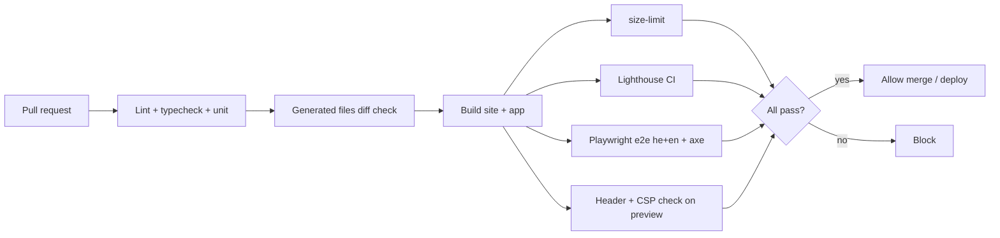

# 05 — Performance and accessibility budgets (CI-checkable)

Scope: REQ-021, REQ-022, REQ-023, REQ-071. Tools: Lighthouse CI (LHCI), axe-core via Playwright, size-limit, Stylelint, ESLint jsx-a11y.
CI owner: A7. Tests owner: A8. A6 gives the config.

## 1. Budgets in one table

| Area | Metric | Public site | Protected app |
|---|---|---|---|
| Lab (mobile, Slow 4G, 4x CPU) | LCP | ≤ 2.0 s target, fail > 2.5 s | ≤ 2.5 s target, fail > 3.5 s |
| | CLS | ≤ 0.05, fail > 0.1 | ≤ 0.05, fail > 0.1 |
| | TBT | ≤ 150 ms, fail > 200 ms | ≤ 250 ms, fail > 350 ms |
| | Lighthouse Performance | ≥ 0.95 | ≥ 0.85 |
| Field p75 (RUM/CrUX, if consented) | LCP / INP / CLS | ≤ 2.5 s / ≤ 200 ms / ≤ 0.1 | n/a (no browser analytics in app); use synthetic checks (A9) |
| Size (gzip) | JS initial | ≤ 30 KB (fail 50) | ≤ 170 KB (fail 220) |
| | JS per lazy route chunk | n/a | ≤ 80 KB (fail 120) |
| | CSS total | ≤ 40 KB (fail 60) | ≤ 60 KB (fail 90) |
| | Fonts | ≤ 120 KB | ≤ 160 KB (Hebrew + Latin subset) |
| | Page weight (no lazy imgs) | ≤ 500 KB (fail 800) | n/a |
| Requests on first view | count | ≤ 25 | ≤ 35 |
| Accessibility | Lighthouse a11y | 1.0 | ≥ 0.98 |
| | axe serious/critical | 0 | 0 |
| | axe moderate/minor | 0 new (baseline file) | 0 new (baseline file) |

Reason for the app numbers: SPA, he/en catalogs, charts. Targets are tight enough for clinic and campus networks.

## 2. Lighthouse CI

`apps/public-site/lighthouserc.json`:

```json
{
  "ci": {
    "collect": {
      "staticDistDir": "./dist",
      "url": [
        "http://localhost/he/index.html",
        "http://localhost/en/index.html",
        "http://localhost/he/about/index.html",
        "http://localhost/he/news/index.html",
        "http://localhost/he/patients/index.html",
        "http://localhost/he/join/index.html",
        "http://localhost/he/privacy/index.html"
      ],
      "numberOfRuns": 3,
      "settings": {
        "preset": "desktop",
        "formFactor": "mobile",
        "screenEmulation": { "mobile": true, "width": 360, "height": 800, "deviceScaleFactor": 2, "disabled": false },
        "throttlingMethod": "simulate",
        "throttling": { "rttMs": 150, "throughputKbps": 1638, "cpuSlowdownMultiplier": 4 },
        "chromeFlags": "--no-sandbox"
      }
    },
    "assert": {
      "assertions": {
        "categories:performance": ["error", { "minScore": 0.95 }],
        "categories:accessibility": ["error", { "minScore": 1 }],
        "categories:seo": ["error", { "minScore": 0.95 }],
        "categories:best-practices": ["error", { "minScore": 0.95 }],
        "largest-contentful-paint": ["error", { "maxNumericValue": 2500 }],
        "first-contentful-paint": ["warn", { "maxNumericValue": 1800 }],
        "cumulative-layout-shift": ["error", { "maxNumericValue": 0.1 }],
        "total-blocking-time": ["error", { "maxNumericValue": 200 }],
        "interactive": ["warn", { "maxNumericValue": 3500 }],
        "server-response-time": ["warn", { "maxNumericValue": 400 }],
        "total-byte-weight": ["error", { "maxNumericValue": 800000 }],
        "uses-responsive-images": "error",
        "uses-optimized-images": "error",
        "modern-image-formats": "warn",
        "offscreen-images": "warn",
        "font-display": "error",
        "unsized-images": "error",
        "is-crawlable": "error",
        "hreflang": "error",
        "canonical": "error",
        "meta-description": "error",
        "document-title": "error",
        "html-has-lang": "error",
        "html-lang-valid": "error",
        "image-alt": "error",
        "color-contrast": "error",
        "tap-targets": "error",
        "viewport": "error",
        "is-on-https": "error",
        "no-vulnerable-libraries": "error",
        "csp-xss": "warn"
      }
    },
    "upload": { "target": "temporary-public-storage" }
  }
}
```

Notes:
- `temporary-public-storage` uploads reports to a public Google-hosted page. The public site has only public content, so this is acceptable. For the protected app use `"target": "filesystem"` and store as a CI artifact (never public).
- Budgets by resource size also go in `budget.json` (LHCI `budgetsFile`):

```json
[
  {
    "path": "/*",
    "resourceSizes": [
      { "resourceType": "script", "budget": 50 },
      { "resourceType": "stylesheet", "budget": 60 },
      { "resourceType": "font", "budget": 120 },
      { "resourceType": "total", "budget": 800 }
    ],
    "resourceCounts": [
      { "resourceType": "third-party", "budget": 1 }
    ]
  }
]
```
(Sizes in KB as LHCI defines them; check units on setup. UNVERIFIED.)

`apps/web/lighthouserc.json` (runs against `vite preview` with a mocked API server using synthetic data; routes `/login`, `/search`, `/requests`, `/admin/users`):

```json
{
  "ci": {
    "collect": {
      "startServerCommand": "pnpm --filter web preview:mock",
      "startServerReadyPattern": "Local:",
      "url": ["http://localhost:4173/login", "http://localhost:4173/search", "http://localhost:4173/requests", "http://localhost:4173/samples"],
      "numberOfRuns": 3,
      "settings": { "formFactor": "mobile", "throttlingMethod": "simulate" }
    },
    "assert": {
      "assertions": {
        "categories:performance": ["error", { "minScore": 0.85 }],
        "categories:accessibility": ["error", { "minScore": 0.98 }],
        "categories:best-practices": ["error", { "minScore": 0.95 }],
        "largest-contentful-paint": ["error", { "maxNumericValue": 3500 }],
        "cumulative-layout-shift": ["error", { "maxNumericValue": 0.1 }],
        "total-blocking-time": ["error", { "maxNumericValue": 350 }],
        "unused-javascript": ["warn", { "maxNumericValue": 60000 }],
        "total-byte-weight": ["warn", { "maxNumericValue": 600000 }],
        "color-contrast": "error",
        "image-alt": "error",
        "label": "error",
        "aria-valid-attr": "error",
        "button-name": "error",
        "link-name": "error",
        "tap-targets": "error",
        "is-on-https": "error",
        "csp-xss": "error"
      }
    },
    "upload": { "target": "filesystem", "outputDir": ".lighthouseci" }
  }
}
```
Authenticated pages are tested in Playwright (axe) with a seeded synthetic session, because LHCI needs login handling. Cold-load of authed routes is checked with `playwright` + `web-vitals` lib in a perf test (`tests/perf/*.spec.ts`) that asserts LCP/CLS from the browser.

## 3. Bundle size guard (size-limit)

`apps/web/.size-limit.json`:

```json
[
  { "name": "initial JS", "path": "dist/assets/index-*.js", "limit": "170 kB", "gzip": true },
  { "name": "route chunks", "path": "dist/assets/*-route-*.js", "limit": "80 kB", "gzip": true },
  { "name": "CSS", "path": "dist/assets/*.css", "limit": "60 kB", "gzip": true },
  { "name": "i18n he", "path": "dist/assets/messages-he-*.js", "limit": "40 kB", "gzip": true }
]
```
Check on build output names after first build (naming is a Vite config choice: `build.rollupOptions.output.chunkFileNames`).

## 4. Accessibility: standard and tests

Standard: Israeli Standard IS 5568 (based on WCAG 2.0 AA at origin; the Israeli regulation refers to the standard and WCAG levels — UNVERIFIED version details, **needs legal review**) and **WCAG 2.1 AA** as the binding floor (REQ-022). Target WCAG 2.2 AA where cheap (focus appearance, target size, redirect auth).

### axe config (`tests/a11y/axe.config.ts`)

```ts
import type { RunOptions } from 'axe-core';

export const axeOptions: RunOptions = {
  runOnly: { type: 'tag', values: ['wcag2a', 'wcag2aa', 'wcag21a', 'wcag21aa', 'wcag22aa', 'best-practice'] },
  rules: {
    'color-contrast': { enabled: true },
    'region': { enabled: true },
    'landmark-one-main': { enabled: true },
    'page-has-heading-one': { enabled: true },
    'heading-order': { enabled: true },
    'html-has-lang': { enabled: true },
    'valid-lang': { enabled: true },
    'target-size': { enabled: true },
    'scrollable-region-focusable': { enabled: true },
    'aria-allowed-role': { enabled: true },
    'label-title-only': { enabled: true },
    'autocomplete-valid': { enabled: true }
  },
  resultTypes: ['violations', 'incomplete']
};

// Gate: fail on any violation with impact serious or critical. Fail on moderate/minor not in baseline.
export const failImpacts = ['critical', 'serious'] as const;
```

Playwright usage (`@axe-core/playwright`): run on every page of the route table, in `he` and `en`, light and dark, at 360 px and 1280 px, and at 200% zoom (viewport 640 px wide at DPR 2 as proxy). Also run after opening dialogs (session warning, MFA, cart drawer), menus, and error states.
`incomplete` results are listed in the CI summary for manual review.
Baseline file: `tests/a11y/baseline.json` (rule id + selector hash); changes to it need a reviewer from the a11y owner.

### Manual and semi-automated checks (per release; A8 owns the checklist)

- Keyboard-only full pass of: login+MFA, search, cart, request form, tracker, committee vote, import wizard.
- Screen readers: NVDA + Firefox/Chrome (Windows), VoiceOver (macOS + iOS), TalkBack (Android). Hebrew voice check for RTL reading order.
- Focus visible and not hidden by sticky header (WCAG 2.4.11/2.4.12).
- Reduced motion: `prefers-reduced-motion` honored; no autoplay.
- Zoom 200% and text spacing override (WCAG 1.4.12) with no loss.
- Reflow at 320 px (WCAG 1.4.10).
- Contrast tokens: text ≥ 4.5:1, large text and UI parts ≥ 3:1, in both themes. A5 token checker in CI.
- Forms: error summary, labels, no placeholder-only labels.
- Charts: text table alternative, patterns not colour only.
- Public-site accessibility statement is kept current (`legal/accessibility`).

### Static rules

- ESLint `jsx-a11y/recommended` as errors.
- Stylelint: logical properties only; `:focus-visible` styles must exist; min target size tokens.
- Storybook a11y addon runs `axe` in the test runner for each component story (he, en, dark).

## 5. CI job layout (inputs for A7)



Required status checks on `main`: `lint`, `typecheck`, `unit`, `gen-diff`, `size-limit`, `lhci-site`, `lhci-app`, `e2e-he`, `e2e-en`, `axe`, `csp-headers`, `content-only-diff` (CMS PRs), `i18n-keys`.

Regression policy: a budget miss blocks merge. A one-time waiver needs a linked issue and an expiry date in `budget-waivers.json`.
