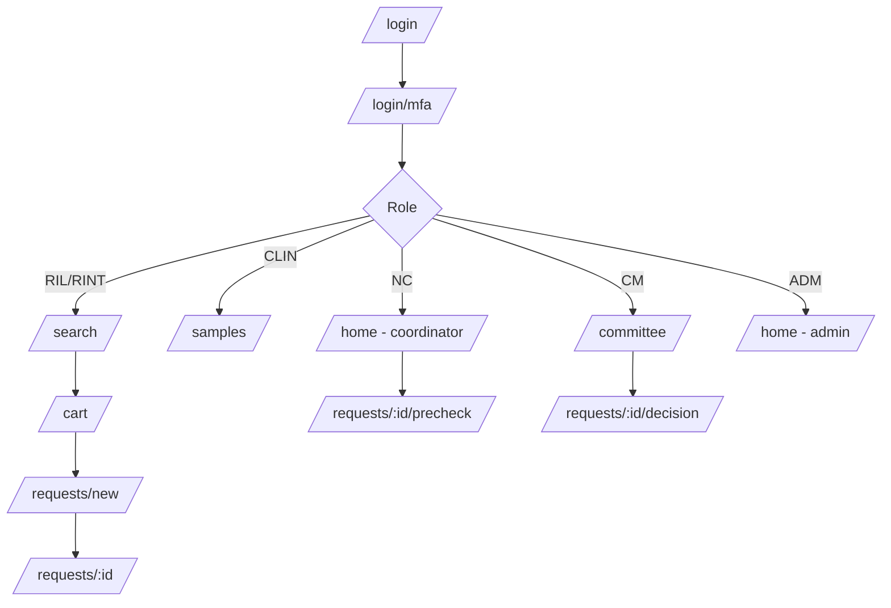

# 07 — Protected app: route table and page components

Scope: REQ-012 to REQ-018, REQ-030 to REQ-037, REQ-046, REQ-067, REQ-068.
Roles: `anonymous`, `researcher_il` (RIL), `researcher_intl` (RINT), `center_clinician` (CLIN, own center), `national_coordinator` (NC), `committee_member` (CM), `system_admin` (ADM).
Legend: Y = allowed. `-` = no. `own` = own records only. `c` = own center only. All access is also enforced by the API. Client guards are UX only.

Paths are in the SPA under `https://app.<domain>`. Locale is a user preference, not in the path.
Note: gaps between what A4 and this table decide go to `plan/requests/A6-to-A4.md`.

## 1. Route table

| Path | Feature | RIL | RINT | CLIN | NC | CM | ADM | Notes |
|---|---|---|---|---|---|---|---|---|
| `/login` | identity-access | anon | anon | anon | anon | anon | anon | Redirect to `/` if session |
| `/login/mfa` | identity-access | Y | Y | Y | Y | Y | Y | Needs partial session |
| `/login/recovery` | identity-access | Y | Y | Y | Y | Y | Y | Recovery code |
| `/invite/:token` | identity-access | anon | anon | anon | anon | anon | anon | Accept invite, set password, enrol 2FA |
| `/password/reset` and `/password/reset/:token` | identity-access | anon | anon | anon | anon | anon | anon | Generic messages |
| `/session-ended` | identity-access | Y | Y | Y | Y | Y | Y | Public page |
| `/` | shell | Y | Y | Y | Y | Y | Y | Role home (below) redirects |
| `/home` | shell | Y | Y | Y | Y | Y | Y | Role dashboard |
| `/search` | search-discovery | Y | Y | Y | Y | Y | - | Aggregate view. ADM has no sample data access |
| `/search/results` | search-discovery | Y | Y | Y | Y | Y | - | Same page state; URL has enum filters only |
| `/samples` | sample-index | - | - | c | Y | - | - | Record list (de-identified) |
| `/samples/:id` | sample-index | - | - | c | Y | - | - | Record detail |
| `/samples/new` | sample-index | - | - | - | Y | - | - | Coordinator entry (minimal screen, REQ-068). CLIN entry: OPEN-A6-08 |
| `/samples/:id/edit` | sample-index | - | - | - | Y | - | - | |
| `/import` | center-ingestion | - | - | - | Y | - | - | Wizard list |
| `/import/new` | center-ingestion | - | - | - | Y | - | - | Upload → map → validate → confirm |
| `/import/:jobId` | center-ingestion | - | - | - | Y | - | - | Result + error report |
| `/freshness` | center-ingestion | - | - | c | Y | - | - | Staleness board (REQ-067) |
| `/cart` | access-requests | Y | - | - | - | - | - | RINT cannot submit requests (REQ-014) |
| `/requests` | access-requests | own | - | - | Y (all, pre-check queue) | Y (committee queue) | - | List by role |
| `/requests/new` | access-requests | Y | - | - | - | - | - | Multi-step form |
| `/requests/:id` | access-requests | own | - | - | Y | Y | - | Tracker/detail; content differs by role |
| `/requests/:id/precheck` | access-requests | - | - | - | Y | - | - | Coordinator pre-check |
| `/requests/:id/decision` | access-requests | - | - | - | - | Y | - | Vote; hidden if conflict declared |
| `/requests/:id/coordination` | access-requests | - | - | c | Y | - | - | Center coordination, MTA/DTA, delivery |
| `/committee` | admin-governance | - | - | - | - | Y | - | Dashboard (REQ-017) |
| `/audit` | audit-log | - | - | - | - | - | Y | Audit viewer (REQ-046). NC read of own-actions: OPEN-A6-09 |
| `/audit/export` | audit-log | - | - | - | - | - | Y | Step-up needed |
| `/admin/users` | admin-governance | - | - | - | - | - | Y | List, invite, disable |
| `/admin/users/:id` | admin-governance | - | - | - | - | - | Y | Roles, center scope |
| `/admin/invitations` | admin-governance | - | - | - | Y (researcher approval, ASSUMPTION-03) | - | Y | |
| `/admin/registrations` | admin-governance | - | - | - | Y | - | - | Approve researcher registrations |
| `/admin/centers` | admin-governance | - | - | - | Y | - | Y | |
| `/admin/settings/privacy` | admin-governance | - | - | - | - | - | Y | k threshold per field set (config only) |
| `/admin/settings/committee` | admin-governance | - | - | - | - | - | Y | Roles N-of-M, criteria data |
| `/admin/content` | admin-governance | - | - | - | - | - | Y | Links to CMS and publish status |
| `/admin/health` | observability | - | - | - | - | - | Y | Version, health badge |
| `/account` | identity-access | Y | Y | Y | Y | Y | Y | Profile, language, theme |
| `/account/security` | identity-access | Y | Y | Y | Y | Y | Y | Passkeys, TOTP, recovery codes, sessions |
| `/notifications` | notifications | Y | Y | Y | Y | Y | Y | Inbox + preferences |
| `/metrics` | admin-governance | - | - | - | Y | Y | Y | REQ-066 dashboards, aggregate only (OPEN-A6-10) |
| `/help` | shell | Y | Y | Y | Y | Y | Y | Privacy help, suppression explanation |
| `/403`, `/404`, `/error` | shell | Y | Y | Y | Y | Y | Y | |

Role homes (`/` redirect): RIL → `/search`; RINT → `/search`; CLIN → `/samples`; NC → `/home` (to-do: pre-checks, imports, stale records); CM → `/committee`; ADM → `/home` (users, health, audit shortcuts; no sample counts).

Menu per role:
- RIL: Search, Cart, My requests, Notifications, Account.
- RINT: Search, Notifications, Account.
- CLIN: My center samples, Freshness, Search, Coordination, Notifications, Account.
- NC: Home, Samples, Import, Freshness, Requests, Search, Registrations, Metrics, Admin (centers), Notifications, Account.
- CM: Committee, Requests, Metrics, Notifications, Account.
- ADM: Home, Users, Audit, Settings, Content, Health, Account.

## 2. Page-by-page component list

Names are `design-system` (DS) or feature components. All components: he/en, RTL, light/dark, keyboard, tested in Storybook.

DS primitives used everywhere: `Button`, `IconButton`, `Link`, `TextField`, `TextArea`, `Select`, `Combobox`, `Checkbox`, `RadioGroup`, `Switch`, `Chip`, `Badge`, `Tooltip` (focus + hover), `Dialog`, `AlertDialog`, `Sheet` (bottom/side), `Toast` (aria-live), `Tabs`, `Table`, `Card`, `Skeleton`, `EmptyState`, `Stepper`, `Timeline`, `Breadcrumbs`, `Pagination`, `Banner`, `Progress`, `VisuallyHidden`, `SkipLink`, `ErrorSummary`, `FormField`, `LocaleSwitch`, `ThemeToggle`.

### Shell
`AppShell` (SkipLink, `Header`, `RoleNav`, `MainLandmark`, `Footer`), `UserMenu`, `NotificationBell`, `CartBadge` (RIL), `SessionTimer` + `SessionWarningDialog`, `OfflineBanner`, `RouteErrorBoundary`, `RootErrorBoundary`, `UnsupportedBrowserPage`, `Forbidden403`, `NotFound404`.

### identity-access
- `/login`: `LoginForm` (username, password), `PasskeySignInButton`, `LoginErrorSummary`, `PublicSiteLink`.
- `/login/mfa`: `MfaChallenge` (`PasskeyChallenge`, `TotpCodeInput`, `RecoveryCodeLink`).
- `/invite/:token`: `InviteAcceptForm`, `PasswordStrengthHint`, `EnrolmentWizard` (`MethodChooser`, `PasskeyEnrol`, `TotpEnrol` with `QrCanvas` + `ManualKey`, `RecoveryCodesPanel`).
- `/password/reset*`: `ResetRequestForm`, `ResetCompleteForm`.
- `/session-ended`: `SessionEndedPanel`.
- `/account`: `ProfileForm` (display name, language, theme).
- `/account/security`: `AuthMethodList`, `AddPasskeyDialog`, `AddTotpDialog`, `RegenerateCodesDialog`, `ActiveSessionsList`, `StepUpDialog`.

### search-discovery
- `/search`: `SearchBar` (free text + "smart" hint), `FilterPanel` (`DiagnosisFilter` tree/combobox, `SampleTypeFilter`, `AgeBandFilter`, `CenterFilter`, `AttachedDataFilter`, `TimepointFilter`), `ActiveFilterChips`, `AggregateSummary` (total with `≈` handling), `BucketTable`, `BucketChart` (+ text table), `SuppressedCell`, `SuppressionNotice`, `AddToCartButton` (RIL only), `SaveFilterSet` (server-side), `NoResultsState`, `RateLimitNotice`.
- NC/CLIN in `/search`: `RecordResultList` (rows with `sample_code`, type, availability, timepoint, center), `RecordRow`, link to `/samples/:id`.
- Mobile: `FilterSheet`.

### sample-index
- `/samples`: `SampleTable` (sort, cursor pagination, column chooser), `SampleCardList` (mobile), `SampleFilters`, `StaleBadge`, `CenterScopeBanner` (CLIN: "Showing center X only").
- `/samples/:id`: `SampleHeader` (`sample_code` in `<bdi>`), `FieldGrid` (all v1 fields), `AttachedDataChips`, `AvailabilityBadge`, `EthicsRefField` (opaque ID), `ContactRefCard` (role of contact), `LocalSystemReference` (pointer to center RedCAP; no identity resolution, GATE-CLINICIAN-ID), `VerifyNowButton` (updates `last_verified_at`), `HistoryPanel` (changes, actor role, day), `NoIdentifiersNotice`.
- `/samples/new` and `/edit`: `SampleEntryForm` (minimal: required fields first, `Combobox` for diagnosis codes, month picker for `collection_month`, no free-text clinical field), `DuplicateWarning`, `RepeatValueHint` (REQ-068 repeat value shown to clinician), `SaveAndNextButton`, `IdentifierPatternWarning`.

### center-ingestion
- `/import`: `ImportJobList`.
- `/import/new`: `ImportWizard` (`UploadStep` with `DropZone`, `MappingStep`, `ValidationStep` with `RowErrorTable`, `ConfirmStep` with `DiffSummary`), `TemplateDownloadLink`.
- `/import/:jobId`: `ImportResult`, `ErrorReportDownload`, `RollbackButton` (if API allows).
- `/freshness`: `StalenessBoard` (by center, age buckets), `StaleRecordList`, `SendReminderButton` (NC).

### access-requests
- `/cart`: `CartList`, `CartItemCard` (filters + snapshot counts + suppression), `RemoveWithUndo`, `StartRequestButton`, `CartLimitNotice`.
- `/requests/new`: `RequestFormWizard`, `StepResearchQuestion`, `StepApprovals` (`IrbRefField`), `StepPlannedUse`, `StepFunding` (repeatable rows), `StepReview`, `DeclarationCheckbox`, `AutosaveIndicator`, `NoPatientDataNotice`, `SubmitSuccess`.
- `/requests`: `RequestList` (by role), `StatusFilter`, `NeedsActionBadge`.
- `/requests/:id`: `RequestSummary`, `RequestTracker` (`TrackerStage`), `NeedsActionBanner` + `RespondForm`, `DocumentList` (Phase 1: generated/templated documents only), `MessageThread` (structured, plain text only), `DeliveryPanel`, `DownloadButton` (safe download).
- `/requests/:id/precheck`: `PrecheckChecklist` (criteria are data), `PrecheckDecisionForm` (forward / ask info / reject + reason code).
- `/requests/:id/decision`: `DecisionPanel` (`VoteControls`, `ReasonSelect`, `ConflictDeclaration`, `VoteTally` N-of-M), `ApplicantInfoCard`, `PrecheckResultCard`.
- `/requests/:id/coordination`: `CenterTaskList`, `MtaDtaStatusPanel` (status only; signing is outside), `DeliveryChecklist`, `MarkDeliveredForm`.

### audit-log
- `/audit`: `AuditFilterBar` (actor role, action, date range, entity type), `AuditTable` (virtualized), `AuditEventDrawer`, `IntegrityBadge` (hash-chain status if A2 provides).
- `/audit/export`: `AuditExportForm` + `StepUpDialog` + `SafeDownload`.

### admin-governance
- `/admin/users`: `UserTable`, `InviteUserDialog`, `DisableUserDialog`.
- `/admin/users/:id`: `RoleAssignmentForm` (center scope for CLIN), `SeparationOfDutiesNotice`, `UserActivitySummary` (counts only).
- `/admin/registrations`: `RegistrationQueue`, `ApproveRejectDialog`.
- `/admin/centers`: `CenterTable`, `CenterForm`.
- `/admin/settings/privacy`: `KThresholdForm` (per field set; change needs step-up + reason).
- `/admin/settings/committee`: `CommitteeConfigForm` (N, M, criteria list).
- `/admin/content`: `ContentStatusCard` (links to CMS and last publish).
- `/committee`: `CommitteeDashboard` (`PendingDecisionsList`, `AgingChart`, `DecisionStats`).
- `/metrics`: `MetricsGrid` (REQ-066 tiles: centers feeding, records + completeness, researchers + searches, requests + completion rate + time to delivery, coordinator-entry share), `MetricTile`, `TrendChart` (+ table alt).

### notifications and observability
- `/notifications`: `NotificationList`, `NotificationPrefs`.
- `/admin/health`: `HealthBadge`, `VersionInfo`, `ClientErrorSummary` (counts by route and code).

### help
- `/help`: `PrivacyHelp` (what suppression means, what is never stored), `ShortcutsHelp`, `ReportProblemForm`.

## 3. Component rules

- Each component has: story (he, en, dark, RTL), unit test, axe test, and i18n keys with the `area.screen.element` format.
- Tables always have a caption and header scope; sort state announced.
- No component renders raw API strings from users as HTML. Plain text only.
- Role-dependent UI uses `useCan(permission)` from `shared/guards`, fed by `/api/v1/me` `permissions[]`. Do not check role names inside components.
- Loading uses skeletons; empty and error states are standard `EmptyState`/`ErrorPanel` with i18n text.
