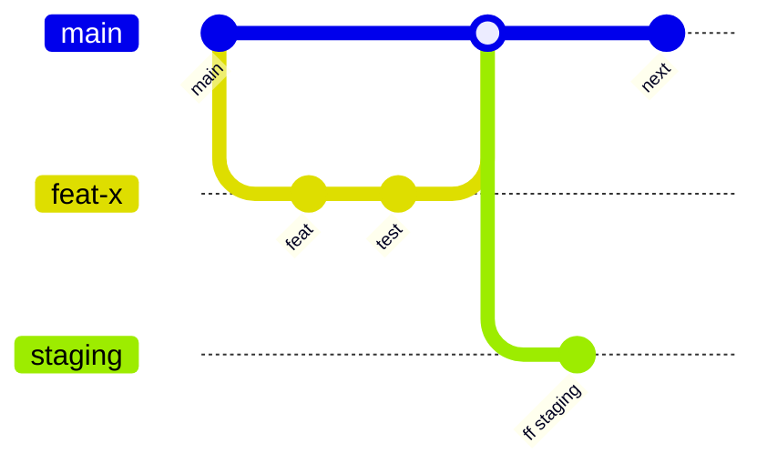

# 01 - Repo strategy

## Monorepo layout (from the contract pack)
```
apps/public-site  apps/web  apps/api
packages/domain  contracts  api-client  design-system  i18n  synthetic-data
apps/api/src/adapters/{postgres,auth-local,objectstore-s3,email-smtp,clock,audit-pg}
db/migrations  infra/render.yaml  infra/terraform  .github/workflows  plan/  docs/
```
Tool: pnpm workspaces. Tasks run by Turborepo-style graph or plain pnpm scripts. CI runs only affected packages on PRs (`pnpm --filter ...[origin/main]`). Full run on `main`.

Repo placement of examples: `examples/render.yaml` goes to `infra/render.yaml`. `examples/workflows/*` go to `.github/workflows/`. `examples/config/CODEOWNERS` goes to `.github/CODEOWNERS`.

## Branch model: trunk-based
- `main` is the trunk. It is always releasable.
- Short-lived branches: `feat/...`, `fix/...`, `chore/...`. Max life: 2 days. Prefer under 400 changed lines.
- `staging` is a deployment branch. It is fast-forwarded from `main` by a bot after CI passes. Nobody pushes to it.
- No long-lived feature branches. Use feature flags (see 05).
- Hotfix: branch from `main`, same PR path, expedited review. No direct push.



## Commit and PR rules
- Conventional Commits: `type(scope): subject`. Types: feat, fix, perf, refactor, docs, test, build, ci, chore, revert. Scopes: see `examples/config/commitlint.config.cjs`.
- Breaking change: `!` or `BREAKING CHANGE:` footer. Release notes come from release-please.
- Squash merge only. PR title must pass commitlint.
- PR template asks: requirement IDs (`REQ-###`), data classification (must say "synthetic"), migration included (yes/no), flag name, rollback note.
- One approval minimum. Two for `db/migrations`, `infra`, `.github`, auth and audit adapters (CODEOWNERS).
- Author cannot approve own PR. Bot commits are signed.

## CODEOWNERS
See `examples/config/CODEOWNERS`. Owner groups are placeholders. Separation of duties: infra changes need `security` plus `platform`.

## Branch protection (main and staging)
- Require PR. No direct pushes. No force push. No deletion.
- Required checks: `ci-gate`, `codeql / analyze`, `secret-scan`.
- Require up-to-date branch or merge queue. Require linear history.
- Require code-owner review. Dismiss stale approvals.
- Require signed commits (Sigstore gitsign or GPG).
- Admins are not exempt ("include administrators").
- `staging`: only the release bot may push.
- Tags `v*`: protected by a tag ruleset.

## Environments
| Env | Trigger | Data | Who can reach |
|---|---|---|---|
| dev | local, Docker Compose | synthetic (`packages/synthetic-data`) | engineers |
| preview | every PR (Render `previews.generation: automatic`) | synthetic only, seeded at boot | engineers, reviewers |
| staging | `staging` branch | synthetic only | engineers, clinical leads (UAT) |
| prod | `main` | synthetic until GATE-PROD-DATA closes | public (site), roles (app) |

Rule: no real data in any environment until `GATE-PROD-DATA`. `DATA_CLASSIFICATION=synthetic` is an env var checked at boot and in tests. A CI test fails if the value is anything else outside prod.

## Config and secrets
- Config in Git: non-secret values in `render.yaml` and env groups (`ari-common`).
- Secrets: never in Git. Three kinds:
  1. Generated by Render (`generateValue: true`): session secret, audit HMAC key.
  2. Entered once in the Dashboard (`sync: false`): SMTP, object store keys.
  3. CI secrets: GitHub Environment secrets (deploy hooks, rollback API key). Scoped to environment `production-protected`.
- Env groups separate: `ari-common` (non-secret), `ari-api-secrets` (secret). Staging has its own groups (`ari-stg-*`). No shared secrets between staging and prod.
- Previews: `sync: false` vars are not copied to previews (UNVERIFIED detail from skill docs). Previews use fake SMTP and an in-memory object store.
- Secret scan: gitleaks on every PR plus GitHub push protection. Rotation: every 90 days, and on any suspected leak (runbook RB-xx by A9).
- OIDC from GitHub to cloud (no long-lived cloud keys) for Terraform.
