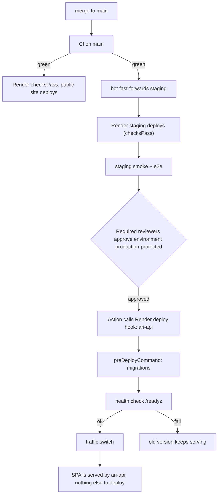

# 02 - Git to Render auto-deploy design

Facts come from `08-research-log.md`. Items marked UNVERIFIED need a check against live Render docs.

## Branch to environment map
| Git event | Render effect | Gate |
|---|---|---|
| PR opened/updated | Preview environment (`previews.generation: automatic`), expires in 3 days | CI runs in parallel. DAST runs on preview |
| Merge to `main` | Public site (`ari-public-site`) deploys, `autoDeployTrigger: checksPass` | CI green on commit |
| Merge to `main` | Protected area: `autoDeployTrigger: off`. GitHub Action calls deploy hooks | CI green + staging green + manual approval |
| `staging` fast-forward | Staging Blueprint services deploy, `checksPass` | CI green |

Render has two Blueprints from the same repo: `render.yaml` (repo root) on branch `main`, `infra/render.staging.yaml` on branch `staging`. Names are prefixed `ari-stg-` to avoid clashes (UNVERIFIED: whether names must be unique per workspace).

## Why protected area uses `autoDeployTrigger: off`
Render has no built-in approval gate (UNVERIFIED). The approval gate is a GitHub Environment with required reviewers. Render deploys only when the workflow calls a deploy hook. The deploy hook secret exists only in that environment. Result: no path to production without CI, staging and approval. The Blueprint policy (`render.rego`) enforces it.

Trade-off: manual hook call means the deploy is not "pure Render auto-deploy". This is a deliberate exception for REQ-054 and protected data. Public site keeps full auto-deploy.

## Blueprint contents (`render.yaml`)
| Resource | Kind | Notes |
|---|---|---|
| `ari-public` | static web | headers, he/en rewrites, buildFilter, `checksPass` |
| ~~`ari-app`~~ | not created | Superseded (C-04, B5 deviation): the SPA is built into `apps/web/dist` and served by `ari-api` on the same host |
| `ari-api` | web node | `healthCheckPath`, `preDeployCommand`, 2 instances, `maxShutdownDelaySeconds: 60`, `off` |
| ~~`ari-internal`~~ | not created | Superseded: not needed in Phase 1 |
| `ari-db` | Postgres | Frankfurt, private (`ipAllowList: []`), `previewPlan` small |
| `ari-cron-staleness` | cron | daily |
| `ari-cron-backup-export` | cron docker | daily encrypted logical export |
| `ari-cron-audit-verify` | cron | hourly hash-chain verify, alerts via webhook |
| env groups | `ari-common`, `ari-api-secrets` | |

Private network: `ari-api` reaches `ari-db` by internal address only. The API reads the DB through `fromDatabase` connection string (internal URL, UNVERIFIED which property gives internal).

## Preview settings (synthetic only)
- `previews.generation: automatic`, `expireAfterDays: 3`.
- `previewPlan` and `previewDiskSizeGB` small.
- Preview DB is a new empty DB. API seeds from `packages/synthetic-data` when `IS_PULL_REQUEST=true` (UNVERIFIED name).
- Previews have no secrets (`sync: false` excluded). API refuses to start in preview if `DATA_CLASSIFICATION != synthetic`.
- Public cron jobs do not run in previews (opt out per service if needed, UNVERIFIED field).
- Disable previews for forked PRs (security). Setting location UNVERIFIED.

## Zero downtime and health checks
- Render starts the new instance, waits for the health check, then switches traffic, then stops the old one with SIGTERM (UNVERIFIED details).
- `/readyz` rules (C-05; the earlier `/healthz` name is retired): returns 200 only if DB ping ok and migration level >= expected. Returns `{"version":"<git sha>","status":"ok"}`. No identifiers. Separate `/livez` is optional.
- API handles SIGTERM: stop accepting, finish in-flight, close pool, exit within 60 s.
- Two instances in prod so a failed instance does not cause an outage.
- Sessions are server-side in Postgres, so any instance serves any user.

## One-click rollback
- Render Dashboard: select a previous successful deploy and "Rollback" (UNVERIFIED wording). Also API `POST /v1/services/{id}/rollback`.
- Rollback turns off auto-deploy for that service in the Dashboard (UNVERIFIED). Runbook step: after fix, re-enable and redeploy. With `off` it is already off.
- DB is not rolled back. Expand/contract keeps old code working on the new schema.
- Public site: roll back the same way, or `git revert` PR (fast path, through CI).

## Migrations at deploy
- `preDeployCommand: pnpm --filter @ari/api migrate:deploy`. Runs after build, before the new version starts. Failure aborts the deploy. Old version keeps serving.
- Forward-only plain `.sql` in `db/migrations`. Each file has a checksum. Runner takes an advisory lock.
- Expand/contract:
  1. Release N (expand): add nullable column/table/index (`CONCURRENTLY`). Code writes both, reads old.
  2. Release N+1: backfill (batch job), switch reads.
  3. Release N+2 (contract): drop old column. Only after N+1 has been live and rollback window closed (>= 7 days).
- Lint rules (`lint:migrations`): no DROP/RENAME/type change/NOT NULL-without-default in the same PR as code that needs it. Lock timeout and statement timeout set per migration.
- CI dry run: apply main's migrations, seed, apply the PR's migrations, run old API against new schema.
- Before a contract step: take a manual Render backup (snapshot) and record its ID in the PR.
- Pre-deploy command time limit: UNVERIFIED (docs mention a limit). Long backfills run as jobs, not in preDeploy.

## Database protection
- Plan must give PITR for ASSUMPTION-05 (RPO 15 min). Render PITR availability and window per plan: UNVERIFIED. Open question OPEN-A7-01.
- Daily logical export (cron) is an extra copy in object storage, encrypted. It also feeds the Base44 round trip.
- Restore test: monthly into a throwaway DB (owned by A9).
