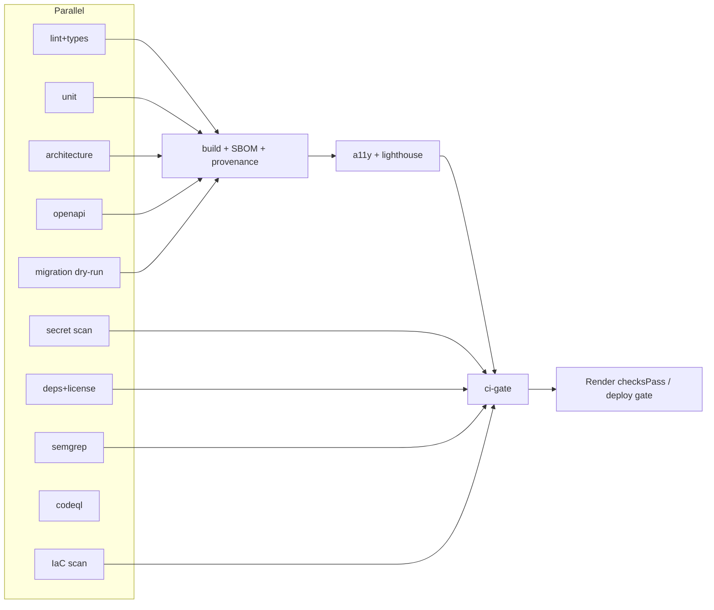

# 03 - Pipeline as code

Workflows are in `.github/workflows/` (originally drafted in `examples/workflows/`). Required check: `ci-gate` (aggregates all jobs).

> **Job names (C-15):** the CI job names are A8's, as built in `.github/workflows/ci.yml`: `lint-types`, `spectral`, `arch-deps`, `unit`, `property`, `integration-pg`, `contract-schemathesis`, `sast-codeql`, `sast-semgrep`, `sca`, `secrets`, `container-scan`, `cms-guard`, `build`, `canary-smoke`, `e2e-smoke-he-en`, `axe`, `trace-check`, then `ci-gate`. The A7 stage names in the "Job" column below (`setup-lint-type`, `architecture`, `openapi`, `migration-dry-run`, `dependency-license`, `secret-scan`, `iac-scan`, `a11y-lighthouse`) map to them: architecture to `arch-deps`, openapi to `spectral` plus `contract-schemathesis`, migration-dry-run to `integration-pg`, dependency-license to `sca`, secret-scan to `secrets`, iac-scan to `container-scan`, a11y-lighthouse to `axe`. Lighthouse CI is not run in the main workflow yet (see `docs/KNOWN-ISSUES.md`).

| Stage | Job (ci.yml) | Tool | Fails when |
|---|---|---|---|
| Lint | setup-lint-type | ESLint, Prettier, commitlint | any error |
| Typecheck | setup-lint-type | tsc strict | any error |
| Unit + property | unit | Vitest, fast-check | fail or coverage below threshold (A8 sets it) |
| Architecture / portability | architecture | dependency-cruiser | domain imports a platform lib. Web imports API internals. Cycles |
| OpenAPI lint | openapi | Spectral | warn or higher. Breaking change vs main (oasdiff) |
| Contract tests | openapi | schemathesis or generated | API differs from OpenAPI |
| Migration dry-run | migration-dry-run | Postgres 16 service | migration fails, old API breaks on new schema, RLS test fails |
| Build | build | pnpm build | build error |
| SBOM | build | CycloneDX (`cyclonedx-npm`) | generation error |
| Provenance | build | `attest-build-provenance`, `attest-sbom` | on main only |
| SAST | codeql.yml, sast-semgrep | CodeQL, Semgrep | high findings |
| Dependency + license | dependency-license | pnpm audit, license-checker, dependency-review | high CVE, denied license |
| Secret scan | secret-scan | gitleaks (+ push protection) | any secret |
| IaC / container | iac-scan | Blueprint validate, conftest, Trivy config, hadolint | policy violation |
| a11y + Lighthouse | a11y-lighthouse | axe via Playwright (he, en), Lighthouse CI | serious axe issue. a11y < 0.95. See `lighthouserc.json` |
| DAST | dast-preview.yml | OWASP ZAP baseline on preview | rule at FAIL level. Only `*.onrender.com` hosts |
| Deploy gate | deploy-protected.yml | GitHub Environment | no approval |

## Pinning policy
- Production rule: every `uses:` is pinned to a full 40-char commit SHA with a trailing comment of the tag. Dependabot (`github-actions`) updates them.
- The example files use tags (`@v4`) because SHAs cannot be verified offline. This is UNVERIFIED and must be replaced before first run. A CI step (`pinact` or `zizmor`) fails PRs with unpinned actions.
- Default token `permissions: contents: read`. Raise per job only.
- No `pull_request_target` with checkout of PR code. Secrets are not exposed to fork PRs.
- Self-hosted runners: none.
- Action versions in the examples (for example `treosh/lighthouse-ci-action@v12`, `zaproxy/action-baseline@v0.14.0`, `instrumenta/conftest-action`) are from memory. Check each. UNVERIFIED.

## Speed budget
Target PR feedback under 12 minutes (p75). Use caching (pnpm store), affected-only tasks, and parallel jobs.

## Gating for Render `checksPass`
Render "After CI Checks Pass" waits for the commit's GitHub checks. Needs the GitHub App connection. If a required check is skipped by path filters, the gate can hang. So `ci.yml` has no top-level `paths` filter. `ci-gate` always runs (`if: always()`).

## Preview data guard
A CI test `test:synthetic-guard` scans `packages/synthetic-data` and fixtures for realistic identifiers (ID-number patterns, real-looking phones, emails not under `example.org`). Fails the build on a match.
