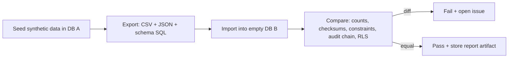

# 06 - Base44 readiness in CI (REQ-070)

Base44 is later and TBD. CI keeps the exit path real.

## Jobs
| Job | Schedule | What it proves |
|---|---|---|
| `architecture` (in ci.yml) | every PR | domain imports no platform lib |
| `test:portability` (ci.yml) | every PR | contract tests for each port run on in-memory and Postgres adapters |
| `export-import-roundtrip` (base44-roundtrip.yml) | nightly + manual | export to open formats and import into an empty DB gives equal data |
| `check:capability-map` | nightly | `docs/platform-capability-map.md` lists every platform feature the code uses |
| OpenAPI breaking-change check | every PR | contract stable for a new backend |

## Round trip steps

Checks in `verify:roundtrip`:
- Row counts per table.
- Hash of each table in key order.
- Audit chain verifies in DB B (the chain survives export).
- Link keys and identifiers do not exist anywhere (negative check).
- Export contains no platform-specific types (no custom extensions beyond `pg_trgm`, `pgcrypto` if any).
- Time to export and import is recorded (feeds exit-time estimate).

## Quality rules
- Tests only use synthetic data.
- A failed nightly round trip blocks release of schema changes until fixed (flagged in `deploy-protected` verify step by a status file, to build).
- The export format is versioned and documented by A3. A7 owns only the job.
