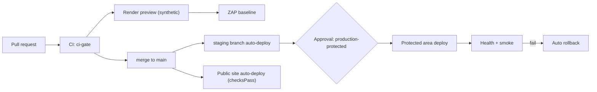

# 07 - DevOps / CI-CD (A7)

Status: draft v1, built and amended. Owner: A7. Binding source: `plan/00-contract-pack.md`; `plan/11-integration/canonical-decisions.md` wins.

**As built (Build wave B5):** the files in `examples/` were copied into the repo and changed. Live locations: `render.yaml` (repo root), `infra/render.staging.yaml` (generated by `scripts/gen-staging.py`), `infra/policy/render.rego`, `.github/workflows/*.yml`, `scripts/*`. Deviations: there is no `ari-app` and no `ari-internal` service (one `ari-api` serves API and SPA, C-03/C-04); health paths are `/livez` and `/readyz` (C-05); no Terraform in Phase 1. Operator guide: `docs/deployment.md`.

| File | Content |
|---|---|
| `01-repo-strategy.md` | Monorepo, trunk-based model, commits, CODEOWNERS, branch protection, environments, config and secrets |
| `02-render-deploy-design.md` | Branch-to-environment map, Blueprint design, gates, zero downtime, rollback, migrations |
| `03-pipeline.md` | Pipeline stages, gates, action pinning, scans |
| `04-iac.md` | Blueprint first, Terraform for the rest, region pin, policy-as-code |
| `05-release-strategy.md` | Flags, auto-rollback, approvals, two pipelines, production access model |
| `06-base44-readiness.md` | Round-trip job and portability tests |
| `07-dora-cost.md` | DORA metrics and cost guardrails |
| `08-research-log.md` | Render facts with source, date, status |
| `examples/render.yaml` | Production Blueprint (valid YAML) |
| `examples/render.staging.yaml` | Staging Blueprint (generated variant) |
| `examples/workflows/*.yml` | GitHub Actions: ci, codeql, dast-preview, deploy-protected, base44-roundtrip, dora, release-please, terraform |
| `examples/config/*` | CODEOWNERS, dependency-cruiser, commitlint, Lighthouse, Dependabot |
| `examples/policy/render.rego` | conftest policy for Blueprints |
| `examples/terraform/main.tf` | Illustrative Terraform |

Validation done: all YAML/JSON parse with Python `yaml`/`json`. `actionlint`, `conftest`, `terraform` and `render blueprints validate` were not available. Run them in the first CI run.

