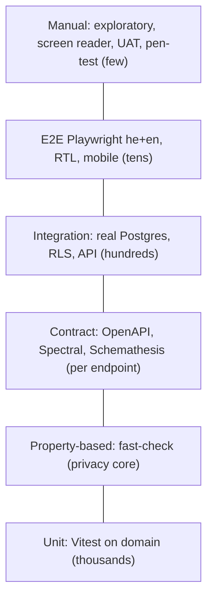
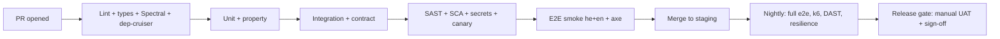

# 01 — Test Strategy and Pyramid (A8)

Binding source: `plan/00-contract-pack.md`. Data in every test is synthetic.

## 1. Principles
- Test the rule, not the screen. Put most tests at the lowest fast level.
- Every REQ has at least one test (see `test-catalog.csv`).
- Privacy and authorization tests are release blockers. They are never skipped or quarantined.
- Tests use `packages/synthetic-data` only. No real data in any environment (GATE-PROD-DATA, GATE-COMPLIANCE).
- Tests are code in Git. A PR cannot merge when a required test fails.

## 2. Pyramid


| Level | Tool | Scope | Runs on | Time budget |
|---|---|---|---|---|
| Unit | Vitest | `packages/domain`, validators, i18n | every commit | < 60 s |
| Property | fast-check (in Vitest) | k-anonymity, suppression, differencing, de-id validators, filters | every PR | < 3 min |
| Contract | Spectral, Schemathesis, openapi-typescript diff | `packages/contracts` | every PR | < 3 min |
| Integration | Vitest + Testcontainers (Postgres, same major as Render) | adapters, RLS, API with real DB | every PR | < 10 min |
| E2E | Playwright (chromium, webkit, firefox; he and en) | critical journeys | PR (smoke), nightly (full) | PR < 10 min |
| Accessibility | axe-core via `@axe-core/playwright`, plus manual | all pages and states | PR (axe), per release (manual) | within e2e |
| Performance | k6 | API and search, public site | nightly + pre-release | 15 min |
| Resilience | k6 + fault scripts, restore drill | outage, restore, rollback | weekly + pre-release | varies |
| Architecture | dependency-cruiser | hexagonal rules | every PR | < 30 s |

## 3. Unit tests
- Pure domain logic only. No DB, no network, no clock (use the `clock` port fake).
- Coverage floor: 90% lines and 85% branches on `packages/domain`. 70% elsewhere. Mutation testing (Stryker) on k-anonymity and validators: score >= 80%.

```ts
// packages/domain/src/suppression.test.ts
import { describe, it, expect } from 'vitest';
import { suppress } from './suppression';
describe('suppress', () => {
  it('hides counts below k and merges them into "other"', () => {
    const out = suppress({ medulloblastoma: 12, ependymoma: 3, atrt: 2 }, { k: 5 });
    expect(out.cells).toEqual({ medulloblastoma: 12, other: 5 });
    expect(out.suppressed).toBe(true);
  });
  it('suppresses the merged bucket too when still below k', () => {
    const out = suppress({ a: 9, b: 1, c: 1 }, { k: 5 });
    expect(Math.min(...Object.values(out.cells))).toBeGreaterThanOrEqual(5);
  });
});
```

## 4. Property-based tests (fast-check)
Run 1,000 cases per property on PR and 20,000 nightly. Seed is printed. Failing seeds are saved to `tests/regressions/`.

| Property | Statement |
|---|---|
| P-K1 | Published cells are all `>= k` or absent. |
| P-K2 | Sum of published cells + merged bucket = true total (no loss, no gain). |
| P-K3 | Result is stable: same input, same output. Order of input does not matter. |
| P-D1 (differencing) | For any two allowed queries Q1 and Q2 where Q2 adds one filter, the arithmetic difference of the published results never reveals a cell `< k`. |
| P-D2 | The query planner refuses a query set from one principal that would reveal a small cell by subtraction (tracking budget). |
| P-ID1 | For any string field, the validator rejects every generated identifier shape: Israeli ID with valid check digit, phone formats, emails, ISO and local dates, MRN-like digit runs, names from the synthetic fake-name list. |
| P-ID2 | Valid sample records never trigger a false positive (precision). Opaque `sample_code` ULIDs pass. |
| P-F1 | Adding a filter never increases the result count (monotone). |
| P-S1 | `sample_code` is never derivable: no field of the record appears in the code. |

```ts
import fc from 'fast-check';
import { suppress } from './suppression';
test('P-K1/P-K2 suppression', () => {
  fc.assert(fc.property(
    fc.dictionary(fc.string({ minLength: 1, maxLength: 8 }), fc.integer({ min: 0, max: 200 })),
    fc.integer({ min: 2, max: 10 }),
    (cells, k) => {
      const out = suppress(cells, { k });
      const total = Object.values(cells).reduce((a, b) => a + b, 0);
      const shown = Object.values(out.cells).reduce((a, b) => a + b, 0);
      return Object.values(out.cells).every(v => v >= k) && (shown === total || out.suppressedAll);
    }), { numRuns: 1000 });
});
```
Note: if the total is itself below k, the whole result is hidden (`suppressedAll`).

## 5. Contract tests
- **Lint:** Spectral with a custom ruleset `spectral/ari-pst.yaml`. Rules: every operation has `x-roles`, `x-audit`, `security`; errors use `application/problem+json`; no schema property named like an identifier; aggregate endpoints use `AggregateResult` only; cursor pagination; idempotency key on POST that creates requests.
- **Breaking-change check:** `oasdiff` against `main`. Breaking change needs an ADR and a version bump.
- **Provider tests:** Schemathesis runs against the API on Postgres with synthetic data. Checks: response matches schema, no 5xx, no stack traces, no identifier in errors, stateful links work.
- **Consumer tests:** the generated `api-client` compiles against the contract. The SPA uses only this client.

```yaml
# spectral/ari-pst.yaml (sketch)
extends: ["spectral:oas"]
rules:
  op-has-roles:
    given: "$.paths[*][get,post,put,patch,delete]"
    then: { field: x-roles, function: truthy }
  no-identifier-props:
    given: "$..properties.*~"
    then: { function: pattern, functionOptions: { notMatch: "/^(name|firstName|lastName|idNumber|dob|birthDate|phone|email|address|mrn)$/i" } }
  problem-json-errors:
    given: "$.paths[*][*].responses[?(@property >= 400)].content"
    then: { field: application/problem+json, function: truthy }
```
```bash
schemathesis run packages/contracts/openapi.yaml --base-url "$API_URL" \
  --checks all --stateful=links --hypothesis-max-examples=200 \
  -H "Authorization: Bearer $TEST_TOKEN_RESEARCHER_IL"
```

## 6. Integration tests (real Postgres)
- Testcontainers starts Postgres in CI. Migrations run forward from empty and from the previous release (expand/contract check).
- One DB role per app role. RLS is on. Tests use the real roles, never a superuser.
- Cover: repositories, FTS (Hebrew + English), `pg_trgm`, RLS, audit append-only, import jobs, retention jobs, idempotency.
- Test data is created per test in a transaction or schema. No shared mutable fixtures.

```ts
it('RLS: clinician of center A cannot read center B', async () => {
  const a = await dbAs({ role: 'center_clinician', centerId: ctrA });
  const rows = await a.query('select sample_code from sample where source_center_id = $1', [ctrB]);
  expect(rows).toHaveLength(0);
});
```

## 7. End-to-end (Playwright)
- Projects: `he-desktop`, `en-desktop`, `he-mobile` (360x740), `en-mobile`. Browsers: chromium and webkit on PR; firefox nightly.
- Locale set by `locale` fixture. Tests use `data-testid` and role selectors, never text (text differs by language). Text checks use i18n keys.
- RTL: assert `dir="rtl"` on `<html>`, visual snapshots of key screens, and check that icons with direction (arrows, chevrons) mirror.
- Auth fixture: seeded users per role; TOTP via a test secret; passkey via CDP virtual authenticator.
- Retries: 1 on CI. A test that needs retries to pass 2 times in a week is a defect.

```ts
test.describe.parallel('request flow', () => {
  for (const locale of ['he', 'en'] as const) {
    test(`researcher submits request (${locale})`, async ({ page, loginAs }) => {
      await loginAs('researcher_il', { locale });
      await page.getByTestId('search-input').fill(t(locale, 'seed.diagnosis'));
      await page.getByTestId('add-to-cart').first().click();
      await page.getByTestId('cart-submit').click();
      await page.getByTestId('form-research-question').fill('Synthetic question');
      await page.getByTestId('form-irb-ref').fill('SYN-IRB-0001');
      await page.getByTestId('form-submit').click();
      await expect(page.getByTestId('request-status')).toHaveAttribute('data-status', 'submitted');
      await expect(page.locator('html')).toHaveAttribute('dir', locale === 'he' ? 'rtl' : 'ltr');
    });
  }
});
```

## 8. Accessibility
- Automated: axe on every route and every state (empty, error, modal, filter open) in he and en. Fail on `serious` and `critical`. `moderate` creates a ticket.
- Manual per release: keyboard-only, NVDA (Windows, Firefox/Chrome), VoiceOver (macOS/iOS), TalkBack, 200% zoom, reduced motion, forced colors, dark mode contrast. Hebrew screen-reader reading order checked by a native speaker.
- Standard: WCAG 2.1 AA and the Israeli standard (SI 5568; edition UNVERIFIED — A6 to confirm). Accessibility statement is checked by a person.
- axe finds about 30–40% of issues (common estimate; UNVERIFIED). The manual pass is required.

## 9. Performance (k6)
| Scenario | Load | Threshold |
|---|---|---|
| Public site (static) | 100 VU, 5 min | p95 TTFB < 400 ms; Core Web Vitals: LCP < 2.5 s, CLS < 0.1, INP < 200 ms (lab) |
| Search (aggregate) | 30 VU, 10 min, 50k synthetic records | p95 < 800 ms; p99 < 1.5 s; errors < 0.5% |
| Record read | 30 VU | p95 < 400 ms |
| Login (Argon2id) | 5 VU | p95 < 1.5 s; no event-loop stall > 200 ms |
| Spike | 0 → 150 VU in 30 s | errors < 2%; recovers in 60 s |
| Soak | 20 VU, 2 h | no memory growth > 10%; no connection leak |
Thresholds are in k6 `thresholds` so a breach fails the run. Targets support ASSUMPTION-05 SLOs. Expected load is small (research portal); thresholds are tuned after the first baseline.

```js
export const options = {
  scenarios: { search: { executor: 'constant-vus', vus: 30, duration: '10m' } },
  thresholds: { http_req_failed: ['rate<0.005'], 'http_req_duration{name:search}': ['p(95)<800', 'p(99)<1500'] },
};
```

## 10. Resilience tests
| ID | Fault | Expect |
|---|---|---|
| R-1 | Kill API instance during request submit | Idempotent retry; one request only |
| R-2 | DB connection loss 60 s | API returns 503 Problem Details; recovers; no data loss |
| R-3 | SMTP down | Request flow works; notification queued and retried; alert raised |
| R-4 | Object store down | CSV import fails with clear error; other features work |
| R-5 | Restore backup to new DB (drill) | RPO <= 15 min, RTO <= 4 h (ASSUMPTION-05); data check passes |
| R-6 | Bad release | Rollback in < 15 min; expand/contract keeps DB compatible |
| R-7 | Clock skew on TOTP | Accept ±1 step; reject more |
| R-8 | Rate limiter store down | Fail closed for login; fail safe (strict default) for search |
Tools: k6, Toxiproxy (in CI), shell scripts for Render restore. A9 owns the runbook; A8 owns the pass/fail criteria.

## 11. Architecture and portability tests
- dependency-cruiser: `packages/domain` imports no `pg`, `fastify`, S3 SDK, SMTP library, or auth library. Failing the rule fails the build (REQ-070).
- Export/import round trip: export all data, import into empty DB, compare with canonical hash.
- Platform capability tests (Base44 later): run the contract suite against a second adapter set when one exists.

## 12. Test data
- `packages/synthetic-data` builds seeded data (seed in env var). Centers: `Synthetic Center A`, `Synthetic Center B`. Spec: `03-privacy-verification.md` section 5.
- Hebrew and English diagnosis labels come from the code tables of A3.
- Each test declares its seed. Flaky data is a defect.

## 13. CI stages

A7 owns the workflow files. A8 owns the required-checks list in `05-traceability-dod.md`.
