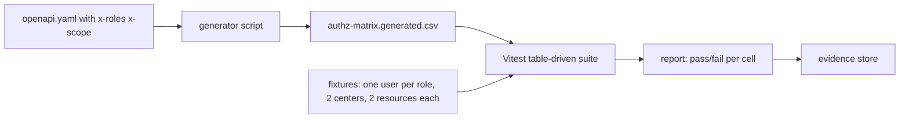

# 02 — Security Verification (A8)

Scope: verify controls that A2 designs. Needs-legal-review items are marked. Synthetic data only.

## 1. Automated scanning
| Type | Tool (default) | When | Gate |
|---|---|---|---|
| SAST | CodeQL + Semgrep (rules: node, ts, sql-injection, jwt, crypto) | every PR | No new high or critical |
| SCA | `pnpm audit` + OSV-Scanner + Dependabot/Renovate | every PR + daily | No known-exploited or high with fix available; waiver needs owner + expiry |
| License | `license-checker` | every PR | Allowlist only |
| Secrets | gitleaks (PR + full history weekly) + GitHub secret scanning | every PR | Zero findings |
| IaC | Checkov or tfsec on `infra/terraform`; `render.yaml` schema check | every PR | No high |
| Container | Trivy on built images | every PR | No high with fix |
| DAST | OWASP ZAP baseline (PR preview) and full active scan (nightly on staging, authenticated per role) | nightly | No high; mediums triaged |
| API fuzz | Schemathesis (see test strategy) | every PR | No 5xx; no schema break |
| TLS/headers | testssl.sh + securityheaders-style assertions | nightly | TLS 1.2+, HSTS, CSP, no mixed content |
| SBOM | CycloneDX generated per release and stored as evidence | release | Present |

## 2. Authorization matrix tests (every role x every endpoint)
### 2.1 Source of truth
Each OpenAPI operation declares `x-roles` (allowed roles), `x-scope` (`own-center`, `own-request`, `any`, `none`), and `x-audit` (event name). The matrix is generated from the contract. No hand-written matrix exists.

### 2.2 Matrix format (`authz-matrix.generated.csv`, built in CI, stored as evidence)
`operation_id,method,path,anonymous,researcher_il,researcher_intl,center_clinician,national_coordinator,committee_member,system_admin`
Cell values: `allow`, `deny`, `own` (allow only on own resource; other resource = 404), `agg` (aggregate view only).

Example (synthetic):
```
operation_id,method,path,anonymous,researcher_il,researcher_intl,center_clinician,national_coordinator,committee_member,system_admin
searchAggregates,GET,/api/v1/search/aggregates,deny,agg,agg,agg,agg,deny,deny
getSample,GET,/api/v1/samples/{id},deny,deny,deny,own,allow,deny,deny
updateSample,PUT,/api/v1/samples/{id},deny,deny,deny,deny,allow,deny,deny
createAccessRequest,POST,/api/v1/requests,deny,allow,deny,deny,deny,deny,deny
getAccessRequest,GET,/api/v1/requests/{id},deny,own,deny,deny,allow,allow,deny
decideRequest,POST,/api/v1/requests/{id}/decisions,deny,deny,deny,deny,deny,allow,deny
listAuditEvents,GET,/api/v1/audit-events,deny,deny,deny,deny,deny,deny,allow
```

### 2.3 Generator approach

Steps:
1. Parse the contract. For each operation and each of 7 roles, compute the expected result.
2. Fixtures create one user per role. Clinician users exist for center A and center B. Resources exist in both centers and for two applicants.
3. For each cell, call the real API (not a mock). Expected: `allow` → 2xx; `deny` → 401 (anonymous) or 403; `own` → 2xx on own, 404 on other; `agg` → 2xx with `AggregateResult` shape only.
4. Completeness test: every operation in the contract is in the matrix, and every route registered in Fastify is in the contract. A new route without `x-roles` fails the build.
5. Negative checks: separation of duties (`system_admin` approve = 403; `committee_member` index write = 403).
6. The matrix is diffed on each PR. A changed cell needs a reviewer from A2's owner group (CODEOWNERS).

```ts
for (const op of matrix) for (const role of ROLES) {
  test(`${op.operationId} as ${role}`, async () => {
    const res = await call(op, as(role));
    expect(classify(res)).toBe(expected(op, role));
  });
}
```

## 3. IDOR tests
- For each path parameter that holds an ID (`smp_`, `req_`, `usr_`, `ctr_`), call with: own ID, another user's ID, another center's ID, a random valid ULID, a malformed ID.
- Expect 404 for not-owned (not 403, to avoid existence leaks). Response time within 20% of a truly missing ID (timing check).
- Check list endpoints return only own-scope rows, cursors cannot be forged to cross scope, and `include`/`expand` params cannot pull other data.
- Check bulk and export endpoints for the same scope rules.
- Applicant sees only own request, comments, attachments (TC-112).

## 4. RLS tests
- Every table with scope data has RLS enabled and forced. A catalog test queries `pg_class`/`pg_policies` and fails if a new table has none.
- Per policy: allow case, deny case, and no-policy-default-deny case, using real DB roles.
- The API sets `app.center_id` and `app.role` per transaction. Test: forget to set them → zero rows (fail closed).
- Test pooled-connection leakage: run request A (center A) then request B (no context) on the same connection; B sees nothing.
- Migration test: RLS policies still present after each migration.

## 5. Rate limit and differencing-attack tests
- **Limits (defaults, A2 sets final):** login 5/min/IP + 10/hour/account; search 60/min/user; aggregates 200/day/external user; request create 10/day/user; password/MFA reset 3/hour.
- Tests: exceed the limit → 429 with `Retry-After`, Problem Details, audit event. Limit resets. Limit is per user and per IP. Spoofed `X-Forwarded-For` does not bypass it (trusted proxy config).
- **Differencing suite** (synthetic data with known small cells):
  1. Filter pairs: `A` and `A + one rare filter`. Check the difference never exposes a cell `< k`.
  2. Complement queries: `total`, `total minus category`. Check merged buckets hide it.
  3. Slicing: many narrow age-band/time-point combos in sequence from one user. The tracking budget blocks or widens results.
  4. Sort/paginate/limit tricks: ordering by count, offset probes.
  5. Multi-account collusion: two users, same IP range or same institution. Budget is per institution as well (A2 decides; OPEN-A8-02).
  6. Timing and error side channels: suppressed cell and empty cell look the same (response, size, time).
  7. Facet counts vs result counts must agree after suppression.
- Pass rule: attacker reconstructs 0 cells below k in the automated attack run; run seeds logged.

## 6. MFA and session tests
- MFA required for every protected role (REQ-044). A session without MFA gets 401 on protected endpoints.
- TOTP: valid code accepted once; replay of the same code rejected; ±1 step window only; brute force locks after 5 tries.
- Passkey (WebAuthn): register, login, remove last factor blocked, lost-device recovery flow needs coordinator + admin approval and is audited.
- Recovery codes: single use, hashed.
- Session: server-side, `__Host-sid` `HttpOnly; Secure; SameSite=Strict` cookie plus `__Host-csrf` (C-03), rotates on login and on privilege change, idle timeout (15 min staff, 30 min researchers) and absolute timeout (4 h admin, 8 h others) (C-02), logout invalidates server-side, concurrent-session policy, fixation test, CSRF token test.
- Password: Argon2id params checked by a unit test; breached-password check; no user enumeration (same message and time on bad user or bad password).
- Step-up: sensitive actions (role change, export) require fresh MFA within 5 min.

## 7. Secrets tests
- gitleaks in PR and history scan. Pre-commit hook recommended.
- Build test: client bundle and Docker image are scanned for strings matching key patterns and for the names of server env vars.
- Runtime test: `/healthz`, errors, and logs never print env values. Log canary (see privacy file) includes fake secret tokens.
- Config test: required secrets exist in staging via Render env groups; none in `render.yaml` values (only `sync: false` or `fromGroup`).
- Rotation test (per release or quarterly): rotate session secret and DB password in staging; app recovers with no downtime beyond SLO.
- PR previews have separate secrets and cannot reach production DB (network test).

## 8. Other security checks
- Headers: CSP (no `unsafe-inline` for scripts), HSTS, `X-Content-Type-Options`, `Referrer-Policy`, `Permissions-Policy`, COOP. Asserted in e2e.
- Input: SQL injection and XSS payload corpus on all text inputs (stored XSS in request form viewed by committee). Hebrew bidi control characters in inputs do not spoof UI text (display isolation).
- CSV/XLSX import: formula injection (`=`, `+`, `-`, `@`) neutralized on export; zip-bomb and oversize rejected; macros rejected.
- Uploads/exports: signed URLs expire; content-type enforced.
- Dependency confusion and lockfile check: `pnpm install --frozen-lockfile`.

## 9. Pen-test scope and cadence
**Scope (in):** protected web app, API, auth flows (passkey, TOTP, recovery), authorization (all 7 roles), RLS, search and aggregate endpoints (re-identification and differencing), import endpoints, public site, CMS access path, admin functions, CI/CD secrets exposure (review), Render configuration review.
**Out:** Render platform itself, third-party SaaS internals, denial-of-service at scale, social engineering of staff (optional separate exercise).
**Method:** grey-box, with test accounts for each role and the OpenAPI file. OWASP ASVS L2 as checklist (L3 for auth and privacy controls where cheap). Include a **privacy red-team task**: try to learn that a specific synthetic person exists, or learn a small cell.
**Cadence:**
| When | Type |
|---|---|
| Before GATE-PROD-DATA (mandatory) | Full external pen-test + retest of fixed findings |
| Yearly | Full external pen-test |
| After major change (auth, RLS, new role, new data class, SSO in Phase 2) | Targeted test |
| Each release | Automated DAST + authz matrix |
| Quarterly | Internal review, bug bounty-style tabletop (optional) |
**Rules:** Critical/High fixed before go-live; Medium within 30 days; retest required. Findings enter defect tracking with `security` label. Report stored as evidence (restricted). Tester under NDA; needs legal review for contract terms.
