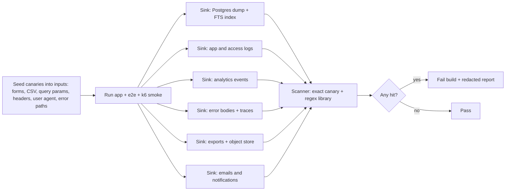

# 03 — Privacy Verification (A8)

Goal: prove that no identifier reaches the index, logs, analytics, errors, search, exports, or backups. Synthetic data only.

## 1. Identifier pattern library
Owned jointly: A2 defines the policy; A8 owns the test corpus. Stored at `packages/domain/src/privacy/patterns.ts` (shared with runtime validators) and `tests/privacy/corpus/`.

| Class | Pattern idea | Notes |
|---|---|---|
| National ID number | 9 digits with check-digit (Luhn-like) valid | Corpus uses fake numbers that pass check digit but are marked synthetic |
| Phone | Israeli mobile/landline, intl forms, spaces, dashes, Hebrew digits | Include `+972`, `05x` |
| Email | RFC-like, Unicode local parts | |
| Date | ISO, `DD/MM/YYYY`, `D.M.YY`, Hebrew calendar text, month names he/en | Only `YYYY-MM` allowed in `collection_month` |
| Name | From fake-name list he/en (clearly fake: "Synthetic Alpha") + generic name-shaped tokens in free-text fields | Free text is disallowed anyway |
| MRN-like | 5–12 digit runs, prefix+digits | |
| Address | Street + number words he/en, postal code | |
| Link key | Format of coding-key IDs used by centers (A3 supplies shape) | Must never exist (REQ-038) |
| Secrets | Fake tokens `SYN-SECRET-...` | Used in log canary |

**Canary tokens:** unique strings per run, e.g. `CANARY-ID-<runid>`, `CANARY-PHONE-<runid>`, plus pattern-valid fake IDs. They let the test search any sink for exact leaks.

## 2. Canary tests (fail the build)

Rules:
- Two expectations. (a) Identifier-shaped input to a record field is **rejected** (HTTP 422, error body does not echo the value). (b) Identifier-shaped input in any other place (search query, header, URL, form note) is **not stored or logged**; logs show a redacted placeholder.
- Sinks: DB dump (`pg_dump` of synthetic DB) and FTS tokens (`ts_stat`), index/trigram tables, log files (JSON lines), analytics payloads captured by a test collector, error responses, OpenTelemetry traces, export files, outgoing email bodies (mail catcher).
- The scanner reports sink, table/field, and pattern class. It never prints the value (prints hash).
- Run: every PR (smoke canary, 2 min) and nightly (full).
- Test the test: a "canary of the canary" step deliberately writes a canary into a log and expects the scanner to fail. If it does not fail, the suite is broken.
- Static checks too: lint rule bans `console.log`, `logger.*(req.body)`; ESLint custom rule bans logging whole objects typed as `SampleRecord` or `AccessRequest`.

```ts
test('canary: search query never logged', async () => {
  const canary = `CANARY-ID-${runId}`;
  await api.as('researcher_il').get('/api/v1/search/aggregates').query({ q: canary });
  const logs = await readAllLogs();
  expect(findLeaks(logs, [canary])).toEqual([]);
});
```

## 3. De-identification validators (test spec)
- Layers: (1) schema (enum/format), (2) pattern validator on every string, (3) DB check constraints, (4) import-time validator, (5) outbound response filter.
- Test each layer alone and together. A bypass of layer 1 must still be caught by layer 3.
- Cases per class: valid-looking identifier, obfuscated form (spaces, Hebrew digits, zero-width chars, homoglyphs), embedded in a long string, in a CSV cell, in a header, in a nested JSON.
- False-positive budget: <= 0.1% on the generated valid corpus (P-ID2).
- Rejection messages contain the field name and class only, never the value.

## 4. Re-identification test suite (synthetic data)
Purpose: show that the aggregate view and k-anonymity resist linkage attacks.

Attack models:
| ID | Attacker knows | Attempt | Pass |
|---|---|---|---|
| RI-1 | Quasi-identifiers of one synthetic person (center, diagnosis, age band, sex, month) | Find a cell with count 1 | 0 cells below k exposed |
| RI-2 | Public site news items (e.g. "a case at Center A in 2026-03") | Link to record via small cell | Merged buckets block it |
| RI-3 | Two queries differing by one filter | Subtract (differencing) | See P-D1 |
| RI-4 | Many queries over time | Track and combine | Tracking budget stops it |
| RI-5 | Sample code of one record | Infer others from code | Code is opaque and random |
| RI-6 | Exports/CSV | Read record-level data as external | Not possible |
| RI-7 | Timing and error shapes | Tell suppressed from empty | Indistinguishable |
| RI-8 | Auxiliary: synthetic "public registry" with overlapping quasi-identifiers | Linkage attack scoring | Unique-match rate < target |

Method: generate 3 synthetic datasets (small rare-disease-like skew, medium, large), run automated attacker scripts (Vitest + k6) with a query budget equal to the rate limits for 24 simulated hours. Metrics: cells exposed below k (target 0), unique-match rate in linkage (target < 1% at k=5; set with A2), prosecutor risk (max 1/k = 0.2) and journalist risk reported using standard formulas. Report goes to evidence. Run on each change to suppression or search code and before each release. Needs expert statistical review before GATE-PROD-DATA (OPEN-A8-01).

Edge cases in rare pediatric tumors: rare diagnosis x small center x narrow age band. Synthetic data includes deliberately skewed distributions to stress this.

## 5. Synthetic data generator test spec (coordination with A3)
The generator is `packages/synthetic-data` (A3 specifies content; A8 specifies tests). See `plan/requests/A8-to-A3.md`.

Generator requirements to test:
| ID | Requirement | Test |
|---|---|---|
| SG-1 | Deterministic: same seed → byte-identical output | Run twice, hash equal |
| SG-2 | Every record validates against schema v1 and code tables | Schema + enum validation 100% |
| SG-3 | No real-looking personal data: no valid-checksum ID, no real phone/email domain (`example.invalid`), names only from fake list | Run the pattern library over output; 0 hits except in the intentional negative set |
| SG-4 | Separate **negative corpus** generator: identifier-shaped strings flagged `expect_reject` | Used by validators and canary tests |
| SG-5 | Distribution control: configurable skew, rare-cell counts, per-center sizes (2 centers: Synthetic Center A = Shaare Zedek stand-in, B = Madgam stand-in), sizes 100 / 5,000 / 50,000 | Check counts per cell vs config |
| SG-6 | Cells below k exist on purpose (known list) for suppression tests | Test reads the "known small cells" manifest |
| SG-7 | Hebrew and English labels present; Hebrew strings include nikud-free text and bidi mixes | i18n tests |
| SG-8 | Plausibility not equal to realism: clinical values are valid but randomized and do not mimic any real patient; no real-cohort statistics | Review checklist |
| SG-9 | Referential integrity: centers, contact_ref roles, ethics_approval_ref (`SYN-IRB-####`) | FK checks |
| SG-10 | Staleness: some records past `last_verified_at` limit | Stale tests |
| SG-11 | Performance: 50k records in < 60 s | Timing test |
| SG-12 | Output labelled: every file and DB row set has `synthetic=true` marker; production loader refuses synthetic marker and non-production loader refuses unmarked data | Loader tests |
| SG-13 | Users per role and 2 centers for authz fixtures | Fixture test |

## 6. Other privacy checks
- Analytics (REQ-025): no events before consent; payload allowlist; IP truncated or not stored; no user IDs; no query text.
- Search logs store only query hash + result-count class, never query text (A2 confirms; OPEN-A8-03).
- Backups and exports: canary scan of a restored backup.
- Data subject handling and retention (REQ-047): synthetic deletion tests; needs legal review for policy values.
- Privacy policy text matches actual data flows (manual review by A2 + legal).
