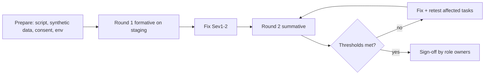

# 04 — Validation with Real Users: UAT and Usability (A8)

Verification asks "did we build it right". Validation asks "did we build the right thing". Participants are real users. The test data is synthetic. No real patient data is shown.

## 1. Participants and groups
| Group | Role mapped | Min. participants | Focus |
|---|---|---|---|
| Treating clinicians (רופאים מטפלים) | `center_clinician` | 5 (min 2 centers) | Own-center view, repeat value, low effort |
| Research coordinators (רכזות מחקר) | `national_coordinator` | 3 | Entry screen, CSV import, stale queue, pre-check |
| Israeli researchers (חוקרים) | `researcher_il` | 6 | Search, filters, aggregates, request form |
| International researchers | `researcher_intl` | 3 | Aggregate view, English UX |
| Committee members (חברי ועדה) | `committee_member` | 3 | Review queue, decision, dashboard |
| Admin / ops | `system_admin` | 1–2 | Roles, logs, content |
| Public visitors incl. parents (הורים) | `anonymous` | 5 | Public site, tone, clarity (see sensitivity rule) |
| Accessibility users | any | 3 (screen reader, keyboard, low vision) | Core journeys |
Five users per group find most issues in a formative round (Nielsen rule of thumb). Use 8+ for a summative SUS result when possible.

Sensitivity rule for patients and families: recruit only through Shaare Zedek channels with ethics advice. Use content review and short interviews, not task tests with live medical content. Needs legal and ethics review.

## 2. UAT plan

- **Environment:** staging with synthetic data. Same build as release candidate.
- **Languages:** each participant uses their own language. At least 40% of sessions in Hebrew (RTL) and 30% in English. Hebrew-first users never get an English-only flow.
- **Format:** 45–60 min moderated session, think-aloud, screen and audio recording with consent (recordings kept per policy; no real data on screen). Remote or in person.
- **Roles on the team:** moderator, note-taker, observer from product. Moderator does not help unless stuck for 2 min.
- **Consent and privacy:** written consent; participants are told data is synthetic; session notes pseudonymous (P01, P02).
- **Entry criteria:** DoR for UAT met (see file 05); no open Sev1/Sev2 defect; staging stable.
- **Exit criteria:** thresholds in section 4 met; no open Sev1/Sev2; all Sev3 triaged; sign-off by owner per group.
- **Phase 1 end-to-end UAT scenario (REQ-063):** one real-but-synthetic-data request goes the full path to delivery. Run with real coordinators and a committee on staging. For real delivery proof with real data, wait for GATE-PROD-DATA.

## 3. Task scripts (examples; he and en)
| ID | Role | Task | Success |
|---|---|---|---|
| UT-01 | researcher_il | Find how many FFPE samples of a given diagnosis exist at all centers | Reads the right aggregate, notes suppression message correctly |
| UT-02 | researcher_il | Filter by age band and time point, add result to request cart | Cart has the filter set |
| UT-03 | researcher_il | Submit request with research question and IRB reference | Submitted; understands next steps |
| UT-04 | researcher_il | Find where the request stands | Finds timeline in < 30 s |
| UT-05 | researcher_intl | Find aggregate availability; understand why some numbers are hidden | Explains "merged for privacy" |
| UT-06 | coordinator | Enter one new record (minimal screen) | Done within threshold, no identifier typed |
| UT-07 | coordinator | Bulk import CSV; fix 3 flagged rows | Import clean |
| UT-08 | coordinator | Pre-check an incoming request and pass to committee | Correct state |
| UT-09 | committee_member | Review request and record a decision with reason | Decision saved; sees vote tally |
| UT-10 | clinician | Open own-center record; find center local-system reference | Correct, and understands no identity is shown |
| UT-11 | clinician | See the repeat value (what the center gets back) | Can state one benefit |
| UT-12 | admin | Invite a researcher, assign role, read audit log | Done |
| UT-13 | visitor | Find "Patients & families" page; say what the portal is for | Correct summary in own words |
| UT-14 | any | Switch language; log in with passkey; set up TOTP | Done without help |

## 4. Usability protocol and success thresholds
Measures per task and per group:
- **Task success rate (completion without help).**
- **Time on task** (median, and p75).
- **Errors** (wrong path, wrong data).
- **SUS** (System Usability Scale, 10 items) after the session. Use the validated Hebrew SUS translation if one exists (UNVERIFIED); otherwise translate and back-translate by two people.
- **SEQ** (Single Ease Question, 7-point) after each task.
- **Satisfaction/brand**: 5 words test (choose words from a list); target words: warm, hopeful, dignified, scientific, clear (REQ-071).

| Metric | Threshold to pass (Phase 1) |
|---|---|
| Task success, core tasks (UT-01..04, 06, 09) | >= 90% unaided; >= 80% for others |
| Task success, accessibility group | >= 80% on core tasks |
| Median SUS per group | >= 78 (good); no group below 68 |
| SEQ median | >= 5.5 |
| Time on task: search to aggregate (UT-01) | median <= 90 s |
| Time on task: submit request (UT-03) | median <= 6 min |
| Time on task: coordinator enters one record (UT-06) | median <= 3 min; p75 <= 5 min |
| Time on task: committee decision (UT-09) | median <= 4 min |
| Critical errors (data exposure, wrong decision) | 0 |
| Hebrew vs English gap | success rate difference <= 10 points; SUS difference <= 8 |
Targets are initial. Review after the first formative round (OPEN-A8-04). Clinical leads can tighten them for the clinician group.

## 5. Findings handling
- Each finding gets severity (see file 06), a quote or clip reference, and the task ID.
- Severity by usability rule: blocks task = Sev2; slows task a lot = Sev3; cosmetic = Sev4.
- Report per round: summary, thresholds table, top 10 issues, he/en comparison. Stored as evidence.

## 6. Ongoing validation after launch
- In-product feedback link (no identifiers).
- Quarterly check with 2 users per group.
- Success metrics (REQ-066) reviewed monthly by product and clinical leads.
