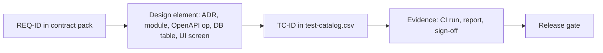

# 05 — Traceability, DoR, DoD, Exit Criteria, Evidence (A8)

## 1. Traceability design
Chain: **REQ → design element → test → evidence.**

- Orchestrator owns `traceability-matrix.csv` at repo plan root. A8 supplies the TC and evidence columns.
- Tests reference IDs in code: `test('TC-063 ...')`, tag `@REQ-037`. A script reads tags and checks them against the catalog.
- CI job `trace-check` fails when: a Phase 1 REQ has no TC; a TC has no automation or manual-run record for the release; a TC-ID in code is not in the catalog.

### 1.1 CSV schema (`traceability-matrix.csv`)
| Column | Meaning | Example |
|---|---|---|
| req_id | Requirement ID | REQ-033 |
| req_title | Short title | k-anonymity screen |
| priority | M/S/C/W | M |
| phase | 0-3 | 1 |
| doc_section | Doc § | 6.3,11 |
| design_ref | ADR / module / OpenAPI operationId / table, `;` separated | ADR-007;search-discovery;searchAggregates |
| tc_ids | TC IDs, `;` separated | TC-055;TC-056;TC-057;TC-058 |
| test_levels | Levels present | unit;property;security |
| verification_status | not-started / in-progress / passed / failed / waived | passed |
| last_run_ref | CI run URL or evidence ID | EV-2027-03-REL-1.0-0042 |
| last_run_at | ISO 8601 UTC | 2027-03-01T10:00:00Z |
| validation_ref | UAT report ID if user-validated | UAT-R2 |
| gate | Related decision gate | GATE-K |
| owner | Role owner | A2 |
| waiver_id | Waiver ID if waived | |

### 1.2 Evidence record (`evidence/index.csv`)
`evidence_id,type,req_ids,tc_ids,release,env,git_sha,created_at,location,sha256,retention_until,sensitivity`
Types: `ci-report`, `authz-matrix`, `k6-report`, `axe-report`, `pentest-report`, `uat-report`, `restore-drill`, `signoff`, `sbom`, `privacy-suite`.

## 2. Evidence storage for audit
- Location: private object-store bucket `ari-pst-evidence` (separate from app data; versioned; write-once or object-lock if available; platform feature UNVERIFIED) plus an index CSV in Git (`docs/evidence/index.csv`, no sensitive content).
- Path: `evidence/<release>/<type>/<evidence_id>/`. Each file has a SHA-256 in the index.
- CI uploads on every release candidate and nightly runs (14-day retention for nightly, release evidence kept >= 7 years or per policy; needs legal review).
- Pen-test reports and UAT recordings: restricted access (admin + A2 owner), encrypted.
- Evidence contains **no real personal data**. Screenshots of UAT use synthetic data. A canary scan runs on the evidence bucket.
- Sign-offs are recorded as signed PR approvals or signed PDF; each names role, date, release, scope.
- Audit retrieval: given a REQ-ID, the matrix gives TC IDs and evidence IDs. Target: retrieve in < 15 min.

## 3. Definition of Ready (DoR)
A user story or task is ready when all are true:
1. Linked to a REQ-ID (and US-ID).
2. Acceptance criteria are measurable (Given/When/Then), in he and en when user-facing.
3. Test approach named: which levels, which TC IDs (draft allowed).
4. Contract impact known: OpenAPI change, migration, RLS policy.
5. Data impact: new field classified (identifier risk checked by A2); synthetic data updated.
6. Design and copy available for he and en (RTL checked).
7. Dependencies and decision gates listed; defaults used if gate open.
8. Small enough: fits one iteration.

## 4. Definition of Done (DoD)
Per change (PR):
- [ ] Code reviewed by 1+ person (2 for auth, RLS, privacy code; CODEOWNERS).
- [ ] CI green: lint, types, Spectral, dependency-cruiser, unit, property, integration, contract, SAST, SCA, secrets, canary smoke, e2e smoke, axe.
- [ ] New or changed behavior has tests tagged with REQ and TC IDs; catalog updated.
- [ ] Authz matrix regenerated; changes reviewed.
- [ ] Migration is forward-only, expand/contract, tested on previous release schema.
- [ ] he and en strings present; RTL checked.
- [ ] Accessibility checked (axe clean; keyboard path checked for UI changes).
- [ ] No identifier-class field or log added; privacy checklist ticked.
- [ ] Docs, OpenAPI examples, and runbook updated if needed.
- [ ] Preview deployed with synthetic data and checked.
- [ ] No open Sev1/Sev2 defect introduced.

Per release: all PR DoD + release exit criteria below.

## 5. Release exit criteria by phase
### Phase 0 (decisions and spec) — verification of documents
- Schema v1 reviewed by clinical leads (GATE-SCHEMA); mapping to Madgam and RedCAP documented.
- Test strategy, catalog and thresholds approved.
- Legal review requested for REQ-049, REQ-050, REQ-052 (A8 only checks that evidence exists).

### Phase 1 (build, synthetic data) — release candidate `1.0-rc`
- 100% of Phase 1 TCs marked `auto` pass in CI; `manual`/`semi` TCs executed and recorded.
- 0 open Sev1 and Sev2. Sev3 <= 10 with owner and date.
- Authz matrix: 100% of cells pass. RLS and IDOR suites pass.
- Privacy: canary suite pass; differencing suite pass; re-identification report meets targets.
- Security: SAST/SCA/secrets/container clean; DAST no high; pen-test not required for rc but internal review done.
- Accessibility: axe zero serious/critical; manual pass done; statement reviewed.
- Performance: k6 thresholds met on staging; soak passes.
- Resilience: restore drill meets RPO/RTO; rollback tested.
- UAT thresholds met for all groups (file 04); sign-offs recorded.
- Export/import round trip passes; architecture tests pass.
- Traceability: every Phase 1 REQ has passing evidence or approved waiver.

### Phase 1 go-live with real data (`GATE-PROD-DATA`) — adds
- External pen-test done; Critical/High closed; retest passed.
- DPA signed, region decided and verified, legal review done, compliance outcome recorded (GATE-COMPLIANCE), migration path documented, export/import round trip on production-like volume.
- Production restore drill done within last 30 days.
- Protected-area entry conditions checklist (REQ-054) signed by owner, A2 owner, and clinical lead.
- First real-data load is staged: dry run with synthetic marker off in an isolated environment is **not allowed**; use a small supervised load by the coordinator with canary monitoring on.

### Phase 2 (outline)
- Contract and authz matrix extended for new center(s) and SSO; RLS tests for ≥3 centers; pathology viewer security tests; SSO misconfiguration tests; pen-test targeted retest.
### Phase 3 (outline)
- Partner API: contract tests, key scopes, quotas, abuse tests, differencing tests on API; analytics/AI layer: model/data privacy review, bias review (not defined here).

## 6. Waivers
A waiver names REQ/TC, reason, risk, compensating control, owner, expiry (max 30 days). Sev1/Sev2 and privacy/authz failures cannot be waived without the product owner and the security owner both signing. Needs legal review if a compliance REQ is affected.

## 7. Required CI checks (A7 implements)
`lint-types`, `spectral`, `arch-deps`, `unit`, `property`, `integration-pg`, `contract-schemathesis`, `sast-codeql`, `sast-semgrep`, `sca`, `secrets`, `container-scan`, `cms-guard`, `build`, `canary-smoke`, `e2e-smoke-he-en`, `axe`, `trace-check`. Nightly: `e2e-full`, `k6`, `dast`, `privacy-full`, `resilience`.
