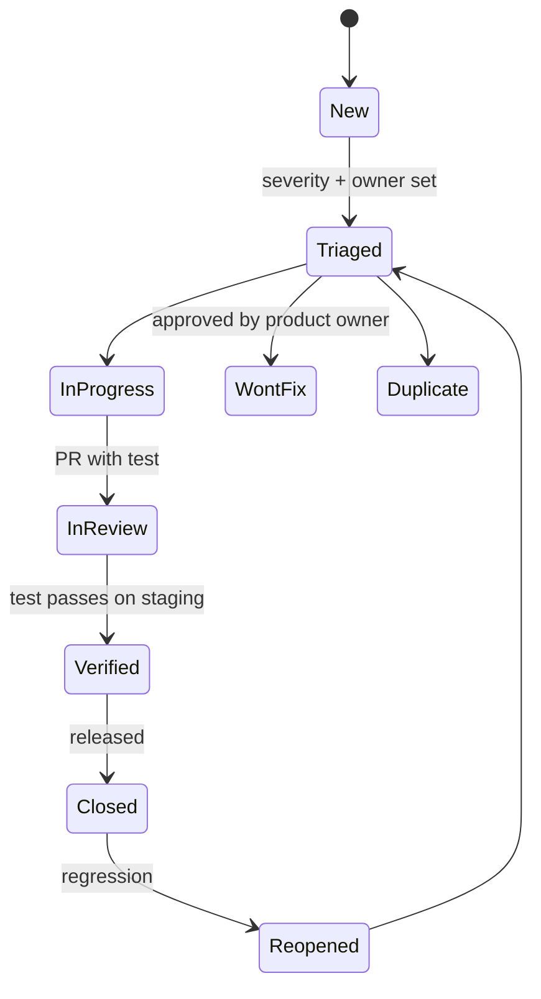

# 06 — Defect Management and Severity Model (A8)

## 1. Workflow

- Tracker: GitHub Issues with labels `defect`, `sev1`..`sev4`, `security`, `privacy`, `a11y`, `i18n`, `regression`, plus REQ-ID and TC-ID in the body.
- Every fix PR adds or updates a test that fails before the fix (regression test). Without it, the PR is not done.
- Triage: weekdays, by product owner + tech lead. Sev1 triage is immediate.
- Defects that include personal-looking data: do not paste data in the ticket. Use the canary scan report. A privacy incident follows A2's incident process (and A9 runbook).

## 2. Severity model
| Sev | Name | Definition | Examples | Response | Fix target | Release rule |
|---|---|---|---|---|---|---|
| Sev1 | Critical | Identifier or small-cell exposure; authz bypass; data loss; full outage of protected area; secret leak | Clinician reads other center; identifier in logs; audit log not written | Start in 1 h (24x7 once live with real data) | Hotfix in 24 h | Blocks release. Stop deploys. |
| Sev2 | High | Core journey blocked or wrong; security control weak; accessibility blocker on a core flow; wrong suppression number; MFA bypass path with preconditions | Request cannot be submitted; Hebrew login broken; axe critical on login | 1 business day | 5 business days | Blocks release |
| Sev3 | Medium | Feature works with a workaround; non-core a11y issue; wrong text; slow but within SLO | Filter label wrong in he; layout break on small phone | 1 week | Next release | Allowed up to cap (10) |
| Sev4 | Low | Cosmetic; typo; minor polish | Icon misaligned by 2 px | Backlog | When convenient | Allowed |

Modifiers: any `privacy` or `security` defect is raised one level if exposure is real or reachable by a lower role. Defects found in production are raised one level for repeat. Defect in a pediatric patient-facing page tone: product owner decides.

## 3. Metrics
- Open defects by severity and age; escaped defects (found after release); mean time to fix by severity; defect density per module; test flakiness rate (target < 1%); change failure rate.
- Release health check: no rising Sev2 trend over 3 sprints.

## 4. Flaky tests
- Quarantine only non-privacy, non-authz tests, for max 7 days, with a ticket. Quarantined tests still run and report.
- Root cause categories: data, timing, environment, product bug.

## 5. Post-incident link
Sev1 produces a blameless review in 5 business days, with a new regression test and, if needed, a new canary or matrix rule.
