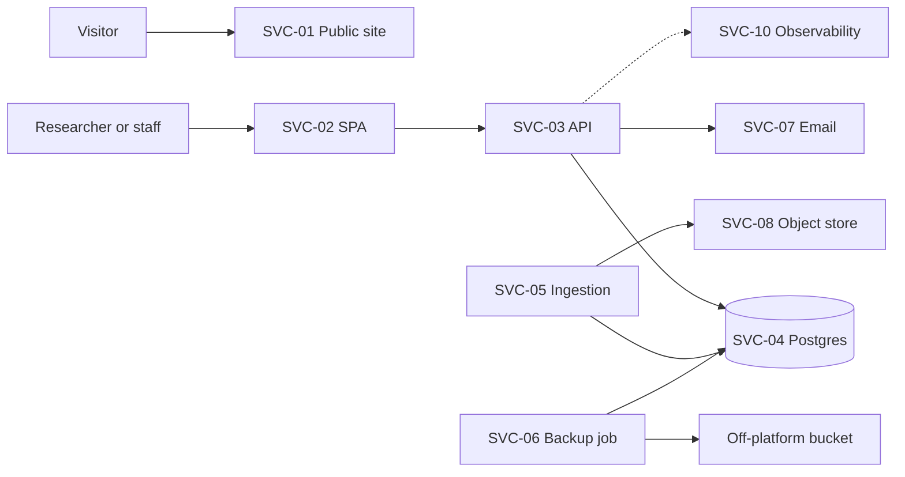
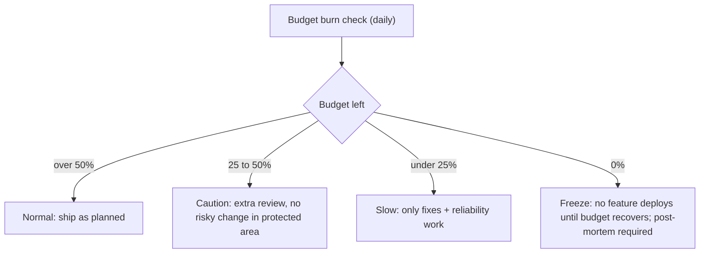

# 01 Service Catalog, Tiers, SLOs

## Service catalog
| ID | Service | Render type | Module | Tier | Data class |
|---|---|---|---|---|---|
| SVC-01 | Public site | Static site (CDN) | public-site | T2 | Public |
| SVC-02 | Protected web app (SPA) | Static site | identity-access UI | T1 | None (code only) |
| SVC-03 | API | Web service | all back-end modules | T1 | Index + governance |
| SVC-04 | Database | Render Postgres | sample-index, audit-log, access-requests | T0 | D1-D4 |
| SVC-05 | Ingestion jobs | Cron job / worker | center-ingestion | T2 | D1 staging |
| SVC-06 | Export / backup jobs | Cron job | admin-governance | T1 | Same as DB |
| SVC-07 | Email relay (SMTP vendor) | External | notifications | T2 | Contact addresses only |
| SVC-08 | Object store (S3 API) | External or Render-adjacent | ObjectStorePort | T2 | CSV staging, exports |
| SVC-09 | Git CMS (Decap) + GitHub | External | public-site | T3 | Public |
| SVC-10 | Observability stack | External | observability | T2 | Telemetry (no identifiers) |

## Tiers
| Tier | Meaning | Response |
|---|---|---|
| T0 | Loss of data or trust. Never lose it. | Page 24x7 for data-loss risk |
| T1 | Protected area works for users | Page in business hours; night page only for Sev1 |
| T2 | Degraded but workable | Ticket / chat |
| T3 | Convenience | Backlog |

Public site is T2 for availability but has a higher SLO than the protected area, because it is static and cheap to keep up. The protected area is T1 and T0 for data. Reason: a down protected area delays work. A lost or leaked index harms trust.

## SLIs
| SLI | Definition | Measured by |
|---|---|---|
| Public availability | Share of external probes that return 200 on `/` and one deep page within 3 s | External uptime check, 1 min, 3 regions |
| Protected availability | Share of valid requests that do not return 5xx, plus synthetic login probe success | API metrics + synthetic probe |
| Search latency | p95 of `POST /api/v1/search` | OTel histogram |
| Request-flow correctness | Share of access-request state changes that commit and write an audit row | Counter: audit rows vs state changes |
| Data freshness | Share of active records with `last_verified_at` within freshness window (90 days, config) | Daily SQL job, aggregate only |
| Backup health | Age of newest verified backup; last restore drill result | Backup job metric |
| Audit integrity | Audit hash-chain verify result | Nightly verify job |

## SLOs (ASSUMPTION-05, kept)
| SLO | Target | Window | Budget |
|---|---|---|---|
| Public site availability | 99.9% | 30 days | 43 min 12 s |
| Protected availability | 99.5% | 30 days | 3 h 36 min |
| Search p95 latency | under 800 ms for 99% of 5-min windows | 30 days | 1% of windows |
| Audit write success | 100% of state changes (no budget) | always | zero |
| Backup freshness | newest verified backup under 24 h; PITR active 100% | always | zero |
| Index freshness | 90% of active records verified within 90 days | quarterly | review item |

Justification: 99.5% allows planned maintenance and a single-instance start-up. A small team cannot staff a higher target. Audit and backup targets have no budget: failing them is an incident by itself.
Check against Render: Render publishes its own platform SLA terms (UNVERIFIED, see F5). Our SLO must not exceed what Render plus our single-region design can give. 99.9% for the public site relies on CDN static hosting.

## Error budget policy

Fast burn alert: burn rate 14.4x over 1 h and 5 min (pages). Slow burn: 6x over 6 h (pages in hours) and 1x over 3 days (ticket).
Exclusions: planned maintenance announced 48 h ahead, max 2 h per month, counted at 50%. Outages caused by a vendor still count (users do not care).
Owner of the policy: tech lead. Monthly review: see `10-operating-model.md`.
