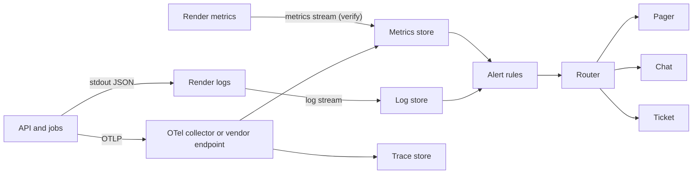

# 02 Observability

Module: `observability`. Rule from contract: logs are structured JSON, no identifiers, no user free text.

## Pipeline

Vendor for the stores is open (OPEN-A9-01). Any vendor must accept EU data residency and a DPA. Telemetry must not contain identifiers, so the DPA risk is low, but the check still applies.

## Log schema (v1)
One JSON object per line. Fixed keys. Unknown keys are dropped by the logger.
| Key | Type | Rule |
|---|---|---|
| `ts` | string | ISO 8601 UTC |
| `level` | enum | `debug` `info` `warn` `error` `fatal` |
| `svc` | enum | `api` `ingest` `backup` `web` |
| `env` | enum | `preview` `staging` `production` |
| `release` | string | Git SHA (short) |
| `event` | string | Stable event code, e.g. `request.completed` |
| `traceId`, `spanId` | string | W3C trace ids. Not user ids. |
| `route` | string | Route template, e.g. `/api/v1/requests/{id}`. Never the real path. |
| `method` | enum | HTTP method |
| `status` | int | HTTP status |
| `durMs` | int | Duration |
| `errCode` | string | App error code from RFC 9457 `code` |
| `role` | enum | One of the 7 roles. Role is not an identifier. |
| `actorRef` | string | HMAC pseudonym of user id, rotating key, 24 h salt. Only for abuse triage. See rule R5. |
| `centerBucket` | string | Hashed center, optional |
| `count` | int | Row counts, batch sizes |

Forbidden in logs: user ids, e-mail, IP address, user agent, sample codes, request ids from the data layer, query strings, request or response bodies, search terms, free text, tokens, session ids, SQL with parameters, stack traces that embed values.

Rules
- R1: Logger is one shared package. Direct `console.log` is blocked by lint.
- R2: Allow-list serializer. Only keys in the table pass. Values are type checked. Strings over 64 chars are dropped.
- R3: Error objects are mapped to `errCode` + stack frames without message text. The exception message is never logged.
- R4: IP addresses are handled only at the Render edge. Application logs never hold them. Rate limiting uses an in-memory key and does not write it.
- R5: `actorRef` is optional. A2 decides if it is allowed (OPEN-A9-02). Default: off in production, on in staging with synthetic users.
- R6: Redaction test in CI: a property test (fast-check) feeds random strings shaped like e-mails, ULIDs with `smp_`, `usr_`, `req_` prefixes, IDs, and tokens. It asserts none appear in log output. Also a log-scan job on staging runs the same regex set against the sink every night. A hit is Sev2 (RB-03 checks if it is a leak).
- R7: Render's own HTTP request logs may carry IP and path. Treat them as sensitive. Short retention. Limit who can read them. Do not forward them to the external sink unless the path and IP are stripped (UNVERIFIED if Render allows that; if not, do not stream HTTP logs — OPEN-A9-03).
- R8: Audit log is not an application log. It is a database table (A2). Never copy audit rows into logs.

Example (synthetic)
```json
{"ts":"2026-11-13T10:00:00Z","level":"info","svc":"api","env":"staging","release":"a1b2c3d","event":"request.completed","traceId":"4bf92f35...","route":"/api/v1/search","method":"POST","status":200,"durMs":212,"role":"researcher_il"}
```

## Metrics (names are final; Prometheus-style, OTel semantic names where they exist)
| Metric | Type | Labels |
|---|---|---|
| `http_server_duration_ms` | histogram | route, method, status_class |
| `http_server_requests_total` | counter | route, status_class |
| `db_query_duration_ms` | histogram | op_class |
| `db_pool_in_use` | gauge | none |
| `auth_login_total` | counter | result (ok, fail, mfa_fail) |
| `audit_write_total`, `audit_write_fail_total` | counter | none |
| `audit_chain_verify_ok` | gauge 0/1 | none |
| `kanon_suppressed_total` | counter | none (no field names with values) |
| `ingest_run_total`, `ingest_rows_rejected_total` | counter | center_bucket |
| `index_stale_ratio` | gauge | none |
| `backup_last_success_age_s` | gauge | kind (pitr_probe, logical, offsite) |
| `restore_drill_last_ok_age_d` | gauge | none |
| `requests_open_by_state` | gauge | state |
Labels must have low cardinality. No ids as labels.

## Traces (OpenTelemetry)
- SDK: OpenTelemetry JS, auto instrumentation for Fastify and `pg`.
- Sampling: 100% of errors, 10% of other requests in production, 100% in staging. Tail sampling in the collector if available.
- Span attributes: allow-list only (route, status, op_class). A span processor drops everything else. `db.statement` is disabled.
- Propagate `traceparent` from SPA to API. The `traceId` appears in RFC 9457 errors so support can find a trace without any user data.
- Export: OTLP over HTTPS to collector or vendor. Failure to export must never fail a request.

## Dashboards
| Dashboard | Panels | Audience |
|---|---|---|
| D-Overview | SLO status, budget left, deploy markers, active alerts | Everyone |
| D-API | Rate, errors, p50/p95/p99, per route | On-call |
| D-DB | CPU, memory, connections, disk, replication lag (if HA), slow query count | On-call |
| D-Release | Deploy history, release SHA, error rate before/after | Release owner |
| D-Data-Health | Freshness ratio, ingest runs, rejected rows, k-suppression rate | Coordinator + product |
| D-Security | Failed logins, MFA fails, admin actions count, audit chain status | Security lead |
| D-Backup | Backup ages, last drill result, off-platform copy age | On-call |
Dashboards show aggregates only. No row-level data.

## Alert rules
Severity: see `07-incident-response.md`. P = page. C = chat. T = ticket.
| ID | Condition | Sev | Route |
|---|---|---|---|
| AL-01 | Public probe fails from 2 of 3 regions for 3 min | Sev2 | P |
| AL-02 | Protected probe or login synthetic fails 5 min | Sev2 | P |
| AL-03 | API 5xx ratio over 5% for 5 min | Sev2 | P |
| AL-04 | Fast SLO burn (14.4x, 1 h and 5 min) | Sev2 | P |
| AL-05 | Slow SLO burn (6x over 6 h) | Sev3 | C + T |
| AL-06 | p95 search over 800 ms for 15 min | Sev3 | C |
| AL-07 | DB disk over 80% (autoscale check) | Sev3 | C + T |
| AL-08 | DB disk over 90% or connections over 90% of max | Sev2 | P |
| AL-09 | `audit_write_fail_total` increases | Sev1 | P (no state change without audit) |
| AL-10 | `audit_chain_verify_ok` equals 0 | Sev1 | P, RB-07 |
| AL-11 | Newest offsite backup older than 26 h | Sev2 | P in hours |
| AL-12 | Backup job failed | Sev3 | C + T; second failure Sev2 |
| AL-13 | PITR not active or probe restore fails | Sev1 | P |
| AL-14 | Render deploy failed (production) | Sev3, Sev2 if auto-rollback did not occur | C; P if production degraded |
| AL-15 | Render health check failing | Sev2 | P |
| AL-16 | Ingestion run failed or over 20% rows rejected | Sev3 | C + T to coordinator |
| AL-17 | `index_stale_ratio` over 25% | Sev3 | T to coordinator, RB-06 |
| AL-18 | Login failure spike (5x baseline) or many MFA fails | Sev3 | C to security lead |
| AL-19 | Redaction scan hit in sink | Sev2 | P to security lead, RB-03 |
| AL-20 | Cert expiry under 14 days or DNS change not made by us | Sev2 | P |
| AL-21 | Dependency advisory critical on production build | Sev3 | T |
| AL-22 | Restore drill overdue by 14 days | Sev3 | T |
Routing: Sev1 and Sev2 reach the pager. Sev3 goes to chat plus ticket. Sev4 is a ticket only. Every alert links to its runbook. An alert with no runbook is not allowed.
Alert hygiene: review all alerts monthly. Delete alerts that nobody acted on.
