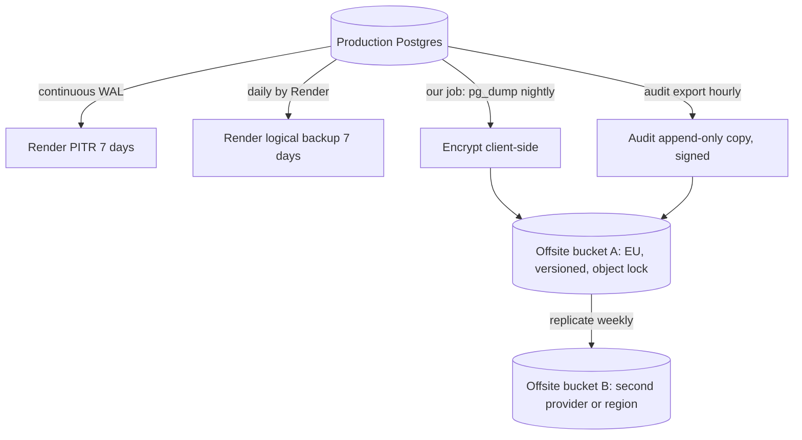
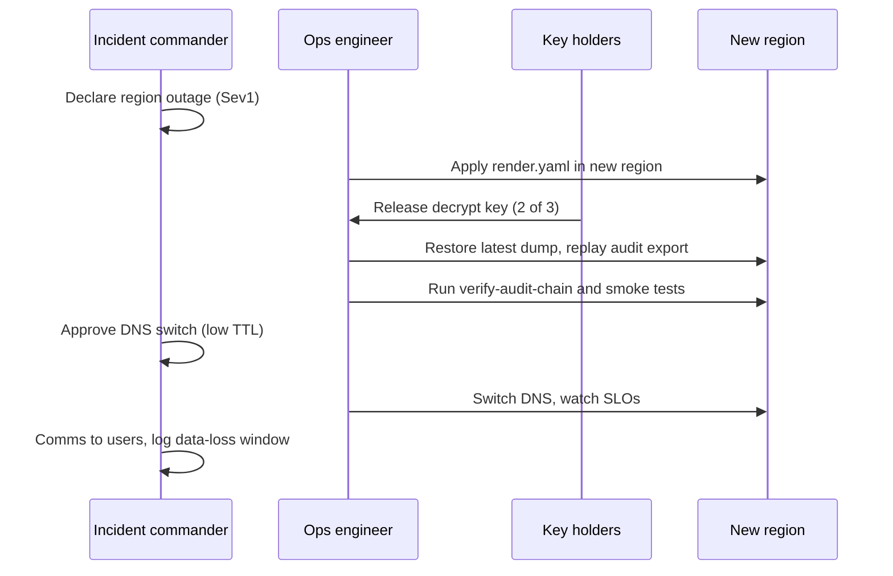

# 03 Backup, Restore, Disaster Recovery

Covers REQ-048. Data is synthetic until GATE-PROD-DATA closes. Drills run now on synthetic data, so the process is proven before real data arrives.

## Data classes and targets
| Class | Content | Store | RPO | RTO | Notes |
|---|---|---|---|---|---|
| D1 Index | Sample records, centers, schema refs | Postgres | 15 min | 4 h | ASSUMPTION-05 |
| D2 Governance | Access requests, decisions, votes | Postgres | 15 min | 4 h | Lost request = broken trail |
| D3 Audit | Audit log + hash chain | Postgres + offsite copy | 15 min | 4 h | Chain must verify after restore |
| D4 Identity | Accounts, Argon2id hashes, passkey public keys, TOTP secrets (encrypted) | Postgres | 15 min | 4 h | Sessions are not restored; all users re-login |
| D5 Public content | Pages, news (Git) | Git + Render | 0 (Git) | 1 h | Rebuild from Git |
| D6 Staging files | CSV imports, exports | Object store | 24 h | 24 h | Can be re-uploaded |
| D7 Config | `render.yaml`, Terraform, env vars | Git + secret store | 0 for code; secrets 24 h | 4 h | Secrets in a vault copy, see below |
| D8 Telemetry | Logs, metrics | Vendor | n/a | n/a | Not restored |

## Render Postgres capabilities (see facts F1 to F5)
- PITR window: 3 days on Hobby, 7 days on Pro or higher (F1). We use Pro or higher. RPO 15 min is met by PITR if restore to any second in the window works; WAL archive lag is not published. UNVERIFIED: real RPO. Drill D3 measures it.
- Render logical backups: kept 7 days (F2). They are a second layer, not our long-term archive.
- A restore from PITR or backup creates a new instance (F4, UNVERIFIED). The app must be re-pointed by changing `DATABASE_URL` through Blueprint or env change. RTO includes this step.
- HA standby (F5, UNVERIFIED): protects from instance failure, not from bad data or region loss. PITR protects from bad data. Both are needed.
- Hobby workspace must not host production (3-day window, ASSUMPTION-A9-01).

## Layered backup design

Offsite job
- Runs as a Render cron job at 02:00 UTC. Uses `pg_dump --format=custom` over the private network.
- Encrypts on the job with age or GPG using a public key. The private key is held offline by two key holders (Shamir split, 2-of-3). The portal never holds the private key.
- Writes to a bucket with versioning and object lock (WORM, 35 days minimum). Lifecycle: daily 35 days, weekly 12 weeks, monthly 12 months. Retention must match the retention policy of A2 (REQ-047): deleted data must age out. Conflict to settle with A2: a "right to erasure" request vs backup retention (OPEN-A9-04, needs legal review).
- Job emits `backup_last_success_age_s` and a SHA-256 manifest. A second job verifies the manifest daily.
- Region: the bucket stays in the same jurisdiction class as the DB (EU). GATE-REGION applies.
- Credentials: write-only key for the job; delete not allowed. Read key held by break-glass only.
- Hourly audit export: append-only signed file of new audit rows. It lets us prove the chain even if the DB is lost.

Secrets backup (D7): the list of env var names is in Git; values are in an encrypted vault entry held by two admins. Rotate after any restore from a compromise.

## Restore drills
| Drill | Frequency | What | Pass |
|---|---|---|---|
| DR-1 PITR to new instance on staging | Monthly | Restore staging to a point 1 h ago; run smoke tests; time it | RTO under 2 h; data at point matches |
| DR-2 Offsite dump restore | Quarterly | Decrypt with key holders, restore to scratch Postgres, run `verify-audit-chain`, row-count compare | RTO under 4 h; chain verifies |
| DR-3 Full environment rebuild from Git | Twice a year | New Render workspace or project from `render.yaml` + restore + DNS test host | Complete under 8 h (stretch target) |
| DR-4 Region failure test | Yearly | See below | RTO 8 h in region loss (relaxed) |
| DR-5 Key custody test | Yearly | Two holders reconstruct the key on a clean machine | Success |
| DR-6 Rollback drill (app) | Quarterly | See `05-safe-release.md` | Rollback under 10 min |
Each drill ends with a short report in `docs/drills/` (no data). A failed drill is a Sev3 ticket with an owner and due date. Drills are on the calendar, with a named owner.
Before GATE-PROD-DATA closes, drills DR-1, DR-2, DR-3 and DR-6 must each pass at least once. This is an entry condition added by A9.

## Disaster recovery plan
Scenarios
| Scenario | Recover by | Target |
|---|---|---|
| Bad migration or data corruption | PITR to a new instance just before the event; re-point | 4 h |
| DB instance lost | HA failover if enabled (F5), else PITR | 1 h (HA) or 4 h |
| Accidental delete of Render resource | Recreate from Blueprint; restore DB from offsite or Render backup if DB deleted | 8 h |
| Render account/workspace loss or lockout | Rebuild on new workspace from Git + offsite dump | 24 h |
| Region outage | Cold standby build in other region from offsite dump | 8 to 24 h |
| Ransomware / credential theft | RB-04, then restore from clean backup, rotate all secrets | 24 h |
| Git host outage | Mirror repo (second remote) in another host | 4 h to deploy fixes |

Region failure design (default Frankfurt, F10 UNVERIFIED)
- Phase 1 is single region. We accept RTO 8 to 24 h for a full region loss. This is explicit risk RISK-A9-01 for the owner.
- A cold standby is documented, not running: `infra/render.yaml` is parameterized by region; offsite dump bucket B is in another EU region or provider.
- A second region must still satisfy GATE-REGION and the DPA. Needs legal review before any real data moves there.
- Region failure test (DR-4): create the full stack in a second EU region on synthetic data, restore from bucket B, point a test hostname at it, run e2e smoke. Record time. No production DNS change in the test.

Data-loss window after a region loss: up to the age of the newest offsite dump (up to 24 h) plus hourly audit export. This exceeds RPO 15 min. The 15 min RPO holds only for failures inside Render's PITR. State this to the owner.

## Restore rules
1. Never restore over production in place. Restore to a new instance, verify, then switch.
2. After restore: run migrations check, audit-chain verify, row counts, one login smoke with a synthetic user, and invalidate all sessions.
3. Log the restore as an audit event by the admin role with a ticket ID.
4. If personal data was in scope: tell the privacy lead (see `07-incident-response.md`).
