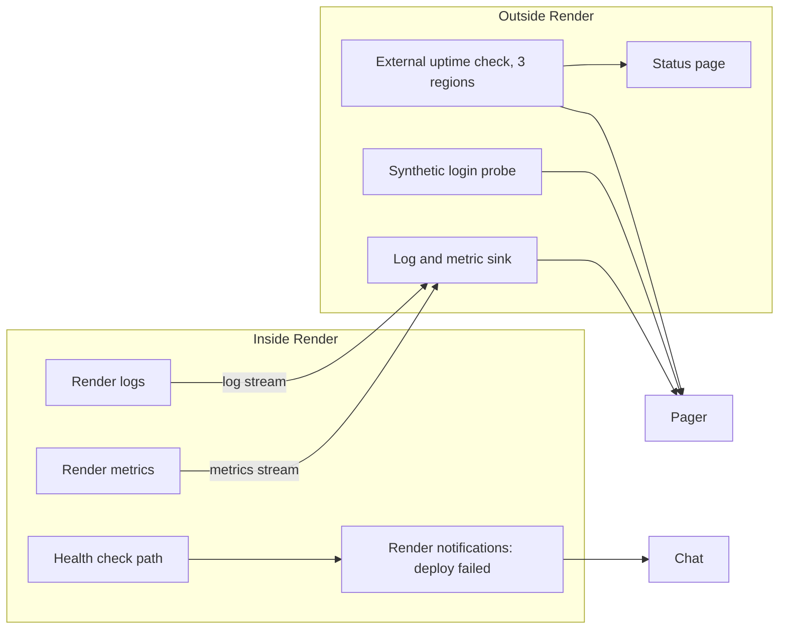

# 04 Monitoring on Render

Render features below: facts F6 to F9 are UNVERIFIED unless stated. A7 owns the Blueprint. A9 owns what we watch.

## Layers

Why outside checks: if Render or its network is down, Render cannot tell us. Rule: the monitor must not live on the same platform as the thing it watches.

## Health checks
- API exposes `GET /healthz` (liveness: process up) and `GET /readyz` (readiness: DB reachable, migrations at expected version).
- Render health check path = `/readyz`. Keep it cheap: one `SELECT 1`, timeout 2 s.
- No data and no version details in the response. Return `{"status":"ok"}` only.
- A new deploy goes live only after `/readyz` passes. A failing check keeps the old instance (zero-downtime deploy, F9 UNVERIFIED for exact behavior; verify in staging, task V-05).
- Static sites have no health check. The uptime probe covers them.

## External uptime check
| Probe | Target | Interval | Locations | Alert |
|---|---|---|---|---|
| UP-01 | Public home, he and en | 1 min | 3 | AL-01 |
| UP-02 | Public deep page + static asset | 5 min | 3 | AL-01 |
| UP-03 | Protected SPA shell | 1 min | 2 | AL-02 |
| UP-04 | `GET /readyz` on API public hostname | 1 min | 2 | AL-02 |
| UP-05 | Synthetic login (synthetic user, TOTP seed in vault), then one search | 5 min | 1 | AL-02 |
| UP-06 | TLS expiry and DNS record check | daily | 1 | AL-20 |
Vendor: any with EU probes and a DPA (OPEN-A9-01). Synthetic user has role `researcher_il` with synthetic data only. In production the synthetic user is flagged and excluded from metrics (success metrics REQ-066).

## Log drain (log stream)
- Configure Render log stream to the sink (F6). Stream only `api`, `ingest`, `backup` services.
- Sink needs: EU residency, retention 30 days hot, 13 months for security events (A2 to confirm, OPEN-A9-02), role-based read.
- HTTP request logs: see rule R7 in `02-observability.md`. Default: do not stream them.
- Test: staging redaction scan nightly (AL-19).
- If the sink is down, logs remain in Render for its own retention. We do not block requests on logging.

## Metrics
- Render dashboard metrics for CPU, memory, instance count, bandwidth, DB metrics. Use for capacity and as a fallback.
- Metrics stream to sink if Render offers it on our plan (F7, UNVERIFIED). If not, an agent job scrapes the Render API for DB and service stats every minute. Fallback: app-level OTel metrics already cover request data.

## Alerts for failed deploys and health checks
| Event | Signal | Action |
|---|---|---|
| Deploy failed (build or start) | Render notification to chat + e-mail; also GitHub Actions status | AL-14. Old version keeps serving. Fix forward or revert commit. |
| Deploy succeeded but error rate rises | Post-deploy watch (15 min) in D-Release | Auto-alert AL-03; rollback per `05-safe-release.md` |
| Health check failing | Render notification + AL-15 | RB-01 |
| Service crash loop / OOM | Render event + restart count metric | RB-01, then scale up |
| Cron job failed | Render notification + missing heartbeat metric | AL-12 or AL-16 |
A deploy webhook (Render deploy hook or notification webhook, UNVERIFIED) posts deploy start/end to D-Release as markers. If webhook is not available, GitHub Actions posts the marker.

## Cron heartbeats
Every cron job pings a heartbeat endpoint at the monitor on success. A missing heartbeat past 1.5x interval alerts. This catches jobs that never start.

## Status page
Public status page for the public site and the protected area (no incident detail with data). Hosted outside Render. Updated by the incident commander. Subscribers by e-mail. Contains no user data.
