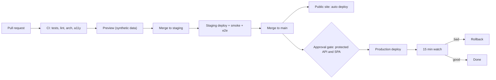
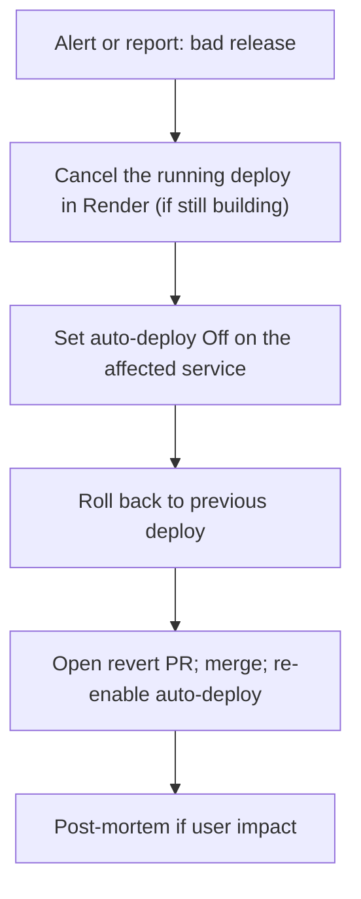

# 05 Safe-Release SRE Rules

Delivery model (contract): Git is truth. `main` deploys to production. Protected area has a manual approval gate. Public site deploys automatically. Deploy only after CI passes. A7 owns the pipeline. These are the SRE rules on top.

## Release flow

## Rules
1. Auto-deploy mode for production services is "After CI Checks Pass" (F8, verify name). Never "On Commit" without CI.
2. Protected area production deploy needs one approver who is not the author. Approver checks: CI green, staging smoke green, migration plan read, rollback plan written in the PR.
3. Deploy windows
   - Protected area: Sun to Thu, 09:00 to 15:00 Israel time. Reason: team is awake and users are few at night. No deploys Fri, Sat, eve of a holiday, or after 15:00.
   - Public site: any time on weekdays; no deploy Fri afternoon to Sat.
   - Emergency fix for Sev1 or Sev2: allowed any time; incident commander approves.
   - Freeze: when error budget is 0% (see `01`), during an open Sev1/Sev2, and during a committee meeting day agreed with the coordinator.
4. Database migrations: forward-only, expand/contract (contract pack). Rules:
   - Expand step ships first and works with old and new code.
   - Contract step ships at least one release later.
   - No migration holds a long lock. Use `lock_timeout` 5 s and `statement_timeout`. Big backfills run as batched jobs.
   - Take a PITR marker (note the timestamp) before each production migration. Record it in the deploy ticket.
   - Because migrations are forward-only, a code rollback must work with the new schema. CI test: previous release code against new schema (A8 to build).
5. Feature flags for risky behavior. Flags are config in DB or env. Default off.
6. Small changes. One concern per PR. Large changes are split.
7. Watch period: release owner stays on the D-Release dashboard for 15 min after deploy. Checks: error rate, p95, login probe, audit writes.
8. Release notes: PR title + one line of user impact. A "who is on call" line is in the deploy chat message.

## Rollback
- App rollback: Render dashboard "rollback to previous deploy" (F8, UNVERIFIED) or revert the commit on `main` and let auto-deploy run. The dashboard route is faster. After a dashboard rollback, turn off auto-deploy for that service until the bad commit is reverted in Git, so Git stays the truth.
- Target time: rollback decision to live in under 10 min.
- Data rollback is never the first move. Use feature flag off, then app rollback, then expand/contract fix. PITR is the last resort (RB-02).
- Rollback drill DR-6 each quarter on staging: deploy a known bad build, trip the alert, roll back, time it, and confirm the sample record still loads.

## Stop a bad auto-deploy fast

Who may do it: any on-call engineer. No approval is needed for steps B to D. Reason: speed. Step E needs the normal PR flow.
Guards that prevent a bad deploy:
- Branch protection on `main` and `staging`. CI required.
- The approval gate on protected area.
- Pause switch: a single repo variable `DEPLOY_PAUSED=true` makes the pipeline stop before the approval step (A7 to implement, request filed).
- Commit text that skips deploys (F8, UNVERIFIED) is banned for production paths by a CI check, to avoid silent drift.
- Render auto-deploy of a stale/failed staging build never reaches production: production only follows `main`.
- Only the CI bot and named release managers can push to `main`. No direct dashboard config edits; drift is detected by a weekly Blueprint diff job (AL via ticket).

## Preview environments
Synthetic data only. Previews are deleted on PR close. Previews get no production secrets. A check in CI fails if a preview env var points to a production DB host.
