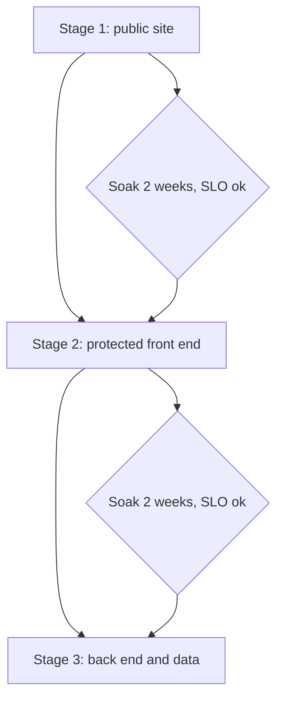
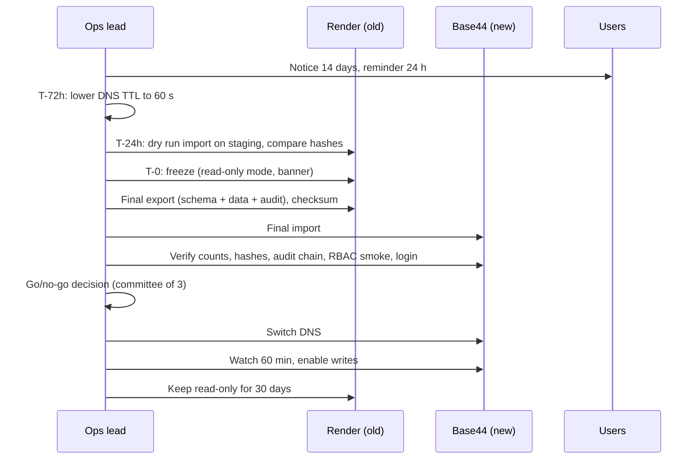

# 06 Cutover Runbook: Later Move to Base44

Status: TBD. Base44 is not decided (contract GATE-PLATFORM). Capabilities of Base44 (database type, regions, export, SLAs, DPA, compliance) are UNVERIFIED and must be checked first. This is a template. Do not start before GATE-COMPLIANCE and GATE-REGION are closed for Base44 and legal review is done.
Migration order from contract: public site, then protected front end, then back end and data last.

## Preconditions (go/no-go checklist)
| # | Check | Owner |
|---|---|---|
| 1 | DPA signed with Base44; region meets GATE-REGION; legal review done | Legal / A2 |
| 2 | Platform capability map shows each port has an adapter or replacement | A1 |
| 3 | Export/import round trip passed on synthetic data, row counts and hashes equal | A3 |
| 4 | Portability tests green in CI | A8 |
| 5 | Target environment passed its own SLO rehearsal and restore drill | A9 |
| 6 | Backups on target working; offsite copy still ours | A9 |
| 7 | Rollback plan rehearsed; Render stays up and untouched for 30 days | A9 |
| 8 | Comms sent to users 14 days before | Ops lead |
| 9 | Pen test on target done | A2 |
| 10 | Rehearsal cutover on staging done at least twice, timed | A9 |

## Stage plan

Stage 1 and 2 are low risk: DNS switch with low TTL, no data move. Stage 3 is the data cutover below.

## Data cutover (Stage 3) timeline

Steps in detail
1. **Freeze (T-0).** Set maintenance flag: API returns 503 with RFC 9457 body for writes; reads may stay up. Pause ingestion crons and backup deletions. Banner on SPA. Expected window: 2 h, planned for Sun morning. Announce as planned maintenance.
2. **Final sync.** Take PITR marker and a logical dump. Export through the portable export (A3). Compute SHA-256 per table and a row count per table. Export audit log with chain head.
3. **Import** into Base44 target. Run schema checks.
4. **Verify.** Row counts and hashes equal. Audit chain verifies and continues. Roles and permissions match. Synthetic login with passkey and TOTP works. k-anonymity screen gives the same counts for 20 fixed test queries on both sides. Sessions are not migrated; users log in again. Passkeys are bound to the domain; keep the same domain so passkeys still work (verify, UNVERIFIED).
5. **Go/no-go.** Three named people agree. Any failed check is no-go. No-go means: lift freeze on Render, nothing else changed.
6. **DNS switch.** Change records at the DNS provider (we own DNS, not the platform). TTL 60 s. Verify TLS on the new host before the switch.
7. **Watch.** 60 min on SLO dashboards and probes. Then enable writes. Then 7 days of heightened on-call.
8. **Old side.** Keep Render DB and services read-only and not deleted for 30 days. Final offsite encrypted dump retained per retention policy. Then delete with a written record.

## Rollback
| Point | Rollback action | Data risk |
|---|---|---|
| Before DNS switch | Lift freeze on Render | None |
| After DNS switch, before writes enabled | Switch DNS back; lift freeze on Render | None |
| After writes enabled, within 24 h | Freeze Base44; export delta (audit-log + changed rows since T-0); apply delta to Render; switch DNS back | Medium; delta merge is manual and rehearsed |
| After 24 h | Treat as forward-fix; rollback needs a new migration project | High |
Rule: do not enable writes until 60 min of clean watch. This keeps the cheap rollback open.

## Monitoring through the move
External probes and the sink stay vendor-neutral, so the same dashboards work on both sides. Add a `platform` label to all metrics during the move.
